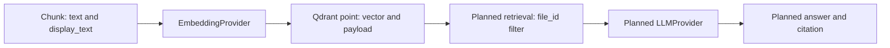

# RAG Engineering Standards

- This skill's instructions apply whenever you are writing or editing pipeline code (chunking, embeddings, Qdrant, retrieval, generation, citation). Follow these contracts exactly rather than re-deriving the shape of an interface — consistency across every prompt matters more than any single prompt's elegance.

## Provider interfaces (must be followed exactly)

### EmbeddingProvider

```python
class EmbeddingProvider(Protocol):
    def embed(self, texts: list[str]) -> list[list[float]]: ...
    @property
    def dimension(self) -> int: ...
```

- `LocalMiniLMEmbedder` (original decision, superseded) wrapped `all-MiniLM-L6-v2`, 384-dim.
- Loading library: FlagEmbedding's `BGEM3FlagModel`, checked against the official BGE-M3 model card; cached `get_bge_m3_embedder()` loads once at startup.
- Encode flags: `return_dense=True`, `return_sparse=False`, `return_colbert_vecs=False`; a provider lock serializes encoding.
- `BGEM3Embedder` (implemented in PLAN_02) wraps `BAAI/bge-m3`, `dimension` = 1024, dense-only mode for MVP (hybrid dense+sparse is supported by the model but deliberately not used yet). Same tokenizer as chunking time, for alignment.
- Any adapter must not change this interface. A provider swap is a reindex operation, not a runtime toggle — see "Reindexing" below.

### LLMProvider

```python
class LLMProvider(Protocol):
    def stream_generate(self, prompt: str, context_chunks: list[str]) -> Iterator[str]: ...
```

- `GeminiFlashProvider` wraps `google-genai`. The model string must be read from config/env, never hardcoded — Gemini Flash variants deprecate on a period of months.

## Text extraction & chunking contract (Docling)

- All supported uploads use Docling's unified pipeline, `DocumentConverter().convert(source).document`; avoid format-specific branching.
- Supported formats: `.pdf`, `.docx`, `.pptx`, `.xlsx`, `.md`, `.txt`, `.html`, `.csv`, `.png`, `.jpg`, `.jpeg`, `.tiff`, `.bmp`, `.webp`.
- Audio/video, EPUB, AsciiDoc, LaTeX, and XML schemas stay deferred; flag additions first.
- Docling pipeline config: standard pipeline (layout analysis, table structure recognition, reading order) with OCR enabled (`do_ocr=True`), engine = `RapidOcrOptions` (`backend="onnxruntime"`). Do NOT enable the VLM pipeline tier (SmolDocling/GraniteDocling) — explicitly excluded, resource ceiling decision (see defensibility notes).
- Chunking via `HybridChunker(tokenizer=..., max_tokens=500, merge_peers=True)`. Tokenizer must be `BAAI/bge-m3`'s tokenizer, not the library default — this aligns token counts with the active embedding model, avoiding a silent mismatch.
- There is no overlap parameter — Docling replaces sliding-window overlap with structure-aware chunk boundaries (headings/sections) plus `contextualize()`, which prepends the heading path to a chunk's text.
- Canonical chunk text = `chunker.contextualize(chunk)` output (heading-enriched), not raw `chunk.text` — this is what actually gets embedded in PLAN_02.
- Output DTO: `Chunk(id, text, display_text, index, count, page, heading, section)` in `schemas/pipeline.py`.
- `id` is the upload's internal UUID string; storage maps it to `file_id`, `index` to `chunk_index`, and `count` to `token_count`.
- `text` is contextualized embedding input; `display_text` is raw Docling source text for citation display and stays internal to the pipeline/storage.
- `page` (not `page_number`), `heading`, and `section` come from `chunk.meta`; all are optional/`None` when unavailable, e.g. `.txt`.
- `heading` is the first heading in the path; `section` is the nearest/last; the public response retains `text`, `index`, `count`, `page`, `heading`, `section`.
- Orphan heading: Docling can label an isolated sentence as `section_header` and emit an empty raw-text record; `always_emit_headings=True` preserves the record and source-reference recovery fills `display_text`.
- Oversized orphan headings dropped by Docling's token budget are recovered as bounded body segments through the same configured chunker, with original provenance; recover before `contextualize()`.
- Independent lexical coverage compares normalized source-word/number multiplicities with final chunks, grouping split/merged provenance and table references without counting repeated heading context.
- Missing source units warn without rejecting uploads or hiding failures; this is diagnostic coverage, not semantic/OCR accuracy proof.
- Every future transform stage needs an equivalent independent check that its output accounts for its input.
- Edge cases to handle explicitly: a file shorter than one chunk (single chunk, no merge needed — Docling handles this natively); a page/image yielding zero extractable text even after Docling's OCR — log a warning identifying it, do not silently drop it or crash the whole upload.

## Vector schema (Qdrant)

- Collection vector size = the active `EmbeddingProvider.dimension` (1024 for the active `BAAI/bge-m3`). Changing providers means creating a new collection, not resizing the existing one.
- Payload per point: `file_id`, `chunk_index`, `token_count`, `page`, `heading`, `section`, `text`, `display_text`.
- Resolved text decision: contextualized `text` matches the embedding input; raw `display_text` supports citation display without repeated heading prefixes.
- Keeping both fields makes stored vector input auditable and preserves citation-friendly source text; metadata carries file, heading, and page information.
- Similarity metric: cosine, set explicitly in the collection config — never rely on a default.

## Retrieval contract

- Planned input: user question (string), `file_id`, and `top_k`; proposed default 5 remains open until retrieval is implemented and tested.
- Steps: embed the question via the same `EmbeddingProvider` used at ingestion -> Qdrant cosine search scoped to the current `file_id` -> return chunks with score.
- Phase 1 has exactly one file per session, so scoping is trivial now, but the retrieval function signature must already accept a `file_id` filter to avoid a rewrite in Phase 2.

## Generation & citation contract

- Prompt assembly: retrieved chunks + question, passed to `LLMProvider.stream_generate`.
- The response must carry enough metadata to render a citation (which chunk_index the answer drew from). Whether this is inline prompt markers or a separate structured return value is an **open decision — flag it to the human, do not assume** the first time generation code is written.

## Reindexing (relevant only when a provider swap is discussed)

- Switching `EmbeddingProvider` requires: re-run chunking only if chunking also changed -> re-embed all chunks with the new provider -> create a new Qdrant collection sized to the new dimension -> re-point app config at the new collection. There is no live/runtime swap.

## Interview-defensibility notes

- **Docling over manual extraction (`pdfplumber`) + manual chunking (`tiktoken`):** preserves document structure (headings, tables, page provenance, reading order) that a flat-text extraction discards; structure-aware `HybridChunker` boundaries are a stronger semantic signal than blind sliding-window overlap. Trade-off accepted: larger dependency footprint, longer processing time per upload than the original manual pipeline.
- **Shared `BAAI/bge-m3` tokenizer at chunking and embedding:** ensures token counts used for chunk sizing are already correct for the model that will embed them — avoids a silent mismatch and a later re-chunk.
- **Standard Docling pipeline + OCR, no VLM tier:** VLM-based document understanding (SmolDocling/GraniteDocling) is a meaningfully heavier model on top of an already-larger stack (Docling's layout/table models + BGE-M3, CPU-only, no GPU provisioned). Standard pipeline + OCR already delivers tables, headings, and scanned-content extraction — full visual understanding is a deliberate, documented exclusion, not an oversight.
- **RapidOCR over EasyOCR (Docling's plug-and-play default):** RapidOCR's underlying PP-OCR models benchmark meaningfully more accurate than EasyOCR on real-document OCR tests, with the same zero-system-dependency install (`pip`, no external binary like Tesseract requires).
- **Cosine similarity:** standard for normalized sentence embeddings, focuses on direction rather than magnitude.
- **Why Qdrant, and how context-window overflow is handled:** not yet decided in this project — fill in once actually discussed, don't invent a justification here.

## Known limitations

- XLSX/CSV table serialization can omit the `Policy` corner-header cell; this is user-accepted and deferred, with coverage warnings active.
- Verified behavior does not imply lossless extraction; OCR can misread text, textless pages warn, and wholly textless files fail explicitly.

## Contract data flow

Legend: ingestion and storage are built; retrieval, generation, and answer/citation output are planned.



## Open items — do not let Codex assume these

- Exact citation payload format (inline markers vs. structured metadata).
- Whether `top_k=5` is final or needs tuning once real retrieval is tested.
- Redis caching strategy (what gets cached, TTL) — out of scope until the Phase 1 core pipeline works end to end.
