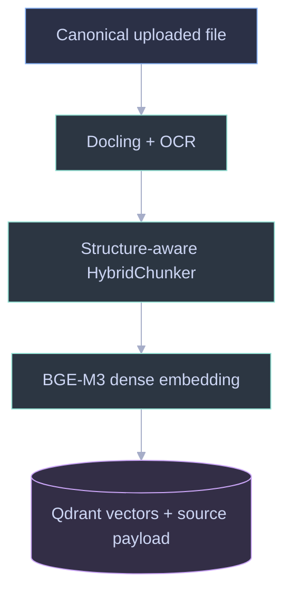
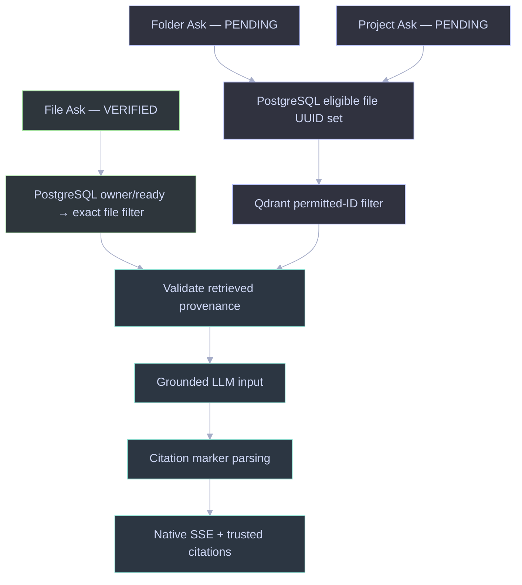
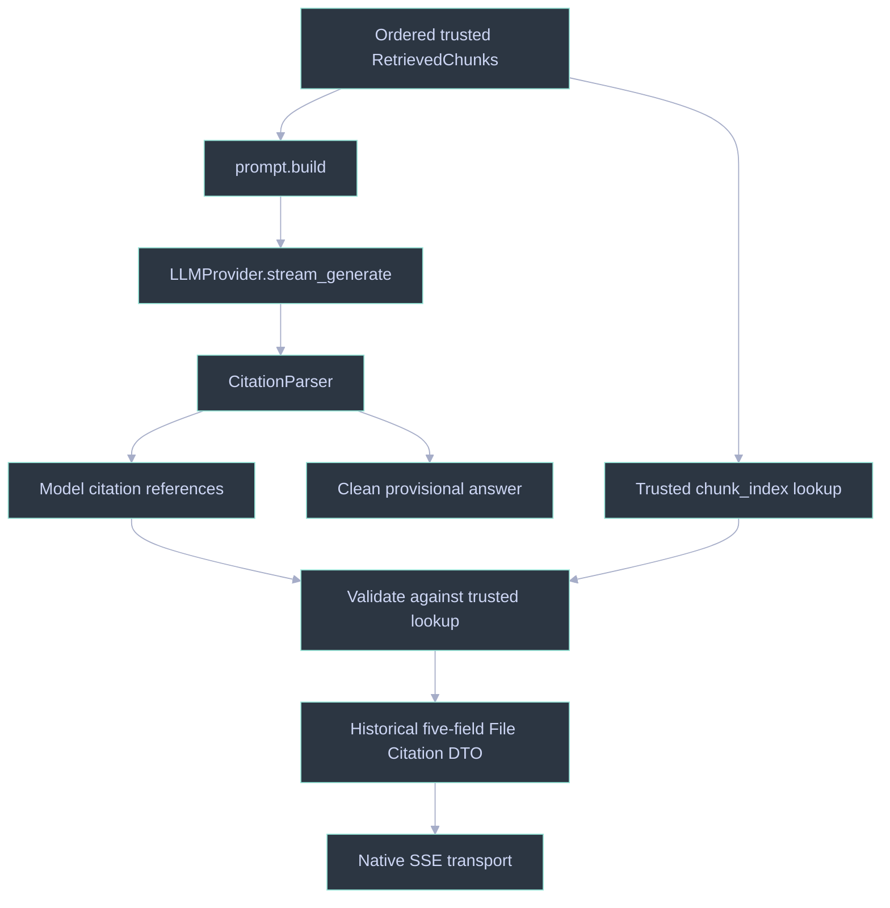

# RAG Engineering Standards

Detailed RAG pipeline contract for Atlas. Inherit these instructions in order:

1. [Root AGENTS](../../../AGENTS.md) — repository governance and authorization.
2. [Server AGENTS](../../../server/AGENTS.md) — backend authority and lifecycle.
3. **This SKILL** — retrieval, embedding, generation and trusted provenance.
4. Current approved **PLAN/AMENDMENT** and targeted source/tests; read [Client AGENTS](../../../client/AGENTS.md) for cross-boundary work.

- **VERIFIED:** PHASE_01/02 single-file ingestion, retrieval, generation and native SSE.
- **BUILDING:** PHASE_03_PLAN_01; Amendment 01's internal resolver and Amendment 02's authorized multi-file retrieval/evaluation are `VERIFIED` through applicable local, packaged, separately approved real-store/BGE-M3/capacity and exact cleanup/preservation evidence. Final numeric policy requires user decision. Public Folder Ask, unified citations and later Project RAG remain `PENDING`; see [CONTEXT](../../../prompts/PHASE_03/PLAN_01/PHASE_03_PLAN_01_CONTEXT.md).
- Statuses: `PENDING`, `BUILDING`, `IMPLEMENTED`, `VERIFIED`. Decisions: `LOCKED`, `PROVISIONAL`, `OPEN`, `SUPERSEDED`.
- Follow approved contracts; do not infer implementation authorization from this document.
- Canonical ownership, hierarchy, readiness and Project membership belong to PostgreSQL/server code, **not** this skill or Qdrant.

---

## 1. Contract Map & Pipeline Boundaries

### Verified Ingestion



### Verified & Planned Retrieval



**Maturity legend:** File Ask is `VERIFIED`; Folder/Project retrieval via a multi-file scope is `PENDING` despite the shared conceptual flow.

### Core Invariants

- **PostgreSQL:** canonical user identity, ownership, file location, readiness and future Project references.
- **Qdrant:** derived vector index and search only; no canonical authorization or membership.
- **Scope:** server resolves permitted files **before** Qdrant ranks candidates; no global search then authorization filtering.
- **Provenance:** extraction/storage produce source identifiers; the model may cite references but MUST NOT invent their metadata.
- **Embedding compatibility:** document chunks and queries share the same active embedding space.
- **Trust:** uploaded text, retrieved context, and provider output remain untrusted data.
- **Failure:** no silent fallback or success promotion after a pipeline error.
- **Change control:** preserve verified File Ask authorization, retrieval, fallback and SSE; deliberately migrate its citation DTO and source-index mapping only through approved PLAN_01 work.

---

## 2. Provider Interfaces & Model Contracts

### EmbeddingProvider

```python
class EmbeddingProvider(Protocol):
    def embed(self, texts: list[str]) -> list[list[float]]: ...
    @property
    def dimension(self) -> int: ...
```

**VERIFIED Active Implementation:**

- `BGEM3Embedder`
- model: `BAAI/bge-m3`
- loading library: FlagEmbedding `BGEM3FlagModel`
- dimension: `1024`
- mode: dense only
- cached `get_bge_m3_embedder()` loads once at startup

Encode flags:

```text
return_dense=True
return_sparse=False
return_colbert_vecs=False
```

A provider lock serializes encoding.

**SUPERSEDED Implementation:**

- `LocalMiniLMEmbedder`
- `all-MiniLM-L6-v2`
- 384-dimensional

MUST NOT restore or mix the superseded embedding space.

Any embedding adapter MUST preserve the interface exactly.

Changing the embedding provider REQUIRES APPROVAL and reindexing; it is not a runtime toggle.

### LLMProvider

```python
class LLMProvider(Protocol):
    def stream_generate(self, prompt: str, context_chunks: list[str]) -> Iterator[str]: ...
```

**VERIFIED Active Implementation:**

- `GeminiFlashProvider`
- official `google-genai`
- model identifier from config/env, never hardcoded
- Gemini model identifiers can deprecate quickly; verify the current configured model when provider work requires it

Verified Provider Behavior:

- stateless Interactions streaming;
- `store=False`;
- model-output text only;
- explicit completion/error handling;
- per-call client/stream cleanup;
- generation settings validate lazily;
- provider remains transport-agnostic.

MUST NOT move:

- retrieval;
- grounded source assembly;
- citation provenance construction;
- public SSE formatting

into the provider.

---

## 3. Extraction, Chunking & Provenance

### Docling Pipeline

All supported uploads use Docling's unified conversion path:

```python
DocumentConverter().convert(source).document
```

Avoid format-specific extraction branches.

Supported formats:

- `.pdf`
- `.docx`
- `.pptx`
- `.xlsx`
- `.md`
- `.txt`
- `.html`
- `.csv`
- `.png`
- `.jpg`
- `.jpeg`
- `.tiff`
- `.bmp`
- `.webp`

Deferred:

- audio/video;
- EPUB;
- AsciiDoc;
- LaTeX;
- XML schemas.

Flag additions before implementing them.

### Processing Tier

Use:

- standard Docling pipeline;
- layout analysis;
- table structure recognition;
- reading order;
- OCR enabled;
- `RapidOcrOptions`;
- ONNX Runtime backend.

Do not enable the VLM pipeline tier such as SmolDocling/GraniteDocling in this baseline.

### Chunker

Use:

```text
HybridChunker(
    tokenizer=<BAAI/bge-m3 tokenizer>,
    max_tokens=500,
    merge_peers=True
)
```

The verified application default is `500`; the existing constants system permits an environment override. Do not alter sizing without approval.

There is no sliding-window overlap parameter.

Docling's structure-aware boundaries plus `contextualize()` replace manual overlap/sentence snapping.

### Canonical Chunk Text

The canonical embedding/retrieval text is:

```python
chunker.contextualize(chunk)
```

not raw `chunk.text`.

This contextualized value becomes `text`.

Raw Docling/source-friendly text becomes `display_text`.

### Chunk DTO

```text
Chunk(
    id,
    text,
    display_text,
    index,
    count,
    page,
    heading,
    section
)
```

Mappings:

- `id` -> upload UUID / storage `file_id`
- `index` -> storage `chunk_index`
- `count` -> storage `token_count`
- `text` -> contextualized embedding input
- `display_text` -> raw citation-friendly source text

Provenance:

- `page`, not `page_number`;
- `heading`;
- `section`;
- metadata may be `None` when unavailable, such as plain text.

Heading semantics:

- `heading` is the first heading in the path;
- `section` is the nearest/last heading in the path.

### Source-Preservation Behavior

Orphan heading:

- Docling may emit an isolated heading as `section_header` with an empty raw-text chunk.
- `always_emit_headings=True` preserves the record.
- source-reference recovery fills `display_text`.

Oversized orphan heading:

- if dropped by Docling's token budget, recover it as bounded body segments;
- preserve original provenance;
- recover before `contextualize()`.

### Coverage Diagnostics

Independent lexical coverage:

- compares normalized source word/number multiplicities against final chunks;
- groups split/merged provenance and table references;
- does not count repeated contextualized heading prefixes as new source content.

Missing source units:

- warn;
- do not silently drop the condition;
- do not reject an otherwise processable upload solely because diagnostic coverage is imperfect.

Coverage is source-accounting evidence, not proof of semantic/OCR accuracy.

Every future transform stage requires an equivalent independent check that its output accounts for its input.

### Extraction Edge Cases

- File shorter than one chunk: one chunk is valid.
- Page/image with no extractable text after OCR: log an identifying warning.
- Do not silently discard the condition.
- Do not crash the entire upload solely because one page is textless.
- Wholly textless files fail explicitly according to the existing implementation behavior.

---

## 4. Qdrant Collection & Payload Contracts

### Collection

Vector dimension:

```text
EmbeddingProvider.dimension
```

Current active dimension:

```text
1024
```

Similarity:

```text
Cosine
```

Set cosine explicitly; never rely on a default.

Changing the active embedding provider/dimension requires a new compatible collection and reindex.

### Stored Payload

Each point stores:

- `file_id`
- `chunk_index`
- `token_count`
- `page`
- `heading`
- `section`
- `text`
- `display_text`

Meaning:

- `text` exactly matches the contextualized text used for embedding;
- `display_text` preserves raw citation-friendly source text;
- metadata carries source/file context;
- retaining both text forms makes vector input auditable while keeping citations readable.

### Upload Handoff

Phase 2 PLAN_02 Amendment 03 supersedes the Phase 1 public upload handoff:

- canonical authenticated `POST /files` returns HTTP `201` and the canonical File DTO;
- the caller supplies the application-generated PostgreSQL file UUID to internal ingestion;
- every chunk payload `file_id` equals that UUID;
- success is returned only after confirmed storage and durable PostgreSQL `ready`;
- legacy `POST /documents/upload` is removed, with no alias or adapter;
- chunk bodies/counts are internal ingestion data, not upload response fields.

The returned top-level `id` is the canonical identity used for `/files/{file_id}/ask`. Owner/ready authorization was implemented and verified in PHASE_02_PLAN_02 Amendment 05; it was not part of Amendment 03. **PHASE_02_PLAN_04 Amendment 02 (`VERIFIED` supersession):** public `/files/{file_id}/query` is completely removed without an alias; internal retrieval remains unchanged. Detailed upload lifecycle/metadata contracts belong to the current PLAN/Amendment.

Historical Phase 1 returned `id`, `name`, `type`, `total`, and `chunks` from `/documents/upload`. That verified history remains in Phase 1 evidence; ingestion and stored vector payloads remain unchanged by PLAN_01. The later public citation DTO migration is an explicit exception.

### PHASE_03 Filter Compatibility — `PENDING`

| Contract                  | Verified File Ask          | Planned Folder/Project Ask         |
| ------------------------- | -------------------------- | ---------------------------------- |
| Collection                | Existing dense collection  | Reuse the same collection          |
| Embeddings                | BGE-M3, 1024-dense, cosine | Unchanged                          |
| Payload identity          | Canonical `file_id`        | Same canonical `file_id`           |
| Scope filter              | One exact `file_id`        | Server-authorized permitted-ID set |
| Reindexing for membership | Not applicable             | Not required                       |

- Do **not** add `project_id` or canonical folder membership to Qdrant payloads as a source of authority.
- Do **not** duplicate chunks/vectors per Project; Project membership is live PostgreSQL state.
- Do **not** create a new collection or trigger re-embedding merely to extend the retrieval filter.
- Folder/Project resolver SQL and membership tables belong to the server/appropriate later PLAN, not this skill.

---

## 5. Retrieval & Scope Enforcement

### Verified Single-File Retrieval

| Input / Behavior | Contract                                                                           |
| ---------------- | ---------------------------------------------------------------------------------- |
| Question         | Trimmed non-empty string; validated before embedding                               |
| Scope            | One canonical file UUID after PostgreSQL owner/`ready` authorization               |
| `top_k`          | Default `5`; validated inclusive range `1–20`                                      |
| Embedding        | Same BGE-M3 provider/encoding lock as ingestion; one validated dense vector        |
| Search           | `QdrantClient.query_points` with exact `file_id` `query_filter` **before** ranking |
| Results          | Ranked payloads and raw cosine scores; payloads enabled, vectors omitted           |
| Post-check       | Every result must contain a valid payload and matching canonical `file_id`         |
| Public endpoint  | Native SSE `POST /files/{file_id}/ask` only                                        |

- Preserve Qdrant's result order and raw scores; never normalize to percentages or call similarity "answer confidence."
- Reject empty, non-finite, dimension-invalid or otherwise malformed embedding output before querying Qdrant.
- Missing/foreign canonical file → `404 FILE_NOT_FOUND`; owned non-ready file → `409 FILE_NOT_READY` **before** retrieval.
- Historical public `/files/{file_id}/query` and `/documents/upload` are removed; no aliases or scored-chunk public endpoint.
- Preserve File Ask request validation, `top_k=5` default, exact-file authorization/retrieval, fallback and SSE behavior. Its previously verified five-field citation DTO and file-local citation index are explicitly `SUPERSEDED` by the approved unified eight-field response and request-local source indexes.

### Internal Retrieved Chunk

Verified internal `RetrievedChunk` preserves the validated stored payload plus raw score:

- `file_id`, `chunk_index`, `token_count`;
- `page`, `heading`, `section`;
- contextualized `text`, citation-friendly `display_text`;
- raw finite `score`.
- Missing required payload data or a file ID outside the authorized scope MUST fail explicitly.
- Retrieval is read-only: do not mutate vectors, points, payloads or collection configuration.
- Qdrant payload data MUST NOT replace canonical PostgreSQL metadata or identity authorization.

### PHASE_03 Authorized Multi-File Retrieval — Internal `VERIFIED`; Public Integration `PENDING`

**Approved direction:** An internal retrieval operation consumes an already-resolved, owned, ready file set. Folder Ask and later Project Ask share the operation; only their PostgreSQL resolvers differ.

```text
Authenticated user + folder/project UUID
    -> PostgreSQL canonical resource and ownership gate
    -> bounded, deduplicated eligible file UUID set + trusted source metadata
    -> scoped dense retrieval(question, trusted scope, top_k)
    -> Qdrant permitted-ID filter BEFORE ranking
    -> validate each returned file_id against the authorized set
    -> ranked chunks with trusted source lookup
```

- PLAN_01 folder eligibility: `files.folder_id = selected_folder_id`, `owner_id = authenticated user`, and `status = ready` **only**.
- Exclude the root, descendant folders, sibling folders, non-ready files and other owners.
- Future Project membership: live references to individual files and recursively expanded folders, deduplicated and owner/ready checked. Project schema and recursive SQL are **not** PLAN_01 pipeline work.
- The internal helper MUST NOT accept arbitrary browser-supplied UUID lists as evidence of authorization.
- An internal server-authorized scope carrier with eligible IDs and canonical source metadata is the `LOCKED` design direction. Choose its exact Python type/signature within the approved PLAN_01 Amendment; the helper MUST NOT trust browser-supplied membership.
- Qdrant filtering MUST restrict the candidate set **before vector ranking**; never globally retrieve and discard unauthorized hits afterward.
- Validate all result payload IDs against the authorized set after Qdrant as defense in depth.
- Deduplicate effective file UUIDs; a file may be referenced through multiple future Project relationships but must not be searched repeatedly merely because of overlap.

### Ranking, Resource Limits & Tuning

| Policy                                                                 | State / Requirement                                                                                                                                                                      |
| ---------------------------------------------------------------------- | ---------------------------------------------------------------------------------------------------------------------------------------------------------------------------------------- |
| Single-file default `top_k=5`, range `1–20`                            | `VERIFIED` / unchanged                                                                                                                                                                   |
| Multi-file ranking                                                     | One global relevance ordering across eligible files; approved direction, `PENDING`                                                                                                       |
| Folder comparison                                                      | Measure `k=5`, `8`, `12` on the same labeled corpus                                                                                                                                      |
| Folder production default `k=8`                                        | `PROVISIONAL` hypothesis; not a locked setting                                                                                                                                           |
| File-count-proportional k                                              | Not approved                                                                                                                                                                             |
| Per-file quotas, diversification, score thresholds, adaptive retrieval | Deferred pending evidence/approval                                                                                                                                                       |
| Eligible-file, latency and context budgets                             | `100` eligible files and ~`12,000` assembled context tokens are `PROVISIONAL` benchmark candidates, not production limits; latency/threshold selection requires measurement and approval |

- `top_k` limits **retrieved chunks in total**, not chunks per eligible file and not the number of searchable files.
- File-count benchmark targets: 10, 50, 100 and 250 ready files; measure source resolution, Qdrant filtering, p50/p95 latency, context volume and answer quality.
- A future explicit user-selected subset of ready files within a folder is **deferred**. Any such selection MUST only narrow a server-authorized scope and remain bounded; PLAN_01 implements automatic direct-folder scope.
- All eligible files must be available to ranking; no "first N files" truncation or silent partial-search success.
- Reject oversized authorized scopes before Qdrant, never silently truncating. A structured pre-stream error is `LOCKED` in principle; HTTP `409` and `FOLDER_SCOPE_LIMIT_EXCEEDED` are PLAN_01 proposals subject to the existing error-envelope contract and approval.
- Select changes through **baseline → measure → targeted improvement → reevaluate**; do not silently add hybrid, sparse retrieval or reranking.
- Existing startup-prepared Qdrant client, BGE-M3 provider and shared inference lock remain the runtime baseline. Respect current synchronous/threadpool boundaries.

### Empty Scope, Failure & Concurrency

| Condition                                                 | Required Behavior                                                               |
| --------------------------------------------------------- | ------------------------------------------------------------------------------- |
| No eligible ready files                                   | Skip embedding, Qdrant and LLM; return approved empty-scope/fallback result     |
| Eligible files but no Qdrant matches                      | Return insufficient-context result without constructing generation provider     |
| Missing/foreign folder                                    | Deny without exposing existence or querying vectors                             |
| Invalid question, top-k or UUID                           | Reject through validated request/route contracts                                |
| Embedding or Qdrant failure                               | Explicit sanitized error; never camouflage as no evidence                       |
| Malformed or out-of-scope Qdrant payload                  | Fail safely; never include the chunk in generation                              |
| File becomes `deleting` after request-start authorization | Already-authorized Ask may continue; subsequent authorizations exclude the file |

- Canonical `processing → ready → deleting → finalized deletion` semantics belong to server lifecycle instructions.
- **Request-start authorization (`LOCKED`):** a new File Ask requires an owned `ready` file; a new Folder Ask resolves only direct owned `ready` files. Committed `deleting` or deleted sources MUST be excluded from all subsequently authorized requests.
- An Ask authorized while its sources were ready MAY complete after deletion begins. Do not add mandatory pre-generation revalidation, continuous revocation polling, or long-lived PostgreSQL locks through generation.
- Qdrant cleanup can race an authorized request before retrieval completes; zero matches follow normal insufficient-context behavior and dependency failures remain errors. No guarantee of uninterrupted answers or immediate in-flight revocation is implied.

### Safe Logging & Observability

- May record authorized scope size (not a full membership dump), `top_k`, result count, raw scores, timings and sanitized error category.
- Avoid logging complete questions, source text, `display_text`, full provider output, secrets or raw dependency exception bodies.
- Keep embeddings, Qdrant queries and generation separate in timings so evaluation can attribute latency.

---

## 6. Grounded Generation, Citations & SSE

### Verified File Ask Data Flow

This diagram describes the **verified Phase 2 implementation**. PLAN_01 deliberately migrates File Ask to the unified DTO and request-local source indexes; the new representation is `PENDING`.



- Verified prompt builder: `prompt.build(question, chunks)`; preserve retrieval order.
- Source content is the verbatim contextualized `text`, within collision-checked untrusted source delimiters; source instructions do not become higher-priority instructions.
- The model is told to answer only from supplied context, not invent missing evidence, use the canonical fallback when unsupported, and cite supplied source references.
- Historically, File Ask prompt source indexes equal file-local `chunk_index` and the verified parser rejects mixed-file or duplicate-index inputs. PLAN_01 supersedes both assumptions for File/Folder Ask by assigning unique request-local indexes while preserving stored `chunk_index` separately.

### Canonical File Fallback — `VERIFIED`

Exact file-scoped answer:

```text
I don't have enough information in this file to answer that.
```

- Zero retrieved chunks → no provider construction; emit the exact answer, empty citations, successful terminal completion.
- Non-empty retrieval with insufficient evidence → exact fallback **without** citations is the only valid unsupported success.
- A substantive successful answer MUST contain valid citations.
- No fallback can conceal a provider, parser, transport or provenance failure.
- Folder Ask has an approved separate exact fallback (below); the existing File Ask fallback sentence MUST remain unchanged.

### Canonical Folder Fallback — `LOCKED` Contract, `PENDING` Implementation

Exact folder-scoped answer:

```text
I don't have enough information in this folder to answer that.
```

- Owned folder with no eligible direct `ready` files → skip embedding, Qdrant and Gemini; emit fallback with `citations: []` and successful `done`.
- Eligible scope with no Qdrant hits → skip Gemini; emit the same successful fallback.
- Non-empty retrieved context that cannot answer → exact fallback without citations, subject to the grounded generation contract.
- Invalid scope, oversized scope, dependency, parser or transport failures MUST NOT be disguised as insufficient information.

### Internal Citation Marker & Parser — `VERIFIED` Baseline

Exact ASCII marker:

```text
[[cite:<non-negative integer>]]
```

Existing parser contracts:

- Recognizes markers split at arbitrary streamed delta boundaries and removes them from user-visible answer text.
- Rejects malformed reserved markers, unfinished reserved markers and unknown indexes.
- Rejects duplicate source indexes and **mixed-file input in the verified file-only path**.
- Accepts leading-zero numeric references; deduplicates citations in first-reference order.
- Retains incomplete, non-reserved bracket text literally.
- Bounds its retained prefix/numeric state; never buffers the whole answer just to parse markers.
- Citation indexes become trusted only through Atlas's existing source lookup, not by model assertion.

### Historical File Citation DTO — `VERIFIED`, `SUPERSEDED` For PLAN_01

The existing public `Citation` has **exactly five fields**:

| Field     | Verified Atlas Source    |
| --------- | ------------------------ |
| `index`   | File-local `chunk_index` |
| `page`    | Retrieved `page`         |
| `heading` | Retrieved `heading`      |
| `section` | Retrieved `section`      |
| `excerpt` | Retrieved `display_text` |

- No public `file_id` exists in the Phase 2 five-field File Ask citation DTO.
- Never adopt model-authored page, heading, section, excerpt, file UUID or confidence values.
- **Approved supersession:** PLAN_01 intentionally migrates File Ask and Folder Ask to the same eight-field DTO and request-local index representation. Do not preserve or reintroduce the five-field public response after the coordinated migration; preserve this section as historical evidence.

### PHASE_03 Multi-File Source Mapping — `PENDING`

The same `chunk_index` can occur in different files. **All** File, Folder and later Project Ask requests use unique request-local source indexes, mapped to validated canonical origin. The planned migration is `PENDING` until implemented and accepted.

| Request-Local Source Index | Canonical File | Original Chunk Index |
| -------------------------- | -------------- | -------------------- |
| `0`                        | File A         | `4`                  |
| `1`                        | File B         | `4`                  |
| `2`                        | File A         | `9`                  |

- Source indexes are unique per Ask and stable for that request, including single-file Ask; use the existing `[[cite:N]]` syntax to reference them.
- The trusted request-local lookup maps each N to at least `(file_id, original chunk_index, page, heading, section, display_text)` and current canonical file metadata captured for that Ask.
- Source names come from PostgreSQL, **not** Qdrant guesses or model-authored prose. Metadata captured at request time is a snapshot, not a promise of updates during streaming.
- Validate file membership and chunk provenance **before** assigning source indexes or including text in the model context.
- References absent from the lookup, incorrectly formed markers and model-attributed source metadata MUST fail safely.
- Reuse the verified marker parsing grammar and streaming safety properties across all Ask scopes; prefer a shared implementation compatible with the unified DTO over parallel schema/parser paths.
- No model-authored provenance and no global file-level `chunk_index` assumptions.

### Unified Citation DTO — `LOCKED` Design, `PENDING` Implementation

One public citation representation applies to **File, Folder and later Project Ask**. It intentionally supersedes the Phase 2 five-field File Ask response; coordinate the schema, parser/prompt source mapping, SSE serialization, client validation/rendering and tests within PLAN_01.

| Field         | Contract                                                                   |
| ------------- | -------------------------------------------------------------------------- |
| `index`       | Non-negative, unique request-local source index referenced by `[[cite:N]]` |
| `file_id`     | Canonical file UUID from the authorized PostgreSQL scope                   |
| `file_name`   | Canonical file name snapshotted for this Ask                               |
| `chunk_index` | Original non-negative per-file index from validated source payload         |
| `page`        | Nullable source page                                                       |
| `heading`     | Nullable source heading                                                    |
| `section`     | Nullable source section                                                    |
| `excerpt`     | Trusted source-oriented `display_text`                                     |

```json
{
  "index": 1,
  "file_id": "11111111-1111-4111-8111-111111111111",
  "file_name": "api-design.md",
  "chunk_index": 0,
  "page": 2,
  "heading": "Authentication",
  "section": "API Security",
  "excerpt": "The API uses bearer-token authentication."
}
```

_The example is synthetic; no eight-field response is implemented or verified yet._

- Construct provenance from validated chunk payload and canonical PostgreSQL source metadata, never from provider/model output or browser-supplied source labels.
- One file may have many request-local sources; identical original `chunk_index` values across different files MUST NOT collide.
- Emit only indexes actually present in grounded context. Unknown, malformed, duplicate-source or incomplete markers fail safely.
- Keep the native `answer` → `citations` → `done` or terminal `error` lifecycle; the event names and File Ask endpoint do not change.
- Citation membership proves _which retrieved source was referenced_, **not** that the answer logically follows from it.

### GroundedStream & Provider Lifecycle — `VERIFIED`

Internal abstraction:

```text
GroundedStream(provider, question, chunks)
```

- Snapshots inputs, consumes the provider stream once and yields clean **provisional** deltas.
- `.citations` is unavailable until valid, successful stream exhaustion and cleanup.
- Caller closes the stream on early exit; provider streams and clients release resources on failure or cancellation.
- Provider/parser/semantic-contract failures remain sanitized failures even after provisional answer text has been sent.
- Reject an empty/non-substantive answer, a fallback with citations, or a substantive answer without valid citations.
- Prompt/source boundary handling limits instruction confusion but does not guarantee prompt-injection immunity.
- Provider is transport-agnostic; no source retrieval, provenance construction or SSE formatting inside it.

### Native Public Transport — `VERIFIED` File Ask, `PENDING` Folder Ask

| Event       | Verified File Ask Behavior                                                                   |
| ----------- | -------------------------------------------------------------------------------------------- |
| `answer`    | Zero or more provisional clean text deltas, or exact fallback                                |
| `citations` | Trusted citations emitted only upon successful generation, including empty list for fallback |
| `done`      | `{"status":"completed"}` terminal success after citations                                    |
| `error`     | Sanitized failure after stream commitment; no citations or `done`                            |

- File endpoint: `POST /files/{file_id}/ask`, native FastAPI SSE.
- Folder endpoint: `POST /folders/{folder_id}/ask` is approved but `PENDING`; preserve the established event lifecycle.
- Auth/ownership/readiness and retrieval occur before SSE commitment where existing architecture allows pre-stream HTTP failure.
- Empty results bypass the provider; partial/invalid generation can never be marked completed.
- Native synchronous SSE iteration and request-scoped cleanup remain the verified server ownership model; do not substitute a new transport without approval.
- Browser path changes (`/drive/file/:id/chat`, `/drive/:id/chat`) do **not** change the verified file backend Ask endpoint.
- PHASE_01 provider, grounded generation, citations and public transport passed recorded live Gemini/Docker acceptance. PHASE_02 final acceptance used deterministic generation; do not claim a new live Gemini call.

---

## 7. Reindexing & Migration Contracts

Changing `EmbeddingProvider` REQUIRES APPROVAL and explicit reindexing.

Process:

1. re-run chunking only if chunking policy also changes;
2. re-embed all chunks with the new provider;
3. create a new Qdrant collection compatible with the new dimension;
4. store/reindex all vectors and payloads;
5. repoint application configuration to the new collection only through an explicit migration decision.

There is no live/runtime embedding-space swap.

Never resize the existing collection in place to accommodate a different provider.

- Adding Folder Ask, live Project references, or permitted-ID retrieval filters **does not by itself require reindexing**.
- A chunking-policy change may require re-chunking and re-embedding; evaluate explicitly before approving it.
- Do not rename or repurpose the verified Qdrant payload/collection to simulate Project membership.

---

## 8. Engineering Rationale & Trade-Offs

### Docling Over Manual `pdfplumber` + `tiktoken`

Docling preserves structure such as headings, tables, page provenance, layout, and reading order. Structure-aware `HybridChunker` boundaries provide stronger semantic context than blind sliding-window overlap.

Accepted trade-off:

- larger dependency footprint;
- longer upload processing than the original manual pipeline.

### Shared BGE-M3 Tokenizer

Chunk sizing and embedding use the same model tokenizer.

Reason:

- token budgets align with the actual embedding model;
- avoids silent chunk/embedding tokenizer mismatch;
- avoids a later re-chunk solely to correct tokenizer semantics.

### Standard Pipeline + OCR Instead of VLM

The standard Docling pipeline + OCR already provides:

- layout;
- tables;
- headings;
- scanned-text extraction.

A VLM tier would materially increase runtime/model complexity on top of Docling + BGE-M3, especially in the current CPU-oriented setup.

The exclusion is deliberate, not accidental.

### RapidOCR Over EasyOCR

RapidOCR's underlying PP-OCR models benchmark meaningfully more accurate than EasyOCR on real-document OCR tests while retaining pip-only installation and avoiding external system dependencies such as Tesseract.

### Cosine Similarity

Cosine focuses on vector direction rather than magnitude and is the explicit similarity metric for the current dense embedding baseline.

### Qdrant Rationale & Context-Window Overflow

A final project-specific interview justification for:

- why Qdrant over alternatives;
- the long-term context-window overflow policy

has not yet been formally decided.

Do not invent a justification. Resolve it explicitly when needed.

---

### PHASE_03 Authorized Filtering

- PostgreSQL determines which files can participate **before** similarity ranking; this prevents unauthorized chunks from competing with permitted chunks.
- A global query followed by Python authorization filtering is both an authorization-boundary violation and an incorrect ranking strategy.

### PHASE_03 Fixed Global Top-K Baseline

- Relevant answer evidence does not scale linearly with the number of files in a folder.
- Start with a bounded, globally ranked set; compare `k=5`, `8`, `12` and only add adaptive or source-diversified retrieval if evaluations justify it.
- Source diversity, relevance and context-token cost are separate measurements; one cannot substitute for another.

---

## 9. Known Limitations & Deferred Capabilities

### Verified Historical Limitations

- XLSX/CSV table serialization can omit the `Policy` corner-header cell; this is an **accepted, deferred** limitation.
- Independent lexical coverage diagnostics warn but do not establish perfect semantic or OCR accuracy.
- OCR may misread source text; textless pages can warn and wholly textless files fail explicitly.
- Dense retrieval may miss relevant lexical matches; adding hybrid/reranking needs evidence and approval.
- Correct citation membership is not proof of semantic entailment.
- Delimiters and source-instruction warnings are not universal prompt-injection immunity.
- Phase 2 has no persistent original file storage; this is a deliberate product limitation.

### PHASE_03 Planned Scope Limitations

- Fixed global top-k can underrepresent a file needed for a cross-document question.
- Multi-file retrieval increases candidate breadth but does not guarantee better answer quality.
- Very large eligible scopes require bounded file-set, query/filter, latency and context budgets; exact values are `OPEN`.
- No implicit file-count scaling, score-threshold cutoff, per-file quotas, hybrid retrieval or reranker without approval.
- Request-start authorization permits an already-authorized Ask to continue after source deletion begins; Qdrant cleanup can still race retrieval and reduce or remove matches. New requests exclude committed `deleting`/deleted sources.
- Entire-drive Ask, user-selectable folder depth and persistent chat history/multi-turn context are excluded from PLAN_01.
- Later Project scope resolution is live and recursive, but its schema/traversal limits are later-PLAN responsibilities.

---

## 10. Decisions & Implementation Boundaries

### Decision Ledger

**Decision state** is distinct from the **implementation status** of the associated feature.

| Decision / Contract                                                           | State                                                                                   | Implementation Context                                  |
| ----------------------------------------------------------------------------- | --------------------------------------------------------------------------------------- | ------------------------------------------------------- |
| Docling standard pipeline, OCR and HybridChunker                              | `LOCKED`                                                                                | `VERIFIED`                                              |
| BGE-M3 dense-only, 1024 dimensions and cosine                                 | `LOCKED`                                                                                | `VERIFIED`                                              |
| Qdrant `file_id`, `text`/`display_text` payload                               | `LOCKED`                                                                                | `VERIFIED`                                              |
| File Ask `top_k=5`, `1–20` and exact-file filter                              | `LOCKED`                                                                                | `VERIFIED`                                              |
| Exact File fallback, `[[cite:N]]` grammar and native SSE                      | `LOCKED`                                                                                | `VERIFIED`; preserve during citation migration          |
| Legacy five-field File citation DTO and file-local source indexes             | `SUPERSEDED` for PLAN_01                                                                | Phase 2 `VERIFIED` history; unified migration `PENDING` |
| Unified eight-field citation DTO and request-local indexes for all Ask scopes | `LOCKED`                                                                                | `PENDING`; File + Folder in PLAN_01, Project later      |
| Folder Ask: immediate owned, ready child files                                | Approved / `LOCKED` scope                                                               | `PENDING`                                               |
| Reusable server-authorized multi-file retrieval                               | `LOCKED`; immutable AuthorizedFileScope / retrieve_scoped                               | `VERIFIED` internally; public integration `PENDING`     |
| Request-local source mapping for File/Folder/Project                          | `LOCKED`                                                                                | `PENDING` implementation                                |
| Exact Folder fallback sentence                                                | `LOCKED`                                                                                | `PENDING` implementation                                |
| Folder default `top_k=8`                                                      | `PROVISIONAL`; compare `5/8/12`                                                         | `PENDING`                                               |
| Scope/context limits                                                          | `PROVISIONAL`: 100 eligible files, ~12,000 prompt tokens; final values require approval | `PENDING`                                               |
| Oversized scope failure                                                       | `LOCKED` principle; proposed 409/application code                                       | `PENDING`                                               |
| In-flight deletion: request-start authorization, no repeated readiness gate   | `LOCKED`                                                                                | `PENDING` for Folder Ask; existing lifecycle preserved  |
| Project schema, membership API and recursive resolver                         | Later PLAN, not SKILL-owned                                                             | `PENDING`                                               |
| Hybrid, sparse retrieval, reranking and Redis caching                         | Deferred, approval required                                                             | Not in PLAN_01                                          |
| Qdrant alternatives and long-term overflow policy                             | `OPEN` interview rationale                                                              | No invented decision                                    |

- `LOCKED` decisions may change only with user authorization and explicit supersession/verification.
- `PROVISIONAL` is not an implementation mandate; `OPEN` blocks the affected contract.
- Do not silently choose architecture through tests, helper signatures, arbitrary constants or documentation examples.
- New scope capability MUST preserve File Ask endpoint, auth, filtering, fallback and SSE; the explicitly approved citation DTO/index migration is the sole intentional File Ask public response supersession.
- No Folder/Project RAG implementation starts from this skill alone: require an approved PLAN, focused AMENDMENT and authorized verification stage.
- No speculative Project schema, additional collections, provider switch, reindexing, folder deletion, movement, sharing or persistent originals in PLAN_01.

---

## 11. Verification & Retrieval Evaluation

### Verification Principles

- Root AGENTS owns status vocabulary, two-stage approval gates, Git/data safety and evidence requirements.
- Server AGENTS owns PostgreSQL authorization, FastAPI errors, lifecycle, Docker/runtime and backend test commands.
- Client AGENTS owns browser navigation, SSE consumption, account/session races and SPA deep-link acceptance.
- This SKILL defines **RAG-specific evidence**; test/code presence does not mean the checks were executed.
- Stage 01 implements only an approved AMENDMENT, runs relevant local/deterministic checks, records results and **STOPS for human review**.
- Stage 02 requires new explicit approval before Docker, real PostgreSQL/Qdrant, browser/provider execution, paid calls or persistent state mutation.

### PLAN_01 RAG Acceptance Matrix — `PENDING`

| Boundary                      | Required Test Evidence                                                                                                                         |
| ----------------------------- | ---------------------------------------------------------------------------------------------------------------------------------------------- |
| File Ask migration/regression | Exact-file filtering, `top_k=5`, exact fallback, native SSE, and deliberate eight-field citation/index migration with coordinated client tests |
| Folder authorization          | Owner-scoped direct children; no root/descendants/siblings/foreign files                                                                       |
| File readiness                | `processing` and `deleting` excluded; zero-ready scope bypasses provider work                                                                  |
| Qdrant prefilter              | Candidate restriction by authorized UUID set **before** ranking                                                                                |
| Retrieval validation          | Unknown file ID, malformed payload, wrong vector and provider/Qdrant errors                                                                    |
| Overlap/dedup                 | Distinct effective file UUIDs; future Project overlap not built ahead                                                                          |
| Unified provenance            | File and Folder Ask use one eight-field DTO; colliding per-file chunk indexes map to distinct canonical sources via request-local indexes      |
| Marker/parser safety          | Split/malformed/unknown markers, trusted citation mapping, no source-content leak                                                              |
| Fallback & generation         | No source → no provider; substantive answer → citations; errors not disguised as fallback                                                      |
| SSE lifecycle                 | Provisional answer, citations then done; terminal error without done; abort/cleanup                                                            |
| Source races                  | Clearly document and test the approved in-flight deletion/readiness contract                                                                   |
| Integration                   | Two-owner PostgreSQL/Qdrant/HTTP/production-SPA evidence after separate approval                                                               |
| Preservation                  | Exact fixtures, cleanup inventory and pre/post datastore/resource comparison                                                                   |

### Retrieval Quality Evaluation

1. Prepare a **controlled, labeled corpus** with independent questions answered by one file, multiple files, and no eligible source.
2. Compare global `k=5`, `8`, `12` with the **same source set and question set**; keep embedding/index/prompt policies otherwise constant.
3. Record **Recall@k**, evidence-bearing file coverage for cross-file questions, answer correctness and citation attribution accuracy.
4. Record retrieval latency, generation latency, retrieved context tokens and provider cost where safely measurable.
5. Inspect cases where all top-ranked chunks come from one file and another file was necessary to answer; do not automatically impose equal representation.
6. Approve the eventual production k and scope limits based on measured trade-offs; repeat evaluation after targeted changes.

- Raw cosine similarity is **not** an entailment probability or model confidence.
- The proposed `k=8` is a hypothesis, not a completed benchmark.
- Deterministic generation tests prove system behavior, not fresh live Gemini availability; label each evidence boundary correctly.
- Record actual commands, failures, cleanup, unrun checks and approval in PLAN CONTEXT/MANUAL; never manufacture acceptance records.

---
