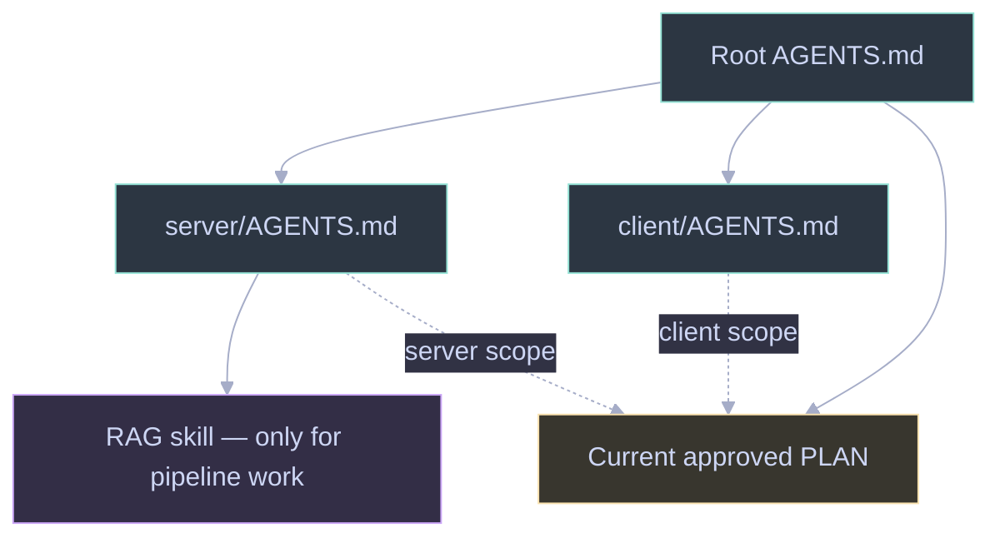
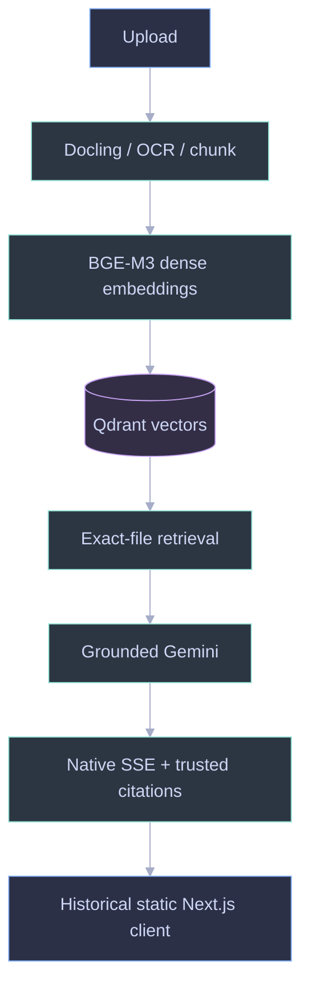
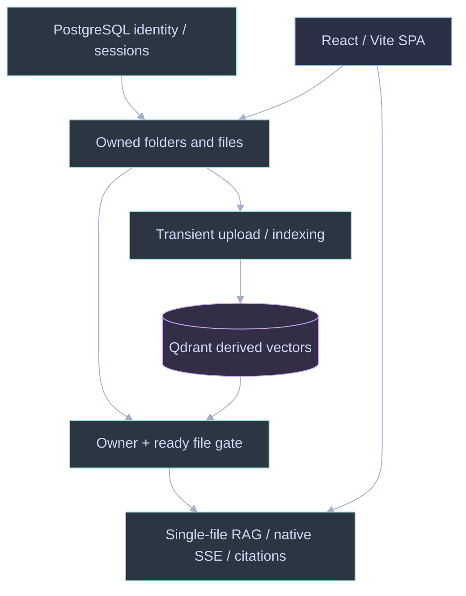
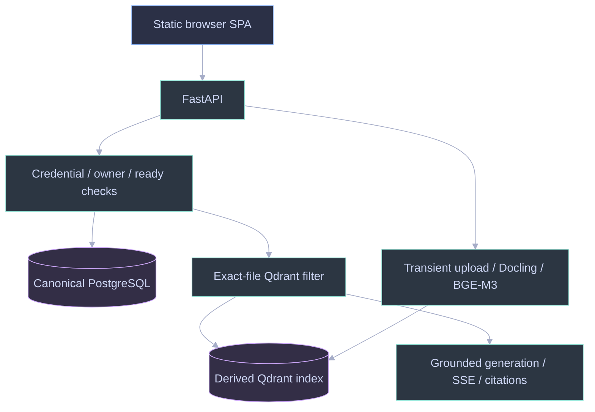
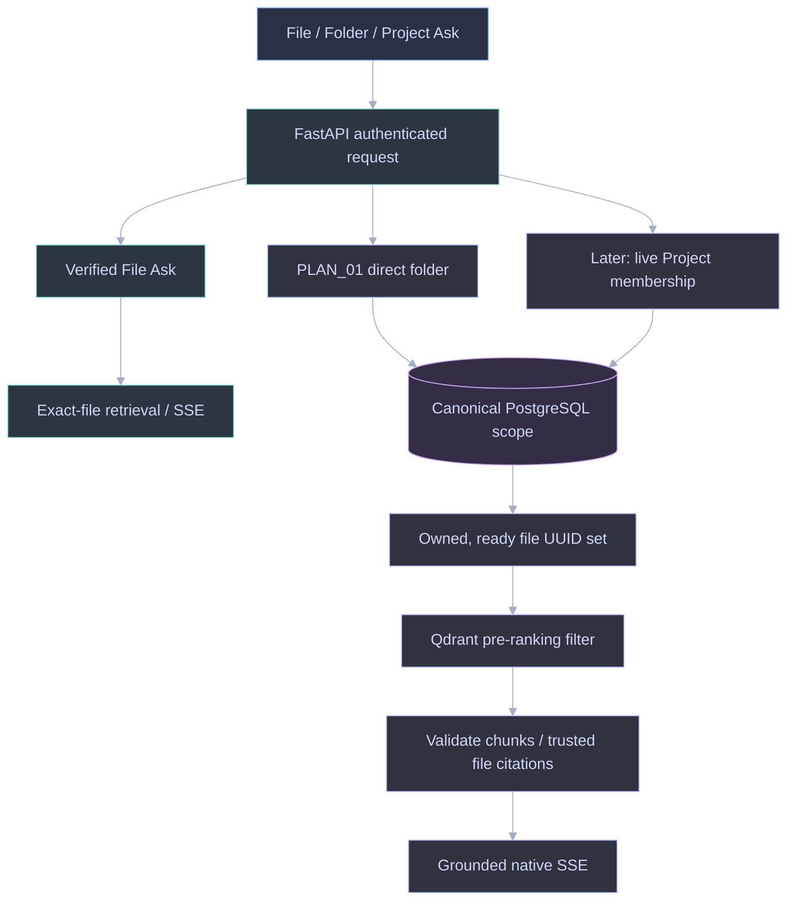
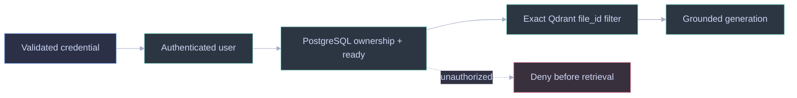

# Atlas — Repository Engineering Standards

Repository-wide engineering contract for Atlas; applies to the entire repository.

- [client/AGENTS.md](client/AGENTS.md) — client-side engineering standards.
- [server/AGENTS.md](server/AGENTS.md) — server-side engineering standards.
- [.agents/skills/rag/SKILL.md](.agents/skills/rag/SKILL.md) — RAG pipeline contracts.
- Scoped instructions may specialize, never weaken, root `LOCKED` contracts.
- Report implementation and verification only with evidence.

---

## 0. DOCUMENT ROLE & INSTRUCTION HIERARCHY

### Authority

Read the **numbered, linked files in order** for the task. Then read the approved PLAN and targeted source/tests.

- Repository
  1. [Root AGENTS](AGENTS.md)
- Client
  1. [Root AGENTS](AGENTS.md)
  2. [Client AGENTS](client/AGENTS.md)
- Server
  1. [Root AGENTS](AGENTS.md)
  2. [Server AGENTS](server/AGENTS.md)
- Server + RAG
  1. [Root AGENTS](AGENTS.md)
  2. [Server AGENTS](server/AGENTS.md)
  3. [RAG SKILL.md](.agents/skills/rag/SKILL.md)
- Cross-Boundary
  1. [Root AGENTS](AGENTS.md)
  2. [Server AGENTS](server/AGENTS.md)
  3. [Client AGENTS](client/AGENTS.md)
  4. [RAG SKILL](.agents/skills/rag/SKILL.md)

Codex invoked from the repository root must explicitly read the applicable scoped files before editing.

### Instruction Inheritance



- Root instructions apply everywhere; scoped files specialize them.
- The RAG skill applies to pipeline work; cross-boundary tasks require both server and client instructions.

### Source-Of-Truth Order

Use the strongest available evidence for claims and implementation decisions:

| Priority | Source                                             |
| -------- | -------------------------------------------------- |
| 1        | Current repository files and source                |
| 2        | Executed tests and runtime observations            |
| 3        | Current authoritative technical documentation      |
| 4        | Approved PHASE, PLAN, and AMENDMENT artifacts      |
| 5        | **CONTEXT.md** and **MANUAL.md** recorded evidence |
| 6        | Explicit current user decisions                    |
| 7        | Historical conversation and older artifacts        |
| 8        | Inference, labeled as unverified                   |

- If evidence conflicts, inspect the relevant scope and report the discrepancy.
- Never silently substitute inference for a verified repository fact.

### Reading Discipline

- Read the current PLAN and targeted code/tests before implementing; include scoped skills only when relevant.
- Inspect the latest applicable **CONTEXT.md** entry first; consult older entries when history affects decisions.
- Use **MANUAL.md** for reproducibility and acceptance, not as proof of fresh execution.
- Avoid repository-wide scans; follow the narrower boundary for documentation-only tasks.

---

## 1. PURPOSE & ENGINEERING OBJECTIVES

Atlas is a Google Drive-like file system with scoped semantic RAG.

**Product Features:**

- **Drive**
  - Canonical owner-scoped files, nested folders, metadata, upload and deletion lifecycle.
- **File Ask — verified baseline**
  - One owned, ready file; exact-file retrieval, grounded SSE and trusted citations.
  - PHASE_03 changes the browser destination to `/drive/file/:id/chat` and intentionally migrates File Ask citations to one unified eight-field DTO; its endpoint, auth, retrieval, fallback and SSE lifecycle remain.
- **Folder Ask — PHASE_03_PLAN_01**
  - Search only immediate owned, ready files in the selected folder.
  - Ask at the bottom of `/drive/:id`; submit to `/drive/:id/chat` for streamed question/answer.
  - Backend endpoint: `POST /folders/{folder_id}/ask`.
- **Projects — later PHASE_03 PLANS**
  - Top-level collections outside the Drive tree; references to Drive file/folder UUIDs, without copying sources.
  - Live membership; recursive inclusion of referenced-folder descendants, deduplicated and owner/ready-gated.
  - Project deletion preserves Drive resources; canonical deletion cleans direct membership references.

**Deferred:** Entire-drive Ask, configurable folder-depth controls, sharing and original-file persistence.

- Approved PHASE_03 direction is **planning**, not implementation authorization.
- Follow the current approved PLAN/AMENDMENT and preserve verified single-file behavior.

### Engineering Priorities

Optimize in this order:

1. correctness;
2. interview defensibility;
3. architectural consistency;
4. user control over material architecture decisions;
5. scope discipline;
6. testability;
7. maintainability;
8. prompt clarity;
9. efficiency;
10. concision.

### Engineering Principles

- Preserve verified File Ask endpoint, ownership/readiness gate, exact-file retrieval, fallback and native SSE; PHASE_03 intentionally supersedes its five-field citation DTO with the unified eight-field format and request-local source indexes.
- Extend retrieval through server-authorized, file-attributed multi-file scopes without reimplementing ingestion or weakening the single-file baseline.
- Build only the current approved PHASE/PLAN/AMENDMENT scope; documentation approval is not execution approval.
- Keep authentication, authorization, ownership, retrieval scope, and provenance enforcement server-side.
- Never rely on the LLM to enforce authorization or ignore unauthorized context.
- Preserve user control over material architecture decisions.
- Follow an evidence-driven improvement cycle: **baseline → measure → targeted change → reevaluate**.
- Never promote `PENDING`/`BUILDING` to `IMPLEMENTED`, or `IMPLEMENTED` to `VERIFIED`, without evidence.

---

## 2. CURRENT STATE & DEVELOPMENT DESTINATION

This is the current-state snapshot. Chronological evidence belongs in PLAN **CONTEXT.md**.

### Status Vocabulary

- Use **exactly these four statuses** for PHASES, PLANS, AMENDMENTS and capabilities.
- Historical CONTEXT/MANUAL evidence retains its original wording; new/current reporting uses this vocabulary.

| Status        | Definition                                                                            | Required evidence                                      |
| ------------- | ------------------------------------------------------------------------------------- | ------------------------------------------------------ |
| `PENDING`     | Approved or planned scope. Implementation pending.                                    | Plan/approval, no implementation claim.                |
| `BUILDING`    | Implementation is in progress. Planned scope is incomplete.                           | In-progress work; outstanding requirements identified. |
| `IMPLEMENTED` | Required implementation exists, but complete acceptance is absent, failed or blocked. | Source/change evidence; unverified gates identified.   |
| `VERIFIED`    | Applicable acceptance passed and is recorded.                                         | Executed tests/runtime evidence covering the scope.    |

- Assess capability, AMENDMENT, PLAN and PHASE separately; verification never automatically rolls up.
- Documentation, a code report or isolated tests do not establish `VERIFIED`.
- Never promote blocked or failed checks to passes. Use `IMPLEMENTED` when coding is complete but acceptance is incomplete.

### Phase Roadmap

| PHASE                                   | Objective                                    | Status     |
| --------------------------------------- | -------------------------------------------- | ---------- |
| PHASE_01 — MVP Core RAG                 | Single-file RAG foundation                   | `VERIFIED` |
| PHASE_02 — Authenticated Personal Drive | Identity, Drive and selected-file Ask        | `VERIFIED` |
| PHASE_03 — Folder & Project RAG         | Single-level Folder Ask and live Project RAG | `BUILDING` |

### Development Destination

- **Active direction:** `PHASE_03 — Folder & Project RAG`; **first PLAN:** `PHASE_03_PLAN_01 — Single-Level Folder RAG`.
- **State:** PHASE_03 and PLAN_01 are `BUILDING`. Amendment 01's internal direct-folder resolver is `VERIFIED` through local, packaged and separately approved real PostgreSQL acceptance with exact cleanup and preservation evidence. See [PLAN_01 CONTEXT](prompts/PHASE_03/PLAN_01/PHASE_03_PLAN_01_CONTEXT.md).
- **Amendment 02:** `VERIFIED`; internal authorized multi-file retrieval has local, packaged, real PostgreSQL/Qdrant, cached BGE-M3 semantic/capacity and exact cleanup/preservation evidence. Final numeric policy requires user decision; public Folder Ask and citation migration remain pending.

| PLAN               | Milestone                                                                 | Status     |
| ------------------ | ------------------------------------------------------------------------- | ---------- |
| `PHASE_03_PLAN_01` | Folder Ask backend, new file/folder chat routes and integrated acceptance | `BUILDING` |
| `PHASE_03_PLAN_02` | Project entities and live UUID-reference membership                       | `PENDING`  |
| `PHASE_03_PLAN_03` | Recursive live Project RAG                                                | `PENDING`  |
| `PHASE_03_PLAN_04` | Projects UI and PHASE-wide acceptance                                     | `PENDING`  |

- **Previous baseline:** PHASE_02 and PLANs 01–04 are `VERIFIED`; see Section 3 and their CONTEXT/MANUAL.
- **Latest inspected remote branch:** `phase-02/plan-04`. Inspect local Git and branch state before implementation; do not create/switch branches without approval.

---

## 3. COMPLETED HISTORY & VERIFIED BASELINES

This section records **completed, `VERIFIED` PHASES only**. Use Section 2 for current development.

- PHASE_03 remains in Section 2 until independently verified.
- Keep dated events, failures, timings and acceptance evidence in PLAN **CONTEXT.md**.
- Later supersessions do not undo historical verification.

### PHASE_01 — MVP Core RAG

**Objective:** End-to-end single-file ingestion, retrieval, grounded generation, native SSE, trusted citations and static browser delivery.

#### Verified Baseline



#### Verified Maturity

| Capability              | Delivered Behavior                                             |
| ----------------------- | -------------------------------------------------------------- |
| Upload endpoint         | Phase 1 upload/returned-ID handoff; endpoint later superseded. |
| Extraction and chunking | Docling structure/OCR and source provenance.                   |
| Embeddings              | BGE-M3 tokenizer/embedding integration.                        |
| Vector storage          | Qdrant dense index and metadata payloads.                      |
| Retrieval               | Exact file-scoped query filtering.                             |
| Grounded generation     | Gemini with Atlas-controlled context.                          |
| Native SSE              | Incremental streamed answer transport.                         |
| Trusted citations       | Provenance-based citation output and display.                  |
| Static client           | Verified Next.js/Bun browser foundation.                       |
| Ask workflow            | Selected file ID to streamed answer.                           |

#### Completion Boundary

Phase 1 intentionally remained:

- single-file;
- unauthenticated;
- single-user;
- without folders;
- without canonical PostgreSQL drive state;
- without multi-file, folder, or drive retrieval.

Phase 2 extends or explicitly supersedes these contracts; Phase 1 evidence remains historical.

#### Evidence

- [PLAN_01 CONTEXT](prompts/PHASE_01/PLAN_01/PHASE_01_PLAN_01_CONTEXT.md)
- [PLAN_01 MANUAL](prompts/PHASE_01/PLAN_01/PHASE_01_PLAN_01_MANUAL.md)
- [PLAN_02 CONTEXT](prompts/PHASE_01/PLAN_02/PHASE_01_PLAN_02_CONTEXT.md)
- [PLAN_02 MANUAL](prompts/PHASE_01/PLAN_02/PHASE_01_PLAN_02_MANUAL.md)
- [PLAN_03 CONTEXT](prompts/PHASE_01/PLAN_03/PHASE_01_PLAN_03_CONTEXT.md)
- [PLAN_03 MANUAL](prompts/PHASE_01/PLAN_03/PHASE_01_PLAN_03_MANUAL.md)
- [PLAN_04 CONTEXT](prompts/PHASE_01/PLAN_04/PHASE_01_PLAN_04_CONTEXT.md)
- [PLAN_04 MANUAL](prompts/PHASE_01/PLAN_04/PHASE_01_PLAN_04_MANUAL.md)
- [PLAN_05 CONTEXT](prompts/PHASE_01/PLAN_05/PHASE_01_PLAN_05_CONTEXT.md)
- [PLAN_05 MANUAL](prompts/PHASE_01/PLAN_05/PHASE_01_PLAN_05_MANUAL.md)

---

### PHASE_02 — Authenticated Personal Drive

**Objective:** Authenticate users and deliver an owner-scoped Drive with nested folders, canonical file lifecycle and selected-file RAG in the current browser SPA.

#### Verified Baseline



#### Verified Maturity

| PLAN      | Verified delivery                                                                                            |
| --------- | ------------------------------------------------------------------------------------------------------------ |
| `PLAN_01` | PostgreSQL identity, verification, JWT access, rotating refresh sessions and auth boundaries.                |
| `PLAN_02` | Canonical nested folders/files, ownership, ready-gated retrieval, transient upload and recoverable deletion. |
| `PLAN_03` | Historical Next.js authentication/browser foundation; subsequently retired with approval.                    |
| `PLAN_04` | Canonical Vite SPA, Drive workflows, file Ask, root Compose and independent Phase 2 acceptance.              |

- **Recorded acceptance:** 424 client tests, 329 packaged backend tests, 222 production-browser checks; 17 PLAN_04 and 15 PHASE_02 criteria reconciled.
- **Provider qualification:** final Phase 2 generation was deterministic, not a new Gemini call; earlier Phase 1 live-provider evidence remains historical.
- **Preservation qualification:** builder cache 111 → 73 records, 42 earlier IDs missing; cause unknown. Literal comparison **FAILED**; user explicitly accepted an exception, not a pass. Exact PostgreSQL/Qdrant cleanup and final approved restoration were verified.

#### Completion Boundary

- Verified: authenticated Drive, nested direct-child browsing, canonical file lifecycle, and single-file Ask.
- Excluded in Phase 2: multi-file/folder/Project/drive Ask, sharing, original-file persistence, file/folder movement and folder deletion.
- Future file-chat route and Folder/Project RAG belong to **PHASE_03**, not historical PHASE_02 implementation.

#### Evidence

| PLAN      | Records                                                                                                                         |
| --------- | ------------------------------------------------------------------------------------------------------------------------------- |
| `PLAN_01` | [CONTEXT](prompts/PHASE_02/PLAN_01/PHASE_02_PLAN_01_CONTEXT.md) · [MANUAL](prompts/PHASE_02/PLAN_01/PHASE_02_PLAN_01_MANUAL.md) |
| `PLAN_02` | [CONTEXT](prompts/PHASE_02/PLAN_02/PHASE_02_PLAN_02_CONTEXT.md) · [MANUAL](prompts/PHASE_02/PLAN_02/PHASE_02_PLAN_02_MANUAL.md) |
| `PLAN_03` | [CONTEXT](prompts/PHASE_02/PLAN_03/PHASE_02_PLAN_03_CONTEXT.md) · [MANUAL](prompts/PHASE_02/PLAN_03/PHASE_02_PLAN_03_MANUAL.md) |
| `PLAN_04` | [CONTEXT](prompts/PHASE_02/PLAN_04/PHASE_02_PLAN_04_CONTEXT.md) · [MANUAL](prompts/PHASE_02/PLAN_04/PHASE_02_PLAN_04_MANUAL.md) |

---

## 4. ARCHITECTURE & DATA FLOW

### Stack

| Layer                            | Selection                                                                           |
| -------------------------------- | ----------------------------------------------------------------------------------- |
| Backend                          | Python + FastAPI                                                                    |
| Frontend                         | React + Vite + TanStack Router + strict TypeScript (verified Phase 2 baseline)      |
| Client runtime / package manager | Bun only                                                                            |
| Client deployment                | Static Vite SPA bundle with deep-link history fallback (verified Phase 2 baseline)  |
| Client styling                   | Tailwind CSS + shadcn/ui                                                            |
| Ordinary client HTTP             | Axios                                                                               |
| Client server state              | TanStack Query v5 (Zustand reserved for authentication)                             |
| Streamed `/ask` transport        | Native browser `fetch()` + `ReadableStream`                                         |
| Client forms / validation        | React Hook Form + Zod                                                               |
| Canonical application database   | PostgreSQL                                                                          |
| Vector retrieval                 | Self-hosted Qdrant                                                                  |
| Parsing / chunking               | Docling                                                                             |
| Embeddings                       | BAAI/bge-m3 through FlagEmbedding                                                   |
| LLM integration                  | Native provider SDKs; Gemini Flash through `google-genai` for the verified baseline |
| Deployment                       | Docker / Docker Compose                                                             |
| Redis                            | Deferred until a concrete transient/cache need is approved                          |

- Next.js is retired historical evidence; canonical `client/` is the verified Vite SPA.
- No default LangChain or other new orchestration dependency.
- Scoped mechanics: [client](client/AGENTS.md) · [server](server/AGENTS.md) · [RAG skill](.agents/skills/rag/SKILL.md).

### System Boundaries

**Verified PHASE_02 File Ask:** the browser is not an authorization boundary; PostgreSQL approves the owned, ready file before exact-file Qdrant retrieval.



- PostgreSQL owns authorization; Qdrant is a derived index.
- Phase 2 uploads use transient original bytes; no persistent original storage.

### PHASE_03 Planned Scope Architecture

**`PENDING`:** Keep verified File Ask; add Folder and Project scopes through a shared authorized multi-file core.



- **Folder:** only direct owned, `ready` files; no descendants, root, siblings or foreign files.
- **Project:** live UUID references to files and folders; recursively expand descendants and deduplicate; bounded scope.
- **Security:** PostgreSQL resolves permissions; Qdrant filters **before ranking** and Atlas validates result membership.
- **Excluded:** entire-drive Ask, depth controls and model-driven authorization.

### Canonical State & Datastore Ownership

- **PostgreSQL:** canonical users, verification, sessions, owned folders/files, identities, metadata and readiness.
- **Projects (planned):** owner-scoped PostgreSQL entities outside the Drive tree; live references to file/folder UUIDs, never copied files, chunks or vectors.
  - Included folders expand current descendants; newly `ready` files become eligible automatically.
  - Renames preserve UUIDs; read current canonical names; metadata edits do not re-embed.
  - Proposed foreign keys clean direct membership on final source deletion; Project deletion never deletes Drive resources. Exact schema belongs to PLAN_02; folder deletion is not yet implemented.
- **Qdrant:** derived vector index, never canonical identity, permission or hierarchy authority.
- **File UUID:** stable across PostgreSQL, API, client and Qdrant payload `file_id` until canonical deletion.
- **Original bytes:** transient upload input; original-file persistence remains excluded.
- **Redis:** deferred until approved need.

### Cross-Boundary Architecture

- Browser SPA → FastAPI directly; no unapproved BFF, Start server functions or proxy-as-backend.
- Verified Vite SPA is static; hosting must serve deep links without turning API/asset 404s into HTML. No client Docker service without approval.
- FastAPI uses explicit origin CORS; **CORS is not authorization**.
- Credentials establish identity; PostgreSQL establishes owner, scope and `ready` eligibility.
- **File Ask:** preserve the exact `file_id` Qdrant filter, endpoint, fallback and SSE; migrate only the source-index mapping and public citation DTO as explicitly approved in PLAN_01.
- **Folder/Project Ask (planned):** server-derived UUID filter **before ranking**, then result-membership validation.
- Never perform global retrieval followed by authorization filtering; never delegate authorization, scope or provenance to a model.
- Citations come from trusted Atlas metadata; refresh sessions remain server-controlled and single-use.
- User approval governs material architectural changes.

### RAG Authority

The [RAG skill](.agents/skills/rag/SKILL.md) owns extraction, embedding, storage, retrieval, grounding, generation, SSE and citation contracts.

- **Extraction:** Docling `DocumentConverter` + `HybridChunker`; standard pipeline and RapidOCR.
- **Embeddings:** `BAAI/bge-m3`, 1024-dimensional dense vectors; same space for chunks/queries.
- **Search:** Qdrant cosine; exact-file and internal authorized UUID-set filtering are `VERIFIED`; public Folder Ask integration is `PENDING`.
- **Generation:** Gemini Flash via official `google-genai` behind Atlas abstractions; trusted citations.
- **Deferred:** managed RAG/File Search, hybrid retrieval and reranking without measured evidence/approval.
- Stop and report conflicts with the RAG skill; do not silently override it.

---

## 5. REPOSITORY STRUCTURE & OWNERSHIP

### Repository Structure

```text
atlas/
├── AGENTS.md
├── .gitignore
├── compose.yml
├── .agents/
│   └── skills/
│       └── rag/
│           └── SKILL.md
│
├── server/
│   ├── AGENTS.md
│   ├── .env
│   ├── .env.example
│   ├── Dockerfile
│   ├── app/
│   ├── migrations/
│   └── tests/
│
├── client/
│   ├── AGENTS.md
│   ├── src/
│   ├── tests/
│   ├── package.json
│   └── bun.lock
│
└── prompts/
    ├── PHASE_01/
    └── PHASE_02/
```

- `prompts/PHASE_03/` contains the current PHASE/PLAN, Amendment 01 and its Stage 01/02 evidence. Later artifacts require authorization.
- `client-legacy/` was retired after approved acceptance; only `client/` is active. Confirm the current checkout before changes.

### Ownership Boundaries

| Path                  | Responsibility                                                                                |
| --------------------- | --------------------------------------------------------------------------------------------- |
| `server/`             | Backend, public API, canonical application-state implementation, authentication/authorization |
| `client/`             | Canonical browser SPA presentation and interaction layer after PLAN_04 cutover                |
| `.agents/skills/rag/` | Detailed RAG engineering authority                                                            |
| `prompts/`            | PHASE / PLAN / AMENDMENT / CONTEXT / MANUAL artifacts                                         |

Additional Rules:

- Root `compose.yml` uses project `atlas`; invoke from root with `--env-file server/.env -f compose.yml` only when authorized. Private `.env`, Dockerfile and `.dockerignore` belong under `server/`.
- Client is a statically hosted SPA, not a Compose service.
- Build new chat routes/Folder Ask on verified `client/`; do not repeat migration or revive `client-legacy/`.
- Follow established path ownership; no speculative directories.

### Vocabulary

- Use `file` / `file_id`, not new `document_id` terminology.
- Historical `POST /documents/upload` was removed; current authenticated upload is `POST /files`. No legacy alias.
- Public file IDs and Qdrant payload `file_id` share the canonical UUID.

---

## 6. ENGINEERING & DOCUMENTATION CONVENTIONS

Atlas uses exactly:

- `PHASE` — major objective;
- `PLAN` — substantial milestone/end-state specification;
- `AMENDMENT` — one focused chronological implementation or documentation task;
- `CONTEXT` — chronological implementation/verification evidence;
- `MANUAL` — reproducibility/human acceptance guide.

### Artifact Hierarchy

```text
PHASE
-> PLAN
-> AMENDMENT
-> CONTEXT
-> MANUAL
```

### Responsibilities & Ownership

| Artifact  | Purpose                                                            | Ownership |
| --------- | ------------------------------------------------------------------ | --------- |
| PHASE     | Major objective and current PLAN roadmap                           | Planning  |
| PLAN      | Stable end-state architecture, contracts, scope, and acceptance    | Planning  |
| AMENDMENT | One focused chronological implementation/documentation task        | Planning  |
| CONTEXT   | What actually happened; decisions, failures, verification evidence | Codex CLI |
| MANUAL    | Proven reproducibility and human acceptance procedures             | Codex CLI |

### PLAN Rules

A `PHASE_<NN>_PLAN_<NN>.md` is the stable end-state specification.

It should describe:

- status/dependencies;
- objective;
- scope/exclusions;
- architecture and useful Mermaid diagrams;
- locked contracts;
- API/data contracts;
- failure/observability behavior;
- folder placement where relevant;
- requirements;
- acceptance criteria;
- risks;
- verification boundaries.

A PLAN must **not** preassign future Amendment numbering.

Capability decomposition is allowed. Chronological numbering belongs to actual Amendments and CONTEXT.

### Placement

PLAN artifacts live under:

```text
prompts/PHASE_<NN>/PLAN_<NN>/
```

A PLAN's approved artifact set uses these names, created only at the proper lifecycle stage:

- `PHASE_<NN>_PLAN_<NN>.md`: destination specification; planning-owned.
- `PHASE_<NN>_PLAN_<NN>_CONTEXT.md`: created by Codex when implementation begins.
- `PHASE_<NN>_PLAN_<NN>_MANUAL.md`: created by Codex for verified reproduction/acceptance.

Focused Amendment prompts live under that PLAN's `AMENDMENTS/` folder.

### CONTEXT & MANUAL Rules

- CONTEXT is the running implementation/verification record and Amendment changelog.
- MANUAL is the human acceptance/reproducibility guide.
- CONTEXT and MANUAL are created and maintained by Codex CLI.
- Planning work must not fabricate implementation evidence in CONTEXT/MANUAL.
- AGENTS and PHASE overview files contain current state, not detailed dated evidence.
- Dated logs, exact test counts/timings, hashes, image/container IDs, point counts, failures, and corrective history belong in CONTEXT.
- Specs remain specifications.
- MANUAL retains numbered steps, commands, and `Expected:` lines.
- Change a MANUAL command only when implementation/evidence proves the current command wrong or superseded, and record the correction in CONTEXT.
- Preserve dead ends, reversed decisions, and historical failures rather than rewriting chronology.
- Emergent decisions must not be retroactively presented as if predicted.

### Documentation Style (Agent-Facing)

- Prefer definitive one-line bullets, compact tables, and useful Mermaid diagrams.
- Express one invariant per bullet; avoid long paragraphs.
- Prefer two- or three-column tables with short cells.
- Use `MUST`, `MUST NOT`, and `REQUIRES APPROVAL` for binding rules.
- Preserve exact file/endpoint/config identifiers and decision terminology.
- Preserve meaningful rationale, including the “because.”
- Keep rationale concise rather than burying it in large tables.
- Include Mermaid diagrams where they clarify authority, flow, state, lifecycle, or trust boundaries; no arbitrary diagram-count ceiling.
- Every Mermaid diagram MUST use the Catppuccin Mocha palette and consistent semantic node classes:
  - `#1e1e2e` base, `#cdd6f4` text, `#45475a` default surfaces;
  - `#89b4fa` browser/entry, `#94e2d5` services/processing, `#cba6f7` persistence;
  - `#a6e3a1` completed, `#b4befe` planned, `#f9e2af` caution, `#f38ba8` failure/denial.
- Set Mermaid `theme: base` with explicit background, text, border, and line colors.
- Use semantic Mermaid classes; label planned features explicitly.
- Avoid adding a diagram that only repeats nearby text.
- Give each Mermaid diagram short context/legend text.
- Folder trees remain plain text.
- Preserve stable referenced headings when practical.
- Keep agent-facing files current and navigable.
- Root AGENTS owns global rules.
- Scoped AGENTS own subtree-specific rules.
- Detailed RAG contracts remain in the RAG skill.
- Do not duplicate a rule across documents unless a short summary is necessary to establish authority or a cross-boundary invariant.

---

### General Code Principles

- Prefer single-word variable/function/parameter names where clear.
- Use multiple words when necessary to avoid ambiguity.
- Follow the applicable scoped language/framework conventions.
- Do not scatter inline comments that explain individual code lines.
- Use function/method documentation when it materially clarifies behavior, parameters, returns, lifecycle, or non-obvious contracts.
- New files mirror the latest established file in the same ownership area unless a documented convention deliberately supersedes it.
- Reuse established abstractions instead of creating parallel ownership paths.
- Keep failures explicit.
- Avoid speculative generalization and “future-proofing” without current requirements.

### Scoped Conventions

- Backend/Python/API details: `server/AGENTS.md`
- Frontend/TypeScript/client details: `client/AGENTS.md` (new SPA instructions take effect for the replacement project; legacy code retains its historical conventions)
- RAG pipeline details: `.agents/skills/rag/SKILL.md`

---

## 7. TECHNICAL CONTRACTS & RUNTIME BEHAVIOR

The following inherited **LOCKED Phase 2 contracts** remain binding. Phase 3 planned extensions and explicit supersessions are described separately; neither an approved direction nor this document proves the new implementation exists.

- The detailed API/auth implementation is owned by `server/AGENTS.md` and completed PLAN_01/02 specifications.
- Browser integration conventions are owned by `client/AGENTS.md`.
- Extraction, retrieval, grounding, SSE, and citation internals are owned by the RAG skill.

### Current Phase Locks — PHASE_02

Do not re-ask these resolved scope decisions unless a new requirement conflicts with them.

#### Authentication & Identity

- PostgreSQL canonical identity tables are `users`, `verifications`, and `sessions`.
- `users.password` stores an Argon2id hash, never plaintext.
- Verification purpose supports `auth`, `reset`, and `forgot`.
- Phase 2 implements the `auth` verification product flow only.
- Development OTP is intentionally database-visible while real email delivery is absent.
- Successful verification deletes its verification row.
- Encountered expired verification/session rows are deleted during the request.
- No cron/background TTL cleanup service is required.
- Refresh credentials are opaque, high-entropy, single-use server sessions; only their hash is persisted.
- A successful refresh atomically consumes the current session before replacement becomes authoritative.
- Registration intentionally exposes account existence but must not disclose verified/unverified status.
- OAuth/social login, password reset, forgot-password flow, and real email delivery are excluded from Phase 2.

#### Folders & Files

- Phase 2 `folders` and `files` are canonical PostgreSQL records owned by one canonical `users` row.
- Phase 2 introduces recursive folders through a nullable self-referencing parent relationship.
- Folder metadata includes user-facing name and description.
- Folder rename is approved.
- Folder deletion and folder movement are excluded.
- File movement is excluded.
- Duplicate sibling folder names are allowed.
- Duplicate sibling file names are allowed.
- Files and folders may share the same display name; names are metadata, not identity.
- Canonical file metadata includes user-facing name and description plus source metadata required by the current PLAN.
- File metadata update does not imply content replacement or re-embedding.
- PLAN_04 Amendment 02 implements `GET /files/{file_id}` (`VERIFIED`): authenticated owner-scoped read of the existing File DTO; absent/foreign files share a privacy-safe 404. Metadata reads do not require `ready`; RAG still requires owner plus `ready`. No schema or RAG change is authorized.
- Canonical file lifecycle uses `processing`, `ready`, and `deleting`; only `ready` files may enter retrieval/generation.
- A known ingestion failure cleans any derived Qdrant state for that exact `file_id` and removes the temporary canonical file row rather than retaining a durable failed-file state.
- Persistent original-file storage is excluded; uploads are transient input to the existing indexing pipeline.
- Permanent file deletion removes all derived Qdrant points for the exact `file_id` and then removes canonical PostgreSQL metadata; `deleting` is a non-queryable retryable cross-store state.
- Content/file deduplication is not part of Phase 2 unless explicitly added later.
- Owner authorization in PostgreSQL must happen before file-scoped retrieval/generation.

#### Retrieval & Infrastructure

- **PLAN_04 Amendment 02 supersession (`VERIFIED`):** public folder reads are `GET /folders` and `GET /folders/{folder_id}`, both returning `FolderListingResponse` and rejecting all query parameters; browser `/drive` routes remain unchanged.
- Public `GET /drive` and `POST /files/{file_id}/query` are removed without aliases; internal scored retrieval and owner/ready-gated native `POST /files/{file_id}/ask` remain.
- Current application API inventory is 18 operations: system 2, auth 7, folders 4, files 5; documentation facilities are excluded. Historical PLAN_02 route acceptance remains historical.
- Multi-file, folder/subtree, or drive-wide RAG remains excluded from Phase 2.
- Hybrid/sparse retrieval and reranking remain deferred until measured evidence justifies them.
- Redis remains deferred until a concrete transient/cache need exists.
- Background workers/queues are not part of Phase 2.
- PostgreSQL and Qdrant diagnostics are current verified backend contracts.
- Future changes must be explicitly specified and reverified.

### PHASE_03 Approved Direction — Planned, Not Implemented

**Product and delivery:**

- `PHASE_03_PLAN_01 — Single-Level Folder RAG` will deliver complete backend/browser Folder Ask. A folder includes **only its immediate owned `ready` files**; ordinary folder Ask does not recursively traverse descendants.
- The approved Folder Ask endpoint is `POST /folders/{folder_id}/ask`. Preserve `POST /files/{file_id}/ask` request validation, ownership/readiness, exact-file retrieval, fallback and SSE lifecycle; its previous five-field citation response is explicitly `SUPERSEDED` by the unified eight-field DTO during PLAN_01.
- The approved **file chat** route is `/drive/file/:id/chat`; navigating to the old `/drive/file/:id` must remain compatible through a deliberate redirect rather than silently breaking existing links.
- The existing folder page `/drive/:id` keeps its browsing controls and gains an Ask input at the bottom. Submitting navigates to `/drive/:id/chat`, where the question is shown immediately and the response streams. Direct chat-route load must not replay a previously submitted question.
- A chat-style view is **not** approval for stored conversations, conversational memory, new chat tables, or multi-turn model context. Preserve existing account/session-aware cancellation and stale-response isolation.
- PHASE_03 later PLANS introduce independent top-level **Projects** outside Drive. Projects are owner-scoped collections of canonical file and folder UUID references, not copied files. Folder membership is live and recursively includes current descendants, while duplicate files in the effective retrieval set appear once.
- Deleting a Project must not delete source Drive resources. Direct memberships to physically deleted canonical resources require database-enforced referential integrity and cleanup. Exact schema, API, and deletion decisions remain for the later Project foundation PLAN.
- Entire-drive Ask, configurable folder-depth controls, sharing/ACLs, file/folder movement, folder deletion, persistent original-file storage, and new RAG providers/frameworks are outside the current PHASE_03 implementation scope.

**Planned retrieval and provenance:**

- A reusable **internal** retrieval helper MUST consume a validated, server-resolved eligible file UUID set and canonical source metadata. Its exact Python carrier/signature is an implementation detail, not permission for browser-supplied file lists to authorize retrieval.
- The existing dense BGE-M3/Qdrant collection, cosine metric, 1024-dimensional vectors, and native POST-SSE transport remain the baseline. Multi-file retrieval requires a permitted-ID filter **before** Qdrant ranking, followed by trusted payload membership validation.
- **Unified Citation DTO (`LOCKED`, implementation `PENDING`):** File, Folder and later Project Ask use exactly `index`, `file_id`, `file_name`, `chunk_index`, `page`, `heading`, `section`, `excerpt`. `index` is a unique request-local `[[cite:N]]` reference; `chunk_index` retains the true per-file index, including collisions across files. Canonical UUID/name and source metadata come from trusted Atlas data, never from the model. This deliberately supersedes the verified five-field File Ask response.
- **Fallbacks (`LOCKED`):** File Ask keeps `I don't have enough information in this file to answer that.`; Folder Ask uses `I don't have enough information in this folder to answer that.` Both yield successful native SSE with empty citations when unsupported. Zero eligible files bypass embedding, Qdrant and Gemini; eligible scope with zero hits bypasses Gemini. Errors MUST NOT become fallback.
- The current single-file `top_k=5` and validation range remain unchanged. Folder RAG will compare **k=5, 8, and 12** using a fixed, globally ranked candidate limit; `k=8` is a **PROVISIONAL** hypothesis, not an approved default. Do not scale top-k directly with folder file count, install arbitrary score thresholds, or introduce hybrid search/reranking without measured evidence and approval.
- **Resource limits:** Complete authorized file scopes MUST NOT be silently truncated. A 100-ready-file ceiling and approximately 12,000 assembled context tokens are `PROVISIONAL` evaluation candidates, not production limits; benchmark and approve final limits, latency budget and explicit pre-stream oversized-scope error before shipping. User-selected per-folder file subsets are deferred.
- **Deletion consistency (`LOCKED`):** Authorize eligible files once at request start. An already-authorized Ask may continue if its source later becomes `deleting` or is removed; new File Ask requests reject non-ready/deleted files, and new Folder Ask scopes exclude them. No mandatory pre-generation revalidation, continuous revocation polling or long-held PostgreSQL locks. If Qdrant cleanup races retrieval, empty results follow normal fallback; true dependency failures remain errors.
- No PostgreSQL schema migration is expected for PLAN_01; Project models/migrations belong to later PLANS. Treat this expectation as `PROVISIONAL` until the approved PLAN and source review establish it.

**PLAN_01 Amendment Workstreams** (six proposed; PLAN roadmap in Section 2):

1. Direct-folder authorization.
2. Authorized multi-file retrieval and k=5/8/12 evaluation.
3. Unified File/Folder citation migration, request-local grounding and exact fallbacks.
4. Folder Ask API/native SSE **plus file-chat route migration**.
5. Folder composer and streamed folder chat route.
6. Integrated verification and PLAN closure.

Assign actual Amendment IDs/artifacts only when authorized. Amendment 01's internal direct-folder resolver is `VERIFIED`; all later workstreams remain outstanding.

- PLAN_01 CONTEXT/MANUAL record verified internal resolution and multi-file retrieval/evaluation with exact preservation. Public Folder Ask, citation migration, numeric-policy approval and browser acceptance remain pending.

---

## 8. SECURITY & TRUST BOUNDARIES

### Secrets & Environment

- Codex may read `.env` for development and use its values as needed.
- Never commit `.env`.
- `.env` must remain ignored.
- Missing/incorrect ignore or secret handling is blocking.
- Commit `.env.example` with placeholders/safe examples only.
- Never copy real API keys, DB credentials, passwords, OTPs, tokens, or signing secrets into tracked files, tests, prompts, CONTEXT, or MANUAL.
- Do not expose secrets through Docker build args/history or diagnostic commands that print complete environment configuration.
- Never place secrets in browser-public configuration.
- Apply scoped environment rules from `server/AGENTS.md` or `client/AGENTS.md` when modifying those subtrees.

### Trust Boundaries

Treat as untrusted at the appropriate boundary:

- uploaded files;
- HTTP/network input;
- provider responses;
- model output.

Rules:

- validate external data before treating it as trusted application state;
- preserve structured error behavior;
- do not silently convert dependency failure into success/fallback unless an approved contract explicitly defines it;
- do not leak out-of-scope retrieval context;
- citation provenance comes from trusted Atlas metadata.

### Authentication & Authorization Sequence

```text
validated credential
-> authenticated user
-> PostgreSQL ownership / ready-state authorization
-> server-resolved eligible file UUID scope (one or many)
-> Qdrant exact file_id or permitted-ID filter BEFORE ranking
-> validate returned payload membership
-> grounded generation + Atlas-trusted provenance
```

Never reverse this sequence. Authorization fixes a request-start eligible-file snapshot; subsequent deletion excludes the source from newly authorized requests but does not mandate cancellation of an in-flight Ask. File Ask uses one canonical UUID; internal direct-folder resolution and multi-file retrieval are verified, while public Folder/Project Ask remain planned.

Authentication identifies the user; it does not replace resource authorization. Folder/Project ownership and file readiness must be validated by PostgreSQL before Qdrant can inspect candidate chunks.

---

### Authorization Flow

The diagram below describes the verified **single-file** boundary; the approved multi-file extension applies the same trust ordering with a server-resolved permitted-ID filter, not with a global Qdrant search.



---

## 9. SCOPE & ARCHITECTURE GOVERNANCE

### Always Allowed

Within an **explicitly authorized** AMENDMENT and its approved verification stage, without making new material architecture decisions:

- implement within already-decided architecture in root AGENTS + applicable scoped AGENTS + relevant skill/PLAN;
- reuse established abstractions and ownership boundaries;
- surface failures explicitly;
- preserve security and scope boundaries;
- keep implementation proportional to the current PLAN;
- update current-state documentation only as implementation facts actually land;
- perform proportional verification.

### Requires Approval

Do not choose silently:

- a new third-party library/service/API outside the fixed stack;
- a new frontend state/form/network/component library;
- a new backend framework or material service boundary;
- a new queue/cache/storage architecture;
- a DB schema change not already specified by the current PLAN;
- a public API shape change not already specified by the current PLAN;
- any change to the `LOCKED` unified eight-field citation DTO, canonical fallbacks, request-local source mapping or request-start deletion policy;
- numeric eligible-file, retrieval, context, or latency limits where not yet approved;
- later Project schema, membership/ownership constraints, and API details not specified by an approved PLAN;
- chunk-size/overlap policy;
- embedding model;
- similarity metric;
- retrieval policy;
- hybrid retrieval/reranking;
- LLM provider;
- approved authentication/session architecture changes;
- provider/resource lifecycle redesign;
- material architecture not already resolved in AGENTS/skill/PLAN.

### Prohibited

- Pull scope beyond the currently approved PHASE/PLAN without explicit approval.
- Scaffold future stages merely because later work will need them.
- Perform unrelated cleanup/refactors.
- Implement multi-file Folder/Project RAG without the relevant approved PLAN, focused AMENDMENT, and verification-stage authorization; approved PHASE_03 planning is not blanket implementation permission.
- Introduce drive-wide RAG, configurable folder depths, or speculative Project functionality outside the current approved PHASE/PLAN.
- Introduce sharing/teams/ACLs beyond approved owner-only Phase 2 scope.
- Introduce persistent original-file storage during Phase 2.
- Introduce folder deletion/movement, file movement, trash/recovery, or versioning during Phase 2.
- Use Gemini File Search or another managed RAG-as-a-service.
- Silently weaken server-side authentication, ownership, retrieval scope, provenance, or trust boundaries.
- Treat client route state or client-supplied `user_id` / `owner_id` as authorization.
- Rewrite historical evidence to make chronology appear cleaner.

### Decision States

| State         | Meaning                                                 |
| ------------- | ------------------------------------------------------- |
| `LOCKED`      | Approved; MUST NOT change without human authorization.  |
| `PROVISIONAL` | Suggested; not an implementation mandate.               |
| `OPEN`        | Material choice awaits the user.                        |
| `SUPERSEDED`  | Earlier decision explicitly replaced; preserve history. |

- Codex MUST NOT silently choose material architecture decisions.
- An unresolved material `OPEN` decision blocks the affected implementation contract.
- Completed PLAN_01/02 contracts remain binding until explicitly superseded.

---

## 10. GIT & REPOSITORY SAFETY

### Session Reconnaissance

At the start of every implementation session, perform read-only Git reconnaissance:

- current branch;
- relevant local/remote branches;
- recent commit history as needed.

Use this information to avoid conflicting with existing work.

### Default Restrictions

Unless explicitly authorized in that session:

- no commits;
- no pushes;
- no branch edits/deletes;
- no branch switching/checkouts;
- no branch creation;
- no merges;
- no rebases;
- no history rewriting;
- no destructive Git operations;
- do not discard unrelated/uncommitted changes.

Work only on the branch already checked out.

If the branch does not match the prompt's expected PLAN, stop and report the mismatch instead of switching.

### Branch Convention

```text
phase-<NN>/plan-<NN>
```

A genuinely new pipeline stage/capability milestone gets a new PLAN/branch.

Cleanup, refactors, conventions, fixes, and documentation alignment remain on the current PLAN branch unless an approved PLAN boundary says otherwise.

### Remote Connector policy

- GitHub-connected plugins/connectors are **read-only reference tools** for this project workflow.
- Do not use a GitHub plugin/connector for repository mutation, commits, pushes, PR creation, or file edits.
- Authorized code changes occur through the user's local repository workflow.
- Inspect actual local Git state before making any implementation claim about the checked-out branch.

### Status Effect

Completed behavior/pipeline/contract changes remain `IMPLEMENTED` until required acceptance passes; use `BUILDING` while implementation is still in progress.

Documentation-only or cosmetic work follows proportional verification and does not automatically demote implementation status.

---

## 11. VERIFICATION & ACCEPTANCE

Verification effort must match change risk.

| Change                                  | Required verification                             | Status effect                                              |
| --------------------------------------- | ------------------------------------------------- | ---------------------------------------------------------- |
| Documentation only                      | Documentation checks; no unnecessary tests/Docker | Unchanged                                                  |
| Whitespace/docstrings/comments/imports  | Static/AST comparison or local suite              | Unchanged                                                  |
| Caller-visible cosmetic behavior        | Local tests + focused touched-path check          | Change only if acceptance behavior changes                 |
| Behavior/API/database/pipeline contract | Full relevant verification                        | `BUILDING` while in progress; `IMPLEMENTED` until verified |
| Deployment-sensitive input              | Docker/package/runtime verification               | Evidence required before verified claim                    |

### Docker Triggers

Docker verification is specifically required when changes affect:

- Dockerfile;
- Compose;
- runtime dependencies;
- environment/configuration forwarding;
- model caching;
- startup lifecycle;
- other deployment-sensitive image inputs.

Docker may also be run deliberately to establish a fresh verified baseline when the human explicitly requests it.

If Docker is authoritative for the affected behavior, prefer Docker as the final verification environment.

### Stage Authorization and Approval Gates

- **Stage 01:** After a focused AMENDMENT is authorized, implement the narrow code/doc change and run applicable deterministic local tests, static checks, and build checks. Record exact outcomes in CONTEXT/MANUAL and **STOP for human review**.
- **Stage 02:** Requires **fresh explicit user approval** before Docker, persistent PostgreSQL/Qdrant changes, migrations, deployment changes, real browser/provider calls, paid APIs, or other live/side-effectful integration acceptance. Prior acceptance does not transfer authority to a new stage.
- Never assume approval of PHASE_03 documentation, PLAN planning, or one Amendment authorizes commits, branch operations, pushes, merges, destructive cleanup, or provider spending.
- Protect canonical user data and unrelated resources; use uniquely owned fixtures, exact cleanup inventories, and before/after preservation evidence for authorized live tests.

### Evidence Rules

- Never claim a test/build/runtime check passed unless it actually ran.
- Verification must include material failure paths where relevant.
- Preserve persistent datastore state unless a task explicitly authorizes mutation/cleanup.
- Run `git diff --check` before completion of non-trivial implementation work.

If a required verification cannot run, record:

```text
command
reason it could not run
remaining unverified scope
```

Do not convert a blocked check into a success claim.

---

## 12. STANDARD ENGINEERING WORKFLOW

### Server-First Cross-Boundary Sequencing

For a capability spanning server and client:

1. define/confirm the server contract in the applicable PLAN;
2. implement server-side data/domain/API behavior;
3. verify the server contract at the appropriate level;
4. implement the client against that established contract;
5. run cross-boundary acceptance after both sides exist.

Exceptions require an explicit PLAN/task reason.

Do not use speculative frontend mocks, DTOs, endpoints, storage semantics, or auth behavior to silently decide backend architecture.

### Workflow Diagram

```mermaid
%%{init: {'theme': 'base', 'themeVariables': {'background': '#1e1e2e', 'primaryColor': '#45475a', 'primaryTextColor': '#cdd6f4', 'primaryBorderColor': '#89b4fa', 'lineColor': '#a6adc8', 'secondaryColor': '#313244', 'tertiaryColor': '#181825', 'fontFamily': 'Inter, sans-serif'}}}%%
flowchart LR
    Instructions["Instructions + Git"] --> Plan["Approved PLAN"]
    Plan --> Inspect["Targeted source + tests"]
    Inspect --> Amend["Focused AMENDMENT"]
    Amend --> Verify["Execute relevant checks"]
    Verify --> Evidence["CONTEXT / MANUAL evidence"]
    Evidence --> Explain["Explain-back"]
    Verify -. "blocked / failed" .-> Incomplete["Unverified scope"]
    class Instructions,Plan,Inspect,Amend service;
    class Verify caution;
    class Evidence,Explain verified;
    class Incomplete denied;
    classDef client fill:#2b3046,stroke:#89b4fa,stroke-width:1px,color:#cdd6f4;
    classDef service fill:#2c3642,stroke:#94e2d5,stroke-width:1px,color:#cdd6f4;
    classDef storage fill:#332e46,stroke:#cba6f7,stroke-width:1px,color:#cdd6f4;
    classDef verified fill:#2e363c,stroke:#a6e3a1,stroke-width:1px,color:#cdd6f4;
    classDef planned fill:#30323f,stroke:#b4befe,stroke-width:1px,color:#cdd6f4;
    classDef caution fill:#38362e,stroke:#f9e2af,stroke-width:1px,color:#cdd6f4;
    classDef denied fill:#39303d,stroke:#f38ba8,stroke-width:1px,color:#cdd6f4;
```



### Before Implementation

```text
read applicable instructions
-> inspect Git state
-> read current PLAN
-> read current CONTEXT state when evidence matters
-> inspect targeted source/tests
-> confirm Amendment boundary
```

### During Implementation

```text
smallest cohesive change
-> reuse established boundaries
-> preserve locked architecture
-> no speculative future work
-> explicit failures
```

### Verification

```text
Stage 01: focused checks + relevant local regression + static/build checks
-> record evidence and STOP for human review
-> separately approved Stage 02: runtime/database/API/browser/provider checks when applicable
-> Docker when triggered and explicitly authorized
```

### Completion

```text
Codex updates CONTEXT with actual evidence
-> Codex updates MANUAL with proven procedures
-> explain-back
-> evidence-based status update
```

Do not update status because code merely exists.

---

## 13. MCP USAGE GUIDELINES

These are **user-configured custom MCP integrations for Codex CLI**, not automatic dependencies. Confirm tool availability in the active session.

### Tool Selection

| MCP               | Purpose                                                      | Use only when                                                                   |
| ----------------- | ------------------------------------------------------------ | ------------------------------------------------------------------------------- |
| `context7`        | Version-specific library/API documentation.                  | Repo and trusted docs do not resolve a material API question.                   |
| `playwright`      | Browser interaction and end-to-end acceptance.               | UI, navigation, forms, auth restoration, or browser journeys require execution. |
| `chrome-devtools` | Browser network, console, runtime and performance diagnosis. | A specific browser failure or verification requirement needs inspection.        |

### Invocation Rules

- MCP usage is **optional**; prefer current source, existing tests, and authoritative project documentation.
- Use the smallest tool surface and fewest calls sufficient for the task.
- `context7` does not override the installed version, repository code, or a LOCKED decision.
- Prefer `playwright` for reproducible browser acceptance; use `chrome-devtools` for targeted diagnostics.
- Do not launch both browser MCPs for the same check without a concrete reason.
- Server-only work normally requires neither browser MCP.
- Do not install tools, start external services, modify account state, or widen test scope without approval.
- Never expose passwords, OTPs, JWTs, cookies, API keys, encryption keys, or uploaded content in tool output, screenshots, recordings, reports, CONTEXT, or MANUAL.
- Use test accounts/data only within the authorized environment and preserve unrelated user/datastore state.
- Record significant observed results in Codex-owned CONTEXT; distinguish observations from inferences.
- If an MCP is unavailable, state the limitation and use an approved alternative; never claim the MCP ran.

### Scope Ownership

- Root: global invocation, safety, and evidence policy.
- Server AGENTS: backend-specific exceptions and tool relevance.
- Client AGENTS: browser checks, auth/cookie/CORS, navigation, SSE and production-SPA/deep-link acceptance.

---

## 14. COMMANDS & TOOLING

Root AGENTS does not duplicate scoped command inventories.

### Client

Read:

```text
client/AGENTS.md
```

Use its Bun-driven commands and current client verification workflow.

### Server

Read:

```text
server/AGENTS.md
```

Use its Python/PostgreSQL/Docker commands and current backend verification workflow.

### RAG

For extraction, chunking, embeddings, Qdrant retrieval/filtering, grounding, generation, citations, or RAG transport, additionally read:

```text
.agents/skills/rag/SKILL.md
```

Do not infer current exact commands or implementation mechanics from historical Amendments when current scoped instructions or MANUAL provide them.

---

## 15. EXPLAIN-BACK REQUIREMENT

Every non-trivial task ends with a concise explain-back covering:

- what changed;
- affected subsystem / pipeline stage;
- meaningful implementation choices;
- architecture boundaries reused;
- relevant failure/security/lifecycle boundaries;
- verification actually performed;
- deviations or blocked checks;
- remaining unverified scope;
- CONTEXT/MANUAL/current-state updates actually made.

The purpose is to keep Atlas implementation technically defensible, reproducible, and interview-ready.
