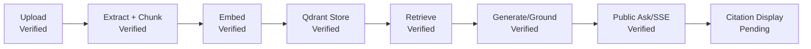
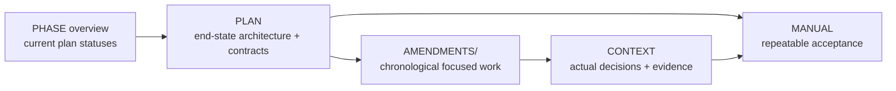
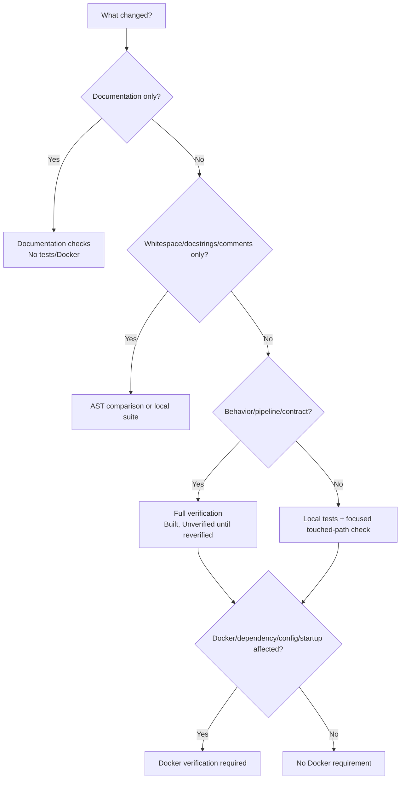

# AGENTS.md — Atlas (Intelligent Knowledge Drive)

- Auto-loaded from the repository root each session; read fully before writing code.
- This file is the repository-wide operating contract.
- Detailed RAG pipeline contracts live in `.agents/skills/rag/SKILL.md`; do not duplicate or silently override them here.

---

## 1. Project purpose and current objective

Atlas organizes files and folders with a semantic RAG layer:

```text
Ask File -> Ask Folder -> Ask Drive
```

Current engineering goal:

- build a hands-on, interview-defensible RAG/embeddings/vector-database system;
- prove the core single-file pipeline before pulling forward folders, file metadata, auth, or multi-scope retrieval;
- preserve user control over material architecture decisions;
- prefer a measurable baseline before adding retrieval/generation complexity.

### Current phase

**Phase 1 — MVP Core RAG pipeline**

```text
upload -> chunk -> embed -> store -> retrieve -> generate -> stream -> cite
```

Phase 1 is:

- single-file;
- unauthenticated;
- single-user;
- no folders or drive-wide retrieval;
- no canonical user-facing file metadata system.

Do not begin Phase 2+ work unless explicitly requested.

---

## 2. Current component maturity

| Component               | Status                 |
| ----------------------- | ---------------------- |
| Upload endpoint         | Implemented & Verified |
| Extraction & chunking   | Implemented & Verified |
| Embedding               | Implemented & Verified |
| Vector storage (Qdrant) | Implemented & Verified |
| Retrieval               | Implemented & Verified |
| Generation/streaming    | Implemented & Verified |
| Citation display        | Not Yet Built          |

Status meanings:

- `Not Yet Built`
- `Implemented, Unverified` — code exists, but the relevant complete acceptance state is not yet verified
- `Implemented & Verified`

Never treat `Implemented, Unverified` as `Implemented & Verified`.

Generation includes the verified Gemini provider, internal grounding/citation core, and public ask/native SSE boundary. PLAN_04 acceptance was performed by the agent under explicit user delegation; citation display remains unbuilt.

Current implementation evidence:

- [PLAN_01 CONTEXT](prompts/PHASE_01/PLAN_01/PHASE_01_PLAN_01_CONTEXT.md)
- [PLAN_02 CONTEXT](prompts/PHASE_01/PLAN_02/PHASE_01_PLAN_02_CONTEXT.md)
- [PLAN_03 CONTEXT](prompts/PHASE_01/PLAN_03/PHASE_01_PLAN_03_CONTEXT.md)
- [PLAN_04 CONTEXT](prompts/PHASE_01/PLAN_04/PHASE_01_PLAN_04_CONTEXT.md)

### Phase 1 maturity flow

Legend: backend stages through public streaming are verified; citation display remains pending.



---

## 3. Fixed stack and locked Phase 1 decisions

### Stack

- Backend: FastAPI
- Frontend: React/Next.js
- Vector database: self-hosted Qdrant in Docker
- PostgreSQL: introduced from Phase 3 for canonical application state
- Redis: introduced only when caching becomes relevant; not part of Phase 1
- Deployment/runtime: Docker Compose

### Extraction and chunking

- Use Docling: `DocumentConverter` + `HybridChunker`.
- Standard Docling pipeline + RapidOCR.
- No VLM tier.
- `pdfplumber`/`tiktoken` are superseded.
- Chunk tokenizer: `BAAI/bge-m3`.
- `DOCLING_MAX_CHUNK_TOKENS` controls chunk size; default `500`.
- `merge_peers=True`.
- Do not hardcode the configurable chunk size.

Supported formats:

- `.pdf`
- `.docx`
- `.pptx`
- `.xlsx`
- `.md`
- `.txt`
- `.html`
- `.csv`
- `.png`
- `.jpg`
- `.jpeg`
- `.tiff`
- `.bmp`
- `.webp`

Deferred formats:

- audio/video;
- EPUB;
- AsciiDoc;
- LaTeX;
- XML schemas.

Flag additions before implementing them.

### Embedding

- `EmbeddingProvider` boundary.
- `BAAI/bge-m3`.
- FlagEmbedding `BGEM3FlagModel`.
- Dense-only MVP.
- Hybrid dense+sparse remains deferred.
- Stored vectors currently contain dense output only.
- Size/latency is explicitly not a constraint for the project.
- Detailed embedding/vector contracts live in the RAG skill.

### Generation

- Gemini Flash through official `google-genai`.
- Must remain behind `LLMProvider`.
- Verify the current model identifier before use because Gemini model names/deprecations can change.
- Never hardcode an unverified model string.
- Detailed provider/grounding/citation contracts live in the RAG skill.

### Configuration

- `.env` loading: `python-dotenv` in `core/constants.py`.
- Validation: Pydantic models in `schemas/constants.py`.
- Configuration groups remain 1:1 across those layers.
- Do not use `pydantic-settings`.
- Loading and validation remain separate concerns.

---

## 4. Repository architecture

```text
atlas/
├── AGENTS.md
├── .gitignore
├── .agents/
│   └── skills/
│       └── rag/
│           └── SKILL.md
│
├── server/
│   ├── .env                                          # Local secrets/runtime configuration; ignored
│   ├── .env.example                                  # Safe reproducible configuration template
│   ├── docker-compose.yml                            # Server + Qdrant Compose definition
│   ├── Dockerfile                                    # Backend runtime image
│   │
│   ├── app/
│   │   ├── main.py                                   # Wiring only
│   │   ├── routers/                                  # Public HTTP boundaries, including system routes
│   │   ├── errors/                                   # Structured API/Qdrant/generation error categories
│   │   ├── core/
│   │   │   ├── constants.py                          # dotenv loading + validated Constants construction
│   │   │   ├── lifespan.py                           # Startup/shutdown ownership
│   │   │   └── runtime.py                            # Access to startup-prepared resources
│   │   ├── schemas/
│   │   │   ├── constants.py                          # 1:1 configuration groups
│   │   │   ├── pipeline.py                           # Chunk DTO
│   │   │   ├── documents.py                          # Upload/public document-route DTOs
│   │   │   ├── retrieval.py                          # Retrieval DTOs
│   │   │   ├── generation.py                         # Generation/citation DTOs where required
│   │   │   └── system.py                             # Health response validation
│   │   ├── models/
│   │   │   ├── qdrant/
│   │   │   │   └── chunk.py                          # Stored payload
│   │   │   └── postgres/                             # Planned from Phase 3
│   │   ├── pipeline/
│   │   │   ├── chunking.py
│   │   │   ├── embeddings/
│   │   │   ├── storage.py
│   │   │   ├── retrieval.py                          # File-scoped dense retrieval
│   │   │   └── generation/                           # Provider, grounding, citations; consumed by public ask/SSE
│   │   └── db/                                       # Qdrant; Postgres from Phase 3
│   │
│   └── tests/
│
├── client/                                           # Placeholder; Next.js in PLAN_05
│
└── prompts/
    └── PHASE_01/
        ├── PHASE_01.md
        ├── PLAN_01/
        ├── PLAN_02/
        ├── PLAN_03/
        └── PLAN_04/
```

### Placement rules

- `server/` is backend; `client/` is frontend.
- HTTP handlers live in `routers/`, not `api/`.
- `main.py` wires the application only; no implementation logic.
- Startup/shutdown implementation belongs in `core/`, imported into `main.py`.
- `models/` contains storage-mapped entities only, split by backing datastore.
- One stored class per file; complex PostgreSQL entities may use a folder such as `models/postgres/user/`.
- `schemas/` contains validation, API shapes, and pipeline DTOs.
- Group schemas by cohesive concern; one class per file unless tightly coupled with no independent use.
- `core/constants.py` loads environment values and validates them through `schemas/constants.py`.
- Compose remains beside `.env` for automatic loading; reconsider the repo-root location when `client/` becomes a real service.

---

## 5. Project vocabulary and resolved scope

### Vocabulary

Use:

- `file`
- `file_id`

Do not introduce new `document_id` vocabulary. `/documents/upload` remains a legacy route name from the earlier product framing.

### Resolved scope decisions — do not re-ask

- File metadata such as custom name, description, and tags is deferred until PostgreSQL.
- Folder-scoped filename uniqueness is deferred until folders/PostgreSQL exist.
- Redis is deferred until caching is actually needed.
- `/system/health/databases` currently checks Qdrant only and returns HTTP 200 with dependency status in the body.
- No deduplication in Phase 1; every upload is independent.

---

## 6. Documentation architecture

Atlas uses exactly:

- `PHASE` — major objective;
- `PLAN` — substantial milestone/end-state specification;
- `AMENDMENT` — one focused chronological implementation or documentation step;
- `CONTEXT` — chronological implementation/verification evidence;
- `MANUAL` — reproducibility/human acceptance guide.

### Relationship

Legend: PLAN describes the destination; Amendments implement it; CONTEXT records what actually happened; MANUAL records how to reproduce/accept it.



### PLAN rules

A `PHASE_<NN>_PLAN_<NN>.md` is the stable end-state specification. It should describe:

- status/dependencies;
- objective;
- scope/exclusions;
- architecture and useful Mermaid diagrams;
- locked contracts;
- API/data contracts;
- failure/observability behavior;
- folder placement;
- requirements;
- acceptance criteria;
- risks;
- verification boundaries.

A PLAN **must not preassign future Amendment numbering**. Capability decomposition is fine; chronological numbering belongs only to actual Amendments/CONTEXT.

### Prompt/document placement

Prompts live under:

```text
prompts/PHASE_<NN>/PLAN_<NN>/
```

Each PLAN has three primary files:

- `PHASE_<NN>_PLAN_<NN>.md`
- `PHASE_<NN>_PLAN_<NN>_CONTEXT.md`
- `PHASE_<NN>_PLAN_<NN>_MANUAL.md`

Focused Amendment prompts live chronologically under that PLAN's `AMENDMENTS/` folder.

Preserve dead ends/reversed decisions in chronological evidence rather than rewriting history. Emergent decisions should not be retroactively presented as if predicted.

### CONTEXT and MANUAL rules

- CONTEXT is the running account cross-checked against implementation/session evidence; it is the PLAN's amendment changelog and no separate changelog file is needed.
- MANUAL is the human acceptance/reproducibility guide.
- AGENTS.md and PHASE overview files hold current state only; dated logs, test counts, hashes, image IDs, and point counts belong in CONTEXT.
- Specs remain specifications.
- Manuals retain numbered steps, commands, and `Expected:` lines.
- Change a MANUAL command only when implementation or CONTEXT proves it wrong and record the correction.
- When told to read CONTEXT, read `Current state` and the latest relevant entry first; read older history only when the task requires it.

### Documentation style

- Prefer short bullets, tables, and Mermaid diagrams.
- Keep meaningful rationale, including its “because.”
- Rationale prose should be concise rather than buried in tables.
- Use at most three Mermaid diagrams per normal agent-facing document unless a PLAN specification materially benefits from more architecture diagrams.
- Each Mermaid diagram should have a short explanatory legend/context.
- Folder trees remain plain text.
- Preserve stable referenced headings when practical.
- Agent-facing files remain current and navigable; detailed RAG contracts belong in the RAG skill.

---

## 7. Environment and secrets

- Codex may read `.env` for development and use its values as needed.
- Never commit `.env`.
- `.env` must remain ignored.
- Missing/incorrect ignore or secret handling is blocking.
- Commit `.env.example` with placeholders/safe examples only.
- Never log or copy real API keys into tracked files, test fixtures, prompts, CONTEXT, or MANUAL.
- Do not expose secrets through Docker build args/history or diagnostic commands that print full environment configuration.

---

## 8. Code style and naming

### Naming

- Prefer single-word variable/function/parameter names where clear.
- Use multiple words only when necessary to avoid ambiguity.

### Comments and docstrings

- Do not scatter inline comments explaining individual code lines.
- Use function/method docstrings to describe behavior, parameters, and return values.

### Import grouping

Order imports as:

1. standard library;
2. third-party;
3. internal `app.*`.

Within internal imports, group by top-level subpackage:

- `app.core`
- `app.db`
- `app.pipeline`
- `app.routers`
- `app.schemas`
- `app.models`
- `app.errors`

Use one blank line between groups and no blank line within a group.

### Entry points

`server/app/main.py`:

- creates the FastAPI app;
- includes routers;
- registers exception handlers;
- sets lifespan;
- contains no implementation logic.

### Vertical spacing

For new/edited code:

- no blank line between a function/method docstring and its first statement;
- one blank line between logical steps such as guard, try/except, logging, construction, return;
- no blank lines inside one tight logical step.

Apply this manually; formatter output does not replace the convention.

Example:

```python
def load(path: str) -> list[str]:
    """Read non-empty lines from a file."""
    if not path:
        raise ValueError("path required")

    try:
        with open(path) as handle:
            lines = handle.readlines()
    except OSError:
        logger.exception("Read failed: path=%s", path)

        raise

    logger.info("Read file: lines=%d", len(lines))

    return [line for line in lines if line.strip()]
```

New files mirror the latest established file in the same folder unless this documented convention intentionally supersedes it.

---

## 9. Error handling

`server/app/errors/` uses one structured FastAPI-native pattern.

Requirements:

- one category-specific string error-code set per error category;
- one mapping from error code to HTTP status;
- base exception such as `ApiError` carrying message + code;
- consistent serialization such as:

```json
{ "error": "...", "code": "..." }
```

- one FastAPI exception handler registered in `main.py`;
- routers raise the structured application error rather than constructing ad hoc `HTTPException` responses.

The pattern is adapted from the human-provided TypeScript/Hono reference; preserve the pattern, not the original framework-specific implementation.

---

## 10. Architecture and scope boundaries

### Always do without asking

- Implement within already-decided architecture in AGENTS.md + the RAG skill.
- Log enough at each pipeline stage to debug retrieval quality later:
  - chunk count;
  - embedding dimension;
  - retrieval top-k scores;
  - generation token usage.
- Surface failures explicitly.
- No silent fallback if chunking, embedding, retrieval, or generation fails.
- Reuse established naming, config, and error patterns.

### Ask first

Do not choose silently:

- a new third-party library/service/API outside the fixed stack;
- chunk-size/overlap policy;
- embedding model;
- similarity metric;
- LLM provider;
- material architecture not already resolved in AGENTS/skill/PLAN.

### Never do

- pull Phase 2+ scope forward unless explicitly requested, including multi-document, auth, teams, or portfolio-style scope;
- add auth/session/user scoping before Phase 3 is explicitly requested;
- use Gemini File Search or managed RAG-as-a-service;
- commit `.env` or any file containing real secrets.

---

## 11. Git and branch discipline

At the start of every session, perform read-only Git reconnaissance:

- current branch;
- relevant local/remote branches;
- recent commit history as needed.

Use that information to avoid conflicting with existing work. This reconnaissance is context gathering and does not need verbose reporting back unless something relevant is discovered.

Unless explicitly instructed in that session:

- no commits;
- no pushes;
- no branch edits/deletes;
- no branch switching/checkouts;
- no branch creation;
- no merges;
- no rebases;
- no history rewriting;
- no destructive Git operations;
- do not discard unrelated/uncommitted work.

Work only on the branch already checked out.

If the branch does not match the prompt's expected PLAN, stop and report the mismatch instead of switching.

Branch pattern:

```text
phase-<NN>/plan-<NN>
```

A genuinely new pipeline stage gets a new PLAN/branch. Cleanup, refactors, conventions, fixes, and documentation alignment remain on the current PLAN branch.

Behavior/pipeline/contract changes demote `Verified` to `Built, Unverified` until reverified. Documentation-only or cosmetic work follows proportional verification.

---

## 12. Verification model

Verification effort must match change risk.



| Change                              | Required verification                        | Status effect                              |
| ----------------------------------- | -------------------------------------------- | ------------------------------------------ |
| Documentation only                  | Documentation checks; no tests or Docker     | Unchanged                                  |
| Whitespace/docstrings/comments only | AST comparison or local suite; no Docker     | Unchanged                                  |
| Caller-visible cosmetics            | Local tests + one focused touched-path check | Change only if acceptance behavior changes |
| Behavior/pipeline/contract          | Full verification                            | Built, Unverified until reverified         |

Docker verification is specifically required when changes affect:

- Dockerfile;
- Compose;
- dependencies;
- model caching;
- startup lifecycle;
- environment/configuration.

Docker may also be run deliberately to establish a fresh verified baseline when the human explicitly requests it.

Never claim a test/build passed unless it actually ran.

---

## 13. Common commands

Run from `server/` inside the project venv:

```bash
python -m pip install -r requirements.txt -r tests/requirements.txt
python -m tests.run
docker compose --env-file .env -f docker-compose.yml up --build
docker compose --env-file .env -f docker-compose.yml ps
```

- Local venv is the primary debugging loop.
- Docker is authoritative for deployment-sensitive verification.

---

## 14. Explain-back requirement

Every non-trivial task ends with a short explain-back covering:

- what changed;
- relevant pipeline stage;
- meaningful implementation choices;
- relevant failure boundaries such as empty/oversized input or API timeout;
- verification actually performed;
- remaining unverified scope.

This is required so the human can defend the implementation in an interview.

CONTEXT, MANUAL, and PLAN updates should remain factual and structured; use nested bullets for detailed evidence instead of large undifferentiated prose blocks.
