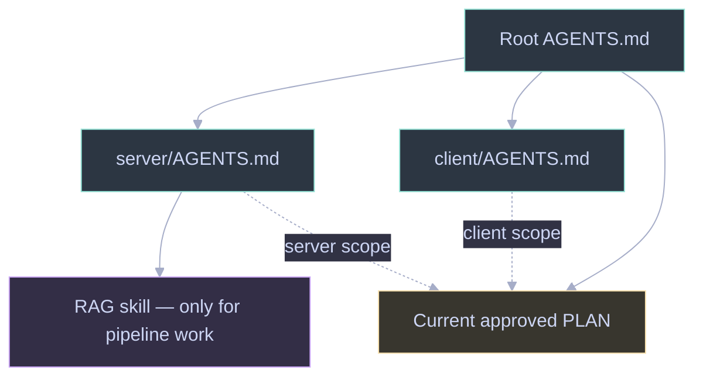
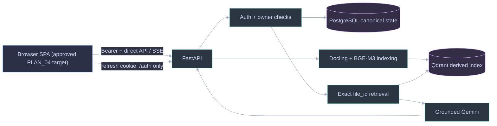
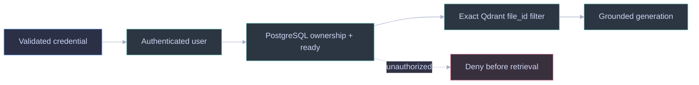

```mermaid
%%{init: {'theme': 'base', 'themeVariables': {'background': '#1e1e2e', 'primaryColor': '#45475a', 'primaryTextColor': '#cdd6f4', 'primaryBorderColor': '#89b4fa', 'lineColor': '#a6adc8', 'secondaryColor': '#313244', 'tertiaryColor': '#181825', 'fontFamily': 'Inter, sans-serif'}}}%%
flowchart LR
    Instructions["Instructions + Git"] --> Plan["Approved PLAN"]
    Plan --> Inspect["Targeted source + tests"]
    Inspect --> Amend["Focused AMENDMENT"]
    Amend --> Verify["Execute relevant checks"]
    Verify --> Evidence["CONTEXT / MANUAL evidence"]
    Evidence --> Explain["Explain-back"]
    Verify -. "blocked / failed" .-> Incomplete["Unverified scope"]
    class Instructions,Plan,Inspect,Amend service;
    class Verify caution;
    class Evidence,Explain verified;
    class Incomplete denied;
    classDef client fill:#2b3046,stroke:#89b4fa,stroke-width:1px,color:#cdd6f4;
    classDef service fill:#2c3642,stroke:#94e2d5,stroke-width:1px,color:#cdd6f4;
    classDef storage fill:#332e46,stroke:#cba6f7,stroke-width:1px,color:#cdd6f4;
    classDef verified fill:#2e363c,stroke:#a6e3a1,stroke-width:1px,color:#cdd6f4;
    classDef planned fill:#30323f,stroke:#b4befe,stroke-width:1px,color:#cdd6f4;
    classDef caution fill:#38362e,stroke:#f9e2af,stroke-width:1px,color:#cdd6f4;
    classDef denied fill:#39303d,stroke:#f38ba8,stroke-width:1px,color:#cdd6f4;
```

# Atlas — Repository Engineering Standards

Repository-wide engineering contract for Atlas. This file applies to the entire repository.

- [client/AGENTS.md](client/AGENTS.md): React/Vite/TanStack Router client standards (PLAN_04 migration and folder workspace `IMPLEMENTED & VERIFIED`; file workflows pending).
- [server/AGENTS.md](server/AGENTS.md): backend-specific standards.
- [.agents/skills/rag/SKILL.md](.agents/skills/rag/SKILL.md): detailed RAG pipeline contracts.
- Scoped instructions may specialize, but MUST NOT weaken, repository-wide LOCKED decisions.
- Implementation claims MUST be grounded in recorded execution evidence.

---

## 0. DOCUMENT ROLE & INSTRUCTION HIERARCHY

### Authority

Use the smallest complete instruction set for the task:

```text
Repository-wide task
-> AGENTS.md

Client task
-> AGENTS.md
-> client/AGENTS.md

Server non-RAG task
-> AGENTS.md
-> server/AGENTS.md

Server RAG task
-> AGENTS.md
-> server/AGENTS.md
-> .agents/skills/rag/SKILL.md

Cross-boundary task
-> AGENTS.md
-> server/AGENTS.md
-> client/AGENTS.md
-> relevant skill / PLAN
```

When Codex is launched from the repository root, explicitly read the applicable scoped AGENTS file before changing files in that subtree.

### Instruction inheritance



- Read root instructions first; then only applicable subtree instructions.
- Read the RAG skill only for owned pipeline work.
- Cross-boundary tasks require both server and client instructions.

### Source-of-truth order

Use the strongest available evidence for claims and implementation decisions:

| Priority | Source                                         |
| -------- | ---------------------------------------------- |
| 1        | Current repository files and source            |
| 2        | Executed tests and runtime observations        |
| 3        | Current authoritative technical documentation  |
| 4        | Approved PHASE, PLAN, and AMENDMENT artifacts  |
| 5        | `CONTEXT.md` and `MANUAL.md` recorded evidence |
| 6        | Explicit current user decisions                |
| 7        | Historical conversation and older artifacts    |
| 8        | Inference, labeled as unverified               |

- If evidence conflicts, inspect the relevant scope and report the discrepancy.
- Never silently substitute inference for a verified repository fact.

### Reading discipline

- For implementation work, read the current PLAN and targeted source/tests before changing code.
- Read applicable skills only when the task touches their owned surface.
- Cross-boundary work requires each applicable scoped AGENTS file.
- Do not read the entire repository by default.
- For current implementation evidence, read the PLAN CONTEXT current-state section and latest relevant Amendment entry first.
- Read older CONTEXT history only when needed to explain, preserve, or avoid reversing prior work.
- MANUAL is the current human reproducibility/acceptance guide.
- Documentation-only tasks follow the reading boundary stated by that task.

---

## 1. PURPOSE & ENGINEERING OBJECTIVES

Atlas is a Google Drive-like file system with scoped semantic RAG.

Product direction:

```text
Ask File -> Ask Folder -> Ask Drive
```

### Engineering priorities

Optimize in this order:

1. correctness;
2. interview defensibility;
3. architectural consistency;
4. user control over material architecture decisions;
5. scope discipline;
6. testability;
7. maintainability;
8. prompt clarity;
9. efficiency;
10. concision.

### Engineering principles

- Preserve the verified single-file RAG baseline as the foundation for later drive capabilities.
- Build only the current approved PHASE/PLAN scope.
- Keep authentication, authorization, ownership, retrieval scope, and provenance enforcement server-side.
- Never rely on the LLM to enforce authorization or ignore unauthorized context.
- Preserve user control over material architecture decisions.
- Follow an evidence-driven improvement cycle: **baseline → measure → targeted change → reevaluate**.

- Never represent planned work as implemented.
- Never represent implemented but unverified work as verified.

---

## 2. CURRENT STATE & DEVELOPMENT DESTINATION

This is the current-state snapshot. Chronological evidence belongs in PLAN `CONTEXT.md`.

### Status vocabulary

Use these labels exactly; do not infer verification from code existence or documentation.

| Status                    | Meaning                                                                 | Applies when                                        |
| ------------------------- | ----------------------------------------------------------------------- | --------------------------------------------------- |
| `NOT YET BUILT`           | Required implementation is absent.                                      | Work remains planned or unstarted.                  |
| `IMPLEMENTED, UNVERIFIED` | Some or all implementation exists; required acceptance is not complete. | Checks are missing, blocked, or failed.             |
| `IMPLEMENTED & VERIFIED`  | Required implementation passed the relevant acceptance checks.          | Executed, recorded verification supports the claim. |

- Assess PHASE, PLAN, and individual capability maturity independently.
- A completed PLAN does not make its enclosing PHASE complete.
- A written specification or passing isolated unit test is not automatically full acceptance.
- If required verification cannot run, identify the unverified scope.

### Phase roadmap

| PHASE                                   | Objective                                                      | Current maturity          |
| --------------------------------------- | -------------------------------------------------------------- | ------------------------- |
| PHASE_01 — MVP Core RAG                 | Single-file RAG baseline                                       | `IMPLEMENTED & VERIFIED`  |
| PHASE_02 — Authenticated Personal Drive | Identity, canonical drive, scoped ownership, browser workflows | `IMPLEMENTED, UNVERIFIED` |

### Development destination

- **Active PHASE:** `PHASE_02 — Authenticated Personal Drive`.
- **Completed PLAN:** `PHASE_02_PLAN_01 — PostgreSQL Identity & Authentication Foundation`.
- **Completed PLAN:** `PHASE_02_PLAN_02 — Authenticated Drive Backend`.
- **Completed PLAN:** `PHASE_02_PLAN_03 — Client Authentication` (`IMPLEMENTED & VERIFIED`); Amendments 01 and 02 are verified; Amendment 03 registration/verification/resend UI is `IMPLEMENTED & VERIFIED`; Amendment 04 login/logout UI is `IMPLEMENTED & VERIFIED`; Amendment 05 protected navigation/minimal dashboard and PLAN_03 are `IMPLEMENTED & VERIFIED` after approved Stage 02 acceptance.
- **Current PLAN:** `PHASE_02_PLAN_04 — Drive Dashboard & Phase Acceptance` (`IMPLEMENTED, UNVERIFIED`; Amendment 01 migration, Amendment 02 backend consolidation and Amendment 03 folder workspace `IMPLEMENTED & VERIFIED` after their approved Stage 02 acceptance).
- **Last inspected repository branch:** `phase-02/plan-04`; inspect it again before each task.
- **Planned PLAN_04 branch convention:** `phase-02/plan-04`; inspect current Git state; do not switch branches automatically.
- **Branch source of truth:** inspect the current local Git state before work; never switch branches automatically.
- PLAN_03 remains the verified historical Next.js authentication baseline. After PLAN_04 Amendment 01 passed approved Stage 02, the user separately approved removal of `client-legacy/`; that directory is retired. The canonical Vite/React/TanStack Router client and minimal protected `/drive` are verified; `/dashboard` is retired. Amendment 03 root/nested folder browsing and folder dialogs are `IMPLEMENTED & VERIFIED` after approved production-SPA/two-owner acceptance and exact fixture/resource preservation; file workflows remain `NOT YET BUILT`. Amendment 02 folder/file API consolidation remains `IMPLEMENTED & VERIFIED`. See [PLAN_04 CONTEXT](prompts/PHASE_02/PLAN_04/PHASE_02_PLAN_04_CONTEXT.md).

### Current capability maturity

| Capability                                             | Status                   |
| ------------------------------------------------------ | ------------------------ |
| PostgreSQL identity persistence                        | `IMPLEMENTED & VERIFIED` |
| Authentication credential primitives                   | `IMPLEMENTED & VERIFIED` |
| Registration, verification, and resend                 | `IMPLEMENTED & VERIFIED` |
| Initial session/access issuance and login              | `IMPLEMENTED & VERIFIED` |
| Refresh rotation and current-session logout            | `IMPLEMENTED & VERIFIED` |
| Credentialed cookie CORS                               | `IMPLEMENTED & VERIFIED` |
| Bearer current-user resolution and `GET /auth`         | `IMPLEMENTED & VERIFIED` |
| Canonical folder/file persistence                      | `IMPLEMENTED & VERIFIED` |
| Recursive folders and historical direct-child APIs     | `IMPLEMENTED & VERIFIED` |
| Authenticated canonical file upload                    | `IMPLEMENTED & VERIFIED` |
| File metadata mutation and permanent deletion          | `IMPLEMENTED & VERIFIED` |
| Owner-authorized internal retrieval and public Ask     | `IMPLEMENTED & VERIFIED` |
| Phase 2 browser registration, verification, and resend | `IMPLEMENTED & VERIFIED` |
| Phase 2 browser login/logout UI                        | `IMPLEMENTED & VERIFIED` |
| Shared browser auth/session foundation                 | `IMPLEMENTED & VERIFIED` |
| Protected `/dashboard` entry (legacy Next.js)          | `IMPLEMENTED & VERIFIED` |
| Vite + TanStack Router migration and `/drive` entry    | `IMPLEMENTED & VERIFIED` |
| Consolidated folder GET APIs                           | `IMPLEMENTED & VERIFIED` |
| Owner-scoped `GET /files/{file_id}`                    | `IMPLEMENTED & VERIFIED` |
| Drive root/folder browsing and folder dialogs          | `IMPLEMENTED & VERIFIED` |
| Browser file lifecycle/detail/Ask workflows            | `NOT YET BUILT`          |

### Verified Phase 2 backend evidence

- PLAN_01 Amendments 01–07 completed registration, verification/resend, login, session rotation, logout, current-user resolution and `GET /auth`.
- PLAN_01 verification includes packaged regression, real PostgreSQL, live API/cookie/CORS, concurrency/rollback, security and data-preservation checks.
- PLAN_02 Amendment 01: canonical folders/files, `0002_drive`, real PostgreSQL acceptance.
- PLAN_02 Amendment 02: authenticated folders, root/direct-child browsing, two-user ownership tests.
- PLAN_02 Amendment 03: `POST /files`, transient ingestion, PostgreSQL/Qdrant lifecycle and compensation; supersedes legacy upload.
- PLAN_02 Amendment 04: file metadata mutation, recoverable cross-store permanent deletion.
- PLAN_02 Amendment 05: PostgreSQL owner/ready authorization before exact-file RAG; deterministic streamed ask checks.
- PLAN_02 Amendment 06: complete two-owner integrated PostgreSQL/Qdrant/live-HTTP, packaged regression, security, and resource-preservation acceptance; 159 evidence rows passed.
- The counts and outcomes above are recorded evidence, **not** a claim of fresh test execution.

Evidence:

- [PHASE_02 PLAN_01 CONTEXT](prompts/PHASE_02/PLAN_01/PHASE_02_PLAN_01_CONTEXT.md)
- [PHASE_02 PLAN_01 MANUAL](prompts/PHASE_02/PLAN_01/PHASE_02_PLAN_01_MANUAL.md)
- [PHASE_02 PLAN_02 CONTEXT](prompts/PHASE_02/PLAN_02/PHASE_02_PLAN_02_CONTEXT.md)
- [PHASE_02 PLAN_02 MANUAL](prompts/PHASE_02/PLAN_02/PHASE_02_PLAN_02_MANUAL.md)

---

## 3. COMPLETED HISTORY & VERIFIED BASELINES

This section admits **completed PHASES only**. Every capability listed here belongs to a verified historical baseline; individual status labels are redundant.

- Do not record ongoing Phase 2 as a completed PHASE.
- Use Section 2 for current and incomplete maturity.
- Use PLAN `CONTEXT.md` for dated Amendment chronology, failures, timings and test counts.
- Later PHASES may explicitly supersede an endpoint without undoing its historical verification.

### PHASE_01 — MVP Core RAG

**Objective:** End-to-end single-file ingestion, retrieval, grounded generation, native SSE, trusted citations and static browser delivery.

#### Verified baseline


#### Verified maturity

| Capability              | Delivered behavior                                             |
| ----------------------- | -------------------------------------------------------------- |
| Upload endpoint         | Phase 1 upload/returned-ID handoff; endpoint later superseded. |
| Extraction and chunking | Docling structure/OCR and source provenance.                   |
| Embeddings              | BGE-M3 tokenizer/embedding integration.                        |
| Vector storage          | Qdrant dense index and metadata payloads.                      |
| Retrieval               | Exact file-scoped query filtering.                             |
| Grounded generation     | Gemini with Atlas-controlled context.                          |
| Native SSE              | Incremental streamed answer transport.                         |
| Trusted citations       | Provenance-based citation output and display.                  |
| Static client           | Verified Next.js/Bun browser foundation.                       |
| Ask workflow            | Selected file ID to streamed answer.                           |

#### Completion boundary

Phase 1 intentionally remained:

- single-file;
- unauthenticated;
- single-user;
- without folders;
- without canonical PostgreSQL drive state;
- without multi-file, folder, or drive retrieval.

Phase 2 extends or explicitly supersedes these contracts; Phase 1 evidence remains historical.

#### Evidence

- [PLAN_01 CONTEXT](prompts/PHASE_01/PLAN_01/PHASE_01_PLAN_01_CONTEXT.md)
- [PLAN_01 MANUAL](prompts/PHASE_01/PLAN_01/PHASE_01_PLAN_01_MANUAL.md)
- [PLAN_02 CONTEXT](prompts/PHASE_01/PLAN_02/PHASE_01_PLAN_02_CONTEXT.md)
- [PLAN_02 MANUAL](prompts/PHASE_01/PLAN_02/PHASE_01_PLAN_02_MANUAL.md)
- [PLAN_03 CONTEXT](prompts/PHASE_01/PLAN_03/PHASE_01_PLAN_03_CONTEXT.md)
- [PLAN_03 MANUAL](prompts/PHASE_01/PLAN_03/PHASE_01_PLAN_03_MANUAL.md)
- [PLAN_04 CONTEXT](prompts/PHASE_01/PLAN_04/PHASE_01_PLAN_04_CONTEXT.md)
- [PLAN_04 MANUAL](prompts/PHASE_01/PLAN_04/PHASE_01_PLAN_04_MANUAL.md)
- [PLAN_05 CONTEXT](prompts/PHASE_01/PLAN_05/PHASE_01_PLAN_05_CONTEXT.md)
- [PLAN_05 MANUAL](prompts/PHASE_01/PLAN_05/PHASE_01_PLAN_05_MANUAL.md)

---

## 4. ARCHITECTURE & DATA FLOW

### Stack

| Layer                            | Selection                                                                           |
| -------------------------------- | ----------------------------------------------------------------------------------- |
| Backend                          | Python + FastAPI                                                                    |
| Frontend                         | React + Vite + TanStack Router + strict TypeScript (approved PLAN_04 target)        |
| Client runtime / package manager | Bun only                                                                            |
| Client deployment                | Static Vite SPA bundle with deep-link history fallback (PLAN_04 target)             |
| Client styling                   | Tailwind CSS + shadcn/ui                                                            |
| Ordinary client HTTP             | Axios                                                                               |
| Client server state              | TanStack Query v5 (Zustand reserved for authentication)                             |
| Streamed `/ask` transport        | Native browser `fetch()` + `ReadableStream`                                         |
| Client forms / validation        | React Hook Form + Zod                                                               |
| Canonical application database   | PostgreSQL                                                                          |
| Vector retrieval                 | Self-hosted Qdrant                                                                  |
| Parsing / chunking               | Docling                                                                             |
| Embeddings                       | BAAI/bge-m3 through FlagEmbedding                                                   |
| LLM integration                  | Native provider SDKs; Gemini Flash through `google-genai` for the verified baseline |
| Deployment                       | Docker / Docker Compose                                                             |
| Redis                            | Deferred until a concrete transient/cache need is approved                          |

The Next.js App Router/static-export client was `IMPLEMENTED & VERIFIED` through PLAN_03; its evidence remains historical after the separately approved retirement of `client-legacy/`. The canonical `client/` implements the Vite SPA; Amendment 01 migration equivalence is `IMPLEMENTED & VERIFIED` after approved Stage 02.

Do not introduce LangChain by default.

Detailed client mechanics belong in `client/AGENTS.md`.
Detailed backend mechanics belong in `server/AGENTS.md`.
Detailed RAG mechanics belong in `.agents/skills/rag/SKILL.md`.

### System boundaries



- PostgreSQL authorizes ownership and readiness before Qdrant retrieval.
- Browser-visible session state is not an authorization authority.
- Original uploaded bytes remain transient in Phase 2.

### Canonical state and datastore ownership

```text
PostgreSQL
-> canonical application state

Qdrant
-> derived retrieval index

Original uploaded bytes in Phase 2
-> transient ingestion input only
```

Rules:

- PostgreSQL is canonical for Phase 2 users, verifications, sessions, folders, files, ownership, and file metadata.
- Qdrant is not canonical application state.
- Redis is not part of Phase 2 and must not be introduced without a concrete approved need.
- Persistent filesystem/S3/object-storage ownership of original file bytes is excluded from Phase 2.
- One immutable file UUID is the canonical identifier across PostgreSQL, the public API/client, and Qdrant payload `file_id`.

### Cross-boundary architecture

- Browser client communicates directly with FastAPI.
- Do not add a Next.js BFF, TanStack Start/server functions, Vite proxy-as-backend, or another browser API middle tier without approval.
- PLAN_04 targets a statically hosted Vite SPA, not a persistent frontend application server or client Docker service; runtime hosting changes require approval.
- Static hosting must support history fallback for client routes without rewriting API or asset failures into HTML.
- FastAPI uses an explicit configured CORS allow-list; wildcard CORS is not the default.
- CORS is browser-origin policy, not authentication or authorization.
- Derive the authenticated user from validated server-side credentials.
- Establish folder/file ownership in PostgreSQL before retrieval.
- After authorization, apply exact `file_id` scope inside Qdrant before generation.
- Never retrieve broadly from Qdrant and post-filter ownership afterward.
- Never let the LLM decide authorization or retrieval scope.
- Citations come from trusted Atlas retrieval/provenance metadata, not model-authored metadata.
- Phase 2 refresh credentials are server-controlled single-use sessions; mechanics belong in `server/AGENTS.md` and the completed PLAN_01 contract.
- Material architecture decisions remain human-controlled.

### RAG authority

Detailed extraction, chunking, embedding, vector schema, retrieval, grounding, generation, streaming, and citation contracts live in:

```text
.agents/skills/rag/SKILL.md
```

High-level verified RAG selections remain:

- Docling `DocumentConverter` + `HybridChunker`;
- standard Docling pipeline + RapidOCR;
- `BAAI/bge-m3` tokenizer/embedding space;
- dense-only 1024-dimensional BGE-M3 vectors;
- Qdrant cosine retrieval;
- exact server-side file scope;
- Gemini Flash through the official `google-genai` SDK behind Atlas abstractions;
- no managed RAG/File Search service;
- hybrid/reranking only after measured failures justify it.

If this high-level summary conflicts with the RAG skill, stop and report the discrepancy.

---

## 5. REPOSITORY STRUCTURE & OWNERSHIP

### Repository structure

```text
atlas/
├── AGENTS.md
├── .gitignore
├── .agents/
│   └── skills/
│       └── rag/
│           └── SKILL.md
│
├── server/
│   ├── AGENTS.md
│   ├── .env
│   ├── .env.example
│   ├── docker-compose.yml
│   ├── Dockerfile
│   ├── app/
│   ├── migrations/
│   └── tests/
│
├── client/                       # canonical Vite SPA; migration IMPLEMENTED & VERIFIED
│   ├── AGENTS.md
│   ├── src/
│   ├── tests/
│   ├── package.json
│   └── bun.lock
│
└── prompts/
    ├── PHASE_01/
    └── PHASE_02/
```

Amendment 01 Stage 01 preserved the original source and local artifacts in `client-legacy/` through review and Stage 02 acceptance. The directory was subsequently removed with separate user approval. Read the checked-out repository before making structural claims. Only `client/` is the active application; migration integration is verified. Full drive workflows remain pending.

### Ownership boundaries

| Path                  | Responsibility                                                                                |
| --------------------- | --------------------------------------------------------------------------------------------- |
| `server/`             | Backend, public API, canonical application-state implementation, authentication/authorization |
| `client/`             | Canonical browser SPA presentation and interaction layer after PLAN_04 cutover                |
| `.agents/skills/rag/` | Detailed RAG engineering authority                                                            |
| `prompts/`            | PHASE / PLAN / AMENDMENT / CONTEXT / MANUAL artifacts                                         |

Additional rules:

- Backend Compose remains under `server/`.
- The approved Vite SPA is a static hosting artifact, not a Compose-managed application service.
- During PLAN_04 Amendment 01, inspect Git/worktree and the legacy client before renaming `client/` to `client-legacy/`; preserve uncommitted and ignored user files, never silently overwrite or delete them.
- Scaffold the replacement `client/` cleanly, migrate only required application code and tests, and verify auth parity before building drive features. Legacy retirement requires separate approval; that approval was granted after Amendment 01 acceptance and the directory is now removed.
- Do not create ad hoc cross-repository folders when an existing ownership boundary fits.

### Vocabulary

Use:

- `file`
- `file_id`

Do not introduce new `document_id` vocabulary.

- Phase 1 `POST /documents/upload` is **historical** and was removed in PLAN_02 Amendment 03.
- Canonical Phase 2 upload is authenticated `POST /files`.
- Do not restore the removed upload endpoint or introduce an alias.
- Public file IDs and Qdrant payload `file_id` use the same immutable canonical UUID.

---

## 6. ENGINEERING & DOCUMENTATION CONVENTIONS

Atlas uses exactly:

- `PHASE` — major objective;
- `PLAN` — substantial milestone/end-state specification;
- `AMENDMENT` — one focused chronological implementation or documentation task;
- `CONTEXT` — chronological implementation/verification evidence;
- `MANUAL` — reproducibility/human acceptance guide.

### Artifact hierarchy

```text
PHASE
-> PLAN
-> AMENDMENT
-> CONTEXT
-> MANUAL
```

### Responsibilities and ownership

| Artifact  | Purpose                                                            | Ownership |
| --------- | ------------------------------------------------------------------ | --------- |
| PHASE     | Major objective and current PLAN roadmap                           | Planning  |
| PLAN      | Stable end-state architecture, contracts, scope, and acceptance    | Planning  |
| AMENDMENT | One focused chronological implementation/documentation task        | Planning  |
| CONTEXT   | What actually happened; decisions, failures, verification evidence | Codex CLI |
| MANUAL    | Proven reproducibility and human acceptance procedures             | Codex CLI |

### PLAN rules

A `PHASE_<NN>_PLAN_<NN>.md` is the stable end-state specification.

It should describe:

- status/dependencies;
- objective;
- scope/exclusions;
- architecture and useful Mermaid diagrams;
- locked contracts;
- API/data contracts;
- failure/observability behavior;
- folder placement where relevant;
- requirements;
- acceptance criteria;
- risks;
- verification boundaries.

A PLAN must **not** preassign future Amendment numbering.

Capability decomposition is allowed. Chronological numbering belongs to actual Amendments and CONTEXT.

### Placement

PLAN artifacts live under:

```text
prompts/PHASE_<NN>/PLAN_<NN>/
```

A PLAN's approved artifact set uses these names, created only at the proper lifecycle stage:

- `PHASE_<NN>_PLAN_<NN>.md`: destination specification; planning-owned.
- `PHASE_<NN>_PLAN_<NN>_CONTEXT.md`: created by Codex when implementation begins.
- `PHASE_<NN>_PLAN_<NN>_MANUAL.md`: created by Codex for verified reproduction/acceptance.

Focused Amendment prompts live under that PLAN's `AMENDMENTS/` folder.

### CONTEXT and MANUAL rules

- CONTEXT is the running implementation/verification record and Amendment changelog.
- MANUAL is the human acceptance/reproducibility guide.
- CONTEXT and MANUAL are created and maintained by Codex CLI.
- Planning work must not fabricate implementation evidence in CONTEXT/MANUAL.
- AGENTS and PHASE overview files contain current state, not detailed dated evidence.
- Dated logs, exact test counts/timings, hashes, image/container IDs, point counts, failures, and corrective history belong in CONTEXT.
- Specs remain specifications.
- MANUAL retains numbered steps, commands, and `Expected:` lines.
- Change a MANUAL command only when implementation/evidence proves the current command wrong or superseded, and record the correction in CONTEXT.
- Preserve dead ends, reversed decisions, and historical failures rather than rewriting chronology.
- Emergent decisions must not be retroactively presented as if predicted.

### Documentation style (agent-facing)

- Prefer definitive one-line bullets, compact tables, and useful Mermaid diagrams.
- Express one invariant per bullet; avoid long paragraphs.
- Prefer two- or three-column tables with short cells.
- Use `MUST`, `MUST NOT`, and `REQUIRES APPROVAL` for binding rules.
- Preserve exact file/endpoint/config identifiers and decision terminology.
- Preserve meaningful rationale, including the “because.”
- Keep rationale concise rather than burying it in large tables.
- Include Mermaid diagrams where they clarify authority, flow, state, lifecycle, or trust boundaries; no arbitrary diagram-count ceiling.
- Every Mermaid diagram MUST use the Catppuccin Mocha palette and consistent semantic node classes:
  - `#1e1e2e` base, `#cdd6f4` text, `#45475a` default surfaces;
  - `#89b4fa` browser/entry, `#94e2d5` services/processing, `#cba6f7` persistence;
  - `#a6e3a1` completed, `#b4befe` planned, `#f9e2af` caution, `#f38ba8` failure/denial.
- Set Mermaid `theme: base` with explicit background, text, border, and line colors.
- Use semantic Mermaid classes; label planned features explicitly.
- Avoid adding a diagram that only repeats nearby text.
- Give each Mermaid diagram short context/legend text.
- Folder trees remain plain text.
- Preserve stable referenced headings when practical.
- Keep agent-facing files current and navigable.
- Root AGENTS owns global rules.
- Scoped AGENTS own subtree-specific rules.
- Detailed RAG contracts remain in the RAG skill.
- Do not duplicate a rule across documents unless a short summary is necessary to establish authority or a cross-boundary invariant.

---

### General code principles

- Prefer single-word variable/function/parameter names where clear.
- Use multiple words when necessary to avoid ambiguity.
- Follow the applicable scoped language/framework conventions.
- Do not scatter inline comments that explain individual code lines.
- Use function/method documentation when it materially clarifies behavior, parameters, returns, lifecycle, or non-obvious contracts.
- New files mirror the latest established file in the same ownership area unless a documented convention deliberately supersedes it.
- Reuse established abstractions instead of creating parallel ownership paths.
- Keep failures explicit.
- Avoid speculative generalization and “future-proofing” without current requirements.

### Scoped conventions

- Backend/Python/API details: `server/AGENTS.md`
- Frontend/TypeScript/client details: `client/AGENTS.md` (new SPA instructions take effect for the replacement project; legacy code retains its historical conventions)
- RAG pipeline details: `.agents/skills/rag/SKILL.md`

---

## 7. TECHNICAL CONTRACTS & RUNTIME BEHAVIOR

The following are existing **LOCKED Phase 2 contracts**. Do not treat them as proposed PLAN_03 decisions.

- The detailed API/auth implementation is owned by `server/AGENTS.md` and completed PLAN_01/02 specifications.
- Browser integration conventions are owned by `client/AGENTS.md`.
- Extraction, retrieval, grounding, SSE, and citation internals are owned by the RAG skill.

### Current phase locks — PHASE_02

Do not re-ask these resolved scope decisions unless a new requirement conflicts with them.

#### Authentication and identity

- PostgreSQL canonical identity tables are `users`, `verifications`, and `sessions`.
- `users.password` stores an Argon2id hash, never plaintext.
- Verification purpose supports `auth`, `reset`, and `forgot`.
- Phase 2 implements the `auth` verification product flow only.
- Development OTP is intentionally database-visible while real email delivery is absent.
- Successful verification deletes its verification row.
- Encountered expired verification/session rows are deleted during the request.
- No cron/background TTL cleanup service is required.
- Refresh credentials are opaque, high-entropy, single-use server sessions; only their hash is persisted.
- A successful refresh atomically consumes the current session before replacement becomes authoritative.
- Registration intentionally exposes account existence but must not disclose verified/unverified status.
- OAuth/social login, password reset, forgot-password flow, and real email delivery are excluded from Phase 2.

#### Folders and files

- Phase 2 `folders` and `files` are canonical PostgreSQL records owned by one canonical `users` row.
- Phase 2 introduces recursive folders through a nullable self-referencing parent relationship.
- Folder metadata includes user-facing name and description.
- Folder rename is approved.
- Folder deletion and folder movement are excluded.
- File movement is excluded.
- Duplicate sibling folder names are allowed.
- Duplicate sibling file names are allowed.
- Files and folders may share the same display name; names are metadata, not identity.
- Canonical file metadata includes user-facing name and description plus source metadata required by the current PLAN.
- File metadata update does not imply content replacement or re-embedding.
- PLAN_04 Amendment 02 implements `GET /files/{file_id}` (`IMPLEMENTED & VERIFIED`): authenticated owner-scoped read of the existing File DTO; absent/foreign files share a privacy-safe 404. Metadata reads do not require `ready`; RAG still requires owner plus `ready`. No schema or RAG change is authorized.
- Canonical file lifecycle uses `processing`, `ready`, and `deleting`; only `ready` files may enter retrieval/generation.
- A known ingestion failure cleans any derived Qdrant state for that exact `file_id` and removes the temporary canonical file row rather than retaining a durable failed-file state.
- Persistent original-file storage is excluded; uploads are transient input to the existing indexing pipeline.
- Permanent file deletion removes all derived Qdrant points for the exact `file_id` and then removes canonical PostgreSQL metadata; `deleting` is a non-queryable retryable cross-store state.
- Content/file deduplication is not part of Phase 2 unless explicitly added later.
- Owner authorization in PostgreSQL must happen before file-scoped retrieval/generation.

#### Retrieval and infrastructure

- **PLAN_04 Amendment 02 supersession (`IMPLEMENTED & VERIFIED`):** public folder reads are `GET /folders` and `GET /folders/{folder_id}`, both returning `FolderListingResponse` and rejecting all query parameters; browser `/drive` routes remain unchanged.
- Public `GET /drive` and `POST /files/{file_id}/query` are removed without aliases; internal scored retrieval and owner/ready-gated native `POST /files/{file_id}/ask` remain.
- Current application API inventory is 18 operations: system 2, auth 7, folders 4, files 5; documentation facilities are excluded. Historical PLAN_02 route acceptance remains historical.

- Multi-file, folder/subtree, or drive-wide RAG remains excluded from Phase 2.
- Hybrid/sparse retrieval and reranking remain deferred until measured evidence justifies them.
- Redis remains deferred until a concrete transient/cache need exists.
- Background workers/queues are not part of Phase 2.
- PostgreSQL and Qdrant diagnostics are current verified backend contracts; future changes must be explicitly specified and reverified.

---

## 8. SECURITY & TRUST BOUNDARIES

### Secrets and environment

- Codex may read `.env` for development and use its values as needed.
- Never commit `.env`.
- `.env` must remain ignored.
- Missing/incorrect ignore or secret handling is blocking.
- Commit `.env.example` with placeholders/safe examples only.
- Never copy real API keys, DB credentials, passwords, OTPs, tokens, or signing secrets into tracked files, tests, prompts, CONTEXT, or MANUAL.
- Do not expose secrets through Docker build args/history or diagnostic commands that print complete environment configuration.
- Never place secrets in browser-public configuration.
- Apply scoped environment rules from `server/AGENTS.md` or `client/AGENTS.md` when modifying those subtrees.

### Trust boundaries

Treat as untrusted at the appropriate boundary:

- uploaded files;
- HTTP/network input;
- provider responses;
- model output.

Rules:

- validate external data before treating it as trusted application state;
- preserve structured error behavior;
- do not silently convert dependency failure into success/fallback unless an approved contract explicitly defines it;
- do not leak out-of-scope retrieval context;
- citation provenance comes from trusted Atlas metadata.

### Authentication and authorization sequence

```text
validated credential
-> authenticated user
-> PostgreSQL ownership / ready-state authorization
-> exact Qdrant file_id scope
-> generation
```

Never reverse this sequence.

Authentication identifies the user; it does not replace resource authorization.

---

### Authorization flow



---

## 9. SCOPE & ARCHITECTURE GOVERNANCE

### Always allowed

Without additional approval:

- implement within already-decided architecture in root AGENTS + applicable scoped AGENTS + relevant skill/PLAN;
- reuse established abstractions and ownership boundaries;
- surface failures explicitly;
- preserve security and scope boundaries;
- keep implementation proportional to the current PLAN;
- update current-state documentation only as implementation facts actually land;
- perform proportional verification.

### Requires approval

Do not choose silently:

- a new third-party library/service/API outside the fixed stack;
- a new frontend state/form/network/component library;
- a new backend framework or material service boundary;
- a new queue/cache/storage architecture;
- a DB schema change not already specified by the current PLAN;
- a public API shape change not already specified by the current PLAN;
- chunk-size/overlap policy;
- embedding model;
- similarity metric;
- retrieval policy;
- hybrid retrieval/reranking;
- LLM provider;
- approved authentication/session architecture changes;
- provider/resource lifecycle redesign;
- material architecture not already resolved in AGENTS/skill/PLAN.

### Prohibited

- Pull scope beyond the currently approved PHASE/PLAN without explicit approval.
- Scaffold future stages merely because later work will need them.
- Perform unrelated cleanup/refactors.
- Introduce multi-file/folder/tree/drive RAG without approval.
- Introduce sharing/teams/ACLs beyond approved owner-only Phase 2 scope.
- Introduce persistent original-file storage during Phase 2.
- Introduce folder deletion/movement, file movement, trash/recovery, or versioning during Phase 2.
- Use Gemini File Search or another managed RAG-as-a-service.
- Silently weaken server-side authentication, ownership, retrieval scope, provenance, or trust boundaries.
- Treat client route state or client-supplied `user_id` / `owner_id` as authorization.
- Rewrite historical evidence to make chronology appear cleaner.

### Decision states

| State         | Meaning                                                 |
| ------------- | ------------------------------------------------------- |
| `LOCKED`      | Approved; MUST NOT change without human authorization.  |
| `PROVISIONAL` | Suggested; not an implementation mandate.               |
| `OPEN`        | Material choice awaits the user.                        |
| `SUPERSEDED`  | Earlier decision explicitly replaced; preserve history. |

- Codex MUST NOT silently choose material architecture decisions.
- An unresolved material `OPEN` decision blocks the affected implementation contract.
- Completed PLAN_01/02 contracts remain binding until explicitly superseded.

---

## 10. GIT & REPOSITORY SAFETY

### Session reconnaissance

At the start of every implementation session, perform read-only Git reconnaissance:

- current branch;
- relevant local/remote branches;
- recent commit history as needed.

Use this information to avoid conflicting with existing work.

### Default restrictions

Unless explicitly authorized in that session:

- no commits;
- no pushes;
- no branch edits/deletes;
- no branch switching/checkouts;
- no branch creation;
- no merges;
- no rebases;
- no history rewriting;
- no destructive Git operations;
- do not discard unrelated/uncommitted changes.

Work only on the branch already checked out.

If the branch does not match the prompt's expected PLAN, stop and report the mismatch instead of switching.

### Branch convention

```text
phase-<NN>/plan-<NN>
```

A genuinely new pipeline stage/capability milestone gets a new PLAN/branch.

Cleanup, refactors, conventions, fixes, and documentation alignment remain on the current PLAN branch unless an approved PLAN boundary says otherwise.

### Remote connector policy

- GitHub-connected plugins/connectors are **read-only reference tools** for this project workflow.
- Do not use a GitHub plugin/connector for repository mutation, commits, pushes, PR creation, or file edits.
- Authorized code changes occur through the user's local repository workflow.
- Inspect actual local Git state before making any implementation claim about the checked-out branch.

### Status effect

Behavior/pipeline/contract changes remain `IMPLEMENTED, UNVERIFIED` until the required verification runs.

Documentation-only or cosmetic work follows proportional verification and does not automatically demote implementation status.

---

## 11. VERIFICATION & ACCEPTANCE

Verification effort must match change risk.

| Change                                  | Required verification                             | Status effect                              |
| --------------------------------------- | ------------------------------------------------- | ------------------------------------------ |
| Documentation only                      | Documentation checks; no unnecessary tests/Docker | Unchanged                                  |
| Whitespace/docstrings/comments/imports  | Static/AST comparison or local suite              | Unchanged                                  |
| Caller-visible cosmetic behavior        | Local tests + focused touched-path check          | Change only if acceptance behavior changes |
| Behavior/API/database/pipeline contract | Full relevant verification                        | IMPLEMENTED, UNVERIFIED until reverified   |
| Deployment-sensitive input              | Docker/package/runtime verification               | Evidence required before verified claim    |

### Docker triggers

Docker verification is specifically required when changes affect:

- Dockerfile;
- Compose;
- runtime dependencies;
- environment/configuration forwarding;
- model caching;
- startup lifecycle;
- other deployment-sensitive image inputs.

Docker may also be run deliberately to establish a fresh verified baseline when the human explicitly requests it.

If Docker is authoritative for the affected behavior, prefer Docker as the final verification environment.

### Evidence rules

- Never claim a test/build/runtime check passed unless it actually ran.
- Verification must include material failure paths where relevant.
- Preserve persistent datastore state unless a task explicitly authorizes mutation/cleanup.
- Run `git diff --check` before completion of non-trivial implementation work.

If a required verification cannot run, record:

```text
command
reason it could not run
remaining unverified scope
```

Do not convert a blocked check into a success claim.

---

## 12. STANDARD ENGINEERING WORKFLOW

### Server-first cross-boundary sequencing

For a capability spanning server and client:

1. define/confirm the server contract in the applicable PLAN;
2. implement server-side data/domain/API behavior;
3. verify the server contract at the appropriate level;
4. implement the client against that established contract;
5. run cross-boundary acceptance after both sides exist.

Exceptions require an explicit PLAN/task reason.

Do not use speculative frontend mocks, DTOs, endpoints, storage semantics, or auth behavior to silently decide backend architecture.

### Workflow diagram



### Before implementation

```text
read applicable instructions
-> inspect Git state
-> read current PLAN
-> read current CONTEXT state when evidence matters
-> inspect targeted source/tests
-> confirm Amendment boundary
```

### During implementation

```text
smallest cohesive change
-> reuse established boundaries
-> preserve locked architecture
-> no speculative future work
-> explicit failures
```

### Verification

```text
focused checks
-> full relevant regression
-> runtime/database/API checks when applicable
-> Docker when triggered
```

### Completion

```text
Codex updates CONTEXT with actual evidence
-> Codex updates MANUAL with proven procedures
-> explain-back
-> evidence-based status update
```

Do not update status because code merely exists.

---

## 13. MCP USAGE GUIDELINES

These are **user-configured custom MCP integrations for Codex CLI**, not automatic dependencies. Confirm tool availability in the active session.

### Tool selection

| MCP               | Purpose                                                      | Use only when                                                                   |
| ----------------- | ------------------------------------------------------------ | ------------------------------------------------------------------------------- |
| `context7`        | Version-specific library/API documentation.                  | Repo and trusted docs do not resolve a material API question.                   |
| `playwright`      | Browser interaction and end-to-end acceptance.               | UI, navigation, forms, auth restoration, or browser journeys require execution. |
| `chrome-devtools` | Browser network, console, runtime and performance diagnosis. | A specific browser failure or verification requirement needs inspection.        |

### Invocation rules

- MCP usage is **optional**; prefer current source, existing tests, and authoritative project documentation.
- Use the smallest tool surface and fewest calls sufficient for the task.
- `context7` does not override the installed version, repository code, or a LOCKED decision.
- Prefer `playwright` for reproducible browser acceptance; use `chrome-devtools` for targeted diagnostics.
- Do not launch both browser MCPs for the same check without a concrete reason.
- Server-only work normally requires neither browser MCP.
- Do not install tools, start external services, modify account state, or widen test scope without approval.
- Never expose passwords, OTPs, JWTs, cookies, API keys, encryption keys, or uploaded content in tool output, screenshots, recordings, reports, CONTEXT, or MANUAL.
- Use test accounts/data only within the authorized environment and preserve unrelated user/datastore state.
- Record significant observed results in Codex-owned CONTEXT; distinguish observations from inferences.
- If an MCP is unavailable, state the limitation and use an approved alternative; never claim the MCP ran.

### Scope ownership

- Root: global invocation, safety, and evidence policy.
- Server AGENTS: backend-specific exceptions and tool relevance.
- Client AGENTS: browser checks, auth/cookie/CORS, navigation, SSE and production-SPA/deep-link acceptance.

---

## 14. COMMANDS & TOOLING

Root AGENTS does not duplicate scoped command inventories.

### Client

Read:

```text
client/AGENTS.md
```

Use its Bun-driven commands and current client verification workflow.

### Server

Read:

```text
server/AGENTS.md
```

Use its Python/PostgreSQL/Docker commands and current backend verification workflow.

### RAG

For extraction, chunking, embeddings, Qdrant retrieval/filtering, grounding, generation, citations, or RAG transport, additionally read:

```text
.agents/skills/rag/SKILL.md
```

Do not infer current exact commands or implementation mechanics from historical Amendments when current scoped instructions or MANUAL provide them.

---

## 15. EXPLAIN-BACK REQUIREMENT

Every non-trivial task ends with a concise explain-back covering:

- what changed;
- affected subsystem / pipeline stage;
- meaningful implementation choices;
- architecture boundaries reused;
- relevant failure/security/lifecycle boundaries;
- verification actually performed;
- deviations or blocked checks;
- remaining unverified scope;
- CONTEXT/MANUAL/current-state updates actually made.

The purpose is to keep Atlas implementation technically defensible, reproducible, and interview-ready.
