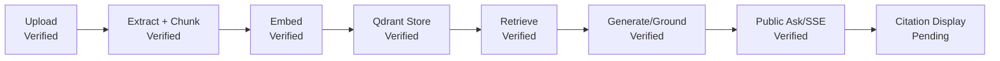
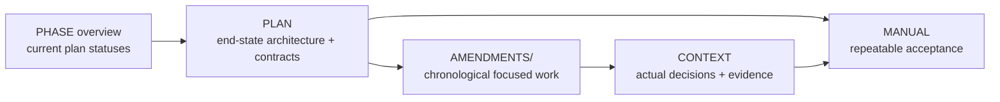
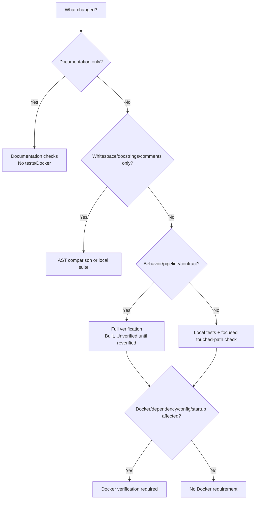

# AGENTS.md — Atlas (Intelligent Knowledge Drive)

- Auto-loaded from the repository root each session; read fully before writing code.
- This file is the repository-wide operating contract.
- Detailed RAG pipeline contracts live in `.agents/skills/rag/SKILL.md`; do not duplicate or silently override them here.

---

## 1. Project purpose and current objective

Atlas organizes files and folders with a semantic RAG layer:

```text
Ask File -> Ask Folder -> Ask Drive
```

Current engineering goal:

- build a hands-on, interview-defensible RAG/embeddings/vector-database system;
- prove the core single-file pipeline before pulling forward folders, file metadata, auth, or multi-scope retrieval;
- preserve user control over material architecture decisions;
- prefer a measurable baseline before adding retrieval/generation complexity.

### Current phase

**Phase 1 — MVP Core RAG pipeline**

```text
upload -> chunk -> embed -> store -> retrieve -> generate -> stream -> cite
```

Phase 1 is:

- single-file;
- unauthenticated;
- single-user;
- no folders or drive-wide retrieval;
- no canonical user-facing file metadata system.

Do not begin Phase 2+ work unless explicitly requested.

---

## 2. Current component maturity

| Component                | Status                 |
| ------------------------ | ---------------------- |
| Upload endpoint          | Implemented & Verified |
| Extraction & chunking    | Implemented & Verified |
| Embedding                | Implemented & Verified |
| Vector storage (Qdrant)  | Implemented & Verified |
| Retrieval                | Implemented & Verified |
| Generation/streaming     | Implemented & Verified |
| Client foundation/upload | Implemented & Verified |
| Client question/answers  | Implemented & Verified |
| Citation display         | Not Yet Built          |

Status meanings:

- `Not Yet Built`
- `Implemented, Unverified` — code exists, but the relevant complete acceptance state is not yet verified
- `Implemented & Verified`

Never treat `Implemented, Unverified` as `Implemented & Verified`.

Generation includes the verified Gemini provider, internal grounding/citation core, and public ask/native SSE boundary. PLAN_04 acceptance was performed by the agent under explicit user delegation; citation display remains unbuilt.

PLAN_05 foundation/upload implements the static Bun/Next client, direct upload/returned-ID handoff, and configured CORS. Amendment 02 aligns naming, hook-owned requests, aliases, Prettier, and the Query environment API. Foundation/upload acceptance passed. Amendment 03 adds shared RagWorkspace composition, question submission, validated native POST-SSE streaming, provisional answer rendering, and internal citation retention. Development/static-export acceptance passed for that slice; whole PLAN_05 remains Built, Unverified pending trusted citation rendering and final whole-client acceptance.

Current implementation evidence:

- [PLAN_01 CONTEXT](prompts/PHASE_01/PLAN_01/PHASE_01_PLAN_01_CONTEXT.md)
- [PLAN_02 CONTEXT](prompts/PHASE_01/PLAN_02/PHASE_01_PLAN_02_CONTEXT.md)
- [PLAN_03 CONTEXT](prompts/PHASE_01/PLAN_03/PHASE_01_PLAN_03_CONTEXT.md)
- [PLAN_04 CONTEXT](prompts/PHASE_01/PLAN_04/PHASE_01_PLAN_04_CONTEXT.md)
- [PLAN_05 CONTEXT](prompts/PHASE_01/PLAN_05/PHASE_01_PLAN_05_CONTEXT.md)

### Phase 1 maturity flow

Legend: backend stages through public streaming are verified; citation display remains pending.



---

## 3. Fixed stack and locked Phase 1 decisions

### Stack

- Backend: FastAPI.
- Frontend: latest stable Next.js available when PLAN_05 is implemented, App Router, TypeScript only.
- Client runtime/package manager/script runner: Bun only; do not introduce Node.js as a required client runtime.
- Client rendering/deployment model: static export (`output: "export"`); no Next.js runtime server and no client Docker service in Phase 1.
- Client styling: Tailwind CSS + shadcn/ui.
- Client standard HTTP: Axios.
- Client server-state orchestration: TanStack Query v5.
- Client streamed `/ask` transport: native browser `fetch()` + `ReadableStream`; do not force Axios or TanStack Query around the SSE stream.
- Client forms/runtime validation: React Hook Form + Zod.
- Vector database: self-hosted Qdrant in Docker.
- PostgreSQL: introduced from Phase 3 for canonical application state.
- Redis: introduced only when caching becomes relevant; not part of Phase 1.
- Backend/Qdrant deployment: Docker Compose under `server/`; PLAN_05 does not move Compose to the repository root.

### Extraction and chunking

- Use Docling: `DocumentConverter` + `HybridChunker`.
- Standard Docling pipeline + RapidOCR.
- No VLM tier.
- `pdfplumber`/`tiktoken` are superseded.
- Chunk tokenizer: `BAAI/bge-m3`.
- `DOCLING_MAX_CHUNK_TOKENS` controls chunk size; default `500`.
- `merge_peers=True`.
- Do not hardcode the configurable chunk size.

Supported formats:

- `.pdf`
- `.docx`
- `.pptx`
- `.xlsx`
- `.md`
- `.txt`
- `.html`
- `.csv`
- `.png`
- `.jpg`
- `.jpeg`
- `.tiff`
- `.bmp`
- `.webp`

Deferred formats:

- audio/video;
- EPUB;
- AsciiDoc;
- LaTeX;
- XML schemas.

Flag additions before implementing them.

### Embedding

- `EmbeddingProvider` boundary.
- `BAAI/bge-m3`.
- FlagEmbedding `BGEM3FlagModel`.
- Dense-only MVP.
- Hybrid dense+sparse remains deferred.
- Stored vectors currently contain dense output only.
- Size/latency is explicitly not a constraint for the project.
- Detailed embedding/vector contracts live in the RAG skill.

### Generation

- Gemini Flash through official `google-genai`.
- Must remain behind `LLMProvider`.
- Verify the current model identifier before use because Gemini model names/deprecations can change.
- Never hardcode an unverified model string.
- Detailed provider/grounding/citation contracts live in the RAG skill.

### Configuration

- `.env` loading: `python-dotenv` in `core/constants.py`.
- Validation: Pydantic models in `schemas/constants.py`.
- Configuration groups remain 1:1 across those layers.
- Do not use `pydantic-settings`.
- Loading and validation remain separate concerns.

### Frontend architecture — locked for PLAN_05

- Browser client communicates directly with FastAPI; do not insert a Next.js BFF/proxy in Phase 1.
- FastAPI must use an explicit configured CORS allow-list for the client origin; do not use permissive wildcard CORS as the default.
- Use the latest stable Next.js release available when scaffolding PLAN_05. Do not pin a stale version from planning documentation.
- Use TypeScript only with strict compiler settings; application code must not use JavaScript files or casual `any`.
- Use Bun for client scaffolding, dependency installation, package execution, development, build, and test commands.
- Use `bun.lock` as the canonical client lockfile. Do not add `package-lock.json`, `pnpm-lock.yaml`, `yarn.lock`, or `bun.lockb`.
- Prefer `bun create`, `bunx --bun`, `bun add`, `bun install`, and `bun run`; do not use `npm`, `npx`, `pnpm`, or `yarn` in normal client workflows.
- Run Next.js CLI commands under Bun rather than relying on Node.js as the runtime.
- The production client artifact is static output and therefore has no persistent JavaScript server runtime.
- `NEXT_PUBLIC_ATLAS_API_BASE_URL` is a build-time public value for the static client; never place secrets in `NEXT_PUBLIC_*` variables.
- Use Axios for ordinary request/response HTTP such as uploads and future CRUD/authenticated calls.
- Use TanStack Query for server-state mutations/queries and their lifecycle; do not use it as a substitute for local ephemeral UI state.
- Use native browser `fetch()` for `POST /files/{file_id}/ask` so the client can consume the response `ReadableStream` directly.
- Use an `AbortController` internally for streamed request ownership and cleanup, but do not add a user-facing Cancel feature in Phase 1.
- Use React Hook Form for forms and Zod for form/network boundary validation. Treat network/SSE JSON as `unknown` until validated.
- Do not add Redux, Zustand, or another global client-state library in Phase 1.

---

## 4. Repository architecture

```text
atlas/
├── AGENTS.md
├── .gitignore
├── .agents/
│   └── skills/
│       └── rag/
│           └── SKILL.md
│
├── server/
│   ├── .env                                          # Local secrets/runtime configuration; ignored
│   ├── .env.example                                  # Safe reproducible configuration template
│   ├── docker-compose.yml                            # Server + Qdrant Compose definition
│   ├── Dockerfile                                    # Backend runtime image
│   │
│   ├── app/
│   │   ├── main.py                                   # Wiring only
│   │   ├── routers/                                  # Public HTTP boundaries, including system routes
│   │   ├── errors/                                   # Structured API/Qdrant/generation error categories
│   │   ├── core/
│   │   │   ├── constants.py                          # dotenv loading + validated Constants construction
│   │   │   ├── lifespan.py                           # Startup/shutdown ownership
│   │   │   └── runtime.py                            # Access to startup-prepared resources
│   │   ├── schemas/
│   │   │   ├── constants.py                          # 1:1 configuration groups
│   │   │   ├── pipeline.py                           # Chunk DTO
│   │   │   ├── documents.py                          # Upload/public document-route DTOs
│   │   │   ├── retrieval.py                          # Retrieval DTOs
│   │   │   ├── generation.py                         # Generation/citation DTOs where required
│   │   │   └── system.py                             # Health response validation
│   │   ├── models/
│   │   │   ├── qdrant/
│   │   │   │   └── chunk.py                          # Stored payload
│   │   │   └── postgres/                             # Planned from Phase 3
│   │   ├── pipeline/
│   │   │   ├── chunking.py
│   │   │   ├── embeddings/
│   │   │   ├── storage.py
│   │   │   ├── retrieval.py                          # File-scoped dense retrieval
│   │   │   └── generation/                           # Provider, grounding, citations; consumed by public ask/SSE
│   │   └── db/                                       # Qdrant; Postgres from Phase 3
│   │
│   └── tests/
│
├── client/                                           # Static client upload/ask/answers; full target structure below
│
└── prompts/
    └── PHASE_01/
        ├── PHASE_01.md
        ├── PLAN_01/
        ├── PLAN_02/
        ├── PLAN_03/
        ├── PLAN_04/
        └── PLAN_05/
```

### Placement rules

- `server/` is backend; `client/` is frontend.
- HTTP handlers live in `routers/`, not `api/`.
- `main.py` wires the application only; no implementation logic.
- Startup/shutdown implementation belongs in `core/`, imported into `main.py`.
- `models/` contains storage-mapped entities only, split by backing datastore.
- One stored class per file; complex PostgreSQL entities may use a folder such as `models/postgres/user/`.
- `schemas/` contains validation, API shapes, and pipeline DTOs.
- Group schemas by cohesive concern; one class per file unless tightly coupled with no independent use.
- `core/constants.py` loads environment values and validates them through `schemas/constants.py`.
- Backend Compose remains beside `server/.env` for automatic loading; PLAN_05 does not move Compose to the repository root because the client is a static export, not a Compose service.

### PLAN_05 client target structure — partially implemented

This tree is the required destination for frontend code. Foundation/upload, Rag workflow, ask schemas/hooks, stream parser, and answer UI now exist; citation display and unused future folders remain unbuilt.

```text
client/
├── public/
├── src/
│   ├── app/                              # Next.js routes/layout/composition only
│   │   ├── globals.css
│   │   ├── layout.tsx
│   │   └── page.tsx
│   ├── components/
│   │   ├── ui/                           # shadcn/ui generated primitives only
│   │   ├── Common/                       # app-wide reusable Atlas components
│   │   ├── Rag/                          # shared upload/ask composition
│   │   ├── Upload/                       # upload-specific components
│   │   ├── Ask/                          # question/stream-specific components
│   │   └── Citations/                    # citation-specific components
│   ├── hooks/
│   │   ├── common/                       # truly cross-domain React hooks
│   │   ├── upload/                       # upload hooks/mutations
│   │   └── ask/                          # streamed ask lifecycle hooks
│   ├── services/
│   │   ├── http/                         # configured Axios and native fetch clients
│   │   ├── upload/                       # upload transport and response validation
│   │   └── ask/                          # request ownership and stream sessions
│   ├── schemas/
│   │   ├── upload/                       # upload form/response Zod schemas
│   │   └── ask/                          # ask form/SSE event Zod schemas
│   ├── types/
│   │   ├── common/                       # compile-time-only shared types when needed
│   │   ├── upload/                       # upload types not derived from schemas
│   │   └── ask/                          # ask types not derived from schemas
│   ├── providers/
│   │   └── query/                        # TanStack Query provider wiring
│   ├── config/                           # validated client configuration/env access
│   ├── constants/
│   │   └── common/                       # stable cross-cutting constants only
│   ├── utils/
│   │   ├── common/                       # pure cross-cutting helpers
│   │   └── stream/                       # pure stream/SSE parsing helpers if needed
│   └── lib/
│       └── utils.ts                      # shadcn-required utility boundary; no business logic
├── tests/
│   ├── unit/
│   │   ├── upload/
│   │   └── ask/
│   └── integration/
│       └── rag/
├── components.json                       # shadcn/ui configuration
├── next.config.ts                        # static export configuration
├── tsconfig.json                         # strict TypeScript configuration
├── package.json
└── bun.lock                              # only client package-manager lockfile
```

### Frontend placement and organization rules

- The folder contract is mandatory. Do not create ad hoc top-level frontend folders when an existing category fits.
- Organize technical layers by domain consistently, using PascalCase component groups and lowercase non-component domains, for example `hooks/upload/`, `components/Upload/`, and `schemas/upload/`.
- Add a domain subfolder only when that layer actually has code for the domain; do not create empty symmetry folders.
- Atlas component domain folders and reusable component files use PascalCase (`components/Upload/UploadPanel.tsx`); shared presentation belongs in `components/Common/` only when needed.
- `components/ui/` retains generated shadcn naming. Next/tool-required names (`page.tsx`, `layout.tsx`, `not-found.tsx`, `next-env.d.ts`, `next.config.ts`, `eslint.config.mts`) remain exceptions.
- Hook domain folders stay lowercase; hook filenames use `use<Name>.ts` and contain no JSX.
- Other user-controlled multiword filenames/directories use lowerCamelCase; single-word names may remain lowercase. Tests follow lowerCamelCase before `.test.ts` (or `.test.tsx` only for JSX). No hyphenated user-controlled filenames.
- Export component/type symbols with PascalCase and variables/functions with camelCase.
- Domain hooks own React orchestration. Extract substantial transport, response validation, and request sessions into services/<domain>/ when this gives them a clear single responsibility; avoid redundant pass-through layers.
- `services/http/axios.ts` exports the configured Axios instance; `services/http/fetch.ts` exports the minimal native fetch client with base/get/post. Both resolve the validated API URL centrally. Preserve native Axios options and raw fetch Responses/streams; no auth interceptors in Phase 1.
- Use dedicated aliases across source roots; short local relative imports are acceptable. Preserve `@/*` as fallback; add no speculative aliases.
- Use Prettier defaults through Bun `format` and `format:check`; exclude generated/build artifacts. Keep lint/typecheck/test/build as separate checks.

Current alias map:

- `@app/*` -> `./src/app/*`;
- `@components/*` -> `./src/components/*`;
- `@config/*` -> `./src/config/*`;
- `@hooks/*` -> `./src/hooks/*`;
- `@lib/*` -> `./src/lib/*`;
- `@providers/*` -> `./src/providers/*`;
- `@schemas/*` -> `./src/schemas/*`;
- `@services/*` -> `./src/services/*`;
- `@utils/*` -> `./src/utils/*`;
- `@/*` -> `./src/*` (fallback).

- `src/app/` owns Next.js routing, layouts, route composition, and route-level metadata only. Do not bury reusable components, hooks, services, schemas, or business logic inside route folders.
- `components/ui/` is reserved for shadcn/ui primitives. Do not place Atlas feature/business logic there.
- `components/Common/` is for genuinely app-wide reusable Atlas presentation components. Keep domain-owned components under `components/<domain>/`.
- `hooks/<domain>/` owns React lifecycle, local state, and direct TanStack Query calls. Hook-specific interfaces stay in the hook file unless shared ownership warrants extraction. Pure parsing/protocol helpers live in utilities.
- `services/http/` contains shared HTTP infrastructure; services/<domain>/ owns extracted endpoint transport, boundary validation, or request sessions. Do not wrap TanStack Query in a generic service/hook abstraction.
- `schemas/<domain>/` contains Zod validation schemas for forms and untrusted external data. Prefer inferred TypeScript types from Zod rather than maintaining duplicate manual interfaces.
- `types/<domain>/` is only for compile-time types that are not naturally derived from Zod schemas or external library types.
- `providers/<domain>/` contains application provider wiring such as TanStack Query. Do not place ordinary hooks or feature components there.
- `config/` is for configuration/env access and validation. It is not a generic constants folder.
- `constants/` contains stable literal constants only; prefer domain subfolders when constants are domain-owned.
- `utils/` contains pure helpers with no React state or network ownership. Use domain subfolders where appropriate; avoid dumping unrelated helpers into generic files.
- `lib/utils.ts` exists only because shadcn/ui expects the shared `cn`-style utility boundary; do not turn `lib/` into a miscellaneous business-logic directory.
- `tests/` mirrors behavior by test level and domain. Do not scatter `__tests__` directories throughout `src/`.
- Do not create barrel `index.ts` files by default. Prefer explicit imports to keep ownership visible and reduce circular-dependency risk.
- Do not create vague files/folders such as `helpers.ts`, `misc.ts`, `stuff/`, or catch-all `common.ts`. Promote code to `common/` only when it is genuinely cross-domain.
- Use the dedicated current source-root aliases above for cross-root imports; preserve `@/*` rooted at `client/src/` as fallback. Avoid deep relative chains.

---

## 5. Project vocabulary and resolved scope

### Vocabulary

Use:

- `file`
- `file_id`

Do not introduce new `document_id` vocabulary. `/documents/upload` remains a legacy route name from the earlier product framing.

### Resolved scope decisions — do not re-ask

- File metadata such as custom name, description, and tags is deferred until PostgreSQL.
- Folder-scoped filename uniqueness is deferred until folders/PostgreSQL exist.
- Redis is deferred until caching is actually needed.
- `/system/health/databases` currently checks Qdrant only and returns HTTP 200 with dependency status in the body.
- No deduplication in Phase 1; every upload is independent.

---

## 6. Documentation architecture

Atlas uses exactly:

- `PHASE` — major objective;
- `PLAN` — substantial milestone/end-state specification;
- `AMENDMENT` — one focused chronological implementation or documentation step;
- `CONTEXT` — chronological implementation/verification evidence;
- `MANUAL` — reproducibility/human acceptance guide.

### Relationship

Legend: PLAN describes the destination; Amendments implement it; CONTEXT records what actually happened; MANUAL records how to reproduce/accept it.



### PLAN rules

A `PHASE_<NN>_PLAN_<NN>.md` is the stable end-state specification. It should describe:

- status/dependencies;
- objective;
- scope/exclusions;
- architecture and useful Mermaid diagrams;
- locked contracts;
- API/data contracts;
- failure/observability behavior;
- folder placement;
- requirements;
- acceptance criteria;
- risks;
- verification boundaries.

A PLAN **must not preassign future Amendment numbering**. Capability decomposition is fine; chronological numbering belongs only to actual Amendments/CONTEXT.

### Prompt/document placement

Prompts live under:

```text
prompts/PHASE_<NN>/PLAN_<NN>/
```

Each PLAN has three primary files:

- `PHASE_<NN>_PLAN_<NN>.md`
- `PHASE_<NN>_PLAN_<NN>_CONTEXT.md`
- `PHASE_<NN>_PLAN_<NN>_MANUAL.md`

Focused Amendment prompts live chronologically under that PLAN's `AMENDMENTS/` folder.

Preserve dead ends/reversed decisions in chronological evidence rather than rewriting history. Emergent decisions should not be retroactively presented as if predicted.

### CONTEXT and MANUAL rules

- CONTEXT is the running account cross-checked against implementation/session evidence; it is the PLAN's amendment changelog and no separate changelog file is needed.
- MANUAL is the human acceptance/reproducibility guide.
- AGENTS.md and PHASE overview files hold current state only; dated logs, test counts, hashes, image IDs, and point counts belong in CONTEXT.
- Specs remain specifications.
- Manuals retain numbered steps, commands, and `Expected:` lines.
- Change a MANUAL command only when implementation or CONTEXT proves it wrong and record the correction.
- When told to read CONTEXT, read `Current state` and the latest relevant entry first; read older history only when the task requires it.

### Documentation style

- Prefer short bullets, tables, and Mermaid diagrams.
- Keep meaningful rationale, including its “because.”
- Rationale prose should be concise rather than buried in tables.
- Use at most three Mermaid diagrams per normal agent-facing document unless a PLAN specification materially benefits from more architecture diagrams.
- Each Mermaid diagram should have a short explanatory legend/context.
- Folder trees remain plain text.
- Preserve stable referenced headings when practical.
- Agent-facing files remain current and navigable; detailed RAG contracts belong in the RAG skill.

---

## 7. Environment and secrets

- Codex may read `.env` for development and use its values as needed.
- Never commit `.env`.
- `.env` must remain ignored.
- Missing/incorrect ignore or secret handling is blocking.
- Commit `.env.example` with placeholders/safe examples only.
- Never log or copy real API keys into tracked files, test fixtures, prompts, CONTEXT, or MANUAL.
- Do not expose secrets through Docker build args/history or diagnostic commands that print full environment configuration.

---

## 8. Code style and naming

### Naming

- Prefer single-word variable/function/parameter names where clear.
- Use multiple words only when necessary to avoid ambiguity.

### Frontend TypeScript and naming

- Frontend application source is TypeScript only: `.ts` and `.tsx`.
- Keep TypeScript `strict` enabled; do not weaken compiler strictness to bypass errors.
- Do not use `any` unless an external library boundary makes it unavoidable and the exception is narrowly documented; prefer `unknown` plus validation/narrowing.
- Follow the frontend placement/naming rules above: PascalCase component groups/files, `use<Name>.ts` hooks, lowerCamelCase other multiword names, and documented framework/shadcn exceptions.
- Components focus on presentation/composition; hooks own React lifecycle; domain services own extracted transport/session concerns; shared HTTP infrastructure stays in services/http.
- Validate untrusted HTTP/SSE payloads at runtime before treating them as typed application data.
- Atlas components, providers, and hooks use `export default function Name(...) {}`. Arrow callbacks remain appropriate. Preserve generated shadcn primitive APIs/conventions.
- Define named interfaces for component props and structural application contracts rather than inline object annotations. Prefer interfaces for object shapes; use type aliases for unions, callbacks, and Zod-inferred data. Primitive and existing library types can be used directly.
- Colocate hook interfaces/types in the hook module by default. Extract shared contracts only when reuse/ownership warrants it; do not create speculative type folders. Export the types/interfaces consumers need and avoid unused exports.
- Write nonempty object literals across multiple lines, one property per line, including nested options, state updates, and return objects.
- Keep all package imports together immediately below directives. Group internal imports by category (hooks together, components together, services together, then other categories); use one blank line between groups and none within each group.
- Leave one blank line between logical React steps and logical JSX sections. Formatting does not replace this manual readability convention.
- Avoid handwritten aria-\* attributes unless necessary for functionality/accessibility; prefer native labels and visible status/error text. Retain generated primitive accessibility behavior.
- Use configured HTTP clients for API-relative paths. Next.js rewrites are unavailable with static export; do not add a proxy or runtime server to imitate base-URL resolution.

### Comments and docstrings

- Do not scatter inline comments explaining individual code lines.
- Use function/method docstrings to describe behavior, parameters, and return values.

### Import grouping

For backend Python, order imports as:

1. standard library;
2. third-party;
3. internal `app.*`.

Within internal imports, group by top-level subpackage:

- `app.core`
- `app.db`
- `app.pipeline`
- `app.routers`
- `app.schemas`
- `app.models`
- `app.errors`

Use one blank line between groups and no blank line within a group.

### Entry points

`server/app/main.py`:

- creates the FastAPI app;
- includes routers;
- registers exception handlers;
- sets lifespan;
- contains no implementation logic.

### Vertical spacing

For new/edited code:

- no blank line between a function/method docstring and its first statement;
- one blank line between logical steps such as guard, try/except, logging, construction, return;
- no blank lines inside one tight logical step.

Apply this manually; formatter output does not replace the convention.

Example:

```python
def load(path: str) -> list[str]:
    """Read non-empty lines from a file."""
    if not path:
        raise ValueError("path required")

    try:
        with open(path) as handle:
            lines = handle.readlines()
    except OSError:
        logger.exception("Read failed: path=%s", path)

        raise

    logger.info("Read file: lines=%d", len(lines))

    return [line for line in lines if line.strip()]
```

New files mirror the latest established file in the same folder unless this documented convention intentionally supersedes it.

---

## 9. Error handling

`server/app/errors/` uses one structured FastAPI-native pattern.

Requirements:

- one category-specific string error-code set per error category;
- one mapping from error code to HTTP status;
- base exception such as `ApiError` carrying message + code;
- consistent serialization such as:

```json
{ "error": "...", "code": "..." }
```

- one FastAPI exception handler registered in `main.py`;
- routers raise the structured application error rather than constructing ad hoc `HTTPException` responses.

The pattern is adapted from the human-provided TypeScript/Hono reference; preserve the pattern, not the original framework-specific implementation.

---

## 10. Architecture and scope boundaries

### Always do without asking

- Implement within already-decided architecture in AGENTS.md + the RAG skill.
- Log enough at each pipeline stage to debug retrieval quality later:
  - chunk count;
  - embedding dimension;
  - retrieval top-k scores;
  - generation token usage.
- Surface failures explicitly.
- No silent fallback if chunking, embedding, retrieval, or generation fails.
- Reuse established naming, config, and error patterns.

### Ask first

Do not choose silently:

- a new third-party library/service/API outside the fixed stack, including new frontend state/form/network/component libraries beyond the PLAN_05 locked client stack;
- chunk-size/overlap policy;
- embedding model;
- similarity metric;
- LLM provider;
- material architecture not already resolved in AGENTS/skill/PLAN.

### Never do

- pull Phase 2+ scope forward unless explicitly requested, including multi-document, auth, teams, or portfolio-style scope;
- add auth/session/user scoping before Phase 3 is explicitly requested;
- use Gemini File Search or managed RAG-as-a-service;
- commit `.env` or any file containing real secrets;
- introduce Node.js, npm, npx, pnpm, or Yarn as a required client runtime/package-manager path when Bun can perform the task;
- add a Next.js runtime server, BFF/proxy, or client Docker service during Phase 1 without an explicit architecture change.

---

## 11. Git and branch discipline

At the start of every session, perform read-only Git reconnaissance:

- current branch;
- relevant local/remote branches;
- recent commit history as needed.

Use that information to avoid conflicting with existing work. This reconnaissance is context gathering and does not need verbose reporting back unless something relevant is discovered.

Unless explicitly instructed in that session:

- no commits;
- no pushes;
- no branch edits/deletes;
- no branch switching/checkouts;
- no branch creation;
- no merges;
- no rebases;
- no history rewriting;
- no destructive Git operations;
- do not discard unrelated/uncommitted work.

Work only on the branch already checked out.

If the branch does not match the prompt's expected PLAN, stop and report the mismatch instead of switching.

Branch pattern:

```text
phase-<NN>/plan-<NN>
```

A genuinely new pipeline stage gets a new PLAN/branch. Cleanup, refactors, conventions, fixes, and documentation alignment remain on the current PLAN branch.

Behavior/pipeline/contract changes demote `Verified` to `Built, Unverified` until reverified. Documentation-only or cosmetic work follows proportional verification.

---

## 12. Verification model

Verification effort must match change risk.



| Change                              | Required verification                        | Status effect                              |
| ----------------------------------- | -------------------------------------------- | ------------------------------------------ |
| Documentation only                  | Documentation checks; no tests or Docker     | Unchanged                                  |
| Whitespace/docstrings/comments only | AST comparison or local suite; no Docker     | Unchanged                                  |
| Caller-visible cosmetics            | Local tests + one focused touched-path check | Change only if acceptance behavior changes |
| Behavior/pipeline/contract          | Full verification                            | Built, Unverified until reverified         |

Docker verification is specifically required when changes affect:

- Dockerfile;
- Compose;
- dependencies;
- model caching;
- startup lifecycle;
- environment/configuration.

Docker may also be run deliberately to establish a fresh verified baseline when the human explicitly requests it.

Never claim a test/build passed unless it actually ran.

---

## 13. Common commands

Run from `server/` inside the project venv:

```bash
python -m pip install -r requirements.txt -r tests/requirements.txt
python -m tests.run
docker compose --env-file .env -f docker-compose.yml up --no-build
docker compose --env-file .env -f docker-compose.yml ps
```

- Reuse existing Docker images/containers/volumes. For this amendment, never rebuild or recreate them; obtain explicit user approval first if a rebuild becomes absolutely necessary. Never rebuild for client-only formatting/structure work.
- Local venv is the primary backend debugging loop.
- Docker is authoritative for backend deployment-sensitive verification.
- PLAN_05 client commands must run through Bun. Once the client exists, prefer project scripts invoked with `bun run <script>` and use `bun install --frozen-lockfile` for reproducible installs.
- Do not claim client lint/typecheck/build/test success unless those Bun-driven checks actually ran.

---

## 14. Explain-back requirement

Every non-trivial task ends with a short explain-back covering:

- what changed;
- relevant pipeline stage;
- meaningful implementation choices;
- relevant failure boundaries such as empty/oversized input or API timeout;
- verification actually performed;
- remaining unverified scope.

This is required so the human can defend the implementation in an interview.

CONTEXT, MANUAL, and PLAN updates should remain factual and structured; use nested bullets for detailed evidence instead of large undifferentiated prose blocks.
