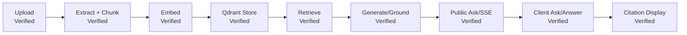
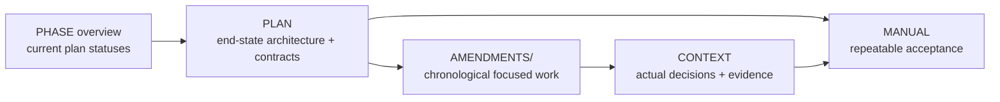
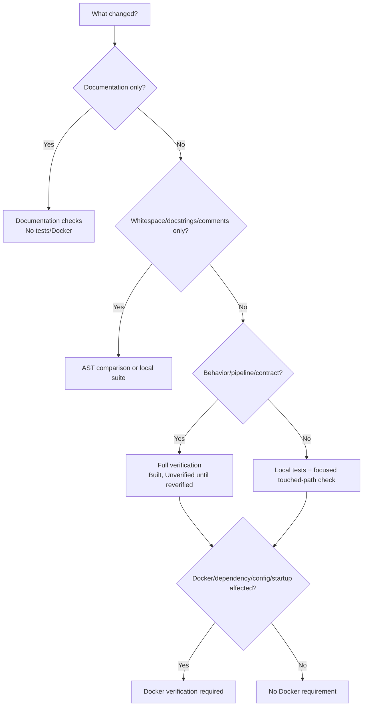

# AGENTS.md — Atlas (Intelligent Knowledge Drive)

- Auto-loaded from the repository root each session; read fully before writing code.
- This file is the repository-wide operating contract.
- [client/AGENTS.md](client/AGENTS.md) contains additional frontend-specific rules for `client/**`.
- [server/AGENTS.md](server/AGENTS.md) contains additional backend-specific rules for `server/**`.
- Detailed RAG pipeline contracts live in `.agents/skills/rag/SKILL.md`; do not duplicate or silently override them here or in a scoped AGENTS file.
- Scoped AGENTS files specialize this repository-wide contract for their subtree. They do not silently weaken or supersede LOCKED repository architecture.

### Instruction hierarchy

Use the smallest complete instruction set for the task:

```text
Repository-wide task
-> AGENTS.md

Client task
-> AGENTS.md
-> client/AGENTS.md

Server non-RAG task
-> AGENTS.md
-> server/AGENTS.md

Server RAG task
-> AGENTS.md
-> server/AGENTS.md
-> .agents/skills/rag/SKILL.md

Cross-boundary task
-> AGENTS.md
-> client/AGENTS.md
-> server/AGENTS.md
-> relevant skill/PLAN
```

When Codex is launched from the repository root, explicitly read the applicable scoped AGENTS file before changing files in that subtree.

For implementation tasks, also read the relevant PLAN and targeted current source/tests; read applicable skills when required. Cross-boundary tasks need each applicable scoped file, not unrelated instructions or the entire repository. Documentation-only tasks follow their stated documentation-reading boundary.

---

## 1. Project purpose and current objective

Atlas organizes files and folders with a semantic RAG layer:

```text
Ask File -> Ask Folder -> Ask Drive
```

Current engineering goal:

- build a hands-on, interview-defensible RAG/embeddings/vector-database system;
- prove the core single-file pipeline before pulling forward folders, file metadata, auth, or multi-scope retrieval;
- preserve user control over material architecture decisions;
- prefer a measurable baseline before adding retrieval/generation complexity.

### Current phase

**Phase 1 — MVP Core RAG pipeline**

```text
upload -> chunk -> embed -> store -> retrieve -> generate -> stream -> cite
```

Phase 1 is:

- single-file;
- unauthenticated;
- single-user;
- no folders or drive-wide retrieval;
- no canonical user-facing file metadata system.

Do not begin Phase 2+ work unless explicitly requested.

---

## 2. Current component maturity

| Component                | Status                 |
| ------------------------ | ---------------------- |
| Upload endpoint          | Implemented & Verified |
| Extraction & chunking    | Implemented & Verified |
| Embedding                | Implemented & Verified |
| Vector storage (Qdrant)  | Implemented & Verified |
| Retrieval                | Implemented & Verified |
| Generation/streaming     | Implemented & Verified |
| Client foundation/upload | Implemented & Verified |
| Client question/answers  | Implemented & Verified |
| Citation display         | Implemented & Verified |

Status meanings:

- `Not Yet Built`
- `Implemented, Unverified` — code exists, but the relevant complete acceptance state is not yet verified
- `Implemented & Verified`

Never treat `Implemented, Unverified` as `Implemented & Verified`.

Generation includes the verified Gemini provider, internal grounding/citation core, and public ask/native SSE boundary. PLAN_04 acceptance was performed by the agent under explicit user delegation. Trusted client citation display is verified.

PLAN_05 is Verified: the static Bun/Next client supports direct upload/returned-ID handoff, question submission, validated native POST-SSE streaming, provisional answers, and trusted completed citations. Whole-client development and static-export acceptance passed over the existing verified backend. Phase 1 MVP Core RAG is Verified; later phases remain outside the current scope.

Current implementation evidence:

- [PLAN_01 CONTEXT](prompts/PHASE_01/PLAN_01/PHASE_01_PLAN_01_CONTEXT.md)
- [PLAN_02 CONTEXT](prompts/PHASE_01/PLAN_02/PHASE_01_PLAN_02_CONTEXT.md)
- [PLAN_03 CONTEXT](prompts/PHASE_01/PLAN_03/PHASE_01_PLAN_03_CONTEXT.md)
- [PLAN_04 CONTEXT](prompts/PHASE_01/PLAN_04/PHASE_01_PLAN_04_CONTEXT.md)
- [PLAN_05 CONTEXT](prompts/PHASE_01/PLAN_05/PHASE_01_PLAN_05_CONTEXT.md)

### Phase 1 maturity flow

Legend: all Phase 1 backend and static-client stages, including trusted citation display, are verified.



---

## 3. Repository-wide stack and locked Phase 1 decisions

### Stack

- Backend: FastAPI.
- Frontend: latest stable Next.js used by PLAN_05, App Router, TypeScript only.
- Client runtime/package manager/script runner: Bun only; do not introduce Node.js as a required client runtime.
- Client rendering/deployment model: static export (`output: "export"`); no Next.js runtime server and no client Docker service in Phase 1.
- Client styling: Tailwind CSS + shadcn/ui.
- Client ordinary HTTP: Axios.
- Client server-state orchestration: TanStack Query v5.
- Client streamed `/ask` transport: native browser `fetch()` + `ReadableStream`.
- Client forms/runtime validation: React Hook Form + Zod.
- Vector database: self-hosted Qdrant in Docker.
- PostgreSQL: introduced from Phase 3 for canonical application state.
- Redis: introduced only when caching becomes relevant; not part of Phase 1.
- Backend/Qdrant deployment: Docker Compose under `server/`.

Detailed client mechanics belong in `client/AGENTS.md`.
Detailed backend mechanics belong in `server/AGENTS.md`.
Detailed RAG mechanics belong in `.agents/skills/rag/SKILL.md`.

### Cross-boundary Phase 1 decisions

- Browser client communicates directly with FastAPI; do not insert a Next.js BFF/proxy in Phase 1.
- FastAPI uses an explicit configured CORS allow-list for client origins; permissive wildcard CORS is not the default.
- Qdrant is the retrieval index, not canonical application state.
- PostgreSQL remains deferred until the approved later phase.
- Redis remains deferred until a concrete caching need exists.
- Authentication/session/user scoping remains outside Phase 1.
- Do not add folders, multi-file retrieval, folder/tree/drive retrieval, or canonical file metadata before their approved phase.
- Material architecture decisions remain human-controlled.

---

## 4. Repository architecture

```text
atlas/
├── AGENTS.md
├── .gitignore
├── .agents/
│   └── skills/
│       └── rag/
│           └── SKILL.md
│
├── server/
│   ├── AGENTS.md
│   ├── .env
│   ├── .env.example
│   ├── docker-compose.yml
│   ├── Dockerfile
│   ├── app/
│   └── tests/
│
├── client/
│   ├── AGENTS.md
│   ├── public/
│   ├── src/
│   ├── tests/
│   ├── package.json
│   └── bun.lock
│
└── prompts/
    └── PHASE_01/
        ├── PHASE_01.md
        ├── PLAN_01/
        ├── PLAN_02/
        ├── PLAN_03/
        ├── PLAN_04/
        └── PLAN_05/
```

### Placement ownership

- `server/` is the backend subtree. Read `server/AGENTS.md` before modifying it.
- `client/` is the frontend subtree. Read `client/AGENTS.md` before modifying it.
- `.agents/skills/rag/SKILL.md` is the detailed RAG technical authority.
- `prompts/` contains PHASE/PLAN/AMENDMENT/CONTEXT/MANUAL project artifacts.
- Backend Compose remains under `server/`; the static client is not a Compose service in Phase 1.
- Do not create ad hoc cross-repository folders when an existing ownership boundary fits.

---

## 5. Project vocabulary and resolved scope

### Vocabulary

Use:

- `file`
- `file_id`

Do not introduce new `document_id` vocabulary. `/documents/upload` remains a legacy route name from the earlier product framing.

### Resolved scope decisions — do not re-ask

- File metadata such as custom name, description, and tags is deferred until PostgreSQL.
- Folder-scoped filename uniqueness is deferred until folders/PostgreSQL exist.
- Redis is deferred until caching is actually needed.
- `/system/health/databases` currently checks Qdrant only and returns HTTP 200 with dependency status in the body.
- No deduplication in Phase 1; every upload is independent.

---

## 6. Documentation architecture

Atlas uses exactly:

- `PHASE` — major objective;
- `PLAN` — substantial milestone/end-state specification;
- `AMENDMENT` — one focused chronological implementation or documentation step;
- `CONTEXT` — chronological implementation/verification evidence;
- `MANUAL` — reproducibility/human acceptance guide.

### Relationship

Legend: PLAN describes the destination; Amendments implement it; CONTEXT records what actually happened; MANUAL records how to reproduce/accept it.



### PLAN rules

A `PHASE_<NN>_PLAN_<NN>.md` is the stable end-state specification. It should describe:

- status/dependencies;
- objective;
- scope/exclusions;
- architecture and useful Mermaid diagrams;
- locked contracts;
- API/data contracts;
- failure/observability behavior;
- folder placement;
- requirements;
- acceptance criteria;
- risks;
- verification boundaries.

A PLAN **must not preassign future Amendment numbering**. Capability decomposition is fine; chronological numbering belongs only to actual Amendments/CONTEXT.

### Prompt/document placement

Prompts live under:

```text
prompts/PHASE_<NN>/PLAN_<NN>/
```

Each PLAN has three primary files:

- `PHASE_<NN>_PLAN_<NN>.md`
- `PHASE_<NN>_PLAN_<NN>_CONTEXT.md`
- `PHASE_<NN>_PLAN_<NN>_MANUAL.md`

Focused Amendment prompts live chronologically under that PLAN's `AMENDMENTS/` folder.

Preserve dead ends/reversed decisions in chronological evidence rather than rewriting history. Emergent decisions should not be retroactively presented as if predicted.

### CONTEXT and MANUAL rules

- CONTEXT is the running account cross-checked against implementation/session evidence; it is the PLAN's amendment changelog and no separate changelog file is needed.
- MANUAL is the human acceptance/reproducibility guide.
- AGENTS.md and PHASE overview files hold current state only; dated logs, test counts, hashes, image IDs, and point counts belong in CONTEXT.
- Specs remain specifications.
- Manuals retain numbered steps, commands, and `Expected:` lines.
- Change a MANUAL command only when implementation or CONTEXT proves it wrong and record the correction.
- When told to read CONTEXT, read `Current state` and the latest relevant entry first; read older history only when the task requires it.

### Documentation style

- Prefer short bullets, tables, and Mermaid diagrams.
- Keep meaningful rationale, including its “because.”
- Rationale prose should be concise rather than buried in tables.
- Use at most three Mermaid diagrams per normal agent-facing document unless a PLAN specification materially benefits from more architecture diagrams.
- Each Mermaid diagram should have a short explanatory legend/context.
- Folder trees remain plain text.
- Preserve stable referenced headings when practical.
- Agent-facing files remain current and navigable.
- Root AGENTS owns global rules; scoped AGENTS own subtree-specific rules; detailed RAG contracts remain in the RAG skill.
- Do not duplicate a rule across documents unless a short summary is necessary to establish authority or a cross-boundary invariant.

---

## 7. Environment and secrets

- Codex may read `.env` for development and use its values as needed.
- Never commit `.env`.
- `.env` must remain ignored.
- Missing/incorrect ignore or secret handling is blocking.
- Commit `.env.example` with placeholders/safe examples only.
- Never log or copy real API keys into tracked files, test fixtures, prompts, CONTEXT, or MANUAL.
- Do not expose secrets through Docker build args/history or diagnostic commands that print full environment configuration.
- Never place secrets in browser-public configuration.
- Apply the more specific environment rules in the scoped AGENTS file for the subtree being modified.

---

## 8. Repository-wide code principles

### Naming

- Prefer single-word variable/function/parameter names where clear.
- Use multiple words only when necessary to avoid ambiguity.
- Follow the language/framework-specific naming rules in the applicable scoped AGENTS file.

### Comments and documentation

- Do not scatter inline comments explaining individual code lines.
- Use function/method documentation where it materially clarifies behavior, parameters, returns, lifecycle, or non-obvious contracts.
- New files mirror the latest established file in the same ownership area unless a documented convention intentionally supersedes it.

### Trust boundaries

- Treat uploads and network/provider responses as untrusted at their trust boundary.
- Validate untrusted external data before treating it as application state.
- Preserve structured error behavior.
- Do not silently hide dependency failures behind success/fallback behavior unless an approved contract explicitly defines that fallback.

---

## 9. Architecture and scope boundaries

### Always do without asking

- Implement within already-decided architecture in root AGENTS + applicable scoped AGENTS + relevant skill/PLAN.
- Reuse established abstractions and ownership boundaries.
- Surface failures explicitly.
- Preserve security and scope boundaries.
- Keep implementation proportional to the current PLAN.
- Update current documentation only as implementation facts actually land.

### Ask first

Do not choose silently:

- a new third-party library/service/API outside the fixed stack;
- a new frontend state/form/network/component library;
- a new backend framework/service boundary;
- chunk-size/overlap policy;
- embedding model;
- similarity metric;
- retrieval policy;
- LLM provider;
- auth/cache/queue/storage architecture;
- public API shape;
- material architecture not already resolved in AGENTS/skill/PLAN.

### Never do

- pull Phase 2+ scope forward unless explicitly requested, including multi-document, auth, teams, or portfolio-style scope;
- add auth/session/user scoping before Phase 3 is explicitly requested;
- use Gemini File Search or managed RAG-as-a-service;
- commit `.env` or any file containing real secrets;
- introduce Node.js, npm, npx, pnpm, or Yarn as a required client runtime/package-manager path when Bun can perform the task;
- add a Next.js runtime server, BFF/proxy, or client Docker service during Phase 1 without an explicit architecture change;
- silently weaken server-side retrieval scope or trust model;
- rewrite historical evidence to make the chronology appear cleaner.

---

## 10. Git and branch discipline

At the start of every session, perform read-only Git reconnaissance:

- current branch;
- relevant local/remote branches;
- recent commit history as needed.

Use that information to avoid conflicting with existing work. This reconnaissance is context gathering and does not need verbose reporting unless something relevant is discovered.

Unless explicitly instructed in that session:

- no commits;
- no pushes;
- no branch edits/deletes;
- no branch switching/checkouts;
- no branch creation;
- no merges;
- no rebases;
- no history rewriting;
- no destructive Git operations;
- do not discard unrelated/uncommitted work.

Work only on the branch already checked out.

If the branch does not match the prompt's expected PLAN, stop and report the mismatch instead of switching.

Branch pattern:

```text
phase-<NN>/plan-<NN>
```

A genuinely new pipeline stage gets a new PLAN/branch. Cleanup, refactors, conventions, fixes, and documentation alignment remain on the current PLAN branch.

Behavior/pipeline/contract changes demote `Verified` to `Built, Unverified` until reverified. Documentation-only or cosmetic work follows proportional verification.

---

## 11. Verification model

Verification effort must match change risk.



| Change                              | Required verification                        | Status effect                              |
| ----------------------------------- | -------------------------------------------- | ------------------------------------------ |
| Documentation only                  | Documentation checks; no tests or Docker     | Unchanged                                  |
| Whitespace/docstrings/comments only | AST comparison or local suite; no Docker     | Unchanged                                  |
| Caller-visible cosmetics            | Local tests + one focused touched-path check | Change only if acceptance behavior changes |
| Behavior/pipeline/contract          | Full verification                            | Built, Unverified until reverified         |

Docker verification is specifically required when changes affect:

- Dockerfile;
- Compose;
- dependencies;
- model caching;
- startup lifecycle;
- environment/configuration.

Docker may also be run deliberately to establish a fresh verified baseline when the human explicitly requests it.

Never claim a test/build passed unless it actually ran.

---

## 12. Common repository workflows

### Client

Read `client/AGENTS.md` and use its Bun-driven commands.

### Server

Read `server/AGENTS.md` and use its Python/Docker commands.

### RAG

For extraction, chunking, embeddings, Qdrant retrieval, grounding, generation, citations, or RAG transport work, additionally read:

```text
.agents/skills/rag/SKILL.md
```

Do not infer current exact commands or implementation details from historical Amendments when the repository or scoped AGENTS file provides current instructions.

---

## 13. Explain-back requirement

Every non-trivial task ends with a short explain-back covering:

- what changed;
- relevant pipeline stage or subsystem;
- meaningful implementation choices;
- relevant failure boundaries;
- verification actually performed;
- remaining unverified scope.

This is required so the human can defend the implementation in an interview.

CONTEXT, MANUAL, and PLAN updates should remain factual and structured; use nested bullets for detailed evidence instead of large undifferentiated prose blocks.
