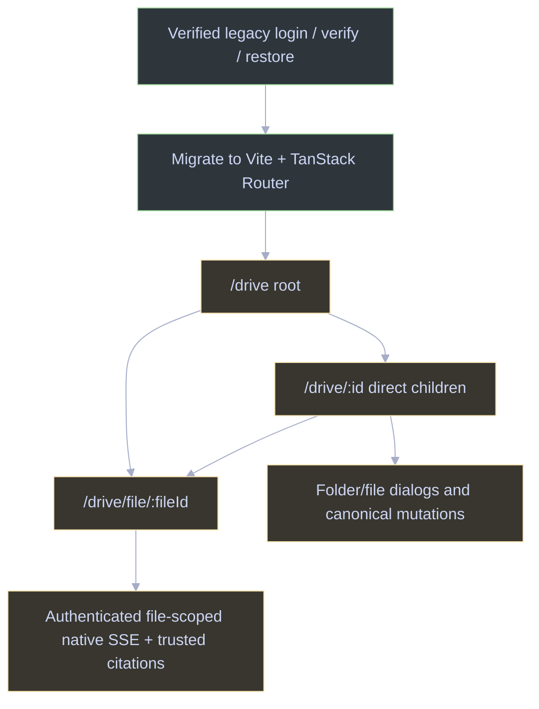
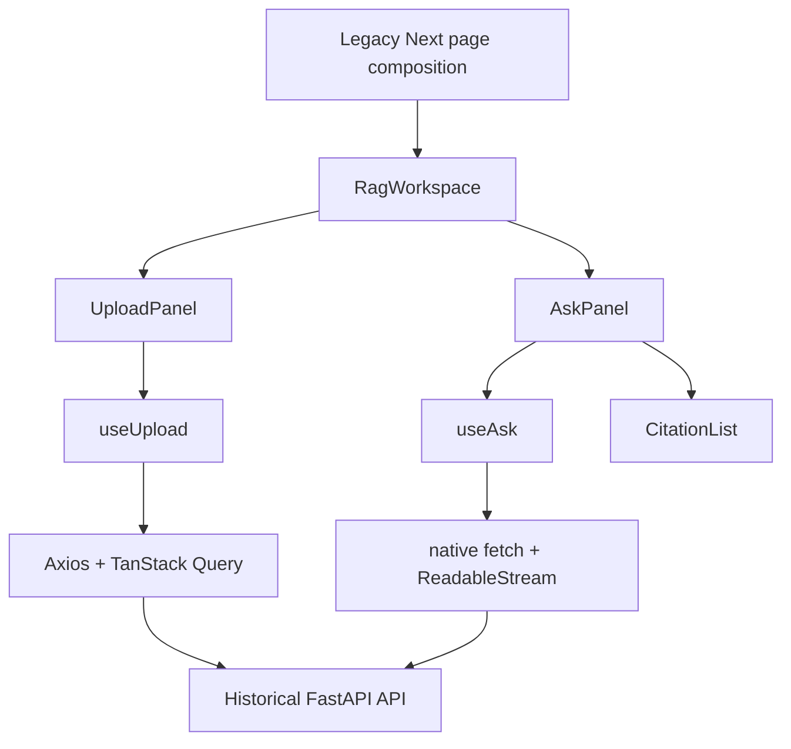
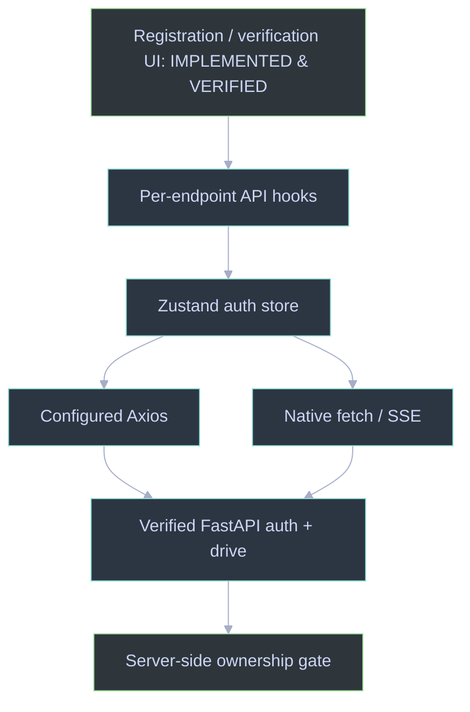

# Atlas — Client Engineering Standards

- Applies to `client/**`; inherits repository-wide rules from [root AGENTS.md](../AGENTS.md).
- Defines the approved React/Vite/TanStack Router SPA destination for PLAN_04, preserving the historically verified Next.js/Bun/TypeScript auth foundation and FastAPI integration.
- Server-only behavior belongs to [server/AGENTS.md](../server/AGENTS.md); detailed RAG contracts belong to the [RAG skill](../.agents/skills/rag/SKILL.md).

---

## 0. DOCUMENT ROLE & INSTRUCTION HIERARCHY

- Applies to all work under `client/**`.
- Inherits every repository-wide rule from [root AGENTS.md](../AGENTS.md); read the root file first.
- This file is the authoritative frontend engineering contract for Atlas.
- It specializes root policy for the approved Vite SPA. Amendment 01 implements this client; migration status is `IMPLEMENTED & VERIFIED` after approved Stage 02. Full Phase 2 drive workflows passed final Amendment 06 acceptance. PLAN_03 evidence remains historical; `client-legacy/` was removed with separate user approval after acceptance.
- Backend-specific rules belong in [server/AGENTS.md](../server/AGENTS.md).
- Detailed RAG implementation contracts belong in the [RAG skill](../.agents/skills/rag/SKILL.md); the client consumes verified public/backend contracts rather than redefining them.

### Reading order

For normal client work:

```text
root AGENTS.md
-> client/AGENTS.md
-> current PLAN
-> targeted source/tests
```

For cross-boundary work:

```text
root AGENTS.md
-> server/AGENTS.md
-> client/AGENTS.md
-> current PLAN
-> targeted server/client source/tests
```

Read backend/RAG instructions only when the client task actually crosses those boundaries.

Do not read the entire repository by default.

---

## 1. PURPOSE & ENGINEERING OBJECTIVES

### Client objective

- Preserve the verified Phase 1 Next.js upload/native POST-SSE work and verified Phase 2 Next.js authentication as historical baselines.
- PLAN_04 Amendment 01: preserve the original client as `client-legacy/`, cleanly scaffold `client/` as a React + Vite + TanStack Router SPA, then migrate the necessary auth/HTTP/stream libraries and tests without changing their semantics.
- Reproduce the PLAN_03 auth/browser acceptance before introducing new drive workflows.
- Consume verified FastAPI contracts; browser navigation and encrypted local persistence are not authorization boundaries.

### Phase 2 integration objectives

**Approved PLAN_04 destination (folder workspace `IMPLEMENTED & VERIFIED`; file lifecycle `IMPLEMENTED & VERIFIED`; file detail/Ask `IMPLEMENTED & VERIFIED`):**



Client goals:

- React + Vite with strict TypeScript, Bun-only tooling, Tailwind CSS, shadcn/ui and TanStack Router file-based routes;
- static client assets served by a host supporting browser-history fallback; no persistent Next.js/TanStack Start server, BFF, client Docker service or backend proxy;
- direct authenticated browser communication with FastAPI through existing shared Axios and native fetch clients;
- Zustand only for canonical user/session state; TanStack Query for remote drive/folder/file data; local React state for dialogs, selection and streamed-answer UI;
- root `/drive`, folder `/drive/:id`, file `/drive/file/:fileId`; `/dashboard` is retired, `/` redirects after auth resolution, and login/register/verify remain separate routes;
- dialogs for create/edit/upload and warning confirmations for permanent file deletion; no folder delete/move, file move, preview/download, multi-file RAG or extra infrastructure;
- preserve backend authorization, ownership, ready-state, citation provenance and session/refresh safety rules.

Approval boundaries:

- The Vite/TanStack Router migration and `GET /files/{file_id}` are `IMPLEMENTED & VERIFIED` under PLAN_04 Amendments 01 and 02 respectively; Amendment 03 folder workspace is `IMPLEMENTED & VERIFIED` after approved production-browser/two-owner Stage 02 acceptance and exact preservation.
- Existing server endpoints remain authoritative; Amendment 02 independently verified the file-detail endpoint before Amendment 05 consumes it.
- Do not introduce TanStack Start, a second router, duplicate data caches, extra persistent browser state, new infrastructure or another token owner without approval.

---

## 2. CURRENT STATE & DEVELOPMENT DESTINATION

### Status vocabulary

Use these labels exactly; do not infer verification from code existence or documentation.

| Status                    | Meaning                                                       | Applies when                                        |
| ------------------------- | ------------------------------------------------------------- | --------------------------------------------------- |
| `NOT YET BUILT`           | Required implementation is absent.                            | Work remains planned or unstarted.                  |
| `IMPLEMENTED, UNVERIFIED` | Implementation exists, but required acceptance is incomplete. | Checks are missing, blocked, or failed.             |
| `IMPLEMENTED & VERIFIED`  | Required implementation passed relevant acceptance checks.    | Executed, recorded verification supports the claim. |

- Assess PHASE, PLAN, and capability maturity independently.
- A completed PLAN does not complete the enclosing PHASE.
- Specifications and isolated checks alone do not prove complete acceptance.
- Identify any required checks that have not run.

### Phase and PLAN destination

| Scope                                             | Current maturity         |
| ------------------------------------------------- | ------------------------ |
| `PHASE_01`                                        | `IMPLEMENTED & VERIFIED` |
| `PHASE_02`                                        | `IMPLEMENTED & VERIFIED` |
| `PHASE_02_PLAN_01` — Identity & Authentication    | `IMPLEMENTED & VERIFIED` |
| `PHASE_02_PLAN_02` — Authenticated Drive Backend  | `IMPLEMENTED & VERIFIED` |
| `PHASE_02_PLAN_03` — Client Authentication        | `IMPLEMENTED & VERIFIED` |
| `PHASE_02_PLAN_04` — Drive Dashboard & Acceptance | `IMPLEMENTED & VERIFIED` |

- **Completed PLAN:** `PHASE_02_PLAN_03 — Client Authentication`; Amendments 01 and 02 are verified; Amendment 03 registration/verification/resend UI is `IMPLEMENTED & VERIFIED`; Amendment 04 login/logout UI is `IMPLEMENTED & VERIFIED`; Amendment 05 protected navigation/minimal dashboard and PLAN_03 are `IMPLEMENTED & VERIFIED` after approved Stage 02 acceptance.
- **Last inspected branch:** `phase-02/plan-04`; inspect Git again before each task.
- PLAN_03 verified Next.js auth/session UX and a minimal protected `/dashboard` entry. PLAN_04 Amendment 01 implements the Vite client and minimal `/drive`, with `/dashboard` removed; approved Stage 02 verified browser equivalence. Amendment 03 root/nested folder browsing and create/edit dialogs are `IMPLEMENTED & VERIFIED`; Amendment 04 file lifecycle is `IMPLEMENTED & VERIFIED` after approved production-SPA/packaged-API/two-owner acceptance and exact cleanup; Amendment 05 file detail/Ask is `IMPLEMENTED & VERIFIED` after approved production-SPA/current-source native API/two-owner Stage 02 acceptance and exact cleanup. Generation was deterministic; no actual Gemini call or packaged-runtime verification is claimed.
- The preserved Phase 1 upload UI is not compatible with the removed `/documents/upload` endpoint and is omitted from the SPA. Amendment 04 implements canonical authenticated `POST /files`, metadata edit and permanent-delete dialogs in existing root/nested listings; status is `IMPLEMENTED & VERIFIED` after explicitly approved Stage 02.
- Preserve the verified auth/HTTP/SSE and citation utilities through migration; do not import the removed legacy upload route or unneeded Next.js scaffolding.

### Server-first integration gate

- Verified Phase 2 auth and drive contracts are available on the server. PLAN_04 Amendment 02 verifies consolidated folder reads and `GET /files/{file_id}`; Amendment 03 consumes only the folder GET/POST/PATCH contracts.
- Client integration must follow those verified contracts; do not invent backend endpoints or auth semantics.
- Browser route protection is UX, not server authorization.

### Current client capability maturity

| Client capability                                        | Status                   |
| -------------------------------------------------------- | ------------------------ |
| Static Next.js + Bun Phase 1 client                      | `IMPLEMENTED & VERIFIED` |
| Phase 2 register / verify / resend UI                    | `IMPLEMENTED & VERIFIED` |
| Phase 2 login / logout UI                                | `IMPLEMENTED & VERIFIED` |
| Auth hooks / encrypted persistence / refresh integration | `IMPLEMENTED & VERIFIED` |
| Shared Zustand auth state and Axios/native fetch access  | `IMPLEMENTED & VERIFIED` |
| Legacy Next.js protected dashboard entry                 | `IMPLEMENTED & VERIFIED` |
| Vite + TanStack Router migration and `/drive` entry      | `IMPLEMENTED & VERIFIED` |
| Drive root/folder navigation and folder dialogs          | `IMPLEMENTED & VERIFIED` |
| File upload/metadata edit/permanent delete dialogs       | `IMPLEMENTED & VERIFIED` |
| Selected-file detail and owner-scoped Ask UI             | `IMPLEMENTED & VERIFIED` |

### Evidence references

- Current migration evidence: [PLAN_04 CONTEXT](../prompts/PHASE_02/PLAN_04/PHASE_02_PLAN_04_CONTEXT.md) and [MANUAL](../prompts/PHASE_02/PLAN_04/PHASE_02_PLAN_04_MANUAL.md); Stage 01 local results and approved Stage 02 production-SPA/browser/live acceptance; migration verified, remaining PLAN_04 features pending.

- Phase 1 client verification: [PLAN_05 CONTEXT](../prompts/PHASE_01/PLAN_05/PHASE_01_PLAN_05_CONTEXT.md) and [MANUAL](../prompts/PHASE_01/PLAN_05/PHASE_01_PLAN_05_MANUAL.md).
- Phase 2 server contract evidence: [PLAN_01 CONTEXT](../prompts/PHASE_02/PLAN_01/PHASE_02_PLAN_01_CONTEXT.md), [PLAN_02 CONTEXT](../prompts/PHASE_02/PLAN_02/PHASE_02_PLAN_02_CONTEXT.md).
- Phase 2 client evidence: [PLAN_03 CONTEXT](../prompts/PHASE_02/PLAN_03/PHASE_02_PLAN_03_CONTEXT.md) and [MANUAL](../prompts/PHASE_02/PLAN_03/PHASE_02_PLAN_03_MANUAL.md); preserve Amendment 01 history; Amendment 02 Stage 02 records current Chromium/live acceptance separately.

---

## 3. COMPLETED HISTORY & VERIFIED BASELINES

- Completed PHASES only; current Phase 2 maturity remains in Section 2.
- Every capability below belongs to a verified historical baseline; repeat status labels are unnecessary.
- Keep detailed Phase 1 verification and Amendment chronology in CONTEXT/MANUAL.
- The historical Phase 1 upload UI does not establish current Phase 2 API compatibility.

### PHASE_01 — MVP Core RAG

**Objective:** Established the complete static browser workflow for uploading one file, retaining the exact backend file ID, consuming native POST-SSE answers, and rendering trusted completed citations.

#### Verified baseline


#### Verified maturity

| Capability                     | Delivered behavior                                      |
| ------------------------------ | ------------------------------------------------------- |
| Static Next.js foundation      | App Router static export via Bun/TypeScript.            |
| Direct browser-to-FastAPI CORS | Direct API calls; backend retains trust authority.      |
| Upload form/request            | Phase 1 browser upload; backend endpoint later removed. |
| Returned-ID handoff            | Exact backend ID retained for subsequent ask.           |
| Naming/aliases/Prettier        | Verified structure, aliases and format.                 |
| Question submission            | Validated file-scoped question.                         |
| Native POST-SSE consumption    | Incremental native `fetch` streaming.                   |
| Incremental answer rendering   | Progressive answer display.                             |
| Internal citation retention    | Citation markers withheld from answer text.             |
| Trusted citation display       | Source metadata rendered after completion.              |

#### Completion boundary

Phase 1 client remains:

- single-file;
- unauthenticated;
- without folders/drive navigation;
- without metadata-management UI;
- without client persistence beyond the verified Phase 1 transient state;
- dependent on FastAPI as the authoritative backend.

#### Evidence

- [PLAN_05 CONTEXT](../prompts/PHASE_01/PLAN_05/PHASE_01_PLAN_05_CONTEXT.md)
- [PLAN_05 MANUAL](../prompts/PHASE_01/PLAN_05/PHASE_01_PLAN_05_MANUAL.md)

---

## 4. ARCHITECTURE & DATA FLOW

### Stack

**Approved PLAN_04 target (NOT YET BUILT before migration):**

- Framework/build: React + Vite, client-rendered SPA.
- Router: TanStack Router with Vite file-based route generation and typed parameters/navigation; do not introduce TanStack Start or React Router as a parallel router.
- Language: strict TypeScript only (`strict: true`, `allowJs: false`).
- Runtime/package manager/script runner: Bun only, text `bun.lock`.
- Deployment: static Vite `dist/` with correct SPA history fallback for deep links.
- Styling: Tailwind CSS + shadcn/ui.
- Ordinary HTTP: the existing configured Axios instance.
- Remote drive data: TanStack Query v5 (no duplicate router-loader cache of canonical drive data).
- Streamed `/ask`: native browser `fetch()` + `ReadableStream` and existing SSE parser.
- Forms: React Hook Form + Zod; modal-driven create/edit/upload/delete presentation.
- Formatting: Prettier with existing manual readability conventions.
- Zustand: solely authenticated user, JWT and safe auth/session status; no drive/file/folder application data in Zustand.

The verified legacy Next.js App Router/static-export implementation is historical. Its temporary `client-legacy/` reference was retained through verified migration acceptance, then removed with separate user approval. PLAN_03 and migration evidence remain in their CONTEXT/MANUAL records.

### Runtime model

- The browser talks directly to FastAPI over the configured API origin. No Next.js runtime, TanStack Start, Vite API proxy, Route Handler, Server Action or BFF is part of the approved application.
- Static hosting must fall back to the SPA entry document for navigation to `/drive/<uuid>` and `/drive/file/<uuid>`, without turning missing assets or backend/API failures into successful HTML responses.
- Local development and preview default to `http://localhost:3000`; configurable ports remain subject to the existing exact FastAPI CORS allow-list. See the environment/build rules for the separate settings.
- Public `VITE_ATLAS_API_BASE_URL` is build-time configuration; changing a deployed API base requires rebuilding the static artifact.
- Route guards hide protected UI until session restoration/validation finishes. FastAPI remains the sole authentication/authorization authority.
- Do not fetch private canonical data during auth restoration or reuse stale private results after logout/account changes.

### Tooling

- Bun owns scaffolding, install, package execution, dev, build, formatting, lint, typecheck and tests.
- `bun.lock` is the only package-manager lockfile; do not produce `package-lock.json`, `pnpm-lock.yaml`, `yarn.lock` or `bun.lockb`.
- Prefer `bun create`, `bunx --bun`, `bun add`, `bun install` and `bun run`.
- Use the official compatible Vite React/TypeScript scaffold; configure TanStack Router's Vite plugin before the React plugin per the installed versions.
- Retain generated typed route-tree source as a version-controlled project artifact when required by the router workflow; do not manually edit it. Do not stage or commit without explicit authorization. Exclude generated routes from handwritten formatting/lint transformations as appropriate.
- Record actual resolved versions and compatibility; do not claim a version is installed before scaffolding.

### Verified Phase 1 composition

**Historical legacy Next.js baseline only** (do not recreate the deprecated upload path):



- `RagWorkspace` and historical `useUpload` depend on the superseded Phase 1 upload route. Do not copy or remount them wholesale as current Phase 2 functionality.
- Preserve and migrate useful `useAsk`, ask session, stream framing/protocol, response schemas and trusted `CitationList` behavior; any retained file-upload UI must be rebuilt for authenticated `POST /files`.
- Citation text, excerpts, order, nullable metadata and final-success gating remain server-derived; do not promote model-authored citation markers to trusted output.

### Phase 2 client boundary and planned drive integration

- PLAN_03 legacy `AuthGate`, `DashboardPanel`, auth operation hooks and shared transports are verified in Next.js; migrate their _behavior_, not Next routing imports or unused page composition.
- The existing QueryProvider/bootstrap ownership and current Zustand auth authority must remain single-owner through migration. Do not create a second bootstrap or token coordinator.
- Auth routes `/register`, `/verify`, `/login` and entry `/` must preserve recorded PLAN_03 restoration, refresh, logout, `credential_action` handoff and navigation error behavior.
- Replace `/dashboard` with `/drive`; use TanStack Router file-based `/drive`, `/drive/$id`, `/drive/file/$id`. Validate UUID parameters before API calls; IDs never prove ownership.
- The folder/file page structure is independent: the file page consumes the separately approved owner-scoped `GET /files/{file_id}` after backend verification and enables Ask only for ready files.
- Router owns navigation/typed params/layout, TanStack Query owns canonical remote drive state, and component/hook state owns ephemeral forms/modals and streamed answers. Avoid shadow copies of remote records in Zustand or router context.
- Amendment 03 supersedes owner/session-in-key recommendations for folder listings ONLY: use exactly `['drive', 'folder', 'root']` and `['drive', 'folder', folderUUID]`. Account isolation remains LOCKED through auth-boundary cancellation/cache retirement, usable-session gating and lease/user/abort checks before result publication.
- Amendment 05 file metadata uses exactly `['drive', 'file', fileUUID]` with `staleTime: 60_000`, memory-only. The same auth lease/abort/publication and QueryProvider retirement rules apply; Ask remains ephemeral route-local state.
- On successful drive mutation invalidate drive-related queries and refetch the active page, not a hard browser refresh. Inactive pages refetch when revisited; no full QueryClient clear for ordinary mutations.
- Use in-memory TanStack Query caching with an initial 60-second freshness target; this does **not** survive full browser reload. Persistent drive cache needs separate approval.
- Account logout/switch must cancel/retire outstanding private queries and streams, prevent stale results from reappearing and clear auth-owned private cache through the existing cleanup boundary.
- Existing authenticated Axios and native fetch share session authority and safe replay rules. Only one eligible bodyless GET may be retried after invalid-access refresh; no automatic mutation, multipart or POST-SSE replay.

---

## 5. REPOSITORY STRUCTURE & OWNERSHIP

After the approved PLAN_04 Amendment 01 migration, **only `client/` is the active SPA**. The directory below is illustrative; create domain subfolders when work actually owns code, not for symmetry. The temporary `client-legacy/` source reference was retired with separate approval after acceptance.

```text
client/
├── AGENTS.md
├── index.html
├── public/
├── src/
│   ├── main.tsx                         # Vite browser entry and providers
│   ├── routes/                          # TanStack Router file-based route definitions
│   │   ├── __root.tsx
│   │   ├── index.tsx                     # auth-aware entry redirect
│   │   ├── login.tsx
│   │   ├── register.tsx
│   │   ├── verify.tsx
│   │   └── drive/
│   │       ├── route.tsx                 # protected drive layout
│   │       ├── index.tsx                 # root direct children
│   │       ├── $id.tsx             # selected folder direct children
│   │       └── file/
│   │           └── $id.tsx           # selected file metadata + Ask
│   ├── routeTree.gen.ts                 # generated typed router tree; never hand-edit
│   ├── components/
│   │   ├── ui/                           # shadcn generated primitives
│   │   ├── Common/
│   │   ├── Drive/
│   │   ├── Folder/
│   │   ├── File/
│   │   ├── Ask/
│   │   └── Citations/
│   ├── hooks/
│   │   ├── auth/
│   │   ├── drive/
│   │   ├── folder/
│   │   ├── file/
│   │   └── ask/
│   ├── services/
│   │   ├── auth/                         # migrate verified session/token/key behavior
│   │   ├── http/                         # shared configured Axios + native fetch
│   │   └── ask/                          # native SSE request-session ownership
│   ├── schemas/                          # auth, drive, file, folder, env, SSE/Zod
│   ├── types/                            # only types not already inferred from Zod
│   ├── providers/query/
│   ├── constants/
│   ├── stores/auth.ts                    # sole Zustand auth authority
│   ├── utils/stream/
│   └── lib/utils.ts                      # shadcn cn() only
├── tests/                                # focused domain + browser integration coverage
├── vite.config.ts
├── tsconfig.json
├── package.json
├── bun.lock
└── components.json
```

- `src/routes/` contains route registration, typed parameter access, thin layouts and page composition only; no transport, auth cryptography, database access, RAG parser or business logic.
- `src/main.tsx` initializes app providers and the router; avoid hidden duplicate session initialization.
- Drive directory routes use an Outlet-only `drive/route.tsx` parent with `drive/index.tsx`, `drive/$id.tsx` and `drive/file/$id.tsx`; canonical `/drive` links remain unchanged. Directory routing is `IMPLEMENTED & VERIFIED` after approved Amendment 06 final packaged/static-browser acceptance; deterministic generation and the explicitly accepted historical cache exception are recorded in PLAN_04 CONTEXT/MANUAL.
- Keep root, folder and file pages separate. `/dashboard` is retired; do not maintain dead routes or the superseded legacy RAG workspace in the new application.
- The TanStack Router Vite plugin owns route-tree generation. Preserve its required filenames even when they differ from Atlas user-controlled filename conventions.
- `components/ui/` remains shadcn-only; domain presentation belongs to `components/<Domain>/` with PascalCase component filenames.
- `hooks/<domain>/` owns React lifecycle, local state and direct TanStack Query composition; do not create a generic Query adapter.
- HTTP and auth services retain their current verified ownership. Extract transport logic only when it has a single meaningful responsibility; no redundant pass-through services.
- Use Zod schemas for untrusted network and form data; prefer inferred types over duplicated DTO declarations.
- `utils/` contains pure helpers without React/network state. `lib/utils.ts` remains the shadcn utility boundary.
- Keep tests under `tests/`, grouped by behavior/domain; no scattered `__tests__` trees.
- Avoid unused barrel exports, empty folder scaffolds and generic `helpers.ts`/`misc.ts` modules.
- During migration, inspect and preserve tracked, untracked and ignored user files before `client/` -> `client-legacy/`. Never overwrite the destination or remove legacy data without separate approval. The post-acceptance removal was separately approved and completed; do not recreate the legacy directory. Do not transfer `.next`, `out`, `node_modules`, old env secrets or other generated artifacts as new source.
- The legacy `AGENTS.md` is historical; this successor `client/AGENTS.md` governs the new SPA after the migration cutover, not the original Next.js implementation.

---

## 6. ENGINEERING & DOCUMENTATION CONVENTIONS

### Components

Atlas component domain folders and reusable component files use PascalCase:

```text
components/Upload/UploadPanel.tsx
components/Ask/AskPanel.tsx
components/Rag/RagWorkspace.tsx
```

Exceptions:

- `components/ui/` retains shadcn-generated lowercase naming.
- TanStack Router/tool-required filenames retain their required conventions, including `__root.tsx`, `index.tsx`, `route.tsx`, `$id.tsx`, `$id.tsx`, `routeTree.gen.ts`, `vite.config.ts` and the selected ESLint config. These are exceptions to handwritten naming rules.

### Hooks

- Hook domain folders stay lowercase.
- Hook filenames use `use<Name>.ts`.
- Hook files contain no JSX.
- Destructure TanStack Query hook results and expose only the named actions and state the domain hook needs.

Examples:

```text
hooks/upload/useUpload.ts
hooks/ask/useAsk.ts
```

### Other files

- User-controlled multiword filenames/directories use lowerCamelCase.
- Single-word names may remain lowercase.
- Tests use lowerCamelCase before `.test.ts`.
- Use `.test.tsx` only when JSX is actually required.
- Do not use hyphenated user-controlled TypeScript/TSX filenames.
- Export component/type symbols with PascalCase.
- Export variables/functions with camelCase.

### Source-root aliases

Current aliases:

- `@routes/*` -> `./src/routes/*` (only if genuinely useful; file-based routing remains plugin-owned)
- `@components/*` -> `./src/components/*`
- `@hooks/*` -> `./src/hooks/*`
- `@stores/*` -> `./src/stores/*`
- `@constants/*` -> `./src/constants/*`
- `@lib/*` -> `./src/lib/*`
- `@providers/*` -> `./src/providers/*`
- `@schemas/*` -> `./src/schemas/*`
- `@services/*` -> `./src/services/*`
- `@utils/*` -> `./src/utils/*`
- `@/*` -> `./src/*` fallback

Use dedicated aliases for cross-root imports.
Short local relative imports are acceptable.
Avoid deep relative chains.
Do not add speculative aliases.

- Frontend application source is TypeScript only: `.ts` and `.tsx`.
- Keep TypeScript `strict` enabled.
- Keep `allowJs=false`.
- Do not weaken compiler strictness to bypass an error.
- Do not use `any` unless an external-library boundary makes it unavoidable and the exception is narrowly documented.
- Prefer `unknown` plus validation/narrowing.
- Treat HTTP/SSE JSON as `unknown` until Zod validation succeeds.
- Define named interfaces for component props and structural application contracts instead of inline object annotations.
- Prefer interfaces for object shapes.
- Use type aliases for unions, callbacks, and Zod-inferred data.
- Primitive and existing library types can be used directly.
- Colocate hook interfaces/types in the hook module by default.
- Extract shared contracts only when reuse/ownership warrants it.
- Export only types/interfaces consumers actually need.
- Do not use type assertions to bypass a missing trust-boundary validation.

### Prettier

- Use Prettier defaults through Bun.
- Use the repository `format` and `format:check` scripts.
- Exclude generated/build artifacts according to the current Prettier ignore file.
- Do not add formatting/import-sorting plugins without approval.
- Formatting does not replace manual readability conventions.

### Exports

Atlas components, providers, and hooks use:

```ts
export default function Name(...) {}
```

Preserve generated shadcn primitive export conventions.

- Hook entry functions and React components/providers MUST retain normal function declarations.
- Functions nested inside hooks and other handwritten helper implementations MUST use arrow functions, including object action implementations; class constructors, getters/setters and interface method signatures retain their required syntax.
- Define arrow functions before any module-level expression that reads them; do not rely on function hoisting.
- Define action implementations above hook return objects; return named function references without inline implementations.

### Object literals

Write nonempty object literals across multiple lines, one property per line, including:

- nested options;
- state updates;
- return objects.

### Imports

- Keep package imports together immediately below directives, including runtime built-ins and named/type imports; do not split one package-import group with blank lines.
- Group internal imports by category.
- Typical internal order:
  1. hooks
  2. components
  3. services
  4. schemas/constants/utils/other categories
- Use one blank line between groups.
- No blank line within one import group.

### Code readability and control flow

- Domain literal unions MUST have named type aliases beside their owning code, such as `AuthStateType`; do not repeat inline status/action unions across fields or return types.
- MUST leave one blank line between logical steps and adjacent function definitions.
- MUST keep conditions, arguments, and operations readable; avoid cramped one-line statements.
- MUST use braces for conditional branches, including branches containing only `return` or `throw`.
- Guard clauses MAY appear wherever validation or branching is needed; prefer quick returns or throws over heavy nesting.
- After an `if` branch unconditionally returns or throws, MUST continue with the next condition or normal flow without a redundant `else` or `else if`.
- Components with successive returning conditions MUST use sequential braced guards followed by the final return, as in `AuthGate`.
- Retain explicit `else` branches when continuing alternatives clarify the relationship; do not flatten branches mechanically when control flow differs.
- Prettier formatting MUST NOT replace these manual readability requirements.
- Apply these conventions to affected handwritten tests as well as production code; keep generated primitives and unrelated files outside a cosmetic sweep.

### React readability

- Leave one blank line between logical JSX sections where it improves readability.
- Do not scatter inline comments explaining individual lines.

### Documentation and ownership

- Inherit the root PHASE / PLAN / AMENDMENT, CONTEXT and MANUAL model.
- Codex records actual code changes and executed tests; do not pre-create client Phase 2 evidence.
- Preserve verified naming, aliases and formatting unless the approved PLAN supersedes them. The Next.js `@app/*` alias is superseded by the new router ownership; avoid old imports in the new client.

---

## 7. TECHNICAL CONTRACTS & RUNTIME BEHAVIOR

### Ordinary HTTP, authentication and SSE

#### Ordinary HTTP

- Use configured Axios for ordinary request/response HTTP such as uploads and later CRUD/authenticated calls.
- Preserve the browser-generated multipart boundary for file uploads.
- Do not invent arbitrary client-side file-size/time limits when the backend contract does not define them.
- TanStack Query owns approved query/mutation server-state orchestration.
- Do not use TanStack Query as a substitute for local ephemeral UI state.

#### Shared HTTP infrastructure

- `services/http/axios.ts` MUST export one actual configured Axios instance; no custom Axios facade or public client factory.
- `services/http/fetch.ts` exports one configured native fetch client with base/get/post; preserve raw responses and streams.
- Both resolve the validated API URL centrally.
- Both accept `isProtected?: boolean`; omission preserves path defaults, `true` requires trusted-target Bearer access, and `false` strips Authorization and bypasses bootstrap/refresh/replay.
- Cookie credentials are independent of `isProtected`; login/verify/logout use `isProtected: false` plus explicit cookies.
- User-facing `useRegister`, `useResend`, `useVerify`, `useLogin`, `useLogout`, and explicit `useAuth` own their endpoint contracts; no grouped auth API service or session controller.
- Hooks MUST import the shared HTTP instance directly and use named, readable actions; do not inject clients/coordination or pass request callbacks through service layers.
- Each hook owns its input validation, direct awaited request, response validation and safe error handling; duplicate-submission protection stays local to mutations.
- Auth hooks expose only named actions and operation-prefixed state; mutation loading maps to `isPending`. `useAuth` remains disabled by default with explicit `getAuth`; Zustand owns authentication truth.
- `services/auth/` contains `auth.ts` (non-React lifecycle), `token.ts` (encrypted persistence), and `key.ts` (IndexedDB CryptoKey); Zustand remains the only user/JWT state owner.
- `auth.ts` supplies start/finish lifecycle operations for cookie ordering and state commit; hooks own user-triggered HTTP.
- Non-React bootstrap and refresh use private native-fetch bypass mechanics in `validate.ts`; no extra Axios instance or React hook invocation.
- Preserve native Axios request options and raw fetch `Response`/stream ownership.
- Phase 2 authenticated Axios and native fetch must consume one shared access-token/session authority rather than duplicating token state.
- Refresh credentials remain in the approved HttpOnly-cookie path and must not be copied into JavaScript-accessible storage.
- Do not blindly replay arbitrary failed mutating requests after refresh; request replay semantics require an explicit safe contract.

#### Streamed ask

- Use native browser `fetch()` for `POST /files/{file_id}/ask`.
- Do not force Axios around the SSE stream.
- Do not wrap the live SSE stream in TanStack Query.
- Do not use EventSource because the endpoint is POST.
- Do not add a third-party SSE library without approval.
- Use `ReadableStream` and incremental UTF-8 decoding.
- Do not assume one transport chunk equals one SSE event.
- Pure SSE framing/protocol helpers belong under `utils/stream/`.
- Runtime-validate application event payloads before trusted state updates.
- Internal citation markers must never become public answer text.
- Use `AbortController` for internal stream ownership/cleanup.
- No user-facing Ask cancellation feature unless an approved later PLAN adds one; mutation-dialog Cancel buttons are a separate approved UI behavior.
- No retry/reconnect/resume/Last-Event-ID semantics unless explicitly approved.

### Forms, state and UI contracts

- Use React Hook Form for forms.
- Use Zod for form validation.
- Use `stores/auth.ts` Zustand selectors for reactive auth state; transports read that same store through `getState()`.
- Credential-action errors remain `error` and carry the safe `credential_action` origin so anonymous form handoffs stay usable; bootstrap/refresh uncertainty still requires explicit recovery. No error origin grants protected access.
- Store actions MUST remain synchronous; no HTTP/crypto/IndexedDB, persist middleware, token devtools, or second token owner.
- TanStack Query owns canonical drive/folder/file remote state and mutations; Zustand owns auth only. Local UI state remains with the owning route/component/hook. Router loaders must not create a second canonical drive-data cache.
- For every confirmed drive mutation, invalidate all drive-related cached queries and refetch active location/detail views without a hard navigation reload. Ordinary mutation invalidation must not indiscriminately clear auth/unrelated query caches.
- Initial drive query freshness target is 60 seconds, in-memory only. Full browser reload performs authenticated revalidation and a fresh API fetch; do not add drive cache persistence.
- Drive dialogs: create/edit/upload use RHF/Zod, Cancel plus task-appropriate submit; permanent file delete uses an explicit warning confirmation dialog, Cancel/Delete and no automatic retry. Handle `processing`, `ready`, `deleting` exactly as canonical backend states.
- On account logout/switch cancel and invalidate private requests/streams; ensure delayed responses cannot render data for another session.
- Phase 2 explicitly permits the approved reversibly encrypted access token in `localStorage`.
- Do not store the refresh token, password, OTP, or client-side encryption key/material in `localStorage`.
- Client-side reversible access-token encryption is defense-in-depth/obfuscation, not an XSS security boundary.
- Do not generalize the access-token exception into arbitrary `localStorage`/`sessionStorage`/IndexedDB persistence without approval.
- If the persisted access token cannot be safely recovered/used, discard it and rely on the approved refresh-cookie flow rather than bypassing authentication checks.
- Prevent duplicate mutating/streaming submissions while the same operation is active.
- Preserve the verified ask abort/reset behavior when the selected active file changes.
- Browser route/auth state never establishes server ownership or authorization.

- Use Tailwind CSS + shadcn/ui.
- Prefer default shadcn behavior unless the current PLAN requires a specific product interaction.
- Keep presentation functional rather than product-polished.
- `components/ui/` is generated primitive territory; preserve generated APIs/conventions.
- Do not add another component/styling system.
- Avoid handwritten `aria-*` attributes unless needed for functionality/accessibility; prefer native labels and visible status/error text.
- Do not add Markdown renderers, animation libraries, or other presentation dependencies without an approved need.

### Environment, build and SPA deployment

- `VITE_ATLAS_API_BASE_URL` is browser-visible build-time configuration. It supersedes `NEXT_PUBLIC_ATLAS_API_BASE_URL` in the new application; it is **not** an implemented migration until the new client exists.
- Never place secrets in `VITE_*` or any other browser-exposed build variable.
- Reuse the existing strict API-base validation: absolute supported HTTP(S) URL, no credentials/query/fragment, normalized consistently for both Axios and fetch.
- The validated public API base is read once through the approved environment/configuration boundary and consumed as `env.API_BASE_URL`.
- Vite production `bun run build` emits `dist/`, not Next.js `out/`. A change in deployed public API configuration requires rebuilding the SPA.
- Static hosting must serve the SPA entry document for valid browser-history paths, including nested folder/file UUIDs, while preserving missing-asset failure behavior and without proxying API requests through the frontend.
- `ATLAS_SERVER_PORT` controls Vite development and `ATLAS_PREVIEW_PORT` controls Vite preview; each independently defaults to `3000` when unset and MUST be a decimal integer from `1` to `65535`.
- Load these ports only in Vite configuration; do not expose them through `VITE_*` or browser runtime configuration. Keep `strictPort: true` for both servers and verify exact FastAPI allowed origins separately when changing ports.
- Client local env files remain ignored; `.env.example` contains only safe placeholders. Do not copy legacy private `.env.local` values into tracked source or logs.
- Do not add SSR, TanStack Start, server loaders/functions, a client Docker service, Vite backend proxy or another application runtime without approval.

### Authentication transport boundary

- Amendment 02 verifies the foundation below in Chromium against the existing backend; Amendment 03 verifies registration/verification/resend UI in Chromium against the existing backend. Amendment 04 login/logout UI is `IMPLEMENTED & VERIFIED`; Amendment 05 protected navigation/minimal dashboard is `IMPLEMENTED & VERIFIED` after approved Stage 02 acceptance.
- AES-GCM/IndexedDB storage retains version-1 compatibility; logout deletes only auth ciphertext and its auth-owned IndexedDB key, and explicit login/verify generates a key when absent.



---

## 8. SECURITY & TRUST BOUNDARIES

### Browser trust boundaries

- All browser input and network payloads are untrusted; use Zod validation at relevant HTTP/SSE boundaries.
- A protected client route is a navigation/UX mechanism; FastAPI performs all authentication and authorization.
- Never infer owner access from local state, selected IDs or encryption.
- Treat model-authored provenance as untrusted; render only Atlas-validated citations.

### Credentials and persistence

- Refresh tokens must remain in the server-controlled HttpOnly cookie.
- Approved access-token exception: active JWT in memory and reversibly encrypted access token in `localStorage`.
- Never store passwords, OTPs, refresh tokens or client encryption keys/material in `localStorage`.
- Reversible client-side encryption is not an XSS security boundary.
- The approved non-extractable AES-256-GCM key lives in IndexedDB `atlas.auth/keys/access`; logout deletes that record, never the origin database or unrelated records.
- Do not introduce `sessionStorage`, additional persistence, or cross-tab arbitration without approval.
- If saved token material is unusable, discard it and restore through the approved refresh-cookie flow.
- Do not silently replay arbitrary mutating or streaming requests after authentication failure.

### Static deployment and exposure

- `VITE_*` is browser-visible in the approved SPA and MUST NOT contain secrets. Next.js `NEXT_PUBLIC_*` behavior is historical only; the legacy directory has been retired.
- Keep API origin and credential/CORS behavior compatible with the verified FastAPI deployment configuration.
- Never log or expose cookies, JWTs, credentials, verification codes, keys, uploaded content or source excerpts in browser diagnostics.

---

## 9. SCOPE & ARCHITECTURE GOVERNANCE

### Always do

- Read root `AGENTS.md` before this file.
- Reuse current client architecture and naming.
- Keep components presentation-focused.
- Keep hooks lifecycle-focused.
- Keep pure parser/utilities free of React/network ownership.
- Validate untrusted network boundaries.
- Preserve exact backend IDs/provenance rather than deriving replacements.
- Keep Vite SPA production build and deep-link history-fallback deployment viable.
- For cross-boundary Phase 2 work, consume only an implemented/verified server contract unless the PLAN explicitly defines a coordinated exception.
- Derive no ownership decision from client-selected IDs; send resource identifiers and let FastAPI authorize them.

### Ask first

- new frontend dependency;
- new state library;
- new form library;
- new network library;
- new component library;
- new testing framework;
- public API shape change;
- Vite/TanStack Router/SPAs hosting-runtime boundary or additional router/data-cache architecture;
- changes to the approved persistence strategy;
- changes to the approved auth/token architecture.

### Never do

- add Node/npm/npx/pnpm/Yarn as required runtime/package-manager workflow;
- add a Next BFF/proxy without an explicit architecture change;
- add a client Docker service without an explicit architecture change;
- add global state merely for convenience;
- persist refresh tokens, passwords, OTPs, or auth secrets in JavaScript-accessible storage;
- treat reversible client-side token encryption as an authorization or XSS security boundary;
- bypass runtime validation with casts;
- treat model-authored provenance as trusted citation metadata;
- invent backend ownership/auth behavior or pre-implement speculative API contracts;
- add speculative future folders/aliases/abstractions beyond the current PLAN;
- place business logic in `components/ui/` or `lib/utils.ts`.

### Decision vocabulary

- `LOCKED`: cannot change without approval.
- `PROVISIONAL`: a recommended but unconfirmed direction.
- `OPEN`: a material decision reserved for the user.
- `SUPERSEDED`: changed by a later approved decision.

---

## 10. GIT & REPOSITORY SAFETY

- Inherit [root Git safety rules](../AGENTS.md) without exception.
- Inspect branch, working tree and relevant diffs before client work.
- Do not commit, push, branch-switch/create, rewrite history, reset or discard uncommitted changes without explicit authorization.
- Preserve tracked `bun.lock`; no npm/pnpm/Yarn lockfiles or ad hoc package-manager migration.
- Avoid unapproved backend edits, database resets, Qdrant cleanup or Docker volume changes during client acceptance.
- Do not assume the planned `phase-02/plan-04` branch exists locally; inspect the actual checked-out branch before implementation.
- Run `git diff --check` and report affected files before completing an AMENDMENT.

---

## 11. VERIFICATION & ACCEPTANCE

Verification follows the root risk model.

For normal client implementation, use the current Bun scripts:

```bash
bun install --frozen-lockfile
bun run format
bun run format:check
bun run lint
bun run typecheck
bun run test
bun run build
```

Rules:

- Do not claim a check passed unless it actually ran.
- Keep `bun.lock` as the only package-manager lockfile.
- Unit tests must not make real Gemini calls.
- Use the narrowest existing test seam; do not add a test library merely for convenience.
- Browser acceptance may use the existing verified backend/Qdrant runtime when the task requires real integration.
- After migration, production-SPA acceptance must exercise Vite `dist/` and a real history-fallback static host, including `/drive`, `/drive/<uuid>` and `/drive/file/<uuid>` direct load, reload and back/forward behavior. Never claim Vite preview alone establishes production hosting behavior.
- Client-only changes do not require backend Docker rebuild unless they change backend/deployment-sensitive inputs.
- Preserve persistent Qdrant data; do not delete/reset backend state for client verification.
- Run `git diff --check` from the repository root before completion.

---

## 12. STANDARD ENGINEERING WORKFLOW

### PLAN_04 Amendment 01 — controlled migration checkpoints

Complete this one cohesive migration Amendment through explicit internal checkpoints. Do not build drive CRUD or change FastAPI behavior during migration.

1. **Checkpoint 0 — Legacy baseline:** inspect checked-out branch, full working tree (including ignored/untracked client inputs), dependency and route inventory. Record the existing Next.js `bun install --frozen-lockfile`, focused/full tests, formatting check, lint, strict typecheck, build, and relevant browser/PLAN_03 evidence. If any check is blocked, record the limitation rather than inventing parity.
2. **Checkpoint 1 — Safe rename and scaffold:** preserve the original `client/` as `client-legacy/` without overwriting an existing destination, discarding user files, switching branches, or committing. Scaffold a clean Bun/Vite React strict-TypeScript `client/`; add only the approved compatible TanStack Router, Tailwind/shadcn and existing application dependencies. Validate scripts, aliases, environment configuration, generated route tree and consistent formatting.
3. **Checkpoint 2 — Foundation migration:** selectively migrate verified auth schemas, Zustand store, non-React token/key lifecycle, HTTP transport, TanStack Query provider, SSE framing/citations and relevant tests. Remove Next-specific imports/configuration from new code; do not copy the old removed upload route, old generated output, ignored credentials or unnecessary packages.
4. **Checkpoint 3 — Route composition:** implement the equivalent anonymous auth routes, protected `/drive` entry and session-aware `/` redirect using TanStack Router, without building folder/file CRUD yet. Preserve `credential_action`, encrypted restoration, refresh single-flight, cookie ordering, terminal/uncertain logout behavior, safe GET replay and account-change privacy.
5. **Checkpoint 4 — Acceptance:** verify frozen install, format, lint, strict typecheck, full/focused tests and Vite `dist/` build. After separate explicit Stage 02 approval, execute actual production-built SPA browser tests against the verified FastAPI auth runtime, including direct route/reload/history and account/session equivalence; compare datastore and resource snapshots where live fixtures are involved. Keep `client-legacy/` intact for review.

These checkpoints record the completed migration sequence. The legacy directory was retained through acceptance and subsequently removed with separate user approval; do not repeat the rename or scaffold.

At Stage 01 completion, record changes and local checks in Codex-owned CONTEXT/MANUAL and stop for review. Stage 02 browser/live/Docker/datastore activity requires fresh explicit authorization. A generated app or passing build alone is `IMPLEMENTED, UNVERIFIED`, not migration acceptance.

### Before implementation

- Read root AGENTS, this file, current approved PLAN and targeted client source/tests.
- Confirm verified backend endpoint/DTO/error behavior only where it affects the current task.
- Inspect existing component, hook, schema, service and test conventions; do not preload the whole repository.
- Resolve material auth/token storage and session-lifecycle decisions with the user before Codex implements them.

### During implementation

- Keep one AMENDMENT focused and preserve Bun, the approved Vite SPA deployment model, the existing SSE parser, and auth/state ownership. Amendment 01 must include staged legacy baseline, safe rename/scaffold, targeted migration and authenticated browser-equivalence checkpoints.
- Separate browser presentation, React lifecycle, HTTP transport and pure parsing.
- Preserve the user's unrelated work and reuse existing dependencies.

### Verification and completion

- Run task-relevant Bun tests, formatting, lint, typecheck and build.
- Exercise deployed Vite `dist/` under a history-fallback host when browser/deep-link behavior is in scope; before migration the historical Next `out/` baseline is evidence only.
- Verify cookie/CORS/auth/browser behavior with approved test accounts only when in scope.
- Record commands and actual results in Codex-owned CONTEXT/MANUAL; report unverified work precisely.

---

## 13. MCP USAGE GUIDELINES

The user has configured three custom Codex CLI MCPs. Use only when necessary; first confirm they are available in the active session. Follow [root MCP safety and evidence rules](../AGENTS.md).

| MCP               | Client relevance                                                             | Use only when                                                               |
| ----------------- | ---------------------------------------------------------------------------- | --------------------------------------------------------------------------- |
| `context7`        | Version-specific Vite, TanStack Router, React, Bun, Axios/browser contracts. | Installed source/docs do not resolve a material API uncertainty.            |
| `playwright`      | Reproducible SPA auth, forms, deep-link and native-SSE browser checks.       | User-approved browser acceptance cannot be established by unit tests alone. |
| `chrome-devtools` | Targeted console, network, cookie/CORS, hydration or SSE diagnosis.          | A specific client runtime problem requires low-level inspection.            |

- Use `playwright` for deterministic journeys; prefer `chrome-devtools` only for deeper diagnosis.
- Avoid running both on the same behavior without a concrete reason.
- Never copy JWTs, cookies, passwords, OTPs, encryption material, user uploads or sensitive source content into recordings/screenshots/CONTEXT.
- Use approved test accounts and preserve persistent remote/user state.
- A successful MCP observation is verification evidence only for the behavior actually exercised.
- MCP tools cannot approve changes to the now-approved Vite/SPA routing boundary or to locked token-storage/auth architecture.

---

## 14. COMMANDS & TOOLING

Run from `client/`:

```bash
bun install --frozen-lockfile
bun run format
bun run format:check
bun run lint
bun run typecheck
bun run test
bun run build
bun run dev
```

Use project scripts rather than ad hoc tool invocations when the script already exists.

Do not use npm/npx/pnpm/yarn in the normal client workflow.

---

## 15. EXPLAIN-BACK REQUIREMENT

For non-trivial client work, report:

- files changed and each responsibility;
- affected client capability;
- component/hook/service/schema ownership;
- request/stream/state lifecycle where relevant;
- trust-boundary/runtime validation behavior;
- failure/abort/reset behavior;
- exact Bun commands/checks run and results;
- browser/production-SPA deep-link verification actually performed;
- remaining unverified client scope.

Do not claim backend verification unless it actually ran.
