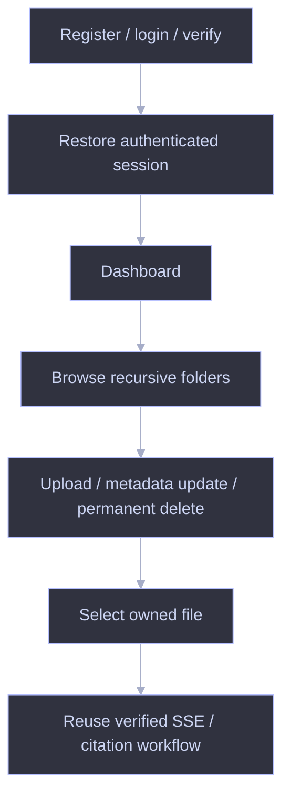
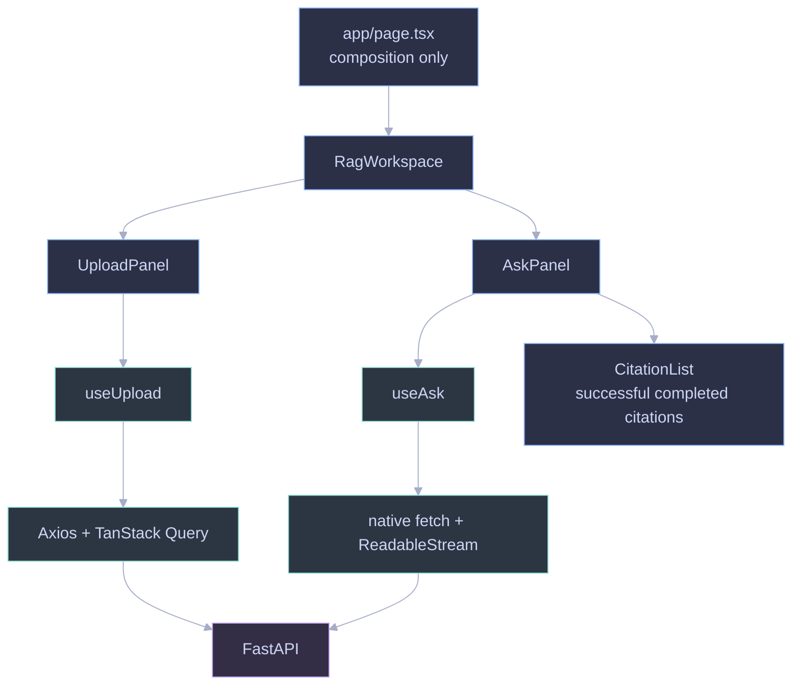
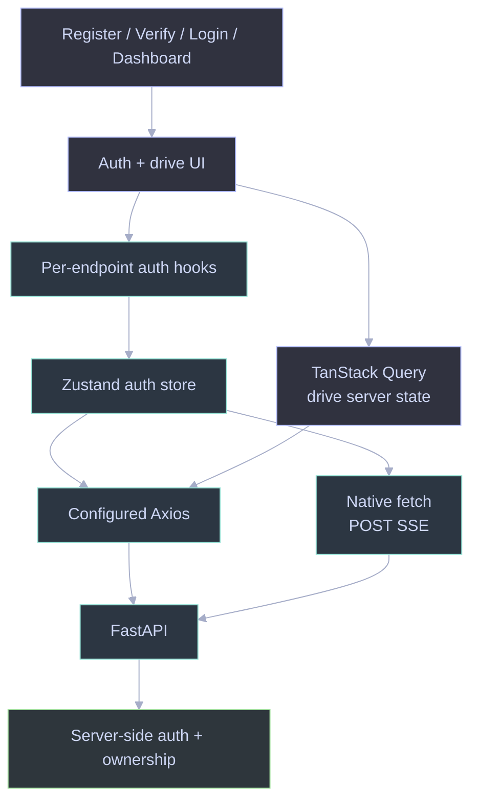
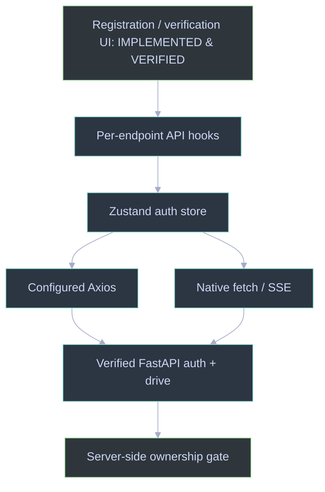

# Atlas — Client Engineering Standards

- Applies to `client/**`; inherits repository-wide rules from [root AGENTS.md](../AGENTS.md).
- Owns static Next.js/Bun/TypeScript browser conventions and verified FastAPI integration.
- Server-only behavior belongs to [server/AGENTS.md](../server/AGENTS.md); detailed RAG contracts belong to the [RAG skill](../.agents/skills/rag/SKILL.md).

---

## 0. DOCUMENT ROLE & INSTRUCTION HIERARCHY

- Applies to all work under `client/**`.
- Inherits every repository-wide rule from [root AGENTS.md](../AGENTS.md); read the root file first.
- This file is the authoritative frontend engineering contract for Atlas.
- It specializes root policy for the static Next.js client and must not silently weaken a LOCKED repository decision.
- Backend-specific rules belong in [server/AGENTS.md](../server/AGENTS.md).
- Detailed RAG implementation contracts belong in the [RAG skill](../.agents/skills/rag/SKILL.md); the client consumes verified public/backend contracts rather than redefining them.

### Reading order

For normal client work:

```text
root AGENTS.md
-> client/AGENTS.md
-> current PLAN
-> targeted source/tests
```

For cross-boundary work:

```text
root AGENTS.md
-> server/AGENTS.md
-> client/AGENTS.md
-> current PLAN
-> targeted server/client source/tests
```

Read backend/RAG instructions only when the client task actually crosses those boundaries.

Do not read the entire repository by default.

---

## 1. PURPOSE & ENGINEERING OBJECTIVES

### Client objective

- Preserve the verified Phase 1 static browser, upload and native POST-SSE foundation as historical evidence.
- Build Phase 2 authentication and protected navigation only when the relevant PLAN is approved.
- Consume verified FastAPI contracts; the browser is not an authorization authority.

### Phase 2 integration objectives

Phase 2 extends the static client only after the corresponding server contracts exist:

**Phase-wide target (NOT YET BUILT):**



Current client goals:

- remain a strict TypeScript, static-export Next.js application;
- communicate directly with FastAPI from the browser;
- integrate only against server contracts that have already been implemented and appropriately verified, unless the current PLAN explicitly defines a coordinated exception;
- preserve backend identity, ownership, trust, and provenance boundaries rather than recreating them client-side;
- add the minimum shared auth/session coordination needed by both Axios and streamed native fetch;
- keep state ownership explicit and avoid adding a global-state library merely for convenience;
- keep the frontend architecture maintainable and interview-defensible.

Still excluded unless explicitly approved:

- Next.js BFF/proxy/runtime-server architecture;
- client Docker service;
- client-authoritative authorization;
- multi-file/folder/drive RAG;
- sharing/teams/ACL management;
- file preview/download or persistent-original-file workflows;
- speculative persistence beyond the specifically approved auth-token behavior.

---

## 2. CURRENT STATE & DEVELOPMENT DESTINATION

### Status vocabulary

Use these labels exactly; do not infer verification from code existence or documentation.

| Status                    | Meaning                                                       | Applies when                                        |
| ------------------------- | ------------------------------------------------------------- | --------------------------------------------------- |
| `NOT YET BUILT`           | Required implementation is absent.                            | Work remains planned or unstarted.                  |
| `IMPLEMENTED, UNVERIFIED` | Implementation exists, but required acceptance is incomplete. | Checks are missing, blocked, or failed.             |
| `IMPLEMENTED & VERIFIED`  | Required implementation passed relevant acceptance checks.    | Executed, recorded verification supports the claim. |

- Assess PHASE, PLAN, and capability maturity independently.
- A completed PLAN does not complete the enclosing PHASE.
- Specifications and isolated checks alone do not prove complete acceptance.
- Identify any required checks that have not run.

### Phase and PLAN destination

| Scope                                             | Current maturity          |
| ------------------------------------------------- | ------------------------- |
| `PHASE_01`                                        | `IMPLEMENTED & VERIFIED`  |
| `PHASE_02`                                        | `IMPLEMENTED, UNVERIFIED` |
| `PHASE_02_PLAN_01` — Identity & Authentication    | `IMPLEMENTED & VERIFIED`  |
| `PHASE_02_PLAN_02` — Authenticated Drive Backend  | `IMPLEMENTED & VERIFIED`  |
| `PHASE_02_PLAN_03` — Client Authentication        | `IMPLEMENTED, UNVERIFIED` |
| `PHASE_02_PLAN_04` — Drive Dashboard & Acceptance | `NOT YET BUILT`           |

- **Active PLAN:** `PHASE_02_PLAN_03 — Client Authentication`; Amendments 01 and 02 are verified; Amendment 03 registration/verification/resend UI is `IMPLEMENTED & VERIFIED`; Amendment 04 login/logout UI is `IMPLEMENTED & VERIFIED`; protected entry remains unbuilt.
- **Last inspected branch:** `phase-02/plan-03`; inspect Git again before each task.
- PLAN_03 creates auth/session UX and minimal protected dashboard entry; full drive workflows belong to PLAN_04.
- The current Phase 1 client is not compatible with the removed `/documents/upload` endpoint; canonical upload is authenticated `POST /files`.
- Preserve useful existing SSE and transport utilities for future authenticated integration.

### Server-first integration gate

- Verified Phase 2 auth and drive contracts are available on the server.
- Client integration must follow those verified contracts; do not invent backend endpoints or auth semantics.
- Browser route protection is UX, not server authorization.

### Current client capability maturity

| Client capability                                        | Status                   |
| -------------------------------------------------------- | ------------------------ |
| Static Next.js + Bun Phase 1 client                      | `IMPLEMENTED & VERIFIED` |
| Phase 2 register / verify / resend UI                    | `IMPLEMENTED & VERIFIED` |
| Phase 2 login / logout UI                                | `IMPLEMENTED & VERIFIED` |
| Auth hooks / encrypted persistence / refresh integration | `IMPLEMENTED & VERIFIED` |
| Shared Zustand auth state and Axios/native fetch access  | `IMPLEMENTED & VERIFIED` |
| Protected dashboard entry                                | `NOT YET BUILT`          |
| Drive dashboard and recursive folders                    | `NOT YET BUILT`          |
| File metadata/lifecycle and owner-scoped ask UI          | `NOT YET BUILT`          |

### Evidence references

- Phase 1 client verification: [PLAN_05 CONTEXT](../prompts/PHASE_01/PLAN_05/PHASE_01_PLAN_05_CONTEXT.md) and [MANUAL](../prompts/PHASE_01/PLAN_05/PHASE_01_PLAN_05_MANUAL.md).
- Phase 2 server contract evidence: [PLAN_01 CONTEXT](../prompts/PHASE_02/PLAN_01/PHASE_02_PLAN_01_CONTEXT.md), [PLAN_02 CONTEXT](../prompts/PHASE_02/PLAN_02/PHASE_02_PLAN_02_CONTEXT.md).
- Phase 2 client evidence: [PLAN_03 CONTEXT](../prompts/PHASE_02/PLAN_03/PHASE_02_PLAN_03_CONTEXT.md) and [MANUAL](../prompts/PHASE_02/PLAN_03/PHASE_02_PLAN_03_MANUAL.md); preserve Amendment 01 history; Amendment 02 Stage 02 records current Chromium/live acceptance separately.

---

## 3. COMPLETED HISTORY & VERIFIED BASELINES

- Completed PHASES only; current Phase 2 maturity remains in Section 2.
- Every capability below belongs to a verified historical baseline; repeat status labels are unnecessary.
- Keep detailed Phase 1 verification and Amendment chronology in CONTEXT/MANUAL.
- The historical Phase 1 upload UI does not establish current Phase 2 API compatibility.

### PHASE_01 — MVP Core RAG

**Objective:** Established the complete static browser workflow for uploading one file, retaining the exact backend file ID, consuming native POST-SSE answers, and rendering trusted completed citations.

#### Verified baseline


#### Verified maturity

| Capability                     | Delivered behavior                                      |
| ------------------------------ | ------------------------------------------------------- |
| Static Next.js foundation      | App Router static export via Bun/TypeScript.            |
| Direct browser-to-FastAPI CORS | Direct API calls; backend retains trust authority.      |
| Upload form/request            | Phase 1 browser upload; backend endpoint later removed. |
| Returned-ID handoff            | Exact backend ID retained for subsequent ask.           |
| Naming/aliases/Prettier        | Verified structure, aliases and format.                 |
| Question submission            | Validated file-scoped question.                         |
| Native POST-SSE consumption    | Incremental native `fetch` streaming.                   |
| Incremental answer rendering   | Progressive answer display.                             |
| Internal citation retention    | Citation markers withheld from answer text.             |
| Trusted citation display       | Source metadata rendered after completion.              |

#### Completion boundary

Phase 1 client remains:

- single-file;
- unauthenticated;
- without folders/drive navigation;
- without metadata-management UI;
- without client persistence beyond the verified Phase 1 transient state;
- dependent on FastAPI as the authoritative backend.

#### Evidence

- [PLAN_05 CONTEXT](../prompts/PHASE_01/PLAN_05/PHASE_01_PLAN_05_CONTEXT.md)
- [PLAN_05 MANUAL](../prompts/PHASE_01/PLAN_05/PHASE_01_PLAN_05_MANUAL.md)

---

## 4. ARCHITECTURE & DATA FLOW

### Stack

- Next.js: App Router, current PLAN_05 installed version.
- Language: TypeScript only.
- Runtime/package manager/script runner: Bun only.
- Rendering/deployment: static export via `output: "export"`.
- Styling: Tailwind CSS + shadcn/ui.
- Ordinary HTTP: Axios.
- Server-state orchestration: TanStack Query v5.
- Streamed `/ask`: native browser `fetch()` + `ReadableStream`.
- Forms: React Hook Form.
- Runtime validation: Zod.
- Formatting: Prettier through Bun.
- Zustand is LOCKED for shared in-memory auth/application state by PLAN_03 Amendment 02; no other state library or speculative store is approved.

### Runtime model

- Browser talks directly to FastAPI.
- Do not insert a Next.js BFF/proxy.
- Do not add Route Handlers or Server Actions to proxy Atlas API traffic.
- Do not add a production Next.js runtime server.
- Do not add a client Docker service without an explicit architecture change.
- Static export is the production client artifact.
- Changing browser-visible API configuration requires rebuilding the static artifact.
- Browser route protection is UX only; FastAPI remains the authoritative authentication/authorization boundary.

### Tooling

- Use Bun for scaffolding, install, package execution, dev, build, formatting, typecheck, lint, and tests.
- Canonical lockfile: `bun.lock`.
- Do not add:
  - `package-lock.json`
  - `pnpm-lock.yaml`
  - `yarn.lock`
  - `bun.lockb`
- Prefer:
  - `bun create`
  - `bunx --bun`
  - `bun add`
  - `bun install`
  - `bun run`
- Do not introduce `npm`, `npx`, `pnpm`, or `yarn` as required client workflows.

### Verified Phase 1 composition



Phase 1 responsibilities remain verified:

- `page.tsx` owns route composition only.
- `RagWorkspace` coordinates upload and ask state across the active file scope.
- `UploadPanel` owns upload presentation/form interaction.
- `AskPanel` owns question/answer presentation/form interaction and gates citations on successful completion.
- `CitationList` renders the validated completed result in backend order, with exact excerpts and only non-null page/heading/section metadata; it owns no transport or stream state.
- `useUpload` owns upload React lifecycle and mutation orchestration.
- `useAsk` owns streamed ask React lifecycle.
- services own extracted transport/session responsibilities when extraction creates a clear single responsibility.
- pure stream parsing lives under `utils/stream/`.
- runtime schemas validate untrusted network/SSE data before trusted state changes.

### Phase 2 intended client boundary

Legend: one client auth/session authority supplies both ordinary Axios requests and native streamed fetch without moving authorization authority out of FastAPI.



Phase 2 rules:

- the shared auth/session boundary is a client coordination mechanism, not an authorization authority;
- both Axios and native streamed fetch consume the same current access-token/session state;
- do not build independent token stores for ordinary HTTP and SSE;
- preserve exact backend folder/file UUIDs as identity; never derive identity, ownership, cache identity, or routing identity from display names;
- duplicate sibling folder names, duplicate sibling file names, and matching file/folder display names are valid; distinguish resources by type + backend UUID rather than assuming name uniqueness;
- do not invent backend DTOs/endpoints/session behavior in client code before the server contract exists;
- preserve the verified SSE parser and citation trust model when adding authenticated transport.

---

## 5. REPOSITORY STRUCTURE & OWNERSHIP

The folder contract is mandatory. Create a domain subfolder only when that layer actually has code for the domain; do not create empty symmetry folders.

```text
client/
├── AGENTS.md
├── public/
├── src/
│   ├── app/                              # Next.js routes/layout/composition only
│   │   ├── globals.css
│   │   ├── layout.tsx
│   │   └── page.tsx
│   ├── components/
│   │   ├── ui/                           # shadcn/ui generated primitives only
│   │   ├── Common/                       # genuinely app-wide Atlas presentation
│   │   ├── Rag/                          # shared upload/ask workflow composition
│   │   ├── Upload/                       # upload-specific components
│   │   ├── Ask/                          # question/answer components
│   │   └── Citations/                    # citation-specific presentation components
│   ├── hooks/
│   │   ├── auth/                         # one hook per user-facing auth endpoint
│   │   ├── common/                       # truly cross-domain React hooks
│   │   ├── upload/                       # upload hooks/mutations
│   │   └── ask/                          # streamed ask lifecycle hooks
│   ├── services/
│   │   ├── auth/                         # auth.ts lifecycle; token.ts encryption; key.ts IndexedDB
│   │   ├── http/                         # configured Axios/native fetch infrastructure
│   │   ├── upload/                       # extracted upload transport/boundary logic if warranted
│   │   └── ask/                          # extracted ask request/session logic if warranted
│   ├── schemas/
│   │   ├── env.ts                        # public environment Zod schema
│   │   ├── auth/                         # strict auth request/response schemas
│   │   ├── upload/                       # upload form/response Zod schemas
│   │   └── ask/                          # ask form/SSE event Zod schemas
│   ├── types/
│   │   ├── common/                       # compile-time-only shared types when needed
│   │   ├── upload/
│   │   └── ask/
│   ├── providers/
│   │   └── query/                        # TanStack Query provider wiring
│   ├── constants/
│   │   ├── env.ts                        # validated env.API_BASE_URL singleton
│   │   ├── auth.ts                       # literal auth endpoint paths only
│   │   └── common/                       # stable cross-cutting constants only
│   ├── stores/
│   │   └── auth.ts                       # sole synchronous in-memory auth state
│   ├── utils/
│   │   ├── common/                       # pure cross-cutting helpers
│   │   └── stream/                       # pure stream/SSE parsing helpers
│   └── lib/
│       └── utils.ts                      # shadcn-required utility boundary only
├── tests/
│   ├── unit/
│   │   ├── upload/
│   │   ├── ask/
│   │   └── stream/
│   └── integration/
│       └── rag/
├── components.json
├── next.config.ts
├── tsconfig.json
├── package.json
└── bun.lock
```

Do not create unused folders merely to make the tree look symmetrical.

- `src/app/` owns Next.js routing, layouts, route composition, and route-level metadata only.
- Do not bury reusable components, hooks, services, schemas, or business logic in route folders.
- `components/ui/` is reserved for shadcn/ui primitives. Do not place Atlas business logic there.
- `components/Common/` is for genuinely app-wide reusable Atlas presentation components.
- Domain-owned presentation remains under `components/<Domain>/`.
- `hooks/<domain>/` owns React lifecycle, local state, direct TanStack Query usage, and hook-specific orchestration.
- Hook-specific interfaces/types remain in the hook module unless shared ownership warrants extraction.
- Extract substantial transport, response validation, or request sessions into `services/<domain>/` only when the extracted module has a clear single responsibility.
- Avoid redundant pass-through service layers.
- `services/http/` owns shared HTTP infrastructure only.
- Do not wrap TanStack Query in a generic service abstraction.
- `schemas/<domain>/` owns Zod validation for forms and untrusted external data.
- Prefer Zod-inferred TypeScript types rather than duplicate manual interfaces.
- `types/<domain>/` is only for compile-time types that are not naturally derived from Zod or external library types.
- `providers/<domain>/` owns application provider wiring such as TanStack Query.
- `schemas/env.ts` owns public environment validation and normalization.
- `constants/` contains stable constants and the validated `env` object; `constants/env.ts` parses the public build-time configuration once and consumers use `env.API_BASE_URL`.
- `utils/` contains pure helpers with no React state or network ownership.
- `lib/utils.ts` remains the shadcn `cn`-style utility boundary; do not turn `lib/` into a business-logic directory.
- `tests/` mirrors behavior by test level/domain. Do not scatter `__tests__` directories through `src/`.
- Do not create barrel `index.ts` files by default.
- Do not create vague catch-all files/folders such as `helpers.ts`, `misc.ts`, `stuff/`, or `common.ts`.

---

## 6. ENGINEERING & DOCUMENTATION CONVENTIONS

### Components

Atlas component domain folders and reusable component files use PascalCase:

```text
components/Upload/UploadPanel.tsx
components/Ask/AskPanel.tsx
components/Rag/RagWorkspace.tsx
```

Exceptions:

- `components/ui/` retains shadcn-generated lowercase naming.
- Next/tool-required filenames keep their required conventions:
  - `page.tsx`
  - `layout.tsx`
  - `not-found.tsx`
  - `next-env.d.ts`
  - `next.config.ts`
  - `eslint.config.mts`

### Hooks

- Hook domain folders stay lowercase.
- Hook filenames use `use<Name>.ts`.
- Hook files contain no JSX.

Examples:

```text
hooks/upload/useUpload.ts
hooks/ask/useAsk.ts
```

### Other files

- User-controlled multiword filenames/directories use lowerCamelCase.
- Single-word names may remain lowercase.
- Tests use lowerCamelCase before `.test.ts`.
- Use `.test.tsx` only when JSX is actually required.
- Do not use hyphenated user-controlled TypeScript/TSX filenames.
- Export component/type symbols with PascalCase.
- Export variables/functions with camelCase.

### Source-root aliases

Current aliases:

- `@app/*` -> `./src/app/*`
- `@components/*` -> `./src/components/*`
- `@hooks/*` -> `./src/hooks/*`
- `@stores/*` -> `./src/stores/*`
- `@constants/*` -> `./src/constants/*`
- `@lib/*` -> `./src/lib/*`
- `@providers/*` -> `./src/providers/*`
- `@schemas/*` -> `./src/schemas/*`
- `@services/*` -> `./src/services/*`
- `@utils/*` -> `./src/utils/*`
- `@/*` -> `./src/*` fallback

Use dedicated aliases for cross-root imports.
Short local relative imports are acceptable.
Avoid deep relative chains.
Do not add speculative aliases.

- Frontend application source is TypeScript only: `.ts` and `.tsx`.
- Keep TypeScript `strict` enabled.
- Keep `allowJs=false`.
- Do not weaken compiler strictness to bypass an error.
- Do not use `any` unless an external-library boundary makes it unavoidable and the exception is narrowly documented.
- Prefer `unknown` plus validation/narrowing.
- Treat HTTP/SSE JSON as `unknown` until Zod validation succeeds.
- Define named interfaces for component props and structural application contracts instead of inline object annotations.
- Prefer interfaces for object shapes.
- Use type aliases for unions, callbacks, and Zod-inferred data.
- Primitive and existing library types can be used directly.
- Colocate hook interfaces/types in the hook module by default.
- Extract shared contracts only when reuse/ownership warrants it.
- Export only types/interfaces consumers actually need.
- Do not use type assertions to bypass a missing trust-boundary validation.

### Prettier

- Use Prettier defaults through Bun.
- Use the repository `format` and `format:check` scripts.
- Exclude generated/build artifacts according to the current Prettier ignore file.
- Do not add formatting/import-sorting plugins without approval.
- Formatting does not replace manual readability conventions.

### Exports

Atlas components, providers, and hooks use:

```ts
export default function Name(...) {}
```

Preserve generated shadcn primitive export conventions.

- Hook entry functions and React components/providers MUST retain normal function declarations.
- Functions nested inside hooks and other handwritten helper implementations MUST use arrow functions, including object action implementations; class constructors, getters/setters and interface method signatures retain their required syntax.
- Define arrow functions before any module-level expression that reads them; do not rely on function hoisting.

### Object literals

Write nonempty object literals across multiple lines, one property per line, including:

- nested options;
- state updates;
- return objects.

### Imports

- Keep package imports together immediately below directives.
- Group internal imports by category.
- Typical internal order:
  1. hooks
  2. components
  3. services
  4. schemas/constants/utils/other categories
- Use one blank line between groups.
- No blank line within one import group.

### Code readability and control flow

- Domain literal unions MUST have named type aliases beside their owning code, such as `AuthStateType`; do not repeat inline status/action unions across fields or return types.
- MUST leave one blank line between logical steps and adjacent function definitions.
- MUST keep conditions, arguments, and operations readable; avoid cramped one-line statements.
- MUST use braces for conditional branches, including branches containing only `return` or `throw`.
- Early-return or early-throw guard clauses MUST appear only as the first statement of a function.
- Later conditional decisions MUST use explicit braced `if`/`else` flow rather than additional guard clauses.
- Prettier formatting MUST NOT replace these manual readability requirements.
- Apply these conventions to affected handwritten tests as well as production code; keep generated primitives and unrelated files outside a cosmetic sweep.

### React readability

- Leave one blank line between logical JSX sections where it improves readability.
- Do not scatter inline comments explaining individual lines.

### Documentation and ownership

- Inherit the root PHASE / PLAN / AMENDMENT, CONTEXT and MANUAL model.
- Codex records actual code changes and executed tests; do not pre-create client Phase 2 evidence.
- Preserve verified naming, aliases and formatting unless the approved PLAN supersedes them.

---

## 7. TECHNICAL CONTRACTS & RUNTIME BEHAVIOR

### Ordinary HTTP, authentication and SSE

#### Ordinary HTTP

- Use configured Axios for ordinary request/response HTTP such as uploads and later CRUD/authenticated calls.
- Preserve the browser-generated multipart boundary for file uploads.
- Do not invent arbitrary client-side file-size/time limits when the backend contract does not define them.
- TanStack Query owns approved query/mutation server-state orchestration.
- Do not use TanStack Query as a substitute for local ephemeral UI state.

#### Shared HTTP infrastructure

- `services/http/axios.ts` MUST export one actual configured Axios instance; no custom Axios facade or public client factory.
- `services/http/fetch.ts` exports one configured native fetch client with base/get/post; preserve raw responses and streams.
- Both resolve the validated API URL centrally.
- Both accept `isProtected?: boolean`; omission preserves path defaults, `true` requires trusted-target Bearer access, and `false` strips Authorization and bypasses bootstrap/refresh/replay.
- Cookie credentials are independent of `isProtected`; login/verify/logout use `isProtected: false` plus explicit cookies.
- User-facing `useRegister`, `useResend`, `useVerify`, `useLogin`, `useLogout`, and explicit `useAuth` own their endpoint contracts; no grouped auth API service or session controller.
- Hooks MUST import the shared HTTP instance directly and use named, readable actions; do not inject clients/coordination or pass request callbacks through service layers.
- Each hook owns its input validation, direct awaited request, response validation and safe error handling; duplicate-submission protection stays local to mutations.
- Auth hooks expose only named actions and operation-prefixed state; mutation loading maps to `isPending`. `useAuth` remains disabled by default with explicit `getAuth`; Zustand owns authentication truth.
- `services/auth/` contains `auth.ts` (non-React lifecycle), `token.ts` (encrypted persistence), and `key.ts` (IndexedDB CryptoKey); Zustand remains the only user/JWT state owner.
- `auth.ts` supplies start/finish lifecycle operations for cookie ordering and state commit; hooks own user-triggered HTTP.
- Non-React bootstrap and refresh use private native-fetch bypass mechanics in `validate.ts`; no extra Axios instance or React hook invocation.
- Preserve native Axios request options and raw fetch `Response`/stream ownership.
- Phase 2 authenticated Axios and native fetch must consume one shared access-token/session authority rather than duplicating token state.
- Refresh credentials remain in the approved HttpOnly-cookie path and must not be copied into JavaScript-accessible storage.
- Do not blindly replay arbitrary failed mutating requests after refresh; request replay semantics require an explicit safe contract.

#### Streamed ask

- Use native browser `fetch()` for `POST /files/{file_id}/ask`.
- Do not force Axios around the SSE stream.
- Do not wrap the live SSE stream in TanStack Query.
- Do not use EventSource because the endpoint is POST.
- Do not add a third-party SSE library without approval.
- Use `ReadableStream` and incremental UTF-8 decoding.
- Do not assume one transport chunk equals one SSE event.
- Pure SSE framing/protocol helpers belong under `utils/stream/`.
- Runtime-validate application event payloads before trusted state updates.
- Internal citation markers must never become public answer text.
- Use `AbortController` for internal stream ownership/cleanup.
- No user-facing Cancel feature unless an approved later PLAN adds one.
- No retry/reconnect/resume/Last-Event-ID semantics unless explicitly approved.

### Forms, state and UI contracts

- Use React Hook Form for forms.
- Use Zod for form validation.
- Use `stores/auth.ts` Zustand selectors for reactive auth state; transports read that same store through `getState()`.
- Store actions MUST remain synchronous; no HTTP/crypto/IndexedDB, persist middleware, token devtools, or second token owner.
- TanStack Query owns approved remote/server state; local UI state remains with the owning route/component/hook.
- Phase 2 explicitly permits the approved reversibly encrypted access token in `localStorage`.
- Do not store the refresh token, password, OTP, or client-side encryption key/material in `localStorage`.
- Client-side reversible access-token encryption is defense-in-depth/obfuscation, not an XSS security boundary.
- Do not generalize the access-token exception into arbitrary `localStorage`/`sessionStorage`/IndexedDB persistence without approval.
- If the persisted access token cannot be safely recovered/used, discard it and rely on the approved refresh-cookie flow rather than bypassing authentication checks.
- Prevent duplicate mutating/streaming submissions while the same operation is active.
- Preserve the verified ask abort/reset behavior when the selected active file changes.
- Browser route/auth state never establishes server ownership or authorization.

- Use Tailwind CSS + shadcn/ui.
- Prefer default shadcn behavior unless the current PLAN requires a specific product interaction.
- Keep presentation functional rather than product-polished.
- `components/ui/` is generated primitive territory; preserve generated APIs/conventions.
- Do not add another component/styling system.
- Avoid handwritten `aria-*` attributes unless needed for functionality/accessibility; prefer native labels and visible status/error text.
- Do not add Markdown renderers, animation libraries, or other presentation dependencies without an approved need.

### Environment, build and static export

- `NEXT_PUBLIC_ATLAS_API_BASE_URL` is a browser-visible build-time value.
- Never place secrets in `NEXT_PUBLIC_*`.
- Validate the public API base through the established client configuration boundary.
- Browser API base must remain an absolute supported HTTP(S) URL according to the current validator.
- Static export means a deployment API-base change requires rebuild.
- Next.js rewrites are unavailable with static export; do not add a runtime proxy to imitate base-URL resolution.
- Client local env files remain ignored.
- `.env.example` contains safe examples/placeholders only.
- Never place passwords, OTPs, access tokens, refresh tokens, or client encryption secrets in public build-time configuration.

### Authentication transport boundary

- Amendment 02 verifies the foundation below in Chromium against the existing backend; Amendment 03 verifies registration/verification/resend UI in Chromium against the existing backend. Amendment 04 login/logout UI is `IMPLEMENTED & VERIFIED`; protected navigation remains planned.
- AES-GCM/IndexedDB storage retains version-1 compatibility; logout deletes only auth ciphertext and its auth-owned IndexedDB key, and explicit login/verify generates a key when absent.



---

## 8. SECURITY & TRUST BOUNDARIES

### Browser trust boundaries

- All browser input and network payloads are untrusted; use Zod validation at relevant HTTP/SSE boundaries.
- A protected client route is a navigation/UX mechanism; FastAPI performs all authentication and authorization.
- Never infer owner access from local state, selected IDs or encryption.
- Treat model-authored provenance as untrusted; render only Atlas-validated citations.

### Credentials and persistence

- Refresh tokens must remain in the server-controlled HttpOnly cookie.
- Approved access-token exception: active JWT in memory and reversibly encrypted access token in `localStorage`.
- Never store passwords, OTPs, refresh tokens or client encryption keys/material in `localStorage`.
- Reversible client-side encryption is not an XSS security boundary.
- The approved non-extractable AES-256-GCM key lives in IndexedDB `atlas.auth/keys/access`; logout deletes that record, never the origin database or unrelated records.
- Do not introduce `sessionStorage`, additional persistence, or cross-tab arbitration without approval.
- If saved token material is unusable, discard it and restore through the approved refresh-cookie flow.
- Do not silently replay arbitrary mutating or streaming requests after authentication failure.

### Static deployment and exposure

- `NEXT_PUBLIC_*` is browser-visible and MUST NOT contain secrets.
- Keep API origin and credential/CORS behavior compatible with the verified FastAPI deployment configuration.
- Never log or expose cookies, JWTs, credentials, verification codes, keys, uploaded content or source excerpts in browser diagnostics.

---

## 9. SCOPE & ARCHITECTURE GOVERNANCE

### Always do

- Read root `AGENTS.md` before this file.
- Reuse current client architecture and naming.
- Keep components presentation-focused.
- Keep hooks lifecycle-focused.
- Keep pure parser/utilities free of React/network ownership.
- Validate untrusted network boundaries.
- Preserve exact backend IDs/provenance rather than deriving replacements.
- Keep static export viable.
- For cross-boundary Phase 2 work, consume only an implemented/verified server contract unless the PLAN explicitly defines a coordinated exception.
- Derive no ownership decision from client-selected IDs; send resource identifiers and let FastAPI authorize them.

### Ask first

- new frontend dependency;
- new state library;
- new form library;
- new network library;
- new component library;
- new testing framework;
- public API shape change;
- Next.js server/runtime boundary;
- changes to the approved persistence strategy;
- changes to the approved auth/token architecture.

### Never do

- add Node/npm/npx/pnpm/Yarn as required runtime/package-manager workflow;
- add a Next BFF/proxy without an explicit architecture change;
- add a client Docker service without an explicit architecture change;
- add global state merely for convenience;
- persist refresh tokens, passwords, OTPs, or auth secrets in JavaScript-accessible storage;
- treat reversible client-side token encryption as an authorization or XSS security boundary;
- bypass runtime validation with casts;
- treat model-authored provenance as trusted citation metadata;
- invent backend ownership/auth behavior or pre-implement speculative API contracts;
- add speculative future folders/aliases/abstractions beyond the current PLAN;
- place business logic in `components/ui/` or `lib/utils.ts`.

### Decision vocabulary

- `LOCKED`: cannot change without approval.
- `PROVISIONAL`: a recommended but unconfirmed direction.
- `OPEN`: a material decision reserved for the user.
- `SUPERSEDED`: changed by a later approved decision.

---

## 10. GIT & REPOSITORY SAFETY

- Inherit [root Git safety rules](../AGENTS.md) without exception.
- Inspect branch, working tree and relevant diffs before client work.
- Do not commit, push, branch-switch/create, rewrite history, reset or discard uncommitted changes without explicit authorization.
- Preserve tracked `bun.lock`; no npm/pnpm/Yarn lockfiles or ad hoc package-manager migration.
- Avoid unapproved backend edits, database resets, Qdrant cleanup or Docker volume changes during client acceptance.
- Do not assume the planned `phase-02/plan-03` branch exists locally.
- Run `git diff --check` and report affected files before completing an AMENDMENT.

---

## 11. VERIFICATION & ACCEPTANCE

Verification follows the root risk model.

For normal client implementation, use the current Bun scripts:

```bash
bun install --frozen-lockfile
bun run format
bun run format:check
bun run lint
bun run typecheck
bun run test
bun run build
```

Rules:

- Do not claim a check passed unless it actually ran.
- Keep `bun.lock` as the only package-manager lockfile.
- Unit tests must not make real Gemini calls.
- Use the narrowest existing test seam; do not add a test library merely for convenience.
- Browser acceptance may use the existing verified backend/Qdrant runtime when the task requires real integration.
- Static-export acceptance should exercise `out/` without a Next production server when relevant.
- Client-only changes do not require backend Docker rebuild unless they change backend/deployment-sensitive inputs.
- Preserve persistent Qdrant data; do not delete/reset backend state for client verification.
- Run `git diff --check` from the repository root before completion.

---

## 12. STANDARD ENGINEERING WORKFLOW

### Before implementation

- Read root AGENTS, this file, current approved PLAN and targeted client source/tests.
- Confirm verified backend endpoint/DTO/error behavior only where it affects the current task.
- Inspect existing component, hook, schema, service and test conventions; do not preload the whole repository.
- Resolve material auth/token storage and session-lifecycle decisions with the user before Codex implements them.

### During implementation

- Keep one AMENDMENT focused and preserve static export, Bun, existing SSE parser and state ownership.
- Separate browser presentation, React lifecycle, HTTP transport and pure parsing.
- Preserve the user's unrelated work and reuse existing dependencies.

### Verification and completion

- Run task-relevant Bun tests, formatting, lint, typecheck and build.
- Exercise deployed static `out/` when browser/static-export behavior is in scope.
- Verify cookie/CORS/auth/browser behavior with approved test accounts only when in scope.
- Record commands and actual results in Codex-owned CONTEXT/MANUAL; report unverified work precisely.

---

## 13. MCP USAGE GUIDELINES

The user has configured three custom Codex CLI MCPs. Use only when necessary; first confirm they are available in the active session. Follow [root MCP safety and evidence rules](../AGENTS.md).

| MCP               | Client relevance                                                           | Use only when                                                               |
| ----------------- | -------------------------------------------------------------------------- | --------------------------------------------------------------------------- |
| `context7`        | Version-specific Next.js, React, Bun, Axios or browser API contracts.      | Local source/dependency docs do not resolve a material API uncertainty.     |
| `playwright`      | Reproducible browser checks of forms, auth, navigation, and static export. | User-approved browser acceptance cannot be established by unit tests alone. |
| `chrome-devtools` | Targeted console, network, cookie/CORS, hydration or SSE diagnosis.        | A specific client runtime problem requires low-level inspection.            |

- Use `playwright` for deterministic journeys; prefer `chrome-devtools` only for deeper diagnosis.
- Avoid running both on the same behavior without a concrete reason.
- Never copy JWTs, cookies, passwords, OTPs, encryption material, user uploads or sensitive source content into recordings/screenshots/CONTEXT.
- Use approved test accounts and preserve persistent remote/user state.
- A successful MCP observation is verification evidence only for the behavior actually exercised.
- MCP tools cannot approve changes to LOCKED Next.js/static export or token-storage architecture.

---

## 14. COMMANDS & TOOLING

Run from `client/`:

```bash
bun install --frozen-lockfile
bun run format
bun run format:check
bun run lint
bun run typecheck
bun run test
bun run build
bun run dev
```

Use project scripts rather than ad hoc tool invocations when the script already exists.

Do not use npm/npx/pnpm/yarn in the normal client workflow.

---

## 15. EXPLAIN-BACK REQUIREMENT

For non-trivial client work, report:

- files changed and each responsibility;
- affected client capability;
- component/hook/service/schema ownership;
- request/stream/state lifecycle where relevant;
- trust-boundary/runtime validation behavior;
- failure/abort/reset behavior;
- exact Bun commands/checks run and results;
- browser/static-export verification actually performed;
- remaining unverified client scope.

Do not claim backend verification unless it actually ran.
