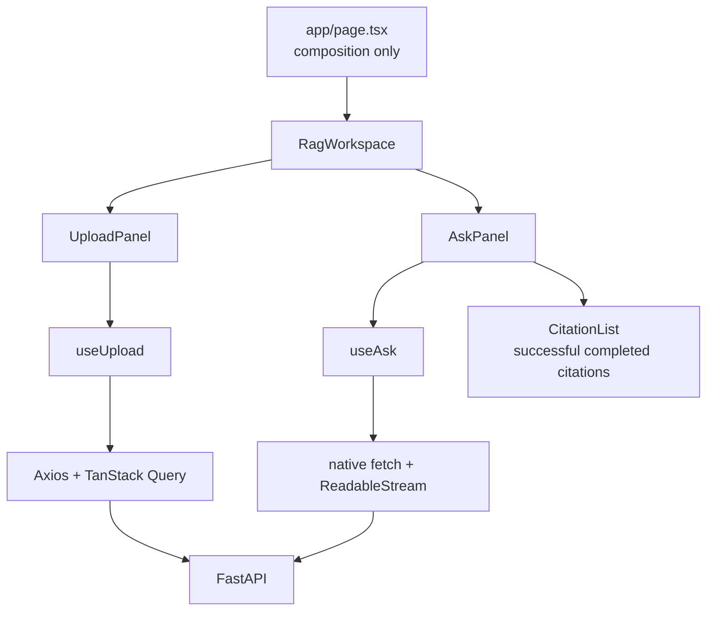
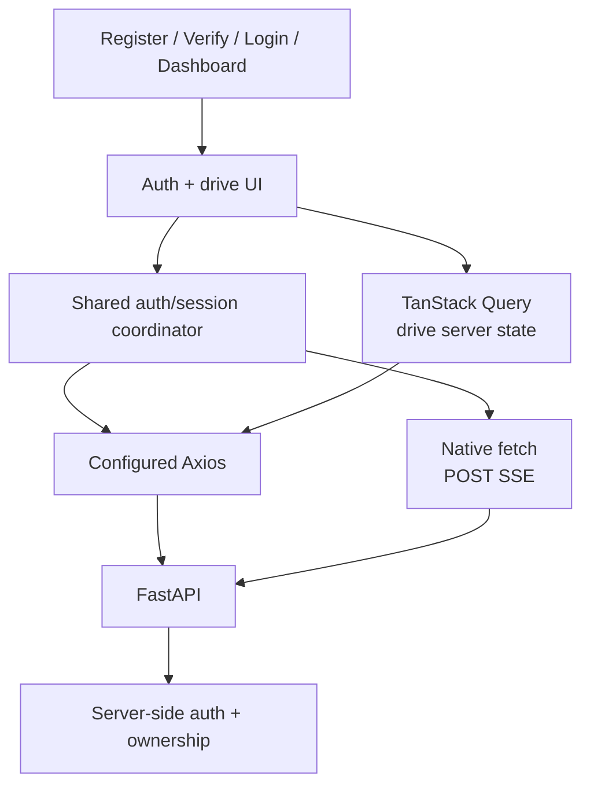

# AGENTS.md — Atlas Client

## 0. DOCUMENT ROLE & INHERITANCE

- Applies to all work under `client/**`.
- Inherits every repository-wide rule from [root AGENTS.md](../AGENTS.md); read the root file first.
- This file is the authoritative frontend engineering contract for Atlas.
- It specializes root policy for the static Next.js client and must not silently weaken a LOCKED repository decision.
- Backend-specific rules belong in [server/AGENTS.md](../server/AGENTS.md).
- Detailed RAG implementation contracts belong in the [RAG skill](../.agents/skills/rag/SKILL.md); the client consumes verified public/backend contracts rather than redefining them.

### Reading order

For normal client work:

```text
root AGENTS.md
-> client/AGENTS.md
-> current PLAN
-> targeted source/tests
```

For cross-boundary work:

```text
root AGENTS.md
-> server/AGENTS.md
-> client/AGENTS.md
-> current PLAN
-> targeted server/client source/tests
```

Read backend/RAG instructions only when the client task actually crosses those boundaries.

Do not read the entire repository by default.

---

## 1. CLIENT PURPOSE & CURRENT OBJECTIVE

### Verified Phase 1 client baseline

The Atlas client already exposes the verified single-file workflow:

```text
upload file
-> retain exact backend file ID
-> ask question
-> consume POST SSE
-> render streamed answer
-> render trusted citations
```

Phase 1 client status is IMPLEMENTED & VERIFIED.

### Current Phase 2 client objective

Phase 2 extends the static client only after the corresponding server contracts exist:

```text
register/login/verify
-> restore authenticated session
-> dashboard
-> browse recursive folders
-> upload/update/delete file metadata/content index
-> select owned file
-> reuse verified ask/SSE/citation workflow
```

Current client goals:

- remain a strict TypeScript, static-export Next.js application;
- communicate directly with FastAPI from the browser;
- integrate only against server contracts that have already been implemented and appropriately verified, unless the current PLAN explicitly defines a coordinated exception;
- preserve backend identity, ownership, trust, and provenance boundaries rather than recreating them client-side;
- add the minimum shared auth/session coordination needed by both Axios and streamed native fetch;
- keep state ownership explicit and avoid adding a global-state library merely for convenience;
- keep the frontend architecture maintainable and interview-defensible.

Still excluded unless explicitly approved:

- Next.js BFF/proxy/runtime-server architecture;
- client Docker service;
- client-authoritative authorization;
- multi-file/folder/drive RAG;
- sharing/teams/ACL management;
- file preview/download or persistent-original-file workflows;
- speculative persistence beyond the specifically approved auth-token behavior.

---

## 2. CURRENT CLIENT STATE

### Active phase

#### PHASE_02 — AUTHENTICATED PERSONAL DRIVE

- **Client status:** `NOT YET BUILT`
- **Integration gate:** client Phase 2 work starts only after the corresponding server contracts are implemented and appropriately verified, unless the current PLAN explicitly defines a coordinated exception.

#### SERVER-FIRST GATE

```text
server contract
-> server implementation
-> server verification
-> client integration
-> cross-boundary acceptance
```

#### CURRENT CLIENT MATURITY

| Client capability                                   | Status        |
| --------------------------------------------------- | ------------- |
| Registration / verification UI                      | NOT YET BUILT |
| Login / logout / refresh integration                | NOT YET BUILT |
| Shared authenticated transport/session coordination | NOT YET BUILT |
| Authenticated dashboard                             | NOT YET BUILT |
| Recursive folder navigation                         | NOT YET BUILT |
| File metadata modals / lifecycle integration        | NOT YET BUILT |
| Owner-authorized ask integration                    | NOT YET BUILT |

Approved designs are not implemented behavior until code and verification exist.

#### CURRENT EVIDENCE

No Phase 2 client CONTEXT/MANUAL evidence exists yet because client implementation has not begun.

---

## 3. COMPLETED CLIENT HISTORY

This section records durable verified client baselines for completed Atlas phases.

It is not a chronological implementation log. Detailed Amendment history, failures, timings, versions, hashes, test counts, and corrective work remain in the corresponding CONTEXT files.

Completed client phases are appended here in order when the entire PHASE reaches `IMPLEMENTED & VERIFIED`.

### PHASE_01 — MVP CORE RAG

- **Status:** `IMPLEMENTED & VERIFIED`
- **Brief:** Established the complete static browser workflow for uploading one file, retaining the exact backend file ID, consuming native POST-SSE answers, and rendering trusted completed citations.

#### VERIFIED BASELINE

```text
upload file
-> retain exact backend file ID
-> ask question
-> consume POST SSE
-> render streamed answer
-> render trusted citations
```

#### VERIFIED CLIENT MATURITY

| Client capability              | Status                 |
| ------------------------------ | ---------------------- |
| Static Next.js foundation      | IMPLEMENTED & VERIFIED |
| Direct browser-to-FastAPI CORS | IMPLEMENTED & VERIFIED |
| Upload form/request            | IMPLEMENTED & VERIFIED |
| Returned-ID handoff            | IMPLEMENTED & VERIFIED |
| Naming/aliases/Prettier        | IMPLEMENTED & VERIFIED |
| Question submission            | IMPLEMENTED & VERIFIED |
| Native POST-SSE consumption    | IMPLEMENTED & VERIFIED |
| Incremental answer rendering   | IMPLEMENTED & VERIFIED |
| Internal citation retention    | IMPLEMENTED & VERIFIED |
| Trusted citation display       | IMPLEMENTED & VERIFIED |

#### COMPLETION BOUNDARY

Phase 1 client remains:

- single-file;
- unauthenticated;
- without folders/drive navigation;
- without metadata-management UI;
- without client persistence beyond the verified Phase 1 transient state;
- dependent on FastAPI as the authoritative backend.

#### EVIDENCE

- [PLAN_05 CONTEXT](../prompts/PHASE_01/PLAN_05/PHASE_01_PLAN_05_CONTEXT.md)
- [PLAN_05 MANUAL](../prompts/PHASE_01/PLAN_05/PHASE_01_PLAN_05_MANUAL.md)

---

## 4. CLIENT ARCHITECTURE & DATA FLOW

### Stack

- Next.js: App Router, current PLAN_05 installed version.
- Language: TypeScript only.
- Runtime/package manager/script runner: Bun only.
- Rendering/deployment: static export via `output: "export"`.
- Styling: Tailwind CSS + shadcn/ui.
- Ordinary HTTP: Axios.
- Server-state orchestration: TanStack Query v5.
- Streamed `/ask`: native browser `fetch()` + `ReadableStream`.
- Forms: React Hook Form.
- Runtime validation: Zod.
- Formatting: Prettier through Bun.
- Do not add Redux, Zustand, or another global client-state library unless explicitly approved.

### Runtime model

- Browser talks directly to FastAPI.
- Do not insert a Next.js BFF/proxy.
- Do not add Route Handlers or Server Actions to proxy Atlas API traffic.
- Do not add a production Next.js runtime server.
- Do not add a client Docker service without an explicit architecture change.
- Static export is the production client artifact.
- Changing browser-visible API configuration requires rebuilding the static artifact.
- Browser route protection is UX only; FastAPI remains the authoritative authentication/authorization boundary.

### Tooling

- Use Bun for scaffolding, install, package execution, dev, build, formatting, typecheck, lint, and tests.
- Canonical lockfile: `bun.lock`.
- Do not add:
  - `package-lock.json`
  - `pnpm-lock.yaml`
  - `yarn.lock`
  - `bun.lockb`
- Prefer:
  - `bun create`
  - `bunx --bun`
  - `bun add`
  - `bun install`
  - `bun run`
- Do not introduce `npm`, `npx`, `pnpm`, or `yarn` as required client workflows.

### Verified Phase 1 composition



Phase 1 responsibilities remain verified:

- `page.tsx` owns route composition only.
- `RagWorkspace` coordinates upload and ask state across the active file scope.
- `UploadPanel` owns upload presentation/form interaction.
- `AskPanel` owns question/answer presentation/form interaction and gates citations on successful completion.
- `CitationList` renders the validated completed result in backend order, with exact excerpts and only non-null page/heading/section metadata; it owns no transport or stream state.
- `useUpload` owns upload React lifecycle and mutation orchestration.
- `useAsk` owns streamed ask React lifecycle.
- services own extracted transport/session responsibilities when extraction creates a clear single responsibility.
- pure stream parsing lives under `utils/stream/`.
- runtime schemas validate untrusted network/SSE data before trusted state changes.

### Phase 2 intended client boundary

Legend: one client auth/session authority supplies both ordinary Axios requests and native streamed fetch without moving authorization authority out of FastAPI.



Phase 2 rules:

- the shared auth/session boundary is a client coordination mechanism, not an authorization authority;
- both Axios and native streamed fetch consume the same current access-token/session state;
- do not build independent token stores for ordinary HTTP and SSE;
- do not invent backend DTOs/endpoints/session behavior in client code before the server contract exists;
- preserve the verified SSE parser and citation trust model when adding authenticated transport.

---

## 5. CLIENT REPOSITORY & OWNERSHIP

The folder contract is mandatory. Create a domain subfolder only when that layer actually has code for the domain; do not create empty symmetry folders.

```text
client/
├── AGENTS.md
├── public/
├── src/
│   ├── app/                              # Next.js routes/layout/composition only
│   │   ├── globals.css
│   │   ├── layout.tsx
│   │   └── page.tsx
│   ├── components/
│   │   ├── ui/                           # shadcn/ui generated primitives only
│   │   ├── Common/                       # genuinely app-wide Atlas presentation
│   │   ├── Rag/                          # shared upload/ask workflow composition
│   │   ├── Upload/                       # upload-specific components
│   │   ├── Ask/                          # question/answer components
│   │   └── Citations/                    # citation-specific presentation components
│   ├── hooks/
│   │   ├── common/                       # truly cross-domain React hooks
│   │   ├── upload/                       # upload hooks/mutations
│   │   └── ask/                          # streamed ask lifecycle hooks
│   ├── services/
│   │   ├── http/                         # configured Axios/native fetch infrastructure
│   │   ├── upload/                       # extracted upload transport/boundary logic if warranted
│   │   └── ask/                          # extracted ask request/session logic if warranted
│   ├── schemas/
│   │   ├── upload/                       # upload form/response Zod schemas
│   │   └── ask/                          # ask form/SSE event Zod schemas
│   ├── types/
│   │   ├── common/                       # compile-time-only shared types when needed
│   │   ├── upload/
│   │   └── ask/
│   ├── providers/
│   │   └── query/                        # TanStack Query provider wiring
│   ├── config/                           # validated client configuration/env access
│   ├── constants/
│   │   └── common/                       # stable cross-cutting constants only
│   ├── utils/
│   │   ├── common/                       # pure cross-cutting helpers
│   │   └── stream/                       # pure stream/SSE parsing helpers
│   └── lib/
│       └── utils.ts                      # shadcn-required utility boundary only
├── tests/
│   ├── unit/
│   │   ├── upload/
│   │   ├── ask/
│   │   └── stream/
│   └── integration/
│       └── rag/
├── components.json
├── next.config.ts
├── tsconfig.json
├── package.json
└── bun.lock
```

Do not create unused folders merely to make the tree look symmetrical.

- `src/app/` owns Next.js routing, layouts, route composition, and route-level metadata only.
- Do not bury reusable components, hooks, services, schemas, or business logic in route folders.
- `components/ui/` is reserved for shadcn/ui primitives. Do not place Atlas business logic there.
- `components/Common/` is for genuinely app-wide reusable Atlas presentation components.
- Domain-owned presentation remains under `components/<Domain>/`.
- `hooks/<domain>/` owns React lifecycle, local state, direct TanStack Query usage, and hook-specific orchestration.
- Hook-specific interfaces/types remain in the hook module unless shared ownership warrants extraction.
- Extract substantial transport, response validation, or request sessions into `services/<domain>/` only when the extracted module has a clear single responsibility.
- Avoid redundant pass-through service layers.
- `services/http/` owns shared HTTP infrastructure only.
- Do not wrap TanStack Query in a generic service abstraction.
- `schemas/<domain>/` owns Zod validation for forms and untrusted external data.
- Prefer Zod-inferred TypeScript types rather than duplicate manual interfaces.
- `types/<domain>/` is only for compile-time types that are not naturally derived from Zod or external library types.
- `providers/<domain>/` owns application provider wiring such as TanStack Query.
- `config/` is for configuration/env access and validation, not generic constants.
- `constants/` contains stable literal constants only; use domain subfolders when domain-owned.
- `utils/` contains pure helpers with no React state or network ownership.
- `lib/utils.ts` remains the shadcn `cn`-style utility boundary; do not turn `lib/` into a business-logic directory.
- `tests/` mirrors behavior by test level/domain. Do not scatter `__tests__` directories through `src/`.
- Do not create barrel `index.ts` files by default.
- Do not create vague catch-all files/folders such as `helpers.ts`, `misc.ts`, `stuff/`, or `common.ts`.

---

## 6. TYPESCRIPT & CLIENT CODE CONVENTIONS

### Components

Atlas component domain folders and reusable component files use PascalCase:

```text
components/Upload/UploadPanel.tsx
components/Ask/AskPanel.tsx
components/Rag/RagWorkspace.tsx
```

Exceptions:

- `components/ui/` retains shadcn-generated lowercase naming.
- Next/tool-required filenames keep their required conventions:
  - `page.tsx`
  - `layout.tsx`
  - `not-found.tsx`
  - `next-env.d.ts`
  - `next.config.ts`
  - `eslint.config.mts`

### Hooks

- Hook domain folders stay lowercase.
- Hook filenames use `use<Name>.ts`.
- Hook files contain no JSX.

Examples:

```text
hooks/upload/useUpload.ts
hooks/ask/useAsk.ts
```

### Other files

- User-controlled multiword filenames/directories use lowerCamelCase.
- Single-word names may remain lowercase.
- Tests use lowerCamelCase before `.test.ts`.
- Use `.test.tsx` only when JSX is actually required.
- Do not use hyphenated user-controlled TypeScript/TSX filenames.
- Export component/type symbols with PascalCase.
- Export variables/functions with camelCase.

### Source-root aliases

Current aliases:

- `@app/*` -> `./src/app/*`
- `@components/*` -> `./src/components/*`
- `@config/*` -> `./src/config/*`
- `@hooks/*` -> `./src/hooks/*`
- `@lib/*` -> `./src/lib/*`
- `@providers/*` -> `./src/providers/*`
- `@schemas/*` -> `./src/schemas/*`
- `@services/*` -> `./src/services/*`
- `@utils/*` -> `./src/utils/*`
- `@/*` -> `./src/*` fallback

Use dedicated aliases for cross-root imports.
Short local relative imports are acceptable.
Avoid deep relative chains.
Do not add speculative aliases.

- Frontend application source is TypeScript only: `.ts` and `.tsx`.
- Keep TypeScript `strict` enabled.
- Keep `allowJs=false`.
- Do not weaken compiler strictness to bypass an error.
- Do not use `any` unless an external-library boundary makes it unavoidable and the exception is narrowly documented.
- Prefer `unknown` plus validation/narrowing.
- Treat HTTP/SSE JSON as `unknown` until Zod validation succeeds.
- Define named interfaces for component props and structural application contracts instead of inline object annotations.
- Prefer interfaces for object shapes.
- Use type aliases for unions, callbacks, and Zod-inferred data.
- Primitive and existing library types can be used directly.
- Colocate hook interfaces/types in the hook module by default.
- Extract shared contracts only when reuse/ownership warrants it.
- Export only types/interfaces consumers actually need.
- Do not use type assertions to bypass a missing trust-boundary validation.

### Prettier

- Use Prettier defaults through Bun.
- Use the repository `format` and `format:check` scripts.
- Exclude generated/build artifacts according to the current Prettier ignore file.
- Do not add formatting/import-sorting plugins without approval.
- Formatting does not replace manual readability conventions.

### Exports

Atlas components, providers, and hooks use:

```ts
export default function Name(...) {}
```

Preserve generated shadcn primitive export conventions.

Arrow callbacks remain appropriate.

### Object literals

Write nonempty object literals across multiple lines, one property per line, including:

- nested options;
- state updates;
- return objects.

### Imports

- Keep package imports together immediately below directives.
- Group internal imports by category.
- Typical internal order:
  1. hooks
  2. components
  3. services
  4. schemas/config/utils/other categories
- Use one blank line between groups.
- No blank line within one import group.

### React readability

- Leave one blank line between logical React steps.
- Leave one blank line between logical JSX sections where it improves readability.
- Do not scatter inline comments explaining individual lines.

---

## 7. HTTP, AUTH SESSION & STREAMING

### Ordinary HTTP

- Use configured Axios for ordinary request/response HTTP such as uploads and later CRUD/authenticated calls.
- Preserve the browser-generated multipart boundary for file uploads.
- Do not invent arbitrary client-side file-size/time limits when the backend contract does not define them.
- TanStack Query owns approved query/mutation server-state orchestration.
- Do not use TanStack Query as a substitute for local ephemeral UI state.

### Shared HTTP infrastructure

- `services/http/axios.ts` exports the configured Axios instance.
- `services/http/fetch.ts` exports the minimal native fetch client with base/get/post when present.
- Both resolve the validated API URL centrally.
- Preserve native Axios request options and raw fetch `Response`/stream ownership.
- Phase 2 authenticated Axios and native fetch must consume one shared access-token/session authority rather than duplicating token state.
- Refresh credentials remain in the approved HttpOnly-cookie path and must not be copied into JavaScript-accessible storage.
- Do not blindly replay arbitrary failed mutating requests after refresh; request replay semantics require an explicit safe contract.

### Streamed ask

- Use native browser `fetch()` for `POST /files/{file_id}/ask`.
- Do not force Axios around the SSE stream.
- Do not wrap the live SSE stream in TanStack Query.
- Do not use EventSource because the endpoint is POST.
- Do not add a third-party SSE library without approval.
- Use `ReadableStream` and incremental UTF-8 decoding.
- Do not assume one transport chunk equals one SSE event.
- Pure SSE framing/protocol helpers belong under `utils/stream/`.
- Runtime-validate application event payloads before trusted state updates.
- Internal citation markers must never become public answer text.
- Use `AbortController` for internal stream ownership/cleanup.
- No user-facing Cancel feature unless an approved later PLAN adds one.
- No retry/reconnect/resume/Last-Event-ID semantics unless explicitly approved.

---

## 8. FORMS, STATE & UI CONTRACTS

- Use React Hook Form for forms.
- Use Zod for form validation.
- Do not add Redux, Zustand, or another global state library merely for authentication/dashboard convenience.
- TanStack Query owns approved remote/server state; local UI state remains with the owning route/component/hook.
- Phase 2 explicitly permits the approved reversibly encrypted access token in `localStorage`.
- Do not store the refresh token, password, OTP, or client-side encryption key/material in `localStorage`.
- Client-side reversible access-token encryption is defense-in-depth/obfuscation, not an XSS security boundary.
- Do not generalize the access-token exception into arbitrary `localStorage`/`sessionStorage`/IndexedDB persistence without approval.
- If the persisted access token cannot be safely recovered/used, discard it and rely on the approved refresh-cookie flow rather than bypassing authentication checks.
- Prevent duplicate mutating/streaming submissions while the same operation is active.
- Preserve the verified ask abort/reset behavior when the selected active file changes.
- Browser route/auth state never establishes server ownership or authorization.

- Use Tailwind CSS + shadcn/ui.
- Prefer default shadcn behavior unless the current PLAN requires a specific product interaction.
- Keep presentation functional rather than product-polished.
- `components/ui/` is generated primitive territory; preserve generated APIs/conventions.
- Do not add another component/styling system.
- Avoid handwritten `aria-*` attributes unless needed for functionality/accessibility; prefer native labels and visible status/error text.
- Do not add Markdown renderers, animation libraries, or other presentation dependencies without an approved need.

---

## 9. ENVIRONMENT, BUILD & STATIC EXPORT

- `NEXT_PUBLIC_ATLAS_API_BASE_URL` is a browser-visible build-time value.
- Never place secrets in `NEXT_PUBLIC_*`.
- Validate the public API base through the established client configuration boundary.
- Browser API base must remain an absolute supported HTTP(S) URL according to the current validator.
- Static export means a deployment API-base change requires rebuild.
- Next.js rewrites are unavailable with static export; do not add a runtime proxy to imitate base-URL resolution.
- Client local env files remain ignored.
- `.env.example` contains safe examples/placeholders only.
- Never place passwords, OTPs, access tokens, refresh tokens, or client encryption secrets in public build-time configuration.

---

## 10. CLIENT VERIFICATION

Verification follows the root risk model.

For normal client implementation, use the current Bun scripts:

```bash
bun install --frozen-lockfile
bun run format
bun run format:check
bun run lint
bun run typecheck
bun run test
bun run build
```

Rules:

- Do not claim a check passed unless it actually ran.
- Keep `bun.lock` as the only package-manager lockfile.
- Unit tests must not make real Gemini calls.
- Use the narrowest existing test seam; do not add a test library merely for convenience.
- Browser acceptance may use the existing verified backend/Qdrant runtime when the task requires real integration.
- Static-export acceptance should exercise `out/` without a Next production server when relevant.
- Client-only changes do not require backend Docker rebuild unless they change backend/deployment-sensitive inputs.
- Preserve persistent Qdrant data; do not delete/reset backend state for client verification.
- Run `git diff --check` from the repository root before completion.

---

## 11. CLIENT SCOPE GOVERNANCE

### Always do

- Read root `AGENTS.md` before this file.
- Reuse current client architecture and naming.
- Keep components presentation-focused.
- Keep hooks lifecycle-focused.
- Keep pure parser/utilities free of React/network ownership.
- Validate untrusted network boundaries.
- Preserve exact backend IDs/provenance rather than deriving replacements.
- Keep static export viable.
- For cross-boundary Phase 2 work, consume only an implemented/verified server contract unless the PLAN explicitly defines a coordinated exception.
- Derive no ownership decision from client-selected IDs; send resource identifiers and let FastAPI authorize them.

### Ask first

- new frontend dependency;
- new state library;
- new form library;
- new network library;
- new component library;
- new testing framework;
- public API shape change;
- Next.js server/runtime boundary;
- changes to the approved persistence strategy;
- changes to the approved auth/token architecture.

### Never do

- add Node/npm/npx/pnpm/Yarn as required runtime/package-manager workflow;
- add a Next BFF/proxy without an explicit architecture change;
- add a client Docker service without an explicit architecture change;
- add global state merely for convenience;
- persist refresh tokens, passwords, OTPs, or auth secrets in JavaScript-accessible storage;
- treat reversible client-side token encryption as an authorization or XSS security boundary;
- bypass runtime validation with casts;
- treat model-authored provenance as trusted citation metadata;
- invent backend ownership/auth behavior or pre-implement speculative API contracts;
- add speculative future folders/aliases/abstractions beyond the current PLAN;
- place business logic in `components/ui/` or `lib/utils.ts`.

---

## 12. COMMON COMMANDS

Run from `client/`:

```bash
bun install --frozen-lockfile
bun run format
bun run format:check
bun run lint
bun run typecheck
bun run test
bun run build
bun run dev
```

Use project scripts rather than ad hoc tool invocations when the script already exists.

Do not use npm/npx/pnpm/yarn in the normal client workflow.

---

## 13. EXPLAIN-BACK REQUIREMENT

For non-trivial client work, report:

- files changed and each responsibility;
- affected client capability;
- component/hook/service/schema ownership;
- request/stream/state lifecycle where relevant;
- trust-boundary/runtime validation behavior;
- failure/abort/reset behavior;
- exact Bun commands/checks run and results;
- browser/static-export verification actually performed;
- remaining unverified client scope.

Do not claim backend verification unless it actually ran.
