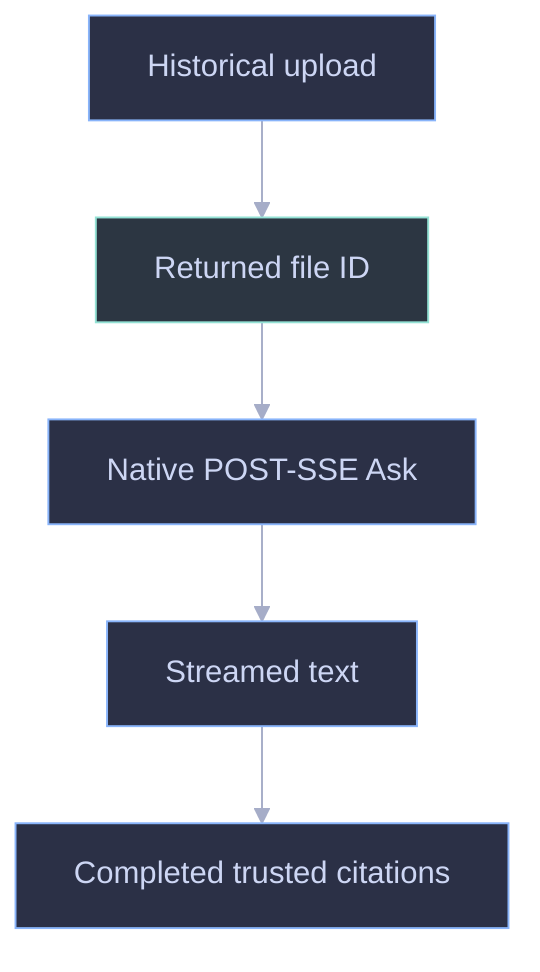
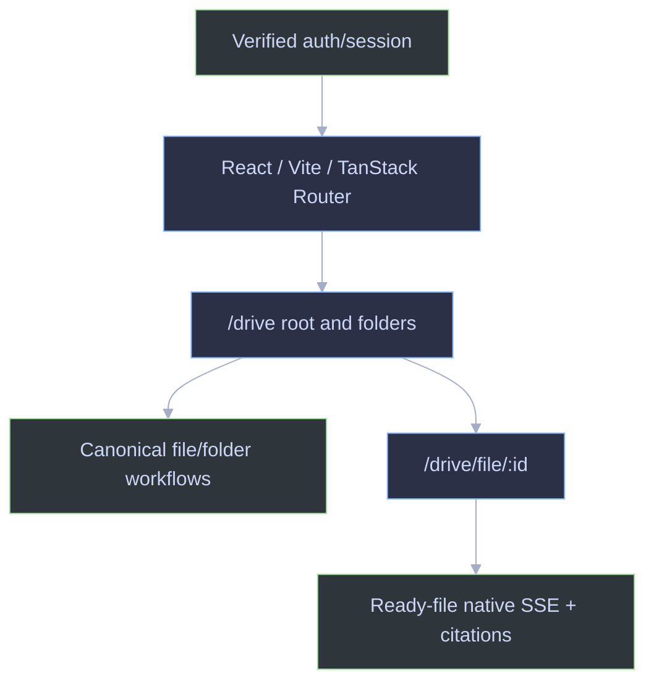
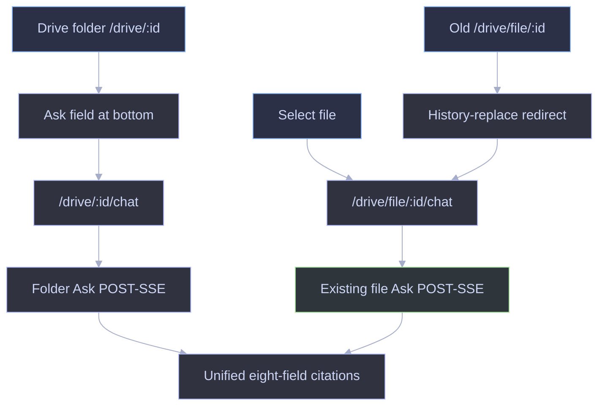
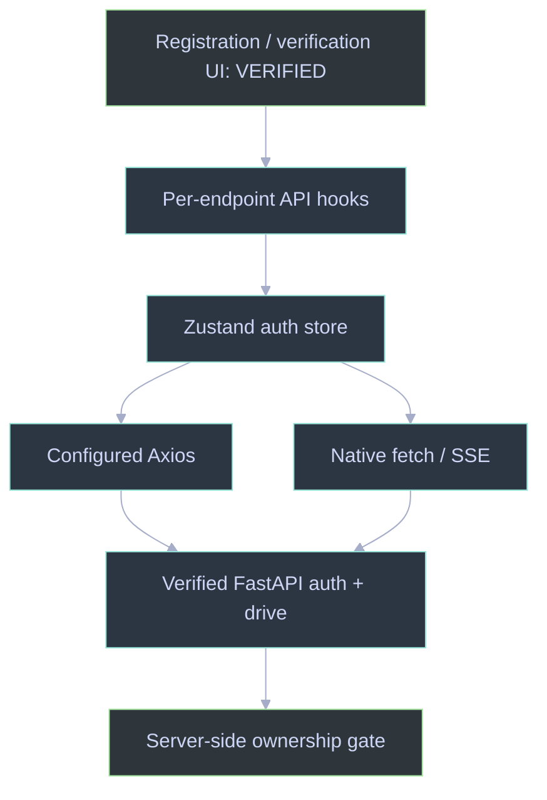

# Atlas — Client Engineering Standards

Client-specific contract for the canonical React/Vite SPA; applies to `client/**`.

- [Root AGENTS](../AGENTS.md) — inherited repository-wide policy.
- [Server AGENTS](../server/AGENTS.md) — backend/API authority.
- [RAG SKILL](../.agents/skills/rag/SKILL.md) — detailed pipeline contracts for cross-boundary RAG work.
- Preserve verified Phase 2 behavior; report new implementation and verification only with evidence.

---

## 0. DOCUMENT ROLE & INSTRUCTION HIERARCHY

### Authority

Read the **numbered, linked files in order**. Then read the approved PLAN, current evidence and targeted source/tests.

- Client
  1. [Root AGENTS](../AGENTS.md)
  2. [Client AGENTS](AGENTS.md)
- Cross-Boundary Client + Server
  1. [Root AGENTS](../AGENTS.md)
  2. [Server AGENTS](../server/AGENTS.md)
  3. [Client AGENTS](AGENTS.md)
  4. [RAG SKILL](../.agents/skills/rag/SKILL.md)
- Root instructions take precedence; this file owns frontend specialization only.
- `server/AGENTS.md` owns backend behavior; the RAG skill owns retrieval/generation internals.
- Read the latest relevant **CONTEXT.md** for implementation evidence; **MANUAL.md** for reproduction.
- Inspect targeted source/tests rather than scanning the entire repository.

### Instruction Inheritance

- Root `LOCKED` contracts remain binding across the client.
- Public API/DTO changes require the approved server contract before client implementation.
- Browser routes, caches, authentication state and encryption do not grant server authorization.

---

## 1. PURPOSE & ENGINEERING OBJECTIVES

### Client Objective

Deliver authenticated Drive, File Ask, Folder Ask and later Projects workflows through the verified React/Vite SPA without redefining backend authority.

**Product Features:**

- **Drive — Verified**
  - Root and nested folders, direct-child browsing, canonical file upload/edit/delete and metadata.
  - Protected routes, session restoration, owner-safe cache and refresh behavior.
- **File Ask — Verified Baseline; Planned Route & Citation Migration**
  - Preserve the verified endpoint, request validation, exact-file retrieval, fallback and SSE lifecycle.
  - PLAN_01 deliberately supersedes the five-field File Ask citation DTO with the unified eight-field DTO and request-local indexes.
  - Move the browser destination from `/drive/file/:id` to `/drive/file/:id/chat`.
  - Preserve old deep links through a deliberate redirect.
- **Folder Ask — PHASE_03_PLAN_01**
  - Show an Ask field at the bottom of `/drive/:id`.
  - Submit the question to `/drive/:id/chat`; show it immediately and stream the answer.
  - Consume `POST /folders/{folder_id}/ask` for direct owned, `ready` file scope only.
  - Display Atlas-trusted source-file citations using the same unified schema as File Ask; no depth selector or file-subset selection.
- **Projects — Later PHASE_03 PLANS**
  - Separate top-level Projects section outside Drive; select Drive files/folders as references.
  - Expose live membership and Project-scoped Ask only after verified backend contracts.
  - Never imply references copy files or that removing a membership deletes a Drive source.

**Deferred:** Entire-drive Ask, configurable folder depths, persistent conversation history, multi-turn model memory, sharing, user-selected folder file subsets and speculative client infrastructure.

### Engineering Priorities

- Preserve Bun, strict TypeScript, Vite, TanStack Router, React Hook Form/Zod, Tailwind/shadcn and existing verified HTTP/Ask infrastructure.
- Keep `Zustand` as the sole authentication owner; `TanStack Query` owns canonical remote data; local state owns ephemeral questions/streams.
- Use one authenticated Axios instance and the established native `fetch`/SSE transport.
- Keep routes presentation/composition only; no client-side authorization or generated provenance.
- Maintain abort and stale-publication protection on folder/file change, logout, account switch and navigation.
- Implement only the current approved AMENDMENT and verification stage.

---

## 2. CURRENT STATE & DEVELOPMENT DESTINATION

This is a current-state snapshot. Dated execution history belongs in PLAN **CONTEXT.md**.

### Status Vocabulary

Use the root file's four statuses for every PHASE, PLAN, AMENDMENT and capability:

| Status        | Definition                                                       | Required Evidence                     |
| ------------- | ---------------------------------------------------------------- | ------------------------------------- |
| `PENDING`     | Planned or approved; implementation not started.                 | Planning/approval; no code claim.     |
| `BUILDING`    | Work is in progress; scoped requirements incomplete.             | Work underway and gaps identified.    |
| `IMPLEMENTED` | Required code exists; full acceptance incomplete/failed/blocked. | Source evidence and unverified gates. |
| `VERIFIED`    | Applicable acceptance passed and was recorded.                   | Executed tests/runtime evidence.      |

- Assess PHASE, PLAN and each Amendment independently; evidence does not roll up automatically.
- Historical CONTEXT/MANUAL wording is preserved. Never claim tests reran because a document changed.

### Phase Roadmap

| PHASE                                   | Client Boundary                                   | Status     |
| --------------------------------------- | ------------------------------------------------- | ---------- |
| PHASE_01 — MVP Core RAG                 | Historical single-file Next.js UI                 | `VERIFIED` |
| PHASE_02 — Authenticated Personal Drive | Canonical Vite SPA, Drive and File Ask            | `VERIFIED` |
| PHASE_03 — Folder & Project RAG         | New chat routes, Folder Ask and later Projects UI | `PENDING`  |

### Development Destination

- **Active direction:** PHASE_03; **first milestone:** `PHASE_03_PLAN_01 — Single-Level Folder RAG` (`PENDING`).
- **PLAN_01 client scope:** File chat route migration; Folder page Ask field; Folder chat destination; unified citation validation/rendering for File and Folder Ask; session-safe navigation.
- **Future:** `PHASE_03_PLAN_02` Project domain APIs (server-owned), `PLAN_03` Project RAG (server-owned), `PLAN_04` Projects UI and PHASE acceptance—all `PENDING`.
- **Baseline:** Phase 2 and PLANs 01–04 are `VERIFIED`; the Next.js client and `/dashboard` are retired.
- **Remote reference:** `phase-02/plan-04` last inspected; recheck actual Git state. No branch/commit operations without approval.

### Integration Gate

- Backend contracts precede client integration; never invent Project or Folder Ask DTOs from UI assumptions.
- PLAN_01 changes File Ask routing and deliberately migrates its citation schema/index mapping; preserve all other verified File Ask contracts.
- Stage 01 implementation stops for review; real browser/backend or Docker work needs new Stage 02 approval.

---

## 3. COMPLETED HISTORY & VERIFIED BASELINES

This section records completed, **`VERIFIED`** PHASES only. PHASE_03 remains in Section 2.

### PHASE_01 — MVP Core RAG

**Objective:** Upload a file and ask grounded questions in a historical static Next.js interface.

#### Verified Baseline



#### Verified Maturity

| Capability       | Delivered Behavior                                                                 |
| ---------------- | ---------------------------------------------------------------------------------- |
| Static client    | Next.js/Bun/TypeScript build and browser workflow (historical).                    |
| Upload           | Returned backend file UUID retained for exact-file Ask; endpoint later superseded. |
| Stream           | Native `fetch`/`ReadableStream`, incremental UTF-8/SSE parsing.                    |
| Citation display | Render Atlas-trusted citations only after valid completion.                        |

#### Completion Boundary

- Single file; no login, folders, canonical Drive metadata or multi-file retrieval.
- Historical upload/Next.js code is not an active integration contract; `client-legacy/` was retired with approval.

#### Evidence

- [PLAN_05 CONTEXT](../prompts/PHASE_01/PLAN_05/PHASE_01_PLAN_05_CONTEXT.md)
- [PLAN_05 MANUAL](../prompts/PHASE_01/PLAN_05/PHASE_01_PLAN_05_MANUAL.md)

### PHASE_02 — Authenticated Personal Drive

**Objective:** Deliver owner-scoped Drive navigation, file management, and selected-file Ask through the current Vite SPA.

#### Verified Baseline



#### Verified Maturity

| PLAN      | Delivered Behavior                                                               |
| --------- | -------------------------------------------------------------------------------- |
| `PLAN_01` | PostgreSQL identity, login, verification, refresh and logout foundation.         |
| `PLAN_02` | Canonical Drive ownership, file lifecycle and ready-gated file Ask backend.      |
| `PLAN_03` | Historical Next.js auth workflows and protected navigation; later retired.       |
| `PLAN_04` | Current Vite SPA, folder/file workflows, selected-file Ask and Phase acceptance. |

- **Recorded final acceptance:** 424 client tests, 329 packaged backend tests, 222 production-browser checks; 17 PLAN_04 and 15 PHASE_02 criteria reconciled.
- **Provider qualification:** Final Phase 2 Ask acceptance used deterministic generation, not a fresh Gemini call.
- **Preservation qualification:** Builder cache declined 111 → 73 records; 42 original IDs missing, cause unproven, literal comparison FAILED and user-accepted as an exception—not a pass. Canonical datastore cleanup was verified.

#### Completion Boundary

- `VERIFIED`: authentication, direct-child browsing, canonical file lifecycle and single-file Ask.
- Excluded then: Folder/Project RAG and the new `/chat` routes; those belong to planned PHASE_03.
- Historical `/dashboard` and the Next.js client are retired; preserve their evidence, not their runtime.

#### Evidence

| PLAN      | Records                                                                                                                               |
| --------- | ------------------------------------------------------------------------------------------------------------------------------------- |
| `PLAN_03` | [CONTEXT](../prompts/PHASE_02/PLAN_03/PHASE_02_PLAN_03_CONTEXT.md) · [MANUAL](../prompts/PHASE_02/PLAN_03/PHASE_02_PLAN_03_MANUAL.md) |
| `PLAN_04` | [CONTEXT](../prompts/PHASE_02/PLAN_04/PHASE_02_PLAN_04_CONTEXT.md) · [MANUAL](../prompts/PHASE_02/PLAN_04/PHASE_02_PLAN_04_MANUAL.md) |

---

## 4. ARCHITECTURE & DATA FLOW

### Stack

| Area            | Verified Selection                                                      |
| --------------- | ----------------------------------------------------------------------- |
| SPA             | React, Vite, TanStack Router file-based routing, strict TypeScript      |
| Toolchain       | Bun, `bun.lock`, Prettier, current lint/typecheck/test/build scripts    |
| Styling & Forms | Tailwind, shadcn/ui, React Hook Form, Zod                               |
| Remote Data     | TanStack Query v5; no parallel canonical route cache                    |
| Auth Authority  | Zustand user/session state and existing auth coordination               |
| Ordinary HTTP   | Shared configured Axios instance                                        |
| Streaming       | Native `fetch` + `ReadableStream` + existing SSE parser                 |
| Hosting         | Static `dist/` SPA with correct history fallback; direct FastAPI origin |

### Runtime & Trust Boundaries

- No Next.js server, TanStack Start, SSR, BFF, API proxy or frontend Docker service.
- `VITE_ATLAS_API_BASE_URL` is public build-time configuration; changing it requires rebuilding `dist/`.
- Browser routes/history fallback must work for nested UUID chat paths without masking missing assets as HTML success.
- Auth restoration gates private reads; account/route/session changes abort and retire requests before publishing stale data.
- FastAPI owns credential, owner, `ready` status, retrieval scope and trusted citation decisions.

### Verified Client Ownership

- **Router:** typed navigation, parameters and thin page composition.
- **TanStack Query:** canonical root/folder/file reads and mutation invalidation; memory-only freshness.
- **Zustand:** authenticated identity/token state only.
- **Ask session:** route-local question/answer lifecycle, POST-SSE transport, source rendering and abort cleanup.
- **Schemas:** Zod validates forms, API response bodies and SSE event payloads before state mutation.

### PHASE_03 Planned Client Flow



- **Folder Ask handoff:** show submitted question immediately in the destination; send the request from the chat page, not the source folder page.
- **No implicit replay:** direct chat load, reload, Back/Forward or auth restoration must not automatically resubmit a consumed question.
- **Chat-style UI:** visual sequence of questions/answers; no persistent conversation table or model memory is approved.
- **Shared sources:** render trusted file identity/name and excerpt for both Ask scopes only after validated completion; never trust model-authored metadata.
- **Pending implementation:** no new route, schema, transport, or API is represented as verified here.

---

## 5. REPOSITORY STRUCTURE & OWNERSHIP

### Verified Client Structure

```text
client/
├── AGENTS.md
├── src/
│   ├── main.tsx
│   ├── routes/
│   │   ├── __root.tsx
│   │   ├── drive/
│   │   │   ├── route.tsx
│   │   │   ├── index.tsx
│   │   │   ├── $id.tsx                 # current folder page
│   │   │   └── file/$id.tsx            # current file detail + Ask
│   ├── routeTree.gen.ts               # generated; never hand-edit
│   ├── components/{Drive,Folder,File,Ask,Citations,Common,ui}/
│   ├── hooks/{auth,drive,folder,file,ask}/
│   ├── services/{auth,http,ask}/
│   ├── schemas/
│   ├── stores/auth.ts
│   └── utils/stream/
├── tests/
├── vite.config.ts
├── package.json
└── bun.lock
```

### Planned Route Ownership

| Browser Route          | Function                                                | State                                                                      |
| ---------------------- | ------------------------------------------------------- | -------------------------------------------------------------------------- |
| `/drive`               | Logical root and direct children                        | `VERIFIED`                                                                 |
| `/drive/:id`           | Folder browsing; new Ask composer at bottom             | Existing page `VERIFIED`; composer `PENDING`                               |
| `/drive/:id/chat`      | Folder chat destination and stream                      | `PENDING`                                                                  |
| `/drive/file/:id/chat` | File chat destination; unified citation migration       | Route and citation migration `PENDING`; prior File Ask baseline `VERIFIED` |
| `/drive/file/:id`      | Compatibility history-replace redirect to new file chat | Redirect `PENDING`; existing route `VERIFIED`                              |

- Keep TanStack Router filename conventions; do not invent the exact file tree before inspecting the installed router plugin.
- `src/routes/` owns route declarations and page composition, not HTTP/auth/retrieval logic.
- `components/ui/` remains shadcn-generated; domain-specific presentation belongs in `components/<Domain>/`.
- `hooks/<domain>/` owns React lifecycle; `services/ask/` owns native SSE request-session behavior.
- `services/auth/` and `stores/auth.ts` preserve the verified single session/token owner.
- `schemas/` owns Zod trust-boundary validation; `utils/stream/` pure SSE processing.
- Do not recreate retired `client-legacy/`, Next.js routes or `/dashboard`.
- Future Projects UI folders/routes belong to a later approved PLAN; do not scaffold them during PLAN_01.

---

## 6. ENGINEERING & DOCUMENTATION CONVENTIONS

### Components

Atlas component domain folders and reusable component files use PascalCase:

```text
components/Drive/DriveWorkspace.tsx
components/Ask/AskPanel.tsx
components/File/FileWorkspace.tsx
```

Exceptions:

- `components/ui/` retains shadcn-generated lowercase naming.
- TanStack Router/tool-required filenames retain their required conventions, including `__root.tsx`, `index.tsx`, `route.tsx`, `$id.tsx`, `routeTree.gen.ts`, `vite.config.ts` and the selected ESLint config. These are exceptions to handwritten naming rules.

### Hooks

- Hook domain folders stay lowercase.
- Hook filenames use `use<Name>.ts`.
- Hook files contain no JSX.
- Destructure TanStack Query hook results and expose only the named actions and state the domain hook needs.

Examples:

```text
hooks/folder/useFolder.ts
hooks/ask/useAsk.ts
```

### Other Files

- User-controlled multiword filenames/directories use lowerCamelCase.
- Single-word names may remain lowercase.
- Tests use lowerCamelCase before `.test.ts`.
- Use `.test.tsx` only when JSX is actually required.
- Do not use hyphenated user-controlled TypeScript/TSX filenames.
- Export component/type symbols with PascalCase.
- Export variables/functions with camelCase.

### Source-Root Aliases

Current aliases:

- `@routes/*` -> `./src/routes/*` (only if genuinely useful; file-based routing remains plugin-owned)
- `@components/*` -> `./src/components/*`
- `@hooks/*` -> `./src/hooks/*`
- `@stores/*` -> `./src/stores/*`
- `@constants/*` -> `./src/constants/*`
- `@lib/*` -> `./src/lib/*`
- `@providers/*` -> `./src/providers/*`
- `@schemas/*` -> `./src/schemas/*`
- `@services/*` -> `./src/services/*`
- `@utils/*` -> `./src/utils/*`
- `@/*` -> `./src/*` fallback

Use dedicated aliases for cross-root imports.
Short local relative imports are acceptable.
Avoid deep relative chains.
Do not add speculative aliases.

- Frontend application source is TypeScript only: `.ts` and `.tsx`.
- Keep TypeScript `strict` enabled.
- Keep `allowJs=false`.
- Do not weaken compiler strictness to bypass an error.
- Do not use `any` unless an external-library boundary makes it unavoidable and the exception is narrowly documented.
- Prefer `unknown` plus validation/narrowing.
- Treat HTTP/SSE JSON as `unknown` until Zod validation succeeds.
- Define named interfaces for component props and structural application contracts instead of inline object annotations.
- Prefer interfaces for object shapes.
- Use type aliases for unions, callbacks, and Zod-inferred data.
- Primitive and existing library types can be used directly.
- Colocate hook interfaces/types in the hook module by default.
- Extract shared contracts only when reuse/ownership warrants it.
- Export only types/interfaces consumers actually need.
- Do not use type assertions to bypass a missing trust-boundary validation.

### Prettier

- Use Prettier defaults through Bun.
- Use the repository `format` and `format:check` scripts.
- Exclude generated/build artifacts according to the current Prettier ignore file.
- Do not add formatting/import-sorting plugins without approval.
- Formatting does not replace manual readability conventions.

### Exports

Atlas components, providers, and hooks use:

```ts
export default function Name(...) {}
```

Preserve generated shadcn primitive export conventions.

- Hook entry functions and React components/providers MUST retain normal function declarations.
- Functions nested inside hooks and other handwritten helper implementations MUST use arrow functions, including object action implementations; class constructors, getters/setters and interface method signatures retain their required syntax.
- Define arrow functions before any module-level expression that reads them; do not rely on function hoisting.
- Define action implementations above hook return objects; return named function references without inline implementations.

### Object Literals

Write nonempty object literals across multiple lines, one property per line, including:

- nested options;
- state updates;
- return objects.

### Imports

- Keep package imports together immediately below directives, including runtime built-ins and named/type imports; do not split one package-import group with blank lines.
- Group internal imports by category.
- Typical internal order:
  1. hooks
  2. components
  3. services
  4. schemas/constants/utils/other categories
- Use one blank line between groups.
- No blank line within one import group.

### Code Readability & Control Flow

- Domain literal unions MUST have named type aliases beside their owning code, such as `AuthStateType`; do not repeat inline status/action unions across fields or return types.
- MUST leave one blank line between logical steps and adjacent function definitions.
- MUST keep conditions, arguments, and operations readable; avoid cramped one-line statements.
- MUST use braces for conditional branches, including branches containing only `return` or `throw`.
- Guard clauses MAY appear wherever validation or branching is needed; prefer quick returns or throws over heavy nesting.
- After an `if` branch unconditionally returns or throws, MUST continue with the next condition or normal flow without a redundant `else` or `else if`.
- Components with successive returning conditions MUST use sequential braced guards followed by the final return, as in `AuthGate`.
- Retain explicit `else` branches when continuing alternatives clarify the relationship; do not flatten branches mechanically when control flow differs.
- Prettier formatting MUST NOT replace these manual readability requirements.
- Apply these conventions to affected handwritten tests as well as production code; keep generated primitives and unrelated files outside a cosmetic sweep.

### React Readability

- Leave one blank line between logical JSX sections where it improves readability.
- Do not scatter inline comments explaining individual lines.

### Documentation & Ownership

- Inherit the root PHASE / PLAN / AMENDMENT, CONTEXT and MANUAL model.
- Codex records actual code changes and executed tests; do not pre-create client Phase 2 evidence.
- Preserve verified naming, aliases and formatting unless an approved PLAN supersedes them. The historical Next.js `@app/*` alias is retired.

---

## 7. TECHNICAL CONTRACTS & RUNTIME BEHAVIOR

### Ordinary HTTP, Authentication & SSE

#### Ordinary HTTP

- Use configured Axios for ordinary request/response HTTP such as uploads and later CRUD/authenticated calls.
- Preserve the browser-generated multipart boundary for file uploads.
- Do not invent arbitrary client-side file-size/time limits when the backend contract does not define them.
- TanStack Query owns approved query/mutation server-state orchestration.
- Do not use TanStack Query as a substitute for local ephemeral UI state.

#### Shared HTTP Infrastructure

- `services/http/axios.ts` MUST export one actual configured Axios instance; no custom Axios facade or public client factory.
- `services/http/fetch.ts` exports one configured native fetch client with base/get/post; preserve raw responses and streams.
- Both resolve the validated API URL centrally.
- Both accept `isProtected?: boolean`; omission preserves path defaults, `true` requires trusted-target Bearer access, and `false` strips Authorization and bypasses bootstrap/refresh/replay.
- Cookie credentials are independent of `isProtected`; login/verify/logout use `isProtected: false` plus explicit cookies.
- User-facing `useRegister`, `useResend`, `useVerify`, `useLogin`, `useLogout`, and explicit `useAuth` own their endpoint contracts; no grouped auth API service or session controller.
- Hooks MUST import the shared HTTP instance directly and use named, readable actions; do not inject clients/coordination or pass request callbacks through service layers.
- Each hook owns its input validation, direct awaited request, response validation and safe error handling; duplicate-submission protection stays local to mutations.
- Auth hooks expose only named actions and operation-prefixed state; mutation loading maps to `isPending`. `useAuth` remains disabled by default with explicit `getAuth`; Zustand owns authentication truth.
- `services/auth/` contains `auth.ts` (non-React lifecycle), `token.ts` (encrypted persistence), and `key.ts` (IndexedDB CryptoKey); Zustand remains the only user/JWT state owner.
- `auth.ts` supplies start/finish lifecycle operations for cookie ordering and state commit; hooks own user-triggered HTTP.
- Non-React bootstrap and refresh use private native-fetch bypass mechanics in `validate.ts`; no extra Axios instance or React hook invocation.
- Preserve native Axios request options and raw fetch `Response`/stream ownership.
- Phase 2 authenticated Axios and native fetch must consume one shared access-token/session authority rather than duplicating token state.
- Refresh credentials remain in the approved HttpOnly-cookie path and must not be copied into JavaScript-accessible storage.
- Do not blindly replay arbitrary failed mutating requests after refresh; request replay semantics require an explicit safe contract.

#### Streamed Ask

- Use native browser `fetch()` for verified `POST /files/{file_id}/ask` and planned `POST /folders/{folder_id}/ask` once approved and implemented.
- Do not force Axios around the SSE stream.
- Do not wrap the live SSE stream in TanStack Query.
- Do not use EventSource because the endpoint is POST.
- Do not add a third-party SSE library without approval.
- Use `ReadableStream` and incremental UTF-8 decoding.
- Do not assume one transport chunk equals one SSE event.
- Pure SSE framing/protocol helpers belong under `utils/stream/`.
- Runtime-validate application event payloads before trusted state updates.
- Internal citation markers must never become public answer text.
- Use `AbortController` for internal stream ownership/cleanup.
- No user-facing Ask cancellation feature unless an approved later PLAN adds one; mutation-dialog Cancel buttons are a separate approved UI behavior.
- No retry/reconnect/resume/Last-Event-ID semantics unless explicitly approved.

### Forms, State & UI Contracts

- Use React Hook Form for forms.
- Use Zod for form validation.
- Use `stores/auth.ts` Zustand selectors for reactive auth state; transports read that same store through `getState()`.
- Credential-action errors remain `error` and carry the safe `credential_action` origin so anonymous form handoffs stay usable; bootstrap/refresh uncertainty still requires explicit recovery. No error origin grants protected access.
- Store actions MUST remain synchronous; no HTTP/crypto/IndexedDB, persist middleware, token devtools, or second token owner.
- TanStack Query owns canonical drive/folder/file remote state and mutations; Zustand owns auth only. Local UI state remains with the owning route/component/hook. Router loaders must not create a second canonical drive-data cache.
- For every confirmed drive mutation, invalidate all drive-related cached queries and refetch active location/detail views without a hard navigation reload. Ordinary mutation invalidation must not indiscriminately clear auth/unrelated query caches.
- Initial drive query freshness target is 60 seconds, in-memory only. Full browser reload performs authenticated revalidation and a fresh API fetch; do not add drive cache persistence.
- Drive dialogs: create/edit/upload use RHF/Zod, Cancel plus task-appropriate submit; permanent file delete uses an explicit warning confirmation dialog, Cancel/Delete and no automatic retry. Handle `processing`, `ready`, `deleting` exactly as canonical backend states.
- On account logout/switch cancel and invalidate private requests/streams; ensure delayed responses cannot render data for another session.
- Phase 2 explicitly permits the approved reversibly encrypted access token in `localStorage`.
- Do not store the refresh token, password, OTP, or client-side encryption key/material in `localStorage`.
- Client-side reversible access-token encryption is defense-in-depth/obfuscation, not an XSS security boundary.
- Do not generalize the access-token exception into arbitrary `localStorage`/`sessionStorage`/IndexedDB persistence without approval.
- If the persisted access token cannot be safely recovered/used, discard it and rely on the approved refresh-cookie flow rather than bypassing authentication checks.
- Prevent duplicate mutating/streaming submissions while the same operation is active.
- Preserve the verified ask abort/reset behavior when the selected active file changes; extend the same isolation to folder chat, route navigation, and one-time question handoff.
- Browser route/auth state never establishes server ownership or authorization.
- Use Tailwind CSS + shadcn/ui.
- Prefer default shadcn behavior unless the current PLAN requires a specific product interaction.
- Keep presentation functional rather than product-polished.
- `components/ui/` is generated primitive territory; preserve generated APIs/conventions.
- Do not add another component/styling system.
- Avoid handwritten `aria-*` attributes unless needed for functionality/accessibility; prefer native labels and visible status/error text.
- Do not add Markdown renderers, animation libraries, or other presentation dependencies without an approved need.

### Environment, Build & SPA Deployment

- `VITE_ATLAS_API_BASE_URL` is browser-visible build-time configuration in the verified Vite SPA. Historical `NEXT_PUBLIC_ATLAS_API_BASE_URL` is retired.
- Never place secrets in `VITE_*` or any other browser-exposed build variable.
- Reuse the existing strict API-base validation: absolute supported HTTP(S) URL, no credentials/query/fragment, normalized consistently for both Axios and fetch.
- The validated public API base is read once through the approved environment/configuration boundary and consumed as `env.API_BASE_URL`.
- Vite production `bun run build` emits `dist/`, not Next.js `out/`. A change in deployed public API configuration requires rebuilding the SPA.
- Static hosting must serve the SPA entry document for valid browser-history paths, including nested folder/file UUIDs, while preserving missing-asset failure behavior and without proxying API requests through the frontend.
- `ATLAS_SERVER_PORT` controls Vite development and `ATLAS_PREVIEW_PORT` controls Vite preview; each independently defaults to `3000` when unset and MUST be a decimal integer from `1` to `65535`.
- Load these ports only in Vite configuration; do not expose them through `VITE_*` or browser runtime configuration. Keep `strictPort: true` for both servers and verify exact FastAPI allowed origins separately when changing ports.
- Client local env files remain ignored; `.env.example` contains only safe placeholders. Do not copy legacy private `.env.local` values into tracked source or logs.
- Do not add SSR, TanStack Start, server loaders/functions, a client Docker service, Vite backend proxy or another application runtime without approval.

### PHASE_03 Planned Folder & File Chat Contracts

**Status: `PENDING` — do not claim these routes or Folder Ask are implemented.**

- **File route:** `/drive/file/:id/chat`; redirect old `/drive/file/:id` with history replacement. Preserve File Ask endpoint, default `top_k=5`, range `1–20`, fallback and SSE lifecycle; migrate its citation DTO and source indexes deliberately.
- **Folder page:** keep `/drive/:id` and its CRUD/listing; place Ask composer at the bottom. Submitting navigates to `/drive/:id/chat` with a one-time ephemeral question handoff.
- **Folder chat:** display submitted question before SSE begins. Native POST to `POST /folders/{folder_id}/ask`; no file-list/owner/depth parameters supplied by the browser.
- **Question handoff:** ephemeral, one-time and scoped to the authenticated folder/session. No replay on reload, direct deep link, Back/Forward or auth restoration; no URL/query or durable storage of question text. Direct chat links open an empty composer. The destination initiates exactly one request per explicit submission.
- **Answer display:** provisional clean streamed text; one shared citation schema for File and Folder Ask; commit successful answers/citations only after a valid `citations`/`done` sequence. Explicit sanitized errors never become successful fallback.
- **Auth/route safety:** reuse current session-version/abort/retire rules for both Ask scopes; never publish late answers or citations to a different file, folder, or account.
- **Deletion consistency:** the backend authorizes each Ask at request start; an already-authorized response may finish after source deletion begins. Do not promise immediate stream revocation; normal route/session abort rules still apply.
- **Not approved:** persistent threads, chat database, multi-turn model context, global browser RAG state, third-party SSE client or new frontend transport architecture.
- **Compatibility:** preserve File Ask endpoint, request validation, fallback and SSE lifecycle, current auth/token behavior and canonical file detail data. The approved citation migration is the explicit public response exception.

### Unified Citation Validation & Display

**Contract: `LOCKED`; implementation: `PENDING`.** See the [RAG SKILL](../.agents/skills/rag/SKILL.md) for the authoritative schema and mapping rules.

- Use one shared runtime-validated citation schema for File, Folder and later Project Ask: `index`, `file_id`, `file_name`, `chunk_index`, `page`, `heading`, `section`, `excerpt`.
- `index` is a non-negative request-local source reference, not the original chunk position; `chunk_index` is the non-negative per-file chunk position.
- Validate canonical UUID, source name, nullable page integer/heading/section strings and excerpt; use trusted server-returned metadata only. Equal chunk indexes in different files are valid.
- Display the request-time file name and trusted excerpt; never substitute a current route name or model-generated provenance.
- Coordinate the server and client migration, schema validation, parser and rendering regressions. The historical five-field File Ask citation schema is `SUPERSEDED` for PLAN_01, not a second public schema to maintain.

### Folder Fallback & Resource Errors

- Preserve the exact File Ask fallback: `I don't have enough information in this file to answer that.`
- Folder Ask fallback: `I don't have enough information in this folder to answer that.`
- Successful fallback includes empty citations and terminal `done`; authorization, dependency and oversized-scope errors remain errors.
- Render structured pre-stream scope-limit failures using the approved server contract; do not silently narrow the scope, retry or present fallback. Final numerical limits remain `PROVISIONAL`.
- User-selected folder file subsets remain deferred; do not scaffold selection UI during PLAN_01.

### Authentication Transport Boundary

- Verified Phase 2 auth/session foundation: registration, verification/resend, login/logout, restoration, cookie rotation and account-safe navigation. Historical PLAN_03/PLAN_04 browser evidence remains in CONTEXT/MANUAL.
- AES-GCM/IndexedDB storage retains version-1 compatibility; logout deletes only auth ciphertext and its auth-owned IndexedDB key, and explicit login/verify generates a key when absent.



---

## 8. SECURITY & TRUST BOUNDARIES

### Browser Trust Boundaries

- All browser input and network payloads are untrusted; use Zod validation at relevant HTTP/SSE boundaries.
- A protected client route is a navigation/UX mechanism; FastAPI performs all authentication and authorization.
- Never infer owner access from local state, selected IDs or encryption.
- Treat model-authored provenance as untrusted; render only Atlas-validated citations.

### Credentials & Persistence

- Refresh tokens must remain in the server-controlled HttpOnly cookie.
- Approved access-token exception: active JWT in memory and reversibly encrypted access token in `localStorage`.
- Never store passwords, OTPs, refresh tokens or client encryption keys/material in `localStorage`.
- Reversible client-side encryption is not an XSS security boundary.
- The approved non-extractable AES-256-GCM key lives in IndexedDB `atlas.auth/keys/access`; logout deletes that record, never the origin database or unrelated records.
- Do not introduce `sessionStorage`, additional persistence, or cross-tab arbitration without approval.
- If saved token material is unusable, discard it and restore through the approved refresh-cookie flow.
- Do not silently replay arbitrary mutating or streaming requests after authentication failure.

### Static Deployment & Exposure

- `VITE_*` is browser-visible in the approved SPA and MUST NOT contain secrets. Next.js `NEXT_PUBLIC_*` behavior is historical only; the legacy directory has been retired.
- Keep API origin and credential/CORS behavior compatible with the verified FastAPI deployment configuration.
- Never log or expose cookies, JWTs, credentials, verification codes, keys, uploaded content or source excerpts in browser diagnostics.

---

## 9. SCOPE & ARCHITECTURE GOVERNANCE

### Always Do

- Inherit root approval, evidence, status, and task-boundary rules.
- Preserve Vite SPA, Bun/TypeScript, auth single-owner, Zod validation, and native SSE ownership.
- Consume approved server contracts; maintain session-safe request and UI publication boundaries.
- Keep generated router artifacts tool-owned and untouched by hand.

### Requires Approval

- New frontend framework/router/state, HTTP/SSE, persistence, or styling dependencies.
- Public API assumptions, citation DTO or fallback changes beyond the approved server contract.
- Persistent chat history, query persistence, model memory, or automatic request replay.
- Changes to token/key/session lifecycle, stale-data isolation, or cache authority.
- Future Projects UI before its owning PLAN and AMENDMENT.
- New client runtime, Docker service, API proxy, SSR, or changed static-hosting contract.

### Prohibited

- Adding Node/npm/pnpm/Yarn as required package-manager workflows; Bun is canonical.
- Treating client-supplied scope/owner IDs as permission to retrieve content.
- Storing refresh tokens, passwords, OTPs, secrets or auth keys in JavaScript-readable storage.
- Rendering model-authored source identity as trusted citation provenance.
- Resubmitting a chat question on refresh/history navigation without an explicit user action.
- Creating parallel session/token/cache controllers or speculative Project routes.
- Modifying backend or RAG contracts from a client-only task without approval.

### Decision States

- `LOCKED`: approved architecture; changes require human authorization.
- `PROVISIONAL`: candidate, not a Codex implementation directive.
- `OPEN`: material decision awaiting approval.
- `SUPERSEDED`: earlier approved decision replaced; history remains.

---

## 10. GIT & REPOSITORY SAFETY

- Inherit [root Git safety rules](../AGENTS.md) without exception.
- Inspect branch, working tree and relevant diffs before client work.
- Do not commit, push, branch-switch/create, rewrite history, reset or discard uncommitted changes without explicit authorization.
- Preserve tracked `bun.lock`; no npm/pnpm/Yarn lockfiles or ad hoc package-manager migration.
- Avoid unapproved backend edits, database resets, Qdrant cleanup or Docker volume changes during client acceptance.
- Do not assume any PLAN branch exists locally; inspect the actual checked-out branch before implementation.
- Run `git diff --check` and report affected files before completing an AMENDMENT.

---

## 11. VERIFICATION & ACCEPTANCE

Inherit root verification and Stage 01/02 approval boundaries.

### Local Client Checks

- From `client/`, use `bun install --frozen-lockfile`, `bun run format:check`, `bun run lint`, `bun run typecheck`, `bun run test`, and `bun run build` as relevant.
- `bun run format` writes files; perform only inside the authorized change scope and review its diff.
- Focus on changed route, session, Ask/SSE, citation and auth-boundary tests; rerun the complete relevant regression suite.
- Never claim a check passed unless it ran; unit tests must not spend Gemini quota.

### PHASE_03_PLAN_01 Acceptance Boundaries

- **Routes:** direct deep links, reload, back/forward, old-file-route redirect and valid/malformed UUIDs under built `dist/` history-fallback hosting.
- **Folder handoff:** user question appears before streaming; one-time submission; no duplicate/replayed POST after reload or route replacement.
- **SSE:** fragmented deltas, error/malformed events, clean provisional text, final citation validation and abort cleanup.
- **Privacy:** logout, account switch, stale folder/file ID, pending auth restoration and late stream/network responses cannot publish another scope's content.
- **Provenance:** verify one eight-field citation schema/rendering path for File and Folder Ask, request-local indexes, distinct files with equal `chunk_index`, trusted source names/excerpts and deliberate legacy schema supersession.
- **Fallback/errors:** verify both exact fallback sentences with empty citations and successful terminal completion; oversized scope and dependency failures must remain explicit errors.
- **Real browser acceptance:** requires separately approved Stage 02 and the actual built SPA; Vite dev/preview alone is insufficient.
- **Resources:** preserve existing PostgreSQL/Qdrant/other services; no incidental Docker rebuild or destructive cleanup.

### Evidence

- Stage 01 ends after actual local commands/results and a review STOP.
- Stage 02 needs fresh approval for production browser/live backend/provider/other effects.
- Codex records results, failures and reproducible procedures in the current PLAN's CONTEXT/MANUAL.
- `git diff --check` and exact changed-path review precede completion.

---

## 12. STANDARD ENGINEERING WORKFLOW

### Before Implementation

1. Read root AGENTS, this file, the approved PLAN/AMENDMENT and targeted client tests/source.
2. For cross-boundary Ask changes, read server AGENTS and the RAG skill when pipeline contracts matter.
3. Inspect branch/status/diffs and established router/Ask/auth conventions; do not switch branches automatically.
4. Confirm backend API/DTO/error/SSE contract and unresolved material decisions before editing.

### During Implementation

- Implement one focused AMENDMENT; preserve verified File Ask behavior except the approved citation migration; retain session/cache ownership.
- Separate presentation, router composition, React hooks, network transport and pure parsers.
- Avoid new dependencies, codebase-wide cosmetic sweeps and speculative Projects code.
- In PLAN_01, the approved sequence includes the File Ask chat-route migration inside Folder Ask API work, followed by Folder composer/chat integration; do not preassign actual Amendment IDs in the PLAN specification.
- Historical Next.js/Vite migration is `VERIFIED`; never repeat it or recreate `client-legacy/`.

### Verification & Completion

- Stage 01: actual targeted/full Bun checks, static/build verification and diff review; update CONTEXT/MANUAL; STOP.
- Stage 02: only with fresh approval, real production SPA/history host, browser, two-owner/session and integration evidence.
- Record every failure and unrun check; `IMPLEMENTED` is not `VERIFIED`.

---

## 13. MCP USAGE GUIDELINES

The user has configured three custom Codex CLI MCPs. Use only when necessary; first confirm they are available in the active session. Follow [root MCP safety and evidence rules](../AGENTS.md).

| MCP               | Client Relevance                                                             | Use Only When                                                               |
| ----------------- | ---------------------------------------------------------------------------- | --------------------------------------------------------------------------- |
| `context7`        | Version-specific Vite, TanStack Router, React, Bun, Axios/browser contracts. | Installed source/docs do not resolve a material API uncertainty.            |
| `playwright`      | Reproducible SPA auth, forms, deep-link and native-SSE browser checks.       | User-approved browser acceptance cannot be established by unit tests alone. |
| `chrome-devtools` | Targeted console, network, cookie/CORS, hydration or SSE diagnosis.          | A specific client runtime problem requires low-level inspection.            |

- Use `playwright` for deterministic journeys; prefer `chrome-devtools` only for deeper diagnosis.
- Avoid running both on the same behavior without a concrete reason.
- Never copy JWTs, cookies, passwords, OTPs, encryption material, user uploads or sensitive source content into recordings/screenshots/CONTEXT.
- Use approved test accounts and preserve persistent remote/user state.
- A successful MCP observation is verification evidence only for the behavior actually exercised.
- MCP tools cannot approve changes to the now-approved Vite/SPA routing boundary or to locked token-storage/auth architecture.

---

## 14. COMMANDS & TOOLING

Run from `client/`:

```bash
bun install --frozen-lockfile
bun run format
bun run format:check
bun run lint
bun run typecheck
bun run test
bun run build
bun run dev
```

Use project scripts rather than ad hoc tool invocations when the script already exists.

Do not use npm/npx/pnpm/yarn in the normal client workflow.

---

## 15. EXPLAIN-BACK REQUIREMENT

For non-trivial client work, report:

- files changed and each responsibility;
- affected client capability;
- component/hook/service/schema ownership;
- request/stream/state lifecycle where relevant;
- trust-boundary/runtime validation behavior;
- failure/abort/reset behavior;
- exact Bun commands/checks run and results;
- browser/production-SPA deep-link verification actually performed;
- remaining unverified client scope.

Do not claim backend verification unless it actually ran.
