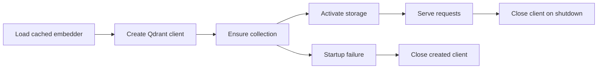

# PHASE_01_PLAN_02 — Qdrant, Embedding, Storage (Specification)

- This specification defines the exhaustive end-state: architecture, contracts, requirements, and acceptance criteria.
- Focused prompts live chronologically in `amendments/`, as in PLAN_01; check work against this specification and execute through amendments.

- **Branch:** `phase-01/plan-02`
- **Depends on:** PLAN_01, Verified.
- **Status:** Verified.
- Current implementation and evidence: [CONTEXT](PHASE_01_PLAN_02_CONTEXT.md).

---

## Scope

- Add embedding and Qdrant storage to the existing upload flow. PLAN_01 already produces chunks (Docling extraction + HybridChunker); this plan embeds those chunks and persists them, in addition to the existing API response behavior.

- **Explicitly excluded:** retrieval/query endpoints (PLAN_03), generation (PLAN_04), any file metadata (name/description/tags — deferred until Postgres), Redis, folders, dedup logic.

---

## Architecture

### EmbeddingProvider interface (from the `rag` skill)

```python
class EmbeddingProvider(Protocol):
    def embed(self, texts: list[str]) -> list[list[float]]: ...
    @property
    def dimension(self) -> int: ...
```

- `BGEM3Embedder` wraps `BAAI/bge-m3`, dense-only, dimension 1024.
- `FlagEmbedding`'s `BGEM3FlagModel` is the resolved loading library, checked against the official BGE-M3 model card in Amendment 01.
- Load once at startup through cached `get_bge_m3_embedder()`; never reload per request.
- Encode with `return_dense=True`, `return_sparse=False`, `return_colbert_vecs=False`.

### Qdrant collection

- Vector size 1024, distance metric Cosine, set explicitly in the collection config — never a default.
- Creation must be idempotent — safe against an already-existing collection.
- Payload per point: `file_id`, `chunk_index`, `token_count`, `page`, `heading`, `section`, `text`, and `display_text` (Amendment 02 resolution).

### Resolved decisions

- Amendment 02 resolves this as two fields: contextualized `text` matching the embedding input, and raw `display_text` for future citation display.
- Amendment 05 preserves orphan headings: when Docling emits a heading-only record with empty raw text, `display_text` contains its original source heading text; oversized orphan headings use bounded recovered body segments. Payload fields stay unchanged.

### Upload write path

Legend: an upload response follows only a confirmed Qdrant write; failures propagate structured errors.


### Startup lifecycle

Legend: startup prepares one provider and client before serving; shutdown or failed startup closes the client.



### file_id

- Generate an internal UUID `file_id` at upload time; user-facing name, description, and tags stay deferred until Postgres per `AGENTS.md`.

### New endpoint

- `GET /system/health/databases` — Qdrant connectivity only. No Redis; not in the stack yet.

- Healthy response: Qdrant `version`, `status: "Qdrant Healthy"`, `uptime: "Running For 150.85s"` (two decimals), `started: "2026-10-07, 09:03:28"` (UTC), and `collection` with native `status`, `name`, and approximate `points`, in that order; no collection total.
- Uses the startup client for `get_collection()` and minimal telemetry; collection-probe failure reports unhealthy, while telemetry failure reports healthy with null metadata and a safe `diagnostics_error`.
- Always HTTP 200; memory, disk usage, host capacity, and detailed configuration remain deferred.

### Error handling

- `server/app/errors/qdrant.py` — Qdrant-specific error codes (connection failure, collection errors), following the existing `ApiError` pattern.

### Folder placement (per `AGENTS.md`)

- `server/app/pipeline/embeddings/` — `EmbeddingProvider` + `BGEM3Embedder`.
- `server/app/db/` — Qdrant client setup.
- `server/app/errors/qdrant.py` — error codes.
- `server/app/routers/system.py` — extended with the new health endpoint.

---

## Requirements (full plan scope, not one amendment)

- `EmbeddingProvider` interface + `BGEM3Embedder`, singleton loading.
- Qdrant collection creation, idempotent, 1024-dim, cosine.
- Upload endpoint extended to embed and store chunks, in addition to existing response behavior.
- `GET /system/health/databases`, Qdrant-only.
- `server/app/errors/qdrant.py`.
- Logging per `AGENTS.md`'s "always do" boundary: embedding dimension, time taken to embed per upload, number of points written to Qdrant.
- `PHASE_01_PLAN_02_MANUAL.md` and `PHASE_01_PLAN_02_CONTEXT.md` created, same convention as PLAN_01.

## Acceptance criteria (full plan, checked once all amendments land)

- Uploading a file results in points actually stored in Qdrant, point count matching chunk count, verified via Qdrant's own API — not application logs alone.
- Payload fields correct on stored points, including the resolved `text` field decision.
- Collection creation is genuinely idempotent — a clean-state rebuild doesn't error.
- BGE-M3 does not reload between sequential requests — verified via timing/logs.
- `GET /system/health/databases` correctly reports Qdrant status.
- Existing PLAN_01 test suite still passes unmodified; new tests cover embedding + storage behavior.

## Key risk

- Embedding model startup latency and memory use — weights load before requests under Amendment 02. Record startup and upload timings separately in the CONTEXT file; tokenizer/Docling first-use overhead can remain.

## Verification approach

- See [MANUAL](PHASE_01_PLAN_02_MANUAL.md) for procedural acceptance checks.
