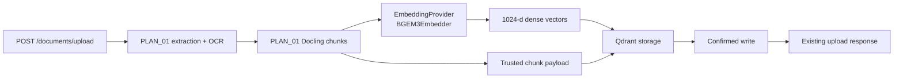
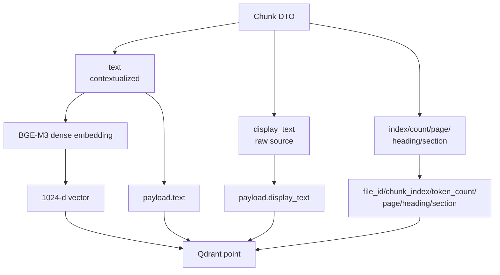
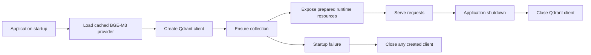
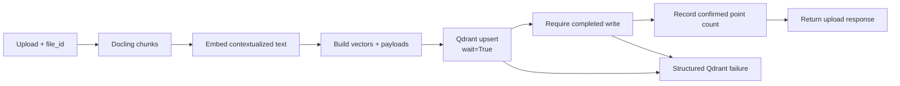

# PHASE_01_PLAN_02 — Qdrant, Embedding, Storage (Specification)

- This specification defines the verified PLAN_02 end-state: architecture, contracts, requirements, acceptance criteria, risks, and verification boundaries.
- Chronological implementation history belongs in `CONTEXT` and focused implementation prompts live separately. This PLAN describes the destination and verified contract, not the sequence used to reach it.

- **Branch:** `phase-01/plan-02`
- **Depends on:** PLAN_01, Verified.
- **Status:** Verified.
- **Pipeline stage:** embed -> store.
- **Current implementation and evidence:** [CONTEXT](PHASE_01_PLAN_02_CONTEXT.md).
- **Repeatable acceptance:** [MANUAL](PHASE_01_PLAN_02_MANUAL.md).

---

## Objective

Extend the verified PLAN_01 upload/chunking pipeline so every produced chunk is embedded with the approved dense embedding model and stored in Qdrant with enough trusted metadata for later retrieval and citation work.

PLAN_02 establishes:

- the embedding-provider boundary;
- the active BGE-M3 embedding implementation;
- the canonical Qdrant collection/vector contract;
- the stored chunk payload contract;
- confirmed upload-to-storage behavior;
- startup ownership of the embedding provider and Qdrant client;
- Qdrant database diagnostics.

---

## Scope

### In scope

- `EmbeddingProvider` abstraction.
- `BGEM3Embedder` using `BAAI/bge-m3`.
- Dense-only 1024-dimensional vectors.
- Explicit cosine similarity in Qdrant.
- Idempotent collection preparation.
- Embedding + storage added to the existing upload flow.
- Confirmed Qdrant writes before upload success.
- Stored provenance needed by later retrieval/citation stages.
- Startup-prepared embedding and Qdrant resources.
- Qdrant health/database diagnostics.
- Structured Qdrant errors and safe observability.

### Explicitly excluded

- retrieval/query endpoints;
- generation;
- answer streaming;
- citation output;
- user-facing file metadata such as name/description/tags in canonical application state;
- PostgreSQL;
- Redis;
- folders or folder-tree scope;
- deduplication;
- authentication;
- hybrid/sparse retrieval;
- reranking.

---

## Architecture overview

PLAN_01 already produces trusted chunks. PLAN_02 adds the embedding/storage boundary without changing the extraction/chunking contract.



### Data contract through storage



### Startup and shutdown lifecycle



---

## Locked contracts

### EmbeddingProvider

The RAG provider boundary is:

```python
class EmbeddingProvider(Protocol):
    def embed(self, texts: list[str]) -> list[list[float]]: ...
    @property
    def dimension(self) -> int: ...
```

Active implementation:

- `BGEM3Embedder`
- model: `BAAI/bge-m3`
- loading library: FlagEmbedding `BGEM3FlagModel`
- dimension: `1024`
- mode: dense only
- encode flags:
  - `return_dense=True`
  - `return_sparse=False`
  - `return_colbert_vecs=False`
- provider is loaded once and reused; it is not reconstructed per upload.

Changing the active embedding provider is a reindexing decision because indexed chunks and queries must remain in the same embedding space.

### Qdrant collection

The collection contract is:

- vector size: `1024`;
- similarity: `Cosine`, set explicitly;
- collection preparation is idempotent;
- stored points contain the approved vector plus trusted payload;
- Qdrant is a retrieval index, not canonical application metadata storage.

### Stored payload

Each stored point carries:

- `file_id`
- `chunk_index`
- `token_count`
- `page`
- `heading`
- `section`
- `text`
- `display_text`

Semantics:

- `text` is the contextualized Docling chunk used for embedding.
- `display_text` is raw citation-friendly source text.
- `chunk_index` maps from the chunk's public/internal index.
- `token_count` maps from the chunk count.
- `page`, `heading`, and `section` preserve source provenance and may be null when unavailable.
- orphan-heading preservation remains part of the verified chunk/payload behavior: heading-only source content and bounded recovered oversized headings remain representable without changing the payload schema.

### file_id

- A new internal UUID `file_id` is generated for each upload.
- Every stored point from that upload uses the same `file_id`.
- PLAN_02 does not introduce canonical user-facing file records or metadata.

---

## Upload-to-storage contract

An upload is successful only after storage is confirmed.



Requirements:

- one point is stored per produced chunk;
- the stored point count for the upload matches the chunk count;
- response success does not precede confirmed storage;
- embedding/storage failure is explicit;
- there is no silent in-memory fallback;
- the existing upload response behavior is otherwise preserved.

---

## Database health contract

### Endpoint

```text
GET /system/health/databases
```

Scope:

- Qdrant only.
- Redis is not part of the current stack.

Healthy response reports:

- Qdrant version;
- `status: "Qdrant Healthy"`;
- uptime formatted as `Running For <seconds>s` with two decimals;
- UTC start timestamp;
- collection status;
- collection name;
- approximate point count.

Behavior:

- uses the startup-prepared Qdrant client;
- collection probe failure reports Qdrant unhealthy;
- telemetry-only failure may still report the database healthy while returning null diagnostic metadata plus a safe diagnostic error indicator;
- endpoint remains HTTP 200 because it is a diagnostic status document rather than an application-operation success response;
- host memory/disk/capacity and detailed database configuration are outside this plan.

---

## Error handling

- Reuse the established `ApiError` architecture.
- Qdrant-specific error definitions belong in `server/app/errors/qdrant.py`.
- Connection failures remain distinct from collection/storage failures.
- No database exception should be converted into false upload success.
- No raw sensitive dependency body should be exposed to clients or logs.

---

## Observability

Record enough to verify provider reuse and storage behavior without logging file contents:

- embedding dimension;
- embedding duration per upload;
- number of chunks embedded;
- number of points confirmed written;
- startup preparation timing where relevant;
- safe dependency failure category.

Do not log:

- full uploaded content;
- chunk bodies merely for diagnostics;
- secrets;
- unnecessary raw dependency response bodies.

---

## Folder placement

```text
server/app/
├── pipeline/
│   ├── embeddings/                       # Embedding-provider boundary and active BGE-M3 implementation
│   └── storage.py                        # Upload-to-vector-storage orchestration
├── db/                                   # Qdrant client/collection preparation and datastore-specific operations
├── models/
│   └── qdrant/
│       └── chunk.py                      # Stored chunk payload representation
├── errors/
│   └── qdrant.py                         # Qdrant-specific structured error vocabulary
├── routers/
│   └── system/                           # System/database health endpoints
└── core/
    ├── lifespan.py                       # Startup/shutdown ownership
    └── runtime.py                        # Access to prepared storage resources
```

Guidelines:

- embedding code owns model-specific embedding behavior, not HTTP concerns;
- Qdrant adapters own datastore mechanics, not RAG orchestration;
- stored payload models represent persisted/indexed data only;
- `main.py` remains wiring only;
- do not place later retrieval or generation behavior inside PLAN_02 modules.

---

## Requirements

- Exact `EmbeddingProvider` contract.
- `BGEM3Embedder` using dense-only `BAAI/bge-m3`.
- 1024-dimensional vectors.
- Explicit cosine Qdrant collection.
- Idempotent collection preparation.
- Singleton/cached provider loading.
- Existing upload flow embeds every chunk and stores one point per chunk.
- Stored payload contains the eight approved fields.
- Storage is confirmed before successful upload response.
- Startup prepares provider/client/collection before serving.
- Shutdown and failed startup close the Qdrant client correctly.
- `GET /system/health/databases` reports Qdrant diagnostics.
- Structured Qdrant errors remain explicit.
- Existing PLAN_01 behavior remains intact.
- CONTEXT and MANUAL preserve actual verification evidence and reproducibility.

---

## Acceptance criteria

PLAN_02 is Verified only because the following end-state was implemented and accepted:

### Embedding

- BGE-M3 dense embeddings are 1024-dimensional.
- The same prepared provider is reused across sequential uploads.
- Dense-only flags remain active.
- Embedding failures do not produce false upload success.

### Storage

- Uploading a file produces actual Qdrant points.
- Stored point count for an upload matches its chunk count.
- Every point contains the approved payload fields.
- `text` matches contextualized embedding input.
- `display_text` preserves citation-friendly raw source content.
- Cosine is explicitly configured.
- Collection preparation is safe when the collection already exists.
- Confirmed-write behavior prevents responding successfully before storage completes.

### Lifecycle

- Provider/client preparation occurs before serving requests.
- Startup failure cleans up created Qdrant resources.
- Normal shutdown closes the Qdrant client.

### Diagnostics

- `GET /system/health/databases` correctly distinguishes healthy/unhealthy Qdrant state.
- Collection diagnostics are returned according to the approved shape.
- Telemetry-only failure does not incorrectly mark a successful collection probe as unavailable.

### Regression

- PLAN_01 regression behavior remains passing.
- New tests cover embedding, storage, lifecycle, database diagnostics, and failure paths.
- Verification uses Qdrant state/API evidence, not application logs alone.

---

## Risks and accepted boundaries

### Embedding model cost

BGE-M3 startup has measurable latency and memory cost. Weights are loaded before requests so first-request behavior does not silently create a second provider or embedding space.

### Index responsibility

Qdrant remains the retrieval index. User-facing file metadata and canonical application state are deliberately deferred to PostgreSQL in later phases.

### Retrieval complexity

Dense+sparse capability exists in BGE-M3 but is intentionally unused. PLAN_02 establishes a dense baseline only; retrieval improvements require later measured evidence.

---

## Verification approach

See [MANUAL](PHASE_01_PLAN_02_MANUAL.md) for the repeatable checks.

Verification evidence should demonstrate:

- provider load/reuse;
- embedding dimension/mode;
- point-count agreement with chunks;
- complete stored payloads;
- cosine collection configuration;
- idempotent collection preparation;
- confirmed-write behavior;
- database-health behavior;
- dependency failure handling;
- full regression;
- Docker/runtime correctness when deployment-sensitive files change.

Historical command results, versions, timing observations, and implementation chronology belong in CONTEXT rather than this specification.
