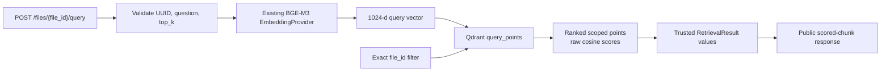
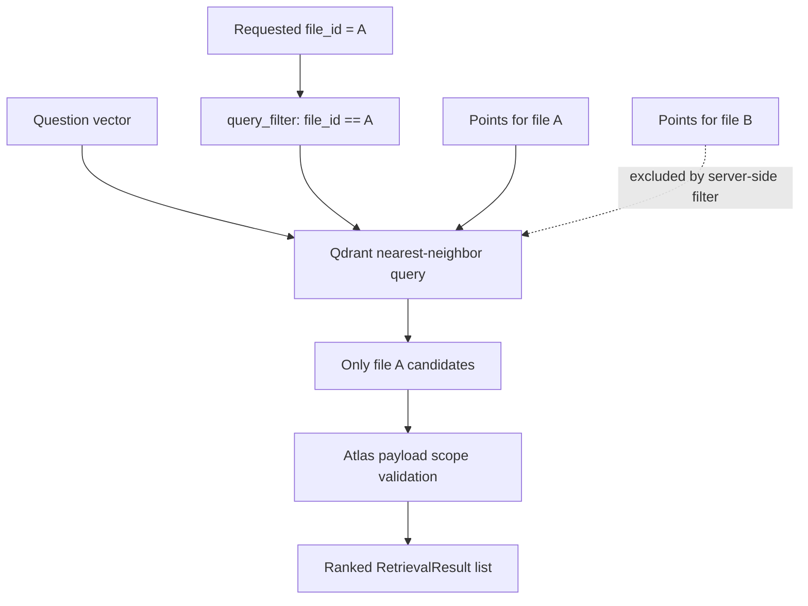
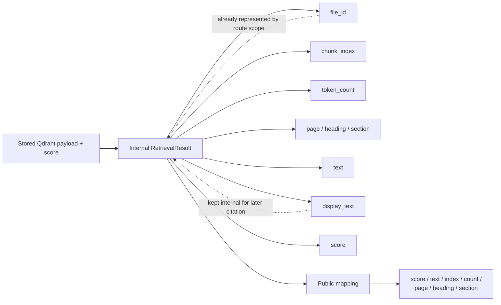
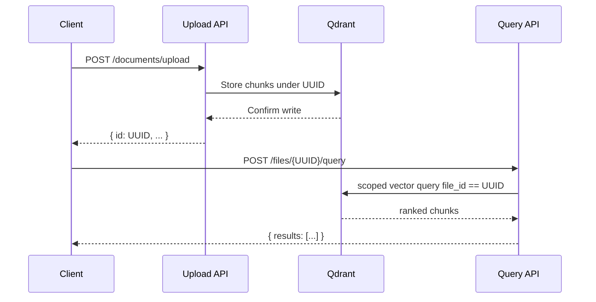

# PHASE_01_PLAN_03 — Retrieval (Specification)

- This specification defines the verified PLAN_03 end-state: architecture, contracts, requirements, acceptance criteria, risks, and verification boundaries.
- Chronological implementation history belongs in `CONTEXT` and focused implementation prompts live separately. This PLAN describes the destination and verified contract, not the sequence used to reach it.

- **Branch:** `phase-01/plan-03`
- **Depends on:** PLAN_02, Verified.
- **Status:** Verified; accepted after human review of the recorded verification walkthrough.
- **Pipeline stage:** retrieve.
- **Current implementation and evidence:** [CONTEXT](PHASE_01_PLAN_03_CONTEXT.md).
- **Repeatable acceptance:** [MANUAL](PHASE_01_PLAN_03_MANUAL.md).

---

## Objective

Add the first measurable retrieval layer over PLAN_02's stored vectors.

Given a user question and a file UUID, Atlas must:

1. embed the question through the already-prepared BGE-M3 provider;
2. search the existing Qdrant collection;
3. enforce exact `file_id` scope inside the vector query;
4. preserve Qdrant ranking and raw cosine scores;
5. map stored payloads into trusted internal retrieval results;
6. expose a stable public scored-chunk response through `POST /files/{file_id}/query`;
7. preserve enough internal provenance for later generation and citation work.

This plan establishes the dense retrieval baseline. More complex retrieval techniques require measured evidence rather than assumption.

---

## Scope

### In scope

- file-scoped dense retrieval;
- query embedding through the verified BGE-M3 provider;
- exact server-side Qdrant `file_id` filter;
- request-configurable `top_k`;
- raw cosine-ranked results;
- internal retrieval DTO with trusted provenance;
- public query API;
- upload-to-query UUID handoff;
- empty-result semantics;
- structured dependency failures;
- retrieval timing and score observability;
- cross-file isolation verification.

### Explicitly excluded

- LLM generation;
- prompt assembly;
- answer streaming;
- citation rendering/output;
- Gemini integration;
- hybrid dense+sparse retrieval;
- BM25/lexical retrieval;
- reranking;
- query rewriting;
- similarity score thresholds;
- Redis;
- PostgreSQL/file metadata;
- authentication/authorization;
- folders, folder trees, or drive scope;
- chunking changes;
- embedding-model changes;
- Qdrant vector-schema changes;
- payload-index migrations;
- reindexing.

---

## Architecture overview

PLAN_03 reuses PLAN_02's embedding provider and Qdrant runtime. It does not create another embedding space, client, or collection.



### Scope isolation

The file filter is applied by Qdrant itself, not after a global search.



### Internal-to-public mapping



---

## Locked retrieval contract

### Input

- `question`: trimmed, non-empty string;
- `file_id`: UUID produced by the upload flow;
- `top_k`: request-configurable integer.

### Output

An ordered list of retrieved chunks with raw Qdrant cosine similarity scores.

### Read-only invariant

Retrieval must not:

- mutate points;
- rewrite payloads;
- re-embed stored chunks;
- store query vectors;
- change collection configuration.

---

## Query embedding

- Reuse the existing startup-loaded `EmbeddingProvider` / `BGEM3Embedder`.
- Do not construct a second embedding model for retrieval.
- Query and indexed chunks share `BAAI/bge-m3`.
- Dimension remains `1024`.
- Dense output only.
- The query embedding is transient and is not persisted.
- Provider/tokenizer/dimension/embedding flags remain PLAN_02 contracts and are not reopened here.

---

## Qdrant search

Use the existing prepared Qdrant client and collection.

The query must:

- use the dense query vector;
- apply exact `file_id` filtering in `query_filter`;
- request payloads required for trusted result mapping;
- exclude stored vectors from returned query results;
- use validated `top_k` as the result limit;
- use no `score_threshold`.

Ranking contract:

- preserve Qdrant result order;
- preserve raw similarity scores;
- do not normalize or convert scores to percentages;
- do not describe raw cosine score as calibrated confidence.

At implementation time the official/current Qdrant client API must be checked for mechanics, but API-version drift must not alter these Atlas retrieval semantics.

---

## Retrieval scope and trust boundary

- `file_id` scope is mandatory and server-side.
- Do not globally retrieve then filter in Python.
- Atlas still validates returned payload scope defensively.
- A returned payload with a different `file_id` is an internal retrieval-scope failure.
- Phase 1 scope is retrieval isolation, not user authorization.
- Authentication/ownership enforcement remains deferred.
- No payload index is required for the Phase 1 baseline. Add one later only if measured filtered-search performance warrants it.

---

## top_k contract

- default: `5`;
- minimum: `1`;
- maximum: `20`;
- user/request configurable within that range.

`5` is the measured baseline default, not a claim of universal optimality. Tuning requires retrieval evidence and an explicit later decision.

---

## Retrieval result contracts

### Internal RetrievalResult

The internal result preserves:

- `file_id`
- `chunk_index`
- `token_count`
- `page`
- `heading`
- `section`
- `text`
- `display_text`
- `score`

Semantics:

- `text` is contextualized stored chunk text.
- `display_text` remains internal and preserves raw source text for later citation presentation.
- metadata is trusted only after payload validation.
- `score` is the raw Qdrant similarity value.

### Public query response

Reference shape:

```json
{
  "results": [
    {
      "score": 0.7834,
      "text": "Contextualized stored chunk text",
      "index": 3,
      "count": 148,
      "page": 2,
      "heading": "Heading",
      "section": "Section"
    }
  ]
}
```

Public mapping:

- `score` <- raw score
- `text` <- contextualized `text`
- `index` <- `chunk_index`
- `count` <- `token_count`
- `page` <- `page`
- `heading` <- `heading`
- `section` <- `section`

`display_text` is intentionally not exposed by PLAN_03.

---

## Public API contract

### Query endpoint

```text
POST /files/{file_id}/query
```

Request:

```json
{
  "question": "What does the file say about ...?",
  "top_k": 5
}
```

Validation:

- `file_id` must be a valid UUID in the established format;
- `question` is required, trimmed, and non-empty after trimming;
- `top_k` defaults to `5`;
- accepted range is `1..20`;
- values outside the range are rejected through existing validation patterns.

### Empty result

A valid UUID with no matching indexed points returns HTTP 200:

```json
{
  "results": []
}
```

Do not infer canonical file existence from Qdrant and do not return 404 solely because no indexed points match. Qdrant remains an index; canonical application file state belongs to later PostgreSQL-backed phases.

---

## Upload-to-query handoff

The existing upload route exposes the stored upload UUID as top-level `id`.

Contract:

- successful confirmed upload returns fields exactly:
  - `id`
  - `name`
  - `type`
  - `total`
  - `chunks`
- the returned `id` is the same UUID stored as Qdrant payload `file_id`;
- no second identifier is generated;
- clients can use the returned `id` directly as `/files/{file_id}/query`;
- internal storage/retrieval vocabulary remains `file_id`.



---

## Error handling

Reuse the existing structured error architecture.

- Qdrant connection failure remains explicit.
- Collection/query failure remains explicit.
- Query-embedding failure remains explicit.
- Missing/invalid stored payload fields are internal failures.
- Scope mismatch is an internal retrieval failure.
- Do not convert dependency errors into `results: []`.
- Do not fall back to:
  - lexical retrieval;
  - a zero vector;
  - unscoped retrieval;
  - default/preselected chunks.

A successful zero-result query is distinct from a failed query.

---

## Observability

Safe retrieval logs may contain:

- `file_id`;
- requested `top_k`;
- result count;
- ranked raw similarity scores;
- query-embedding duration;
- Qdrant-query duration;
- total retrieval duration.

Do not log:

- full user question;
- chunk bodies;
- `display_text`;
- secrets;
- raw dependency bodies unnecessarily.

---

## Folder placement

```text
server/app/
├── pipeline/
│   └── retrieval.py                            # File-scoped dense retrieval orchestration
├── schemas/
│   └── retrieval.py                            # Retrieval request/internal/public DTOs
├── routers/
│   └── files.py                                # /files/{file_id}/query HTTP boundary
├── pipeline/
│   └── embeddings/                             # Reused verified embedding provider
├── db/                                         # Reused Qdrant adapter/client
├── core/
│   └── runtime.py                              # Reused startup-prepared resources
└── models/
    └── qdrant/
        └── chunk.py                            # Reused stored payload contract
```

Guidelines:

- retrieval orchestration belongs in `pipeline/retrieval.py`;
- HTTP validation/response mapping stays thin in the router;
- schemas define DTOs, not business logic;
- embedding/Qdrant/storage responsibilities are reused rather than duplicated;
- `main.py` remains wiring only;
- later generation/citation logic must consume the internal result contract rather than move retrieval into generation.

---

## Requirements

- File-scoped dense retrieval accepting `question`, `file_id`, and `top_k`.
- Existing BGE-M3 provider reused for query embedding.
- Same 1024-dimensional dense embedding space as indexed chunks.
- Existing Qdrant collection/client reused.
- Mandatory exact server-side `file_id` filtering.
- Cosine-ranked results preserved in Qdrant order.
- Raw scores remain unnormalized.
- `top_k` default `5`, range `1..20`.
- No score threshold.
- Internal retrieval result retains trusted provenance and `display_text`.
- Public response excludes `display_text`.
- Valid UUID with zero scoped points returns HTTP 200 + empty results.
- Query operation is read-only.
- Upload response exposes the same stored UUID as top-level `id`.
- Existing structured dependency errors remain explicit.
- Safe timing/count/score observability is retained.
- No new third-party dependency, Qdrant schema migration, payload index, or future-stage scaffolding is introduced.

---

## Acceptance criteria

PLAN_03 is Verified because the following end-state was implemented and accepted.

### Upload handoff

- Upload response fields are exactly `id`, `name`, `type`, `total`, and `chunks`.
- Returned `id` equals stored payload `file_id`.
- Sequential uploads produce independent UUID scopes.
- Failed/unconfirmed storage does not return a successful ID.

### Validation

- Non-empty question accepted.
- default `top_k=5`.
- `top_k=1` and `top_k=20` accepted.
- values outside `1..20` rejected.

### Query embedding and reuse

- Query embedding uses the existing prepared BGE-M3 provider.
- Vector dimension remains 1024.
- Provider is not reloaded per query.

### Scope isolation

- Exact `file_id` filter is executed by Qdrant.
- File A cannot return competing chunks from file B.
- Payload scope mismatch is not silently accepted.

### Ranking and mapping

- Qdrant ranking order is preserved.
- Raw scores are preserved.
- Public fields match the approved response contract.
- `display_text` remains internal.
- An obvious-answer fixture ranks the relevant chunk among the highest results.
- An unrelated question still returns nearest scoped chunks when points exist, exposing the dense baseline rather than hiding it behind a threshold.

### Empty/failure semantics

- Valid unused UUID returns `{"results":[]}` with HTTP 200.
- Qdrant/dependency failure remains an explicit error.
- Retrieval does not mutate point count or payloads.

### Regression and acceptance

- PLAN_01 and PLAN_02 regression behavior remains passing.
- Tests cover validation, ranking/mapping, empty results, dependency failure, and cross-file scope isolation.
- Live API/Qdrant acceptance proves the real upload-to-query handoff.
- Human review of the recorded evidence completed PLAN_03 acceptance.

---

## Risks and accepted boundaries

### Dense retrieval quality ceiling

BGE-M3 dense-only retrieval may underperform on exact identifiers, lexical-heavy questions, or domain-specific wording. Record measured misses; do not silently add sparse search, hybrid fusion, reranking, query rewriting, or arbitrary thresholds.

### Score interpretation

Raw cosine similarity is ranking evidence, not a calibrated probability or answer-confidence score.

### Filter performance

Unindexed `file_id` filtering is accepted for the Phase 1 baseline. A Qdrant payload index is a later targeted optimization only if measured scale/performance requires it.

---

## Verification approach

See [MANUAL](PHASE_01_PLAN_03_MANUAL.md).

Verification should cover:

- request validation;
- upload-ID handoff;
- obvious-answer ranking;
- unrelated-query score visibility;
- two-file competitive scope isolation;
- empty scoped results;
- Qdrant outage/error propagation;
- read-only point-count preservation;
- provider reuse;
- retrieval timings;
- full local regression;
- live Compose/API acceptance when deployment-sensitive state requires it.

Historical command outputs, timings, versions, and implementation chronology belong in CONTEXT rather than this specification.
