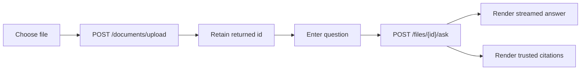
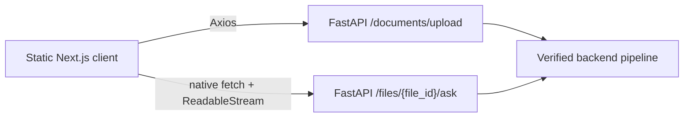
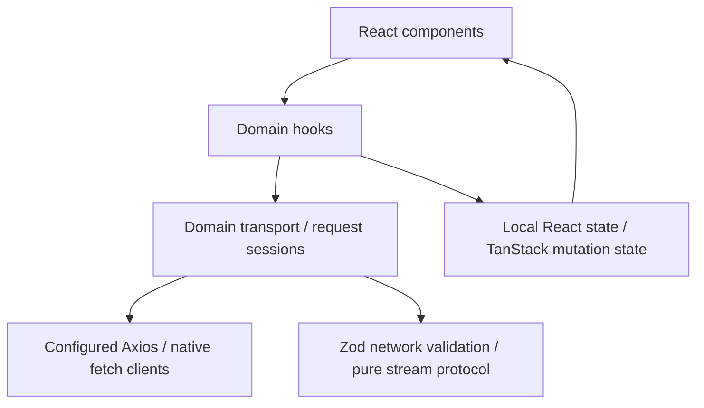

# PHASE_01_PLAN_05 — Minimal Client UI (Specification)

- This specification defines the PLAN_05 end-state: architecture, contracts, requirements, acceptance criteria, risks, and verification boundaries.
- Chronological implementation history belongs in `CONTEXT` and focused implementation prompts live separately. This PLAN defines capabilities and contracts without preassigning future Amendment numbering.

- **Branch:** `phase-01/plan-05`
- **Depends on:** PLAN_04, Verified.
- **Status:** Verified — complete upload/question/native SSE/trusted citation workflow passed development-browser and static-export acceptance over the existing verified backend.
- **Pipeline stage:** client/browser presentation over the verified Phase 1 backend.
- **Current implementation and evidence:** `PHASE_01_PLAN_05_CONTEXT.md`.
- **Repeatable acceptance:** `PHASE_01_PLAN_05_MANUAL.md`.

---

## Objective

Complete Phase 1 with a minimal browser client over the already-verified Atlas single-file RAG backend.

Given one user-selected file, the client must:

1. upload the file through the existing `POST /documents/upload` contract;
2. retain the returned public `id` as the active `file_id` scope;
3. accept one question for the active file;
4. call the existing `POST /files/{file_id}/ask` endpoint directly from the browser;
5. consume the POST response as Server-Sent Events through native browser `fetch()` and `ReadableStream`;
6. render clean answer text incrementally;
7. render only trusted citation metadata supplied by the backend;
8. surface validation, upload, transport, protocol, and generation failures explicitly;
9. preserve the verified backend RAG contracts rather than redesigning them;
10. produce a static Next.js client artifact with no persistent Next.js server runtime.

PLAN_05 completes the Phase 1 user-visible flow:



Legend: PLAN_01–04 backend stages are already Verified. PLAN_05 owns only browser/client consumption and presentation of those contracts.

---

## Scope

### In scope

- latest stable Next.js at implementation time;
- App Router;
- TypeScript-only frontend source with strict type checking;
- Bun-only client scaffolding, package management, script execution, development, build, and tests;
- static Next.js export;
- Tailwind CSS;
- shadcn/ui;
- direct browser-to-FastAPI communication;
- explicit configured FastAPI CORS allow-list for the client origin;
- Axios for ordinary request/response HTTP;
- TanStack Query v5 for server-state query/mutation lifecycle;
- React Hook Form for forms;
- Zod for form and untrusted network/SSE validation;
- native browser `fetch()` + `ReadableStream` for the POST SSE ask path;
- internal `AbortController` lifecycle ownership;
- one active uploaded file;
- one active streamed answer at a time;
- trusted citation rendering;
- minimal functional developer-facing UI;
- strict frontend folder-placement contract;
- local/static-build/browser acceptance;
- proportional backend regression and Docker verification when backend CORS/configuration changes.

### Explicitly excluded

- authentication;
- access/refresh-token implementation;
- Axios auth interceptors;
- cookies/session handling;
- users/teams;
- folders or folder trees;
- multi-file/drive retrieval;
- file metadata persistence;
- PostgreSQL;
- Redis;
- multi-turn chat/history;
- persisted client conversations;
- Next.js BFF/proxy routes;
- Next.js Route Handlers for Atlas API proxying;
- Server Actions;
- SSR-dependent product behavior;
- Next.js runtime server deployment;
- client Docker image/service;
- moving backend Compose to repository root;
- Redux;
- Zustand;
- another global state library;
- user-facing stream cancellation controls;
- automatic stream reconnection/resume;
- `Last-Event-ID` handling;
- optimistic RAG answer caching;
- hybrid retrieval/reranking/query rewriting;
- backend retrieval/generation/citation redesign;
- custom design system;
- elaborate responsive/product polish;
- dashboards, navigation shells, file browser, dark-mode work, animation work, or unrelated product surfaces.

---

## Architecture overview

### Browser-to-backend topology



Rules:

- The browser communicates directly with FastAPI.
- Next.js is not a BFF in Phase 1.
- No browser request should be routed through a Next.js API/Route Handler merely to avoid CORS.
- FastAPI owns CORS authorization for the static client origin.

### Client responsibility flow



Rules:

- components render and compose;
- domain hooks own React lifecycle and direct TanStack Query orchestration; domain services own extracted transport, validation, and request sessions;
- services/http owns configured Axios and native fetch clients; pure parsing/protocol helpers live in utils/stream;
- Zod schemas validate untrusted external data;
- TanStack Query owns ordinary server-state mutation/query lifecycle;
- local React state owns ephemeral workflow/display state;
- no feature transport logic belongs in `app/` or `components/ui/`.

---

## Locked frontend stack

### Framework

- Use the latest stable Next.js release available when PLAN_05 implementation begins.
- At PLAN authoring time on 2026-10-20, the official Next.js release line is 16.4.
- Do not hardcode or preserve an older planning-time Next.js version if a newer stable version exists when scaffolding.
- Use App Router.
- Use a `src/` directory.
- Use dedicated aliases for current roots; retain `@/*` rooted at `client/src/*` as fallback.

- `@app/*` -> `./src/app/*`;
- `@components/*` -> `./src/components/*`;
- `@config/*` -> `./src/config/*`;
- `@hooks/*` -> `./src/hooks/*`;
- `@lib/*` -> `./src/lib/*`;
- `@providers/*` -> `./src/providers/*`;
- `@schemas/*` -> `./src/schemas/*`;
- `@services/*` -> `./src/services/*`;
- `@utils/*` -> `./src/utils/*`;
- `@/*` -> `./src/*` (fallback).
- Use TypeScript only.

### TypeScript

- `strict` remains enabled.
- Do not add JavaScript application/configuration files where the selected tool supports TypeScript.
- Do not weaken TypeScript compiler strictness to make code compile.
- Avoid `any`.
- If an external-library boundary cannot avoid `any`, narrow the exception and document why.
- Treat network/SSE JSON as `unknown` until runtime validation succeeds.
- Prefer Zod-inferred types over manually duplicated DTO interfaces.
- Use discriminated unions for protocol/event state where appropriate.
- Compile-time typing does not replace runtime validation at trust boundaries.

### Runtime/package manager

Bun is the only supported PLAN_05 client runtime/package-manager/script-runner workflow.

Use Bun for:

- project scaffolding;
- dependency installation;
- package execution;
- Next.js development;
- Next.js build;
- format/format-check/lint/type/test scripts.

Expected command family:

```text
bun create ...
bunx --bun ...
bun add ...
bun install ...
bun run ...
```

Do not introduce normal client workflows using:

```text
npm
npx
pnpm
yarn
```

Lockfile contract:

- `bun.lock` is the canonical client lockfile.
- Do not add `package-lock.json`.
- Do not add `pnpm-lock.yaml`.
- Do not add `yarn.lock`.
- Do not add legacy `bun.lockb`.

Record the actual Bun version used for implementation/verification in PLAN_05 CONTEXT.

### Formatting

- Install current stable compatible Prettier through Bun without unrelated upgrades.
- Use default formatting, an empty config for editor discovery, and an artifact ignore file.
- `bun run format` writes and `bun run format:check` checks the same quoted TypeScript/TSX source/test/root-config globs.
- Exclude next-env.d.ts, node_modules, .next, out, lock/build artifacts; add no formatter/import-sort/Tailwind plugins.
- Format checking supplements ESLint, strict TypeScript, tests, and static builds.

### Rendering/deployment model

- Configure Next.js static export with `output: "export"`.
- `next build` must produce the static client artifact, normally `client/out/`.
- No persistent Next.js runtime server is part of Phase 1.
- No client Docker service/image is part of Phase 1.
- Development may use the Next.js dev server executed under Bun.
- Static acceptance must exercise the exported artifact through a simple static file server without adding a permanent runtime dependency.
- Do not introduce SSR-only/server-action/runtime-route dependencies into the Phase 1 client.

### Styling

- Tailwind CSS.
- shadcn/ui.
- Use mostly default shadcn visual behavior.
- Add only components needed by the Phase 1 workflow.
- Do not create a custom design system.
- `components/ui/` is reserved for generated/customized shadcn primitives.
- Atlas domain behavior must not be implemented inside shadcn primitive files.

---

## Client data-access architecture

### Ordinary HTTP

Use Axios for request/response HTTP such as file upload and later conventional CRUD.

Required boundary:

- one shared configured Axios instance under `services/http/`;
- `baseURL` comes from validated public client configuration;
- no auth interceptors in Phase 1;
- no speculative refresh-token logic;
- no API endpoint construction scattered through React components;
- domain transport services validate unknown response bodies before hooks adopt Atlas-domain values.

TanStack Query v5 owns ordinary server-state lifecycle:

- one application `QueryClient`;
- one `QueryClientProvider`;
- upload uses `useMutation`;
- no query caching is added where no query exists;
- no unnecessary global server-state abstractions are introduced merely because TanStack Query is installed.

### Streamed ask HTTP

`POST /files/{file_id}/ask` uses native browser `fetch()`.

Reasons locked by architecture:

- the public endpoint is POST SSE;
- browser `Response.body` exposes a `ReadableStream`;
- Atlas needs direct incremental byte/text consumption;
- forcing the stream through Axios/TanStack Query would obscure rather than improve the transport boundary.

The ask session implementation:

- lives under `services/ask/` and contains no React logic;
- may use pure reusable SSE parsing helpers under `utils/stream/`;
- owns its request AbortController and forwards its signal through the configured fetch client;
- performs the POST request;
- validates non-SSE/pre-stream HTTP failures;
- reads the response body incrementally;
- parses logical SSE events;
- runtime-validates event JSON;
- applies validated domain events to subscribed session snapshots;
- never trusts arbitrary event payloads.

The same React-facing hook:

- lives under `hooks/ask/`;
- subscribes to its request session;
- resets/aborts that session on teardown or scope replacement;
- prevents concurrent ask streams;
- exposes typed streaming state to components.

TanStack Query is not used as the transport owner for the streamed `/ask` response in Phase 1.

The fetch client centralizes API URL joining, omitted credentials, GET/POST methods, JSON serialization and default JSON headers. base accepts native body/options without forcing JSON; caller headers/signals/options remain available. Responses are not parsed or consumed by this client. Next rewrites are unsupported by static export, so browser requests resolve directly to FastAPI through configured clients.

Atlas React code follows client AGENTS conventions under the inherited root policy: default function exports, named props/hook interfaces, grouped imports, multiline objects and logical blank lines. Hook contracts stay local unless sharing warrants extraction; generated shadcn primitives retain their APIs. A body-only suppressHydrationWarning handles browser extension attributes without suppressing descendant mismatches.

---

## Client configuration contract

Public client configuration:

```text
NEXT_PUBLIC_ATLAS_API_BASE_URL
```

Rules:

- required at build time for the static client;
- validated before use;
- must be an absolute HTTP(S) base URL;
- must not contain secrets;
- is embedded into the static JavaScript bundle by Next.js;
- changing the API base after build requires rebuilding the static client;
- configured HTTP clients consume centralized validated config rather than reading `process.env` throughout the app.

No other public environment setting should be added without a concrete need.

---

## FastAPI CORS contract

Direct browser-to-FastAPI communication requires explicit CORS configuration.

PLAN_05 therefore permits one backend integration change:

- add validated CORS origin configuration through the existing Atlas constants architecture;
- add FastAPI `CORSMiddleware` wiring;
- update safe environment examples/Compose forwarding where required.

Rules:

- use an explicit origin allow-list;
- do not use `*` as the normal allowed-origin policy;
- include the development client origin needed by the documented local workflow;
- allow only methods/headers required by the Phase 1 client flow;
- do not add auth/cookie credential policy merely for future authentication;
- CORS is a browser transport boundary only; it is not authentication or authorization;
- no existing upload/query/ask behavior may change because of CORS wiring.

Because this touches backend environment/configuration/Compose, the implementation slice that introduces it requires proportional backend Docker verification.

---

## Upload contract

The client consumes the existing verified backend endpoint:

```text
POST /documents/upload
Content-Type: multipart/form-data
field: file
```

Successful response is the existing backend `UploadResponse` and includes:

```text
id
name
type
total
chunks
```

Client rules:

- construct `FormData` with the selected file;
- do not manually hardcode the multipart boundary;
- send through the shared Axios client;
- runtime-validate the backend response before treating it as typed;
- retain the returned public `id` as the active file scope;
- the UI may retain/display `name`, `type`, and `total`;
- chunk response data does not need to be rendered in PLAN_05;
- do not generate a second client-side identifier;
- do not rename the backend public `id` field;
- internally, client workflow naming may use `fileId` after mapping from public response `id`;
- the backend remains authoritative for supported file formats and upload validation.

Upload failure:

- must remain explicit;
- must not create/retain a new active file;
- should render a concise safe error;
- should preserve the previous active file only if the user has not intentionally reset/replaced it;
- no silent retry.

---

## Active file state

Phase 1 supports exactly one active uploaded file in the browser workflow.

The active file state must retain enough information for the UI and ask path:

- `fileId`;
- filename;
- file type if useful;
- chunk count if useful.

Rules:

- no local persistence is required;
- no localStorage/sessionStorage is required;
- page refresh may reset client state;
- no file history/list is required;
- successful upload of a replacement file resets prior answer/citation/question-result state;
- do not model folders or drive state.

No global client-state library is required.

Use local React state at the smallest common owner that coordinates the Phase 1 workflow.

---

## Question contract

The client consumes:

```text
POST /files/{file_id}/ask
Content-Type: application/json
```

Phase 1 question UI:

- one required question field;
- trim before submission;
- reject blank-after-trim input;
- no multi-turn history;
- no top-k control in the UI;
- omit `top_k` unless implementation needs to send the verified backend default explicitly;
- backend default `top_k=5` remains authoritative.

The Ask action is disabled when:

- no active file exists;
- an upload is active;
- an ask stream is active;
- question validation fails.

Only one active ask stream is allowed.

---

## SSE consumption contract

The verified backend event names are:

```text
answer
citations
done
error
```

The client parser must operate on logical SSE framing rather than network chunk boundaries.

Requirements:

- decode UTF-8 incrementally;
- tolerate an SSE record split across arbitrary `ReadableStream` chunks;
- handle CRLF/LF event framing correctly;
- ignore SSE comment/keepalive lines;
- collect `event:` and `data:` fields according to the backend contract;
- parse event `data` as JSON;
- validate JSON through event-specific Zod schemas;
- reject unknown/invalid protocol events explicitly rather than silently treating them as answer text;
- do not parse or expose internal `[[cite:N]]` markers as a client concern.

### `answer`

Expected data:

```json
{ "text": "<incremental clean text>" }
```

Rules:

- append text in arrival order;
- render incrementally;
- empty text may be ignored;
- answer text is provisional until successful terminal `done`.

### `citations`

Expected data:

```json
{"citations":[...]}
```

Rules:

- accept exactly one successful citations event;
- runtime-validate each trusted Citation;
- stage citations for successful completion;
- do not derive provenance from answer text.

### `done`

Expected data:

```json
{ "status": "completed" }
```

Rules:

- exactly one successful terminal;
- no event may be accepted after `done`;
- only `done` transitions the client answer to completed/success state.

### `error`

Expected data:

```json
{ "error": "Generation failed.", "code": "..." }
```

Rules:

- terminal failure;
- no citations/done may be accepted after `error`;
- surface the safe server error;
- any previously streamed answer remains explicitly incomplete/provisional and must not be presented as a completed answer.

No automatic reconnection or resume behavior exists in Phase 1.

---

## Citation presentation contract

The client trusts only the structured Citation objects supplied by PLAN_04.

Fields:

```text
index
page
heading
section
excerpt
```

Presentation:

- simple developer-facing list/cards;
- display `excerpt`;
- display `page`, `heading`, and `section` when non-null;
- `index` may be shown as the source/chunk label;
- do not expose or infer retrieval score/confidence;
- do not reconstruct excerpts from answer text;
- do not infer page/heading/section;
- do not ask the model/client to generate citation metadata;
- no click-to-document navigation is required because the Phase 1 client has no document viewer.

Citations are successful result metadata only after the stream reaches `done`.

---

## Form architecture

Use React Hook Form + Zod.

Phase 1 forms:

- upload form;
- ask form.

Rules:

- form schemas live under `schemas/<domain>/`;
- hooks/components consume typed schema output;
- browser-only values such as `File` must be validated in a way compatible with static prerender/build execution;
- do not access browser globals unsafely during static build;
- do not add Formik;
- do not add TanStack Form;
- do not add a second schema-validation library.

---

## Error and lifecycle semantics

Client-visible states should distinguish at minimum:

```text
idle
uploading
file-ready
streaming
completed
failed
```

Exact implementation may use separate typed state values rather than one global enum, but behavior must be unambiguous.

### Upload failure

- render explicit safe error;
- no false success;
- no fabricated file ID.

### Ask pre-stream HTTP failure

Examples:

- request validation failure;
- CORS/network failure;
- backend retrieval/provider preparation failure returned as normal HTTP.

Behavior:

- do not enter completed state;
- do not fabricate answer/citations;
- surface safe error.

### Ask post-commit SSE error

- stream may already have rendered provisional text;
- mark the answer failed/incomplete;
- do not render staged citations as successful citations;
- do not transition to completed;
- do not silently preserve partial text as a successful answer.

### Cancellation

Phase 1 has no user-facing Cancel button.

Internal lifecycle must still:

- retain the active request `AbortController`;
- abort on component/workflow teardown where necessary;
- clear controller ownership after terminal success/failure/abort;
- prevent concurrent ask streams;
- treat abort separately from successful completion.

Do not add reconnect/resume/background streaming.

---

## Minimal UI contract

The UI is a functional developer-facing MVP.

A single page is sufficient:

```text
Atlas
Single-file grounded RAG

[ Upload file ]
<active file status>

[ Question input ]
[ Ask ]

Answer
<incremental answer or status>

Sources
<trusted citation list>
```

Required behavior:

- obvious upload action;
- selected/active file identity visible after success;
- obvious question input and ask action;
- loading/disabled states;
- explicit errors;
- streamed answer;
- trusted citations;
- basic accessible labels;
- basic keyboard/form semantics.

Not required:

- custom branding;
- complex navigation;
- file explorer;
- dashboards;
- responsive-product-design work beyond avoiding broken layout;
- dark-mode customization;
- animation system;
- toast framework if inline feedback is sufficient;
- Markdown rendering unless plain text proves inadequate for the verified backend output;
- drag-and-drop unless it falls out naturally from the selected minimal shadcn primitive without adding scope.

---

## Frontend folder placement

The frontend folder contract in [client/AGENTS.md](../../../client/AGENTS.md), inheriting [root AGENTS.md](../../../AGENTS.md), is authoritative. PLAN_05 must follow the same model. Work under `server/**` additionally follows [server/AGENTS.md](../../../server/AGENTS.md); detailed RAG contracts remain in the [RAG skill](../../../.agents/skills/rag/SKILL.md).

Target structure:

```text
client/
├── public/
├── src/
│   ├── app/
│   │   ├── globals.css
│   │   ├── layout.tsx
│   │   └── page.tsx
│   ├── components/
│   │   ├── ui/
│   │   ├── Common/
│   │   ├── Rag/
│   │   ├── Upload/
│   │   ├── Ask/
│   │   └── Citations/
│   ├── hooks/
│   │   ├── common/
│   │   ├── upload/
│   │   └── ask/
│   ├── services/
│   │   ├── http/
│   │   ├── upload/
│   │   └── ask/
│   ├── schemas/
│   │   ├── common/
│   │   ├── upload/
│   │   └── ask/
│   ├── types/
│   │   ├── common/
│   │   ├── upload/
│   │   └── ask/
│   ├── providers/
│   │   └── query/
│   ├── config/
│   ├── constants/
│   │   └── common/
│   ├── utils/
│   │   ├── common/
│   │   └── stream/
│   └── lib/
│       └── utils.ts
├── tests/
│   ├── unit/
│   │   ├── upload/
│   │   └── ask/
│   └── integration/
│       └── rag/
├── components.json
├── next.config.ts
├── tsconfig.json
├── package.json
└── bun.lock
```

Rules:

- this is a destination/placement contract, not a requirement to create empty directories;
- create a domain subfolder only when that layer has code for the domain;
- technical layer first, domain second;
- Atlas component domain folders and reusable component files use PascalCase (`components/Upload/UploadPanel.tsx`); shared presentation belongs in `components/Common/` only when needed.
- `components/ui/` retains generated shadcn naming. Next/tool-required names (`page.tsx`, `layout.tsx`, `not-found.tsx`, `next-env.d.ts`, `next.config.ts`, `eslint.config.mts`) remain exceptions.
- Hook domain folders stay lowercase; hook filenames use `use<Name>.ts` and contain no JSX.
- Other user-controlled multiword filenames/directories use lowerCamelCase; single-word names may remain lowercase. Tests follow lowerCamelCase before `.test.ts` (or `.test.tsx` only for JSX). No hyphenated user-controlled filenames.
- Export component/type symbols with PascalCase and variables/functions with camelCase.
- Domain hooks own React orchestration; domain services own extracted transport, validation, and request sessions. Avoid redundant pass-through layers.
- `services/http/axios.ts` exports the configured Axios instance; `services/http/fetch.ts` exports base/get/post and returns native Responses without consuming streams. Both use validated API configuration; no auth interceptors in Phase 1.
- Use dedicated aliases across source roots; short local relative imports are acceptable. Preserve `@/*` as fallback; add no speculative aliases.
- Use Prettier defaults through Bun `format` and `format:check`; exclude generated/build artifacts. Keep lint/typecheck/test/build as separate checks.
- `app/` is route/layout/composition only;
- `components/ui/` is shadcn primitives only;
- `components/Common/` is truly cross-domain;
- `hooks/<domain>/` owns React orchestration and direct TanStack Query calls;
- `services/http/` owns common HTTP configuration;
- `schemas/<domain>/` owns Zod validation;
- `types/<domain>/` is only for types not naturally inferred from schemas/library types;
- `providers/query/` owns TanStack Query provider wiring;
- `config/` owns validated public environment access;
- `utils/` contains pure helpers only;
- `lib/utils.ts` remains the shadcn utility boundary, not a miscellaneous business-logic location;
- tests live under `client/tests/`, grouped by level/domain;
- no barrel `index.ts` files by default;
- no vague catch-all `helpers.ts`, `misc.ts`, `stuff/`, or giant `common.ts` files;
- no `features/` parallel architecture unless a later human-approved architecture decision supersedes this folder contract.

---

## Capability decomposition

This section describes end-state capabilities only. It does not assign future Amendment numbers.

### Client foundation and upload handoff

- scaffold latest stable Next.js with Bun;
- establish strict TypeScript, static export, Tailwind, shadcn;
- establish folder contract;
- configure QueryClient;
- configure validated public API base;
- configure Axios;
- add FastAPI CORS;
- implement upload form/mutation;
- retain active `file_id`;
- prove browser upload integration.

### Ask streaming and answer rendering

- implement question form;
- implement native fetch POST stream transport;
- implement robust SSE parsing;
- validate event payloads;
- incrementally render answer;
- enforce terminal success/error semantics;
- internal abort cleanup;
- no user-facing cancellation.

### Trusted citation presentation

- consume validated citation event;
- render trusted provenance only;
- handle nullable page/heading/section;
- render excerpt;
- ensure citations are success metadata only after `done`.

### Full Phase 1 client acceptance

- static export succeeds;
- exported artifact can be served without Next.js runtime;
- browser can upload;
- browser can ask;
- answer streams incrementally;
- citations match backend trusted metadata;
- unsupported answer renders canonical fallback and zero citations;
- generation error remains explicit;
- existing backend regressions remain passing;
- documentation/current-state files reflect actual accepted state.

---

## Current authoritative implementation research

Version-sensitive facts must be re-checked immediately before implementation.

Authoring-time research on 2026-10-20 establishes:

### Next.js

- the current official release line is Next.js 16.4;
- `create-next-app` supports TypeScript, Tailwind, App Router, and `src/` layout;
- static export is configured with `output: "export"`;
- static export removes the need for a Next.js runtime server;
- Client Components/browser APIs remain usable when invoked in browser-safe lifecycle paths;
- `NEXT_PUBLIC_*` environment variables are embedded into the client build.

Implementation rule:

- use the latest stable release at implementation time, not a stale version written in this PLAN;
- if current Next.js static-export behavior materially conflicts with a locked PLAN_05 requirement, stop and report the conflict rather than silently changing architecture.

### Bun

Current official Bun guidance supports:

- `bun create next-app@latest`;
- running Next.js CLI commands under Bun with `bun --bun`;
- `bun.lock` as the current text lockfile.

Implementation rule:

- use current official Bun mechanics;
- do not fall back to Node/npm workflows merely because a third-party example uses them.

### shadcn/ui

Current official shadcn documentation supports:

- Next.js;
- Bun as a package-manager option;
- `src/` directory projects;
- `@/*` aliases;
- CLI-installed local source components.

Implementation rule:

- use the current shadcn CLI syntax;
- add only the primitives the Phase 1 UI needs.

### TanStack Query

Current TanStack Query React documentation identifies v5 as the latest line and supports:

- `QueryClient`;
- `QueryClientProvider`;
- queries;
- mutations;
- invalidation;
- `AbortSignal` integration.

PLAN_05 uses it for ordinary server-state lifecycle, not the streamed ask transport.

### FastAPI CORS

Current official FastAPI documentation requires explicit allowed origins for cross-origin browser requests and recommends explicit origins rather than wildcard behavior when credentialed behavior may matter.

PLAN_05 uses explicit origins and does not treat CORS as authentication.

---

## Requirements

### Client foundation

- Create a real `client/` Next.js application.
- Use latest stable Next.js at implementation time.
- Use Bun only for client tool/runtime/package workflows.
- Use TypeScript only.
- Keep TypeScript strict.
- Use App Router with `src/`.
- Configure `@/*` to `client/src/*`.
- Configure static export.
- Configure Tailwind.
- Configure shadcn/ui.
- Add only approved dependencies required by this PLAN.
- Produce only `bun.lock`.

### Client dependencies

Approved PLAN_05 dependencies include the latest mutually compatible stable versions at implementation time of:

- Next.js;
- React/React DOM selected by the current Next.js scaffold;
- Tailwind CSS selected by the scaffold;
- shadcn/ui generated/runtime dependencies;
- Axios;
- `@tanstack/react-query`;
- React Hook Form;
- Zod;
- the official React Hook Form Zod resolver package if current React Hook Form integration requires it;
- Prettier as an exact-pinned development dependency using defaults, without unapproved plugins.

Do not add another HTTP client, form library, schema library, global state library, SSE library, or design system.

### Folder structure

- Follow the `client/AGENTS.md` frontend placement contract under inherited root `AGENTS.md` policy.
- Do not create empty symmetry folders.
- Keep routing/composition in `app/`.
- Keep React orchestration in domain hooks, extracted endpoint transport in domain services, and configured HTTP clients in services/http.
- Keep UI primitives in `components/ui/`.
- Keep domain UI under `components/<domain>/`.
- Keep runtime schemas under `schemas/<domain>/`.
- Avoid barrel files/catch-all helper directories.

### Configuration

- Add validated `NEXT_PUBLIC_ATLAS_API_BASE_URL`.
- Centralize access in `src/config/`.
- Fail clearly if missing/invalid at build/runtime use boundary.
- Never place secrets in public client env.
- Document a safe client environment example if the selected Next.js/Bun workflow needs one.

### CORS

- Add explicit FastAPI CORS configuration through existing validated constants architecture.
- Wire `CORSMiddleware` without moving business logic into `main.py`.
- Add safe example configuration.
- Forward through Compose if required for the authoritative backend runtime.
- Preserve all existing backend API behavior.
- Add focused backend CORS verification.
- Perform Docker verification because configuration/Compose are deployment-sensitive.

### Upload

- Use React Hook Form + Zod.
- Use TanStack `useMutation`.
- Use the configured Axios instance from the upload transport service invoked by the hook mutation.
- Use `FormData`.
- Validate `UploadResponse` at runtime.
- Retain the returned `id`.
- Show active file state.
- Show pending/failure/success state.
- Do not render upload chunk bodies.
- Do not silently retry.

### Ask stream

- Use React Hook Form + Zod for the question.
- Use native fetch.
- Use `ReadableStream`.
- Use robust incremental SSE parsing.
- Validate every event payload.
- Preserve answer order.
- Enforce `citations`/`done`/`error` terminal semantics.
- Use `AbortController` internally.
- No concurrent streams.
- No auto-reconnect.
- No EventSource API because the backend endpoint is POST.

### Citations

- Render only backend trusted Citation DTO values.
- Do not derive provenance in the client.
- Hide absent nullable metadata cleanly.
- Do not display retrieval confidence.
- Treat citations as successful only after `done`.

### UI

- One page.
- Functional layout.
- Default/minimal shadcn appearance.
- Accessible form labels/buttons.
- Disabled/loading states.
- Inline errors are sufficient.
- No custom design-system work.

### Compatibility

- Preserve PLAN_01–PLAN_04 backend contracts.
- Do not alter upload response shape.
- Do not alter `/query`.
- Do not alter `/ask`.
- Do not alter SSE event names/payloads.
- Do not alter retrieval, generation, citation, Qdrant, embedding, chunking, or Gemini behavior.
- Do not introduce auth/folders/PostgreSQL/Redis.

---

## Acceptance criteria

### Foundation

- `client/` exists and follows the locked folder-placement rules.
- latest stable Next.js at implementation time is recorded in CONTEXT.
- client source is TypeScript-only except generated/config artifacts that cannot be TypeScript by tool contract.
- TypeScript strict mode remains enabled.
- Bun is the only normal package/runtime workflow.
- only `bun.lock` is present as client package-manager lockfile.
- App Router and `src/` are used.
- static export is configured.
- `bun run build` produces the static export successfully.
- no Next.js runtime server is required to serve the production artifact.
- no client Docker service is introduced.

### Upload

- browser can select and upload one supported file.
- request reaches existing `POST /documents/upload`.
- successful backend response is runtime-validated.
- returned `id` becomes active file scope.
- file name/status is visible.
- upload error remains explicit.
- no second file identifier is fabricated.
- no backend upload contract changes.

### Ask/stream

- ask is disabled until a file is active.
- blank question is rejected.
- browser POSTs directly to `/files/{file_id}/ask`.
- response is consumed incrementally.
- logical SSE records parse correctly independent of network chunk boundaries.
- answer text renders incrementally.
- successful sequence requires citations then done.
- protocol/server error never becomes completed state.
- no automatic reconnect/resume.
- internal abort cleanup works.
- no user-facing cancel feature.

### Citations

- citations are rendered only from validated structured server data.
- excerpt is displayed.
- page/heading/section are displayed when present.
- no citation field is inferred from answer text.
- no score/confidence is invented.
- citations are not presented as successful after terminal error.

### Browser/backend integration

- explicit CORS allows the documented client origin.
- wildcard origin is not the normal policy.
- unrelated origins remain disallowed in focused verification.
- existing backend endpoint behavior remains unchanged.
- backend full regression suite remains passing after CORS/config changes.
- proportional Docker verification passes for configuration/Compose changes.

### Quality

- client lint passes using generated/current tooling.
- client type check passes.
- client static build passes.
- pure frontend tests added during the PLAN pass under Bun.
- backend focused/full regressions pass where touched.
- `git diff --check` passes.
- no secret enters tracked client files/static output.
- no prohibited Git operations occur.

### End-to-end Phase 1

Using the static client and real verified backend:

1. upload a controlled file;
2. receive/retain the returned ID;
3. ask a supported question;
4. observe answer text before terminal completion where the provider naturally streams;
5. receive trusted citations;
6. receive terminal done;
7. ask an unsupported question and receive the canonical insufficient-context response with zero citations;
8. exercise a safe failure path and confirm it is explicit;
9. verify no cross-file/backend contract regression;
10. verify the UI remains strictly single-file/single-question-flow scope.

PLAN_05 becomes Verified only after its full implementation and acceptance evidence are complete according to current project verification rules.

---

## Risks and accepted boundaries

### Latest-version drift

Next.js, Bun, shadcn, and client-library APIs change.

Mitigation:

- verify current official docs immediately before implementation;
- record resolved versions;
- do not let stale examples override current APIs or locked architecture.

### Static export limits

Static export cannot use Next.js runtime-server features.

Accepted:

- Phase 1 does not need them;
- FastAPI remains the backend;
- public API base is build-time configuration.

### CORS is not security

CORS controls browser origin access, not backend authorization.

Accepted:

- Phase 1 is unauthenticated;
- future auth will require a separate explicit architecture decision.

### Future dual-token auth

Axios is selected partly because future ordinary HTTP may benefit from interceptors.

Boundary:

- do not implement auth/token interceptors now;
- do not couple streamed fetch transport to speculative auth code;
- later auth work must define a shared session/token coordinator usable by both Axios and streaming fetch.

### Upload response size

The current upload response includes chunk details even though the Phase 1 client only needs file identity/status.

Accepted:

- PLAN_05 consumes the existing verified contract;
- do not redesign the backend response solely for client optimization in this PLAN.

### SSE protocol complexity

Network chunks do not align with SSE events.

Mitigation:

- parser operates on buffered logical event framing;
- incremental UTF-8 decode;
- deterministic pure parser tests.

### Partial streamed answer on failure

PLAN_04 text is provisional until successful stream completion.

Client behavior:

- terminal error prevents completed state;
- staged citations are discarded/not presented as success;
- any partial text remains visibly incomplete/failed.

### No client persistence

Refresh loses active file/question/answer state.

Accepted for Phase 1.

### No user-facing cancellation

Internal abort ownership exists, but no Cancel button.

Accepted to keep the MVP focused on the core RAG path.

---

## Verification approach

Verification is proportional by capability.

### Frontend static/tooling

- record `bun --version`;
- record resolved Next.js/React/client dependency versions;
- `bun install --frozen-lockfile` after lockfile exists;
- run current lint script;
- run explicit TypeScript check;
- run frontend tests under Bun;
- run static `bun run build`;
- verify exported artifact exists.

### Backend CORS/configuration

Because CORS adds environment/configuration/Compose behavior:

- run focused backend config/CORS tests;
- run established full backend suite;
- build/verify the backend Docker image through the authoritative server Compose path;
- verify configured client origin is allowed;
- verify an unapproved origin is not allowed;
- preserve Qdrant data and existing backend behavior.

### Browser acceptance

Use the real browser client against the real backend:

- development-client check;
- exported-static-client check;
- upload;
- active ID handoff;
- ask;
- incremental answer;
- citations;
- done;
- unsupported fallback;
- safe failure;
- reload/reset behavior as documented.

### Documentation

As implementation progresses:

- append chronological evidence to PLAN_05 CONTEXT;
- create/update PLAN_05 MANUAL with Bun/client/backend/browser commands and explicit `Expected:` behavior;
- update AGENTS/PHASE current-state text only as implementation facts actually land;
- preserve PLAN_04 historical records;
- do not mark PLAN_05 Verified until acceptance evidence supports it.
