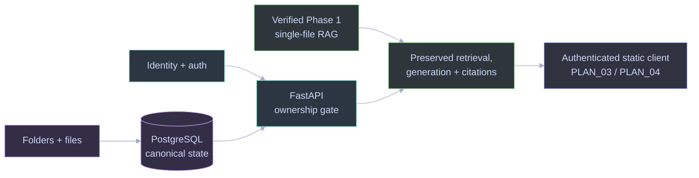
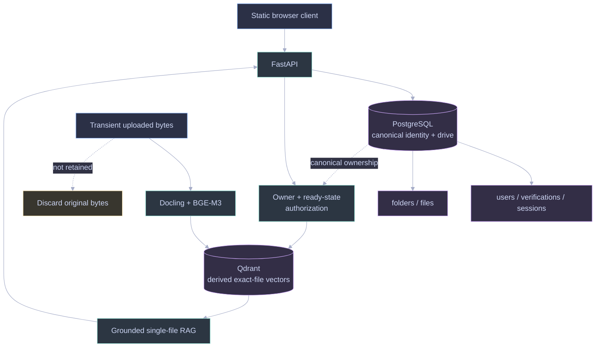
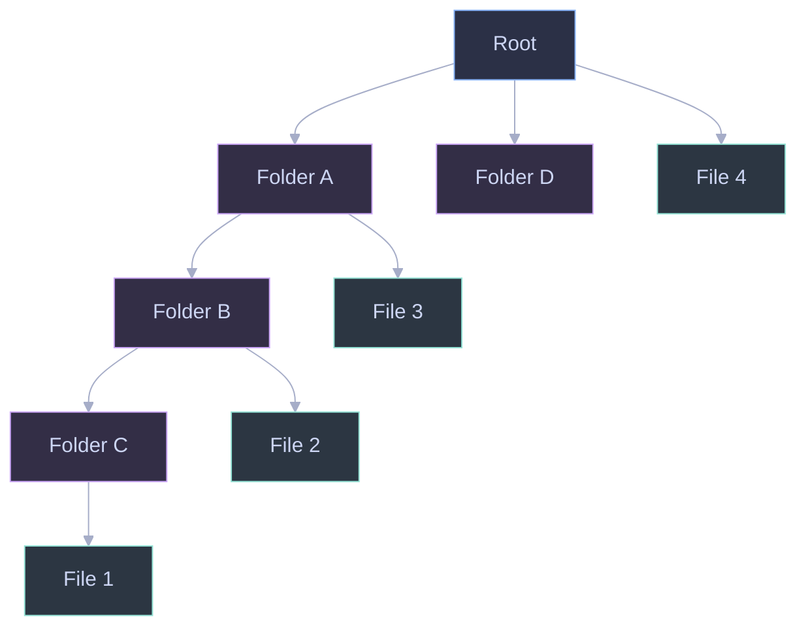
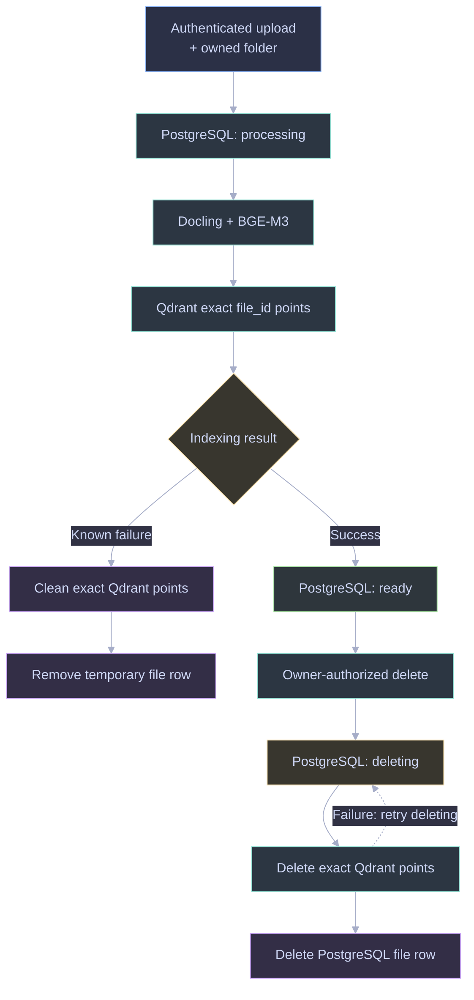

# PHASE_02 — Authenticated Personal Drive

| Field                        | Current baseline                                        |
| ---------------------------- | ------------------------------------------------------- |
| PHASE status                 | `IMPLEMENTED, UNVERIFIED`                               |
| Verified prerequisite        | `PHASE_01 — MVP Core RAG`                               |
| Completed PLANS              | `PHASE_02_PLAN_01`, `PHASE_02_PLAN_02`                  |
| Next development destination | `PHASE_02_PLAN_03 — Client Authentication`              |
| Final milestone              | `PHASE_02_PLAN_04 — Drive Dashboard & Phase Acceptance` |

- **Authority:** This PHASE defines the destination, cross-PLAN contracts, exclusions, and final acceptance; individual PLANS own their detailed specifications.
- **Execution:** Verify server contracts before client consumption unless an approved PLAN explicitly provides an exception.
- **Evidence:** Executed implementation and verification records belong to Codex-maintained `CONTEXT.md` and `MANUAL.md` files.

---

## 1. PHASE OBJECTIVE & SUCCESS BOUNDARY

### Verified Phase 1 baseline

- Preserve **upload → Docling parse/OCR/chunk → BGE-M3 embedding → Qdrant exact-file retrieval → grounded Gemini generation → native SSE → trusted citations**.
- Preserve the verified static Next.js client foundation and reusable stream/citation behavior.
- Historical Phase 1 interfaces may be explicitly superseded by Phase 2 without erasing their verification records.

### Phase 2 extension

- Add PostgreSQL-backed identity, authentication sessions, canonical folder/file metadata, and immutable file UUIDs.
- Add recursive owner-scoped drive navigation and server-authorized single-file RAG.
- Add authenticated browser workflows to the static client, after stable server contracts are verified.
- Require the server to establish ownership **before** any owned file content reaches retrieval or generation.

### Phase boundary diagram

---

## 2. CURRENT STATE & PLAN ROADMAP

### PHASE and PLAN maturity

| PLAN               | Status                    | Responsibility                                                                                       |
| ------------------ | ------------------------- | ---------------------------------------------------------------------------------------------------- |
| `PHASE_02_PLAN_01` | `IMPLEMENTED & VERIFIED`  | PostgreSQL identity and complete backend authentication/session contracts                            |
| `PHASE_02_PLAN_02` | `IMPLEMENTED & VERIFIED`  | Owner-scoped drive backend, file lifecycle, and authorized single-file RAG                           |
| `PHASE_02_PLAN_03` | `IMPLEMENTED, UNVERIFIED` | Shared auth foundation; browser registration, verification, login and protected entry remain unbuilt |
| `PHASE_02_PLAN_04` | `NOT YET BUILT`           | Drive dashboard, file/folder workflows, selected-file RAG and final acceptance                       |

- **PHASE_02** remains `IMPLEMENTED, UNVERIFIED` until all four PLANS and end-to-end acceptance are verified.
- **Active PLAN:** `PHASE_02_PLAN_03`; Amendments 01 and 02 are verified; authentication UI and protected entry remain unbuilt.
- **Backend closure:** PLAN_02 Amendment 06 records integrated two-owner real PostgreSQL/Qdrant, running HTTP, packaged regression/equivalence, security and exact resource-preservation acceptance.
- **Evidence:** The PLAN_02 record reports 159 passing evidence rows; this document does not claim those checks were rerun.
- **Branch reference:** `phase-02/plan-03` was inspected during current implementation; recheck before each task.

### Evidence sources

| PLAN    | Implementation and reproducibility records                                                    |
| ------- | --------------------------------------------------------------------------------------------- |
| PLAN_01 | [CONTEXT](PLAN_01/PHASE_02_PLAN_01_CONTEXT.md) · [MANUAL](PLAN_01/PHASE_02_PLAN_01_MANUAL.md) |
| PLAN_02 | [CONTEXT](PLAN_02/PHASE_02_PLAN_02_CONTEXT.md) · [MANUAL](PLAN_02/PHASE_02_PLAN_02_MANUAL.md) |

- The PHASE overview reports maturity; a PLAN specification or AMENDMENT prompt alone never establishes completion.

---

## 3. SCOPE & EXCLUSIONS

### Included capabilities

**Identity and sessions**

- Registration with `name`, `email`, and `password`; PostgreSQL development verification OTP.
- Login, logout, short-lived access JWT, single-use rotating opaque refresh token, and authenticated current-user resolution.

**Canonical drive state**

- PostgreSQL users, sessions, folders, files, ownership, metadata, and file lifecycle.
- Recursive owner-scoped folder creation, name/description update, and root/direct-child browsing.
- Duplicate folder/file display names with canonical UUID identity.
- Canonical `processing`, `ready`, and `deleting` states; transient upload bytes and recoverable permanent deletion.
- File name/description update without content replacement or reindexing.

**Authorized RAG and browser**

- PostgreSQL owner/ready authorization before exact-file Qdrant retrieval and grounded generation.
- Authenticated browser routes, session restoration, and root/folder dashboard navigation.
- File selection and reuse of verified `/query` and `/ask` behavior.
- Two-user ownership-isolation and complete cross-boundary acceptance.

### Explicit exclusions

| Area           | Excluded capabilities                                                                                            |
| -------------- | ---------------------------------------------------------------------------------------------------------------- |
| Retrieval      | Multi-file, folder/subtree/drive-wide RAG; hybrid/sparse retrieval; reranking or retrieval tuning                |
| Accounts       | Sharing, teams, roles, ACLs, organizations, OAuth/social login, profile/account management                       |
| Verification   | Email delivery; implemented `reset` or `forgot` password workflows                                               |
| Files          | Stored original binaries, download, preview, stored-original reprocessing, versions, movement, recoverable trash |
| Folders        | Movement and deletion                                                                                            |
| Discovery      | Full-text drive search                                                                                           |
| Infrastructure | Redis, queues/workers, S3/MinIO/object storage, audit-log and notification systems                               |

- **Permitted schema support:** Verification purpose enum may include `auth`, `reset`, and `forgot`; only the `auth` product workflow is in scope.
- Exclusions are contractual: an implementation must not silently introduce them.

---

## 4. SYSTEM ARCHITECTURE & AUTHORITY

### Canonical state and derived index

- **PostgreSQL is canonical** for users, verification records, sessions, folders, files, ownership, file metadata, and lifecycle.
- **Qdrant is derived** chunk/vector retrieval state; it never decides application identity or ownership.
- **FastAPI is authoritative** for authentication, file/folder ownership, and ready-state authorization.
- **The LLM never authorizes access** or supplies trusted provenance metadata.
- Preserve the existing Docling/BGE-M3/Qdrant/Gemini pipeline and exact `file_id` query filter.

### Immutable file identity

- Generate one immutable PostgreSQL `files.id` UUID per file.
- Use the same value as the public API file ID, browser file ID, and Qdrant payload `file_id`.
- Do not introduce parallel document, RAG, or storage identifiers.

### System authority diagram

### Non-negotiable retrieval boundary

- Authenticate through validated server credentials; do not accept browser-supplied user identity as proof.
- Authorize owned, ready files using PostgreSQL **before** querying Qdrant.
- Apply exact `file_id` filtering inside the Qdrant query; never broad-search then ownership-filter in application code.
- Cite source provenance from trusted pipeline metadata, not model-authored citation claims.

---

## 5. IDENTITY & AUTHENTICATION CONTRACTS

### Access JWT

- Signed, short-lived JWT supplied as `Authorization: Bearer <token>`.
- Validate signature, expiry, token type, and required claims server-side.
- Resolve identity from the validated `sub` claim.
- No server-side record for each issued access token is required.
- Already-issued JWTs remain valid until expiry after logout.

### Refresh credential and sessions

- Generate a cryptographically random opaque refresh token.
- Transport it in an HttpOnly cookie with configured Secure behavior; preserve the verified cookie/CORS contract.
- Persist **only its SHA-256 hash** in PostgreSQL; one session row represents one currently usable refresh credential.
- Atomically consume the current row and create a replacement credential/session on successful refresh.
- Reject and remove expired rows when encountered; no cron, TTL worker, or background cleanup service is required.
- Preserve the single-use rotation contract, including concurrent-refresh failure handling.

### Development verification OTP

- Store verification OTPs in PostgreSQL; email delivery is excluded.
- Support enum values `auth`, `reset`, and `forgot`; implement only `auth`.
- Delete a successfully consumed OTP row.
- Reject/delete an expired row when encountered.
- Replace the current `(user, type)` verification on resend.
- Never log OTP values.

### Browser integration boundary

- PLAN_03 owns `/register`, `/verify`, `/login`, minimal protected dashboard entry, session restoration, and logout.
- Use an active in-memory access JWT and the approved reversibly encrypted access-token copy in `localStorage`.
- Do not store refresh tokens, passwords, OTPs, or encryption key material in `localStorage`.
- Restore encrypted JWT first through raw `GET /auth`; missing/corrupt/rejected JWT falls back to one cookie refresh, then startup `GET /auth` validation.
- Zustand owns one in-memory auth state for per-endpoint hooks, Axios and native fetch/SSE; automatic bootstrap/refresh remain non-React helpers.
- Treat client-side route guards and token encryption as UX/defense-in-depth, **not** server authorization or an XSS boundary.
- **LOCKED:** Non-extractable AES-256-GCM key in IndexedDB; version-1 encrypted JWT in localStorage. Logout deletes auth ciphertext and its key; subsequent explicit login/verify regenerates an absent key.
- **Accepted limitation:** Single-flight and cookie ordering apply within one browser session; cross-tab arbitration remains excluded.

---

## 6. RECURSIVE DRIVE HIERARCHY

### Ownership and parent relationships

| Entity        | Relationship                      |
| ------------- | --------------------------------- |
| Root folder   | `parent_id = NULL`                |
| Nested folder | `parent_id = <owned folder UUID>` |
| Root file     | `folder_id = NULL`                |
| Nested file   | `folder_id = <owned folder UUID>` |

- Every folder/file has one canonical PostgreSQL user owner.
- A child folder's parent and a file's optional folder must share its owner.
- Names/descriptions are display metadata; UUIDs are canonical identity.
- Allow duplicate sibling folder names, duplicate sibling file names, and file/folder name collisions.
- Folder depth need not be stored; no materialized path/tree table is required.
- Keep folder `parent_id` immutable after creation; movement is excluded.
- Rename/description changes update metadata only.
- Dashboard browsing fetches direct children of the selected folder/root, not the entire subtree.

### Illustrative hierarchy

---

## 7. FILE STORAGE & LIFECYCLE

### Transient ingestion

- Accept uploaded bytes transiently; do **not** persist original files.
- Authenticate the request and authorize its target folder.
- Create one canonical file UUID and PostgreSQL `processing` row.
- Parse/chunk with Docling; embed with BGE-M3; store derived points using the same `file_id`.
- Confirm successful indexing **before** changing the PostgreSQL row to `ready`.
- Discard original upload bytes after the processing attempt.
- Return the canonical authenticated File DTO from `POST /files`; legacy `POST /documents/upload` is removed, not aliased.

### Ingestion failure compensation

- On a known ingestion/indexing failure, remove derived Qdrant points for the exact `file_id`.
- Remove the temporary PostgreSQL file row and return a structured failure.
- Do not retain a durable `failed` file state or a failed user-visible drive entry.

### Permanent deletion

- Authorize the file owner before deletion.
- Transition the canonical row to `deleting`.
- Remove all Qdrant points for the exact `file_id` before removing the PostgreSQL row.
- Treat `deleting` as non-queryable and retryable after a cross-store failure.
- Permanent deletion is not a recoverable-trash workflow.

### Ingestion and deletion lifecycle

### Accepted storage limitations

- No download, preview, or reprocessing from stored original bytes.
- Reprocessing requires another upload; no durable binary/object-store lifecycle exists.
- File name/description updates do not replace content or trigger reindexing.
- Metadata renaming has no binary-storage rename operation.

---

## 8. PLAN RESPONSIBILITIES & HANDOFFS

### PLAN_01 — PostgreSQL Identity & Authentication Foundation

- **Branch:** `phase-02/plan-01`.
- **Dependency:** Verified PHASE_01 RAG baseline.
- **Delivered:** PostgreSQL 18, SQLAlchemy/Psycopg/Alembic, `users`/`verifications`/`sessions`, Argon2id/password credential primitives, JWTs, hashed opaque refresh sessions, OTPs, registration, verification/resend, login, refresh, logout, `GET /auth`, and current-user resolution.
- **Acceptance:** Amendments 01–07 completed backend, PostgreSQL, Docker, HTTP/cookie/CORS, security, and datastore-preservation verification.
- **Boundary:** No folder/file implementation, owner-aware RAG, or Phase 2 browser work.
- **Specification:** [PHASE_02_PLAN_01.md](PLAN_01/PHASE_02_PLAN_01.md).

### PLAN_02 — Authenticated Drive Backend

- **Branch:** `phase-02/plan-02`.
- **Dependency:** Verified PLAN_01 authentication and persistence.
- **Delivered:** Canonical owner-scoped folder/file persistence, recursive hierarchy, direct-child APIs, authenticated transient `POST /files`, file metadata changes, recoverable cross-store deletion, and owner/ready-authorized single-file `/query` and `/ask`.
- **Acceptance:** Amendments 01–06 completed integrated two-owner PostgreSQL/Qdrant, HTTP, regression, security and exact datastore/resource-preservation verification.
- **Boundary:** No authenticated browser/dashboard, folder delete/move, file move, persistent originals, or multi-scope RAG.
- **Specification:** [PHASE_02_PLAN_02.md](PLAN_02/PHASE_02_PLAN_02.md).

### PLAN_03 — Client Authentication

- **Planned branch:** `phase-02/plan-03`.
- **Dependency:** Verified server authentication APIs from PLAN_01.
- **Destination:** `/register`, `/verify`, `/login`, protected dashboard entry, session restoration and logout.
- **Client contracts:** One Zustand auth store, per-endpoint React hooks and literal auth constants; non-React lifecycle in `services/auth/auth.ts`, encrypted-token `token.ts` and IndexedDB-key `key.ts`; direct shared HTTP clients with `isProtected`; encrypted localStorage JWT, IndexedDB key, HttpOnly refresh cookie and shared Axios/native fetch access.
- **Boundary:** Client route protection is UX only; no full drive CRUD/navigation or selected-file RAG UI.
- **Architecture:** Amendment 02 supersedes the controller/grouped API design. Typed auth required/none remains independent of cookies; trusted Bearer and once-only bodyless GET replay preserve mutation/SSE behavior.
- **Specification:** [PLAN_03](PLAN_03/PHASE_02_PLAN_03.md); actual results in its [CONTEXT](PLAN_03/PHASE_02_PLAN_03_CONTEXT.md) and [MANUAL](PLAN_03/PHASE_02_PLAN_03_MANUAL.md).

### PLAN_04 — Drive Dashboard & Phase Acceptance

- **Planned branch:** `phase-02/plan-04`.
- **Dependency:** PLAN_02 and PLAN_03 verified and ready to integrate.
- **Destination:** Root/child listings, lazy folder navigation, folder create/rename, upload with name/description, file metadata edit, permanent-delete confirmation, current-folder query invalidation/refetch, file selection, and authenticated native POST-SSE ask/citations.
- **Acceptance:** Complete static-client workflow against real backend and two-user ownership/persistence isolation.
- **Boundary:** No new Phase 2 excluded functionality.

---

## 9. EXECUTION & DOCUMENTATION GOVERNANCE

### Server-first cross-boundary sequencing

- Define and approve the authoritative server contract in the relevant PLAN.
- Implement and verify the server before building its browser consumer.
- Stabilize DTOs, errors, cookie/session behavior and ownership semantics.
- Implement the static client consumer and run cross-boundary acceptance.
- An explicit PLAN may authorize a justified exception; client mocks do not authorize backend design changes.
- Do not mark client work complete from mock-only verification.

### Sequencing diagram

### Artifact ownership

| Artifact     | Responsibility                                                                  |
| ------------ | ------------------------------------------------------------------------------- |
| PHASE        | Major objective, roadmap, cross-PLAN constraints, final acceptance              |
| PLAN         | Approved destination, architecture and contracts; not implementation chronology |
| AMENDMENT    | One focused chronological implementation task                                   |
| `CONTEXT.md` | Codex-maintained executed implementation and verification record                |
| `MANUAL.md`  | Codex-maintained reproducibility and human-acceptance guide                     |

- Do not preassign future AMENDMENT numbering in PLAN specifications.
- Do not pre-create, fabricate, or edit CONTEXT/MANUAL records during ChatGPT planning or document authoring.
- Retain Phase 1 documents as historical evidence; do not rewrite them to make Phase 2 appear preplanned.

---

## 10. PHASE-WIDE SECURITY INVARIANTS

### Identity and credentials

- Never persist plaintext passwords; `users.password` contains the password hash.
- Never log passwords, password hashes, OTPs, raw access/refresh tokens, refresh hashes, or signing secrets.
- Registration deliberately reveals account existence but not whether an account is verified.
- Derive the current user from validated server credentials, never client-supplied owner IDs.
- The refresh credential is an HttpOnly-cookie value; the access credential is a Bearer JWT.
- CORS restricts browser origins and credentials; it does not establish authentication or authorization.

### Data isolation and retrieval

- Enforce all ownership and ready-state checks server-side using PostgreSQL.
- Treat original upload bytes as untrusted and transient.
- Treat Qdrant as derived retrieval state, not an authorization authority.
- Never delegate authorization to an LLM or trust model-authored provenance.
- Keep exact `file_id` query scoping after owner authorization.

### Browser security

- Access-token encryption in localStorage is defense-in-depth/obfuscation, not an XSS security boundary.
- Do not persist refresh credentials, passwords, OTPs or encryption key material in localStorage.
- Never infer ownership from client-side route guards, file IDs, or cached UI state.
- Preserve verified cookie attributes, explicit credentialed CORS, and native POST-SSE transport expectations.

---

## 11. VERIFICATION & REGRESSION STANDARD

### Verification by boundary

| Area         | Required evidence                                                           |
| ------------ | --------------------------------------------------------------------------- |
| Logic        | Deterministic unit tests and targeted regressions                           |
| Persistence  | PostgreSQL schema/migrations, constraints, transaction and ownership tests  |
| Runtime      | Docker/Compose for dependency, topology and configuration changes           |
| HTTP/session | Public DTO/error checks, Bearer/cookie lifecycle, refresh rotation and CORS |
| Retrieval    | Exact-file Qdrant scope, cleanup, deletion and owner isolation              |
| Browser      | Format, lint, type, unit tests, static build and real browser/session flows |
| Repository   | `git diff --check` and preservation of unrelated changes                    |

- Run two-user authorization-isolation acceptance at the real PostgreSQL/Qdrant/HTTP boundary where required.
- Preserve verified Phase 1 behavior when shared server/client contracts are touched.
- Do not substitute mocked success for full trust-boundary acceptance.
- Record executed commands, outcomes and environmental blockers in the appropriate CONTEXT/MANUAL.
- Never claim a check passed unless it actually ran; report incomplete verification explicitly.

---

## 12. PHASE COMPLETION CRITERIA

- **PHASE_02 becomes `IMPLEMENTED & VERIFIED` only when all four PLANS and every criterion below pass.**
- Preserve the complete fifteen-criterion acceptance contract; group criteria by concern without weakening them.

### Identity and session acceptance

1. **AC-01 — Registration:** A new user registers and verifies with the database-visible OTP.
2. **AC-02 — Login:** Verified login establishes access and refresh credentials.
3. **AC-03 — Rotation:** Refresh consumes a single-use rotating refresh credential.
4. **AC-04 — Restoration:** Client reload restores the authenticated session correctly.

### Drive and file lifecycle acceptance

5. **AC-05 — Folders:** Recursive folders can be created, navigated and renamed.
6. **AC-06 — Ownership:** Folders/files retain canonical PostgreSQL ownership and UUID identity; duplicate names remain permitted.
7. **AC-07 — Storage:** Files retain canonical metadata without original-byte persistence.
8. **AC-08 — Ingestion:** Authenticated transient upload uses one canonical UUID, reaches `ready` only after indexing, and leaves no durable failed row after known failure.
9. **AC-09 — Metadata:** File metadata edits do not reindex content.

### Authorization, retrieval and deletion acceptance

10. **AC-10 — File RAG:** Only owner-authorized `ready` files reach verified `/query` and `/ask`.
11. **AC-11 — Isolation:** Another authenticated user cannot access the first user's folders, files, retrieval, generation context or citations.
12. **AC-12 — Deletion:** Recoverable `deleting` cleanup ultimately removes PostgreSQL state and every Qdrant point for that `file_id`.

### Client, exclusions and evidence acceptance

13. **AC-13 — Client:** The static browser completes the end-to-end workflow against verified backend services.
14. **AC-14 — Scope:** No explicitly excluded Phase 2 capability is silently introduced.
15. **AC-15 — Evidence:** Codex records actual verification in the corresponding PLAN CONTEXT/MANUAL files.

### End-to-end acceptance flow

### Completion gate

- Confirm the full workflow: **register → inspect OTP → verify → dashboard → nested folders → upload → refresh listing → edit metadata → ask → refresh session → logout/login → cross-user denial → delete → PostgreSQL/Qdrant cleanup**.
- Treat the completed PLAN_01/02 evidence as prerequisites, not proof of unbuilt client workflows.
- Until the final acceptance gate passes, PHASE_01 remains the verified baseline and PHASE_02 remains `IMPLEMENTED, UNVERIFIED`.
