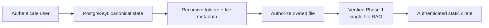
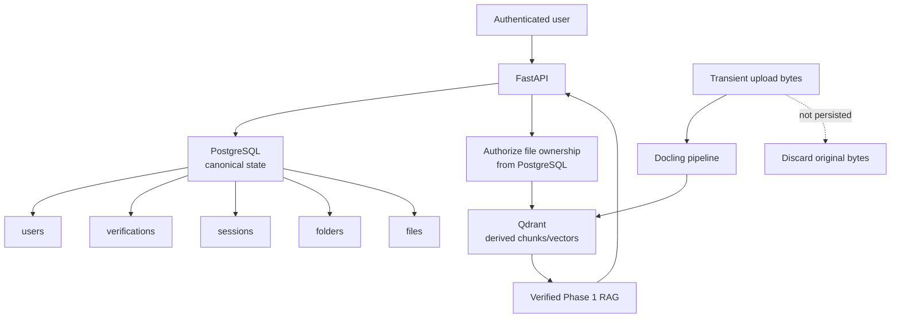

# PHASE 02 — Authenticated Personal Drive: Plan Overview

- **Phase goal:** extend the verified single-file RAG MVP into an authenticated personal drive with canonical PostgreSQL application state, recursive folders, file metadata/lifecycle, owner-authorized single-file RAG, and a static authenticated browser workflow.
- **Verified dependency:** PHASE_01 — MVP Core RAG is `IMPLEMENTED & VERIFIED`.
- **Current Phase 2 state:** `IMPLEMENTED, UNVERIFIED`. PLAN_01 identity/authentication and PLAN_02 authenticated drive backend are `IMPLEMENTED & VERIFIED`. Amendment 06 is complete: integrated two-owner real PostgreSQL/Qdrant and running HTTP acceptance, packaged regression/equivalence, security and exact datastore/resource preservation passed. PLAN_02 is `IMPLEMENTED & VERIFIED`; PHASE_02 remains `IMPLEMENTED, UNVERIFIED`. PLAN_03 Client Authentication and PLAN_04 Drive Dashboard & Phase Acceptance remain `NOT YET BUILT`.
- **Execution rule:** server-side contracts are implemented and verified before the client consumes them, unless an explicitly approved PLAN exception requires otherwise.
- **Evidence ownership:** `CONTEXT.md` and `MANUAL.md` are created and maintained exclusively by Codex CLI as implementation/evidence artifacts. Planning/authoring work does not pre-create or edit them.

---

## 1. Phase objective

Phase 1 proved the complete single-file RAG baseline:

```text
upload
-> Docling parse / OCR / chunk
-> BGE-M3 embed
-> Qdrant
-> exact file-scoped retrieve
-> grounded Gemini generation
-> native SSE
-> trusted citations
-> static Next.js client
```

Phase 2 does not replace that pipeline. It adds canonical application state, identity, ownership, and a drive hierarchy around it:



The phase succeeds when Atlas can distinguish users and their owned drive state before any file content reaches retrieval/generation.

---

## 2. Phase boundary

### In scope

Phase 2 includes:

- user registration with `name`, `email`, and `password`;
- development OTP verification stored in PostgreSQL;
- login and logout;
- short-lived JWT access tokens;
- single-use rotating opaque refresh tokens backed by PostgreSQL sessions;
- authenticated current-user resolution;
- PostgreSQL canonical state;
- recursive owner-scoped folder creation with user-facing name/description metadata;
- folder rename/description update without movement;
- duplicate folder/file display names, with UUIDs remaining canonical identity;
- root and direct-child folder/file browsing;
- canonical file metadata and explicit `processing` / `ready` / `deleting` lifecycle;
- transient file-upload bytes used only for the existing ingestion/indexing pipeline;
- file name/description update without content replacement or reindexing;
- recoverable permanent file deletion from Qdrant and PostgreSQL;
- PostgreSQL owner and ready-state authorization before file-scoped RAG;
- authenticated client routes and session restoration;
- root/folder dashboard navigation;
- file selection and reuse of the verified `/query` and `/ask` RAG capabilities;
- complete two-user ownership-isolation acceptance.

### Explicitly excluded

Phase 2 does **not** include:

- multi-file RAG;
- folder, subtree, or drive-wide RAG;
- hybrid retrieval, sparse retrieval, reranking, or retrieval tuning;
- sharing, teams, roles, ACLs, or organization accounts;
- persistent original-file storage;
- file download or preview;
- reprocessing/reindexing from a stored original;
- file versions;
- file movement;
- folder movement;
- folder deletion;
- recoverable trash;
- full-text drive search;
- email delivery;
- implemented `reset` or `forgot` password flows;
- OAuth/social login;
- profile/account-management product features;
- Redis;
- background workers/queues;
- S3/MinIO/object storage;
- audit-log/notification systems.

Schema support for verification types `reset` and `forgot` is allowed, but those product flows remain excluded.

---

## 3. Core Phase 2 architecture

### Canonical state vs derived retrieval state

PostgreSQL becomes the source of truth for application state.

Qdrant remains a derived retrieval index.



### Authority rules

- PostgreSQL is canonical for user identity, sessions, folders, files, ownership, and file metadata.
- Qdrant is not canonical application state.
- The same immutable `files.id` UUID is used as:
  - PostgreSQL file primary key;
  - public API `file_id`;
  - browser file ID;
  - Qdrant payload `file_id`.
- Do not introduce a second document/RAG/storage identifier.
- Authentication identifies a user; PostgreSQL authorization establishes whether that user owns the requested file/folder.
- Qdrant exact `file_id` filtering still applies after PostgreSQL authorization.
- Never retrieve broadly and then filter ownership in application code.
- Never rely on the LLM to enforce authorization.

---

## 4. Storage boundary

Phase 2 intentionally does **not** persist original uploaded bytes.

Upload lifecycle:

```text
authenticated request
-> authorize target folder
-> create canonical file UUID + PostgreSQL `processing` row
-> receive upload bytes transiently
-> existing Docling parse / chunk
-> existing BGE-M3 embed
-> Qdrant store under the same file_id
-> confirm indexing success
-> transition PostgreSQL file to `ready`
-> discard original bytes
```

Known ingestion failure:

```text
ingestion/indexing failure
-> clean any derived Qdrant state for the exact file_id
-> remove the temporary PostgreSQL file row
-> return a structured failure
```

Phase 2 does not retain a durable `failed` file state. A failed upload therefore does not remain as a user-visible drive file.

Permanent deletion uses a recoverable cross-store lifecycle:

```text
owner-authorized file
-> transition to `deleting`
-> delete all Qdrant points for the exact file_id
-> delete the PostgreSQL file row
```

`deleting` is non-queryable and retryable when a cross-store delete step fails.

Consequences accepted for Phase 2:

- no download;
- no preview from persisted original bytes;
- no later reprocessing without re-upload;
- no object-store/file-system lifecycle;
- metadata rename/description update does not rename storage because no persistent original storage exists.

This is a deliberate phase boundary, not an accidental omission.

---

## 5. Authentication direction

Phase 2 uses two credential classes with different responsibilities.

### Access token

- signed JWT;
- short-lived;
- sent as `Authorization: Bearer <token>`;
- server validates signature, expiry, token type, and required claims;
- user identity comes from `sub`;
- no server-side access-token record is required;
- already-issued access tokens are not revoked on logout and expire naturally.

### Refresh token

- opaque cryptographically random value;
- stored in a Secure/HttpOnly-capable browser cookie;
- only its SHA-256 hash is persisted in PostgreSQL;
- one database row represents one currently usable refresh credential;
- single-use;
- successful refresh atomically consumes the current row and creates a replacement row/token;
- expired rows are rejected and deleted when encountered;
- no cron/TTL/background cleanup service is required.

### Verification OTP

- development-only verification mechanism;
- stored in PostgreSQL because email delivery is intentionally absent;
- purpose is represented by a typed enum supporting `auth`, `reset`, and `forgot`;
- Phase 2 implements only `auth`;
- successful use deletes the row;
- expired row is rejected and deleted when encountered;
- resend replaces the current `(user, type)` verification row;
- OTPs are never logged.

---

## 6. Recursive drive hierarchy

Folders are recursively nestable through a nullable self-reference:

```text
Root
├── Folder A
│   ├── Folder B
│   │   ├── Folder C
│   │   │   └── File 1
│   │   └── File 2
│   └── File 3
├── Folder D
└── File 4
```

Rules:

- folders and files are owned by one canonical PostgreSQL user;
- `parent_id = NULL` means root-level folder;
- `parent_id = <folder UUID>` means direct child of that folder;
- root-level files use `folder_id = NULL`;
- nested files use `folder_id = <folder UUID>`;
- a child folder's parent and a file's optional folder must belong to the same owner;
- folder metadata includes user-facing `name` and `description`;
- duplicate sibling folder names are allowed;
- duplicate sibling file names are allowed;
- files and folders may share the same display name;
- names are metadata; backend UUIDs establish identity;
- folder depth is not stored separately;
- no materialized path/tree table is required;
- folder move is excluded, so `parent_id` is immutable after creation during Phase 2;
- folder rename/description update changes only folder metadata;
- dashboard navigation fetches only direct children for the selected parent, not the whole tree recursively.

---

## 7. Phase plans

| Plan             | Status                 | Server/client ownership    | One-line scope                                                                                                                                      |
| ---------------- | ---------------------- | -------------------------- | --------------------------------------------------------------------------------------------------------------------------------------------------- |
| PHASE_02_PLAN_01 | IMPLEMENTED & VERIFIED | Server                     | PostgreSQL identity foundation and complete server authentication/session contract                                                                  |
| PHASE_02_PLAN_02 | IMPLEMENTED & VERIFIED | Server                     | Owner-scoped folders/files, canonical file lifecycle, authenticated transient ingestion, recoverable deletion, and owner-authorized single-file RAG |
| PHASE_02_PLAN_03 | NOT YET BUILT          | Client                     | Registration/login/verification/session restoration/logout over verified PLAN_01 APIs                                                               |
| PHASE_02_PLAN_04 | NOT YET BUILT          | Client + final integration | Drive dashboard, folder/file workflows, selected-file RAG, and complete Phase 2 acceptance                                                          |

No PLAN may be treated as implemented merely because this overview describes its destination.

---

## 8. PHASE_02_PLAN_01 — PostgreSQL Identity & Authentication Foundation

- **Branch:** `phase-02/plan-01`
- **Status:** `IMPLEMENTED & VERIFIED` — Identity persistence, credential primitives, registration, verification/resend, login, refresh rotation, logout, Bearer current-user resolution, GET /auth, and credentialed CORS passed complete final Docker/database/live/security/preservation acceptance. Amendments 01–07 are complete.
- **Depends on:** PHASE_01 `IMPLEMENTED & VERIFIED`
- **Builds:**
  - PostgreSQL 18 service and canonical identity persistence;
  - SQLAlchemy/Psycopg/Alembic database foundation;
  - `users`, `verifications`, and `sessions`;
  - password hashing;
  - access JWTs;
  - opaque single-use refresh sessions;
  - registration;
  - OTP verify/resend;
  - login;
  - refresh;
  - logout;
  - `GET /auth`;
  - reusable authenticated-user server dependency.
- **Stops before:** folders, files, ownership-aware RAG, and all Phase 2 client work.

Detailed destination: `PLAN_01/PHASE_02_PLAN_01.md`.

---

## 9. PHASE_02_PLAN_02 — Authenticated Drive Backend

- **Branch:** `phase-02/plan-02`
- **Status:** `IMPLEMENTED & VERIFIED` - canonical persistence, authenticated folders/upload/metadata/deletion/owner-gated RAG and final integrated acceptance passed. Complete evidence is in PLAN_02 CONTEXT and MANUAL; later authenticated client work remains `NOT YET BUILT`.
- **Depends on:** PLAN_01 `IMPLEMENTED & VERIFIED`
- **Builds:**
  - recursive owner-scoped folders with name/description metadata;
  - duplicate folder/file display names with UUID-based identity;
  - folder rename/description update without movement;
  - canonical file metadata linked to the owning user and optional owned folder;
  - direct-child root/folder listing;
  - authenticated transient upload orchestration using one immutable file UUID across PostgreSQL/Qdrant/API/client;
  - explicit `processing` -> `ready` ingestion lifecycle with failed-ingestion cleanup and no durable failed-file state;
  - file name/description update without content reindexing;
  - recoverable permanent deletion through `deleting` -> exact Qdrant cleanup -> PostgreSQL row deletion;
  - PostgreSQL owner + ready-state authorization before `/query` and `/ask`.
- **Stops before:** client auth/dashboard, folder deletion/movement, file movement, persistent binaries, and multi-scope RAG.

---

## 10. PHASE_02_PLAN_03 — Client Authentication

- **Branch:** `phase-02/plan-03`
- **Status:** `NOT YET BUILT`
- **Depends on:** PLAN_01 `IMPLEMENTED & VERIFIED`; consume verified server APIs rather than inventing them.
- **Builds:**
  - `/register`;
  - `/verify`;
  - `/login`;
  - protected dashboard entry;
  - shared client auth/session coordinator;
  - in-memory active access token;
  - approved reversible-encryption persistence for the access token in `localStorage`;
  - HttpOnly refresh-cookie consumption;
  - startup/session restoration through `/auth/refresh` + `GET /auth`;
  - logout;
  - shared token authority for Axios and native fetch/SSE.
- **Security boundary:** browser route protection is UX only; server authorization remains authoritative.
- **Stops before:** full drive dashboard CRUD/navigation.

---

## 11. PHASE_02_PLAN_04 — Drive Dashboard & Phase Acceptance

- **Branch:** `phase-02/plan-04`
- **Status:** `NOT YET BUILT`
- **Depends on:** PLAN_02 and PLAN_03 `IMPLEMENTED & VERIFIED`
- **Builds:**
  - root drive contents;
  - lazy recursive folder navigation;
  - folder creation and rename;
  - upload modal with client-side name/description entry;
  - file metadata update;
  - permanent file delete confirmation;
  - current-folder query invalidation/refetch;
  - file selection;
  - reuse of the verified native POST-SSE ask/citation workflow under authentication;
  - complete Phase 2 two-user ownership-isolation and persistence acceptance.

Final acceptance includes at least:

```text
register
-> inspect DB OTP
-> verify
-> dashboard
-> create nested folders
-> upload file
-> refresh current folder
-> update file metadata
-> ask selected file
-> refresh access session
-> logout/login
-> confirm second user cannot access first user's folders/files/RAG
-> delete file
-> confirm PostgreSQL + Qdrant deletion
```

---

## 12. Server-first sequencing rule

For every cross-boundary Phase 2 capability:

```text
define/confirm server contract in PLAN
-> implement server
-> verify server
-> expose stable DTO/error/session behavior
-> implement client consumer
-> run cross-boundary acceptance
```

Do not:

- use speculative client mocks to silently decide backend contracts;
- implement a client endpoint shape before the server contract is established;
- let client needs silently alter ownership/auth architecture;
- mark a client workflow complete because a mocked server behaved as expected.

An explicitly approved PLAN may define a justified exception, but server-first is the default Phase 2 execution rule.

---

## 13. Phase-wide security invariants

- Never persist plaintext passwords.
- `users.password` contains the password hash.
- Never log passwords, password hashes, OTPs, raw access tokens, raw refresh tokens, refresh-token hashes, or signing secrets.
- Derive authenticated user identity from validated server credentials, not client-supplied IDs.
- Authorization is always server-side.
- Registration intentionally reveals that an account already exists, but does not reveal whether it is verified.
- CORS is browser-origin policy, not authentication.
- Refresh credentials are HttpOnly-cookie credentials; access tokens use Bearer authorization.
- Client-side reversible access-token encryption is defense-in-depth/obfuscation only, not an XSS security boundary.
- Original file bytes are untrusted and transient.
- Qdrant must never become the authority for user/file ownership.
- The LLM must never decide authorization.

---

## 14. Phase-wide verification standard

Phase 2 work is not complete because code exists.

Each PLAN must require evidence appropriate to its responsibility:

- deterministic unit tests;
- integration tests at trust boundaries;
- PostgreSQL migration/schema checks;
- Docker/Compose verification for dependency/topology/configuration changes;
- HTTP contract checks;
- cookie/token lifecycle checks;
- two-user authorization isolation;
- Qdrant deletion/retrieval checks;
- client format/lint/type/test/build checks;
- browser/static-export acceptance;
- `git diff --check`;
- exact recording of blocked verification rather than invented success.

Previously verified Phase 1 behavior remains a regression requirement whenever Phase 2 changes shared server/client boundaries.

---

## 15. Documentation ownership

Phase 2 keeps the existing Atlas documentation architecture:

```text
PHASE
-> PLAN
-> AMENDMENTS
-> Codex-owned CONTEXT
-> Codex-owned MANUAL
```

Rules:

- PHASE defines the major objective and PLAN status overview.
- PLAN defines the stable destination/architecture/contracts.
- AMENDMENT defines one focused chronological implementation task.
- PLAN specifications do not preassign future Amendment numbering.
- `CONTEXT.md` is created and maintained only by Codex CLI as chronological implementation/verification evidence.
- `MANUAL.md` is created and maintained only by Codex CLI as the reproducibility/human-acceptance guide.
- Planning/authoring work must not pre-create, edit, or fabricate CONTEXT/MANUAL evidence.
- Historical Phase 1 documents remain historical evidence and are not rewritten to make Phase 2 appear preplanned.

---

## 16. Phase completion criteria

PHASE_02 becomes `IMPLEMENTED & VERIFIED` only when all four plans are `IMPLEMENTED & VERIFIED` and the full end-to-end workflow proves:

1. a new user can register and verify with the database-visible OTP;
2. verified login establishes an access/refresh session;
3. refresh uses a single-use rotating refresh token;
4. sessions restore correctly after client reload;
5. recursive folders can be created/navigated and renamed;
6. folders/files have canonical PostgreSQL ownership and UUID identity while duplicate display names remain valid;
7. files have canonical PostgreSQL metadata without persistent original-byte storage;
8. authenticated transient upload uses the canonical file UUID, reaches `ready` only after successful indexing, and leaves no durable failed file after a known ingestion failure;
9. file metadata updates do not reindex content;
10. only an owner-authorized `ready` file can be queried/asked through the verified RAG path;
11. a second authenticated user cannot access the first user's folders, files, retrieval results, generation context, or citations;
12. permanent file deletion uses the recoverable `deleting` lifecycle and ultimately removes canonical PostgreSQL state plus all Qdrant points for that `file_id`;
13. the static client completes the workflow against the verified backend;
14. no excluded Phase 2 capability was silently introduced;
15. actual verification evidence is recorded by Codex in each PLAN's CONTEXT/MANUAL.

Until that acceptance is complete, Phase 1 remains the verified baseline and Phase 2 remains incomplete.
