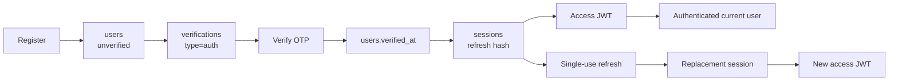
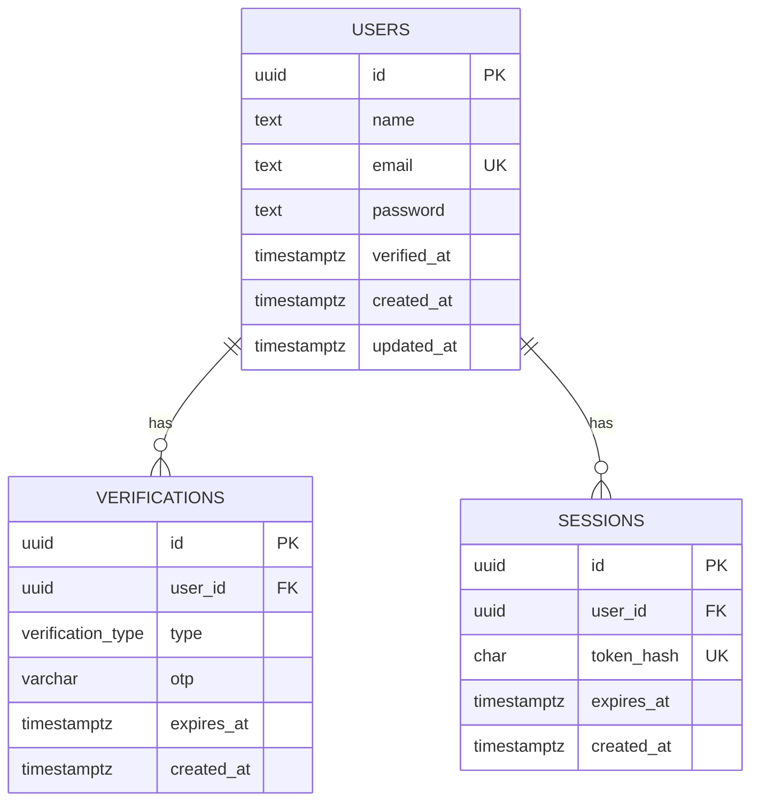
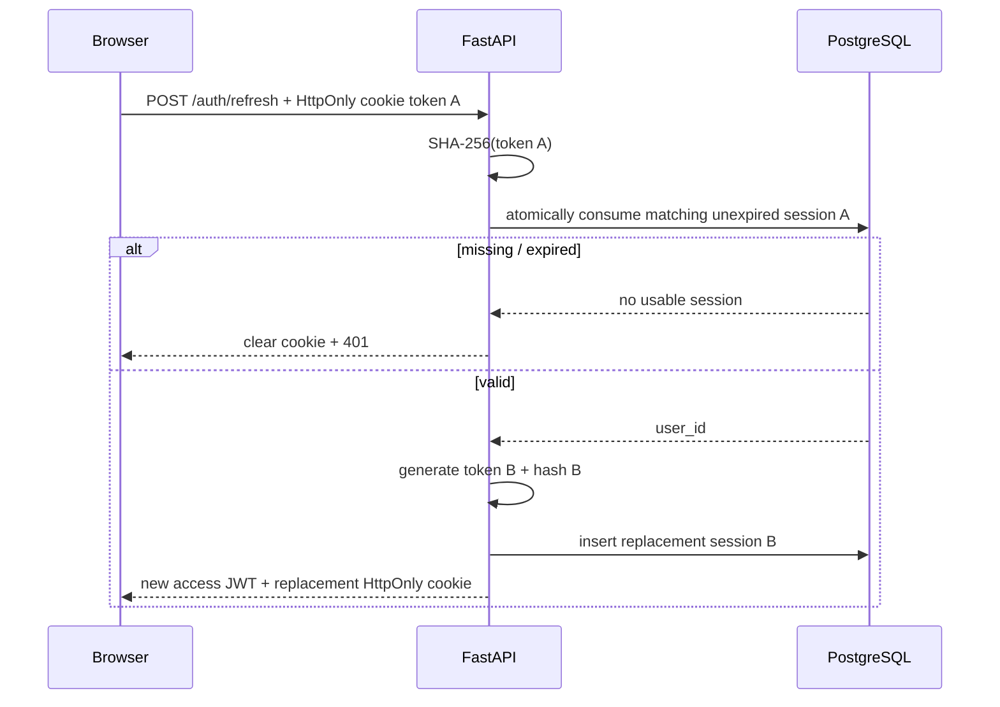

# PHASE_02_PLAN_01 — PostgreSQL Identity & Authentication Foundation (Specification)

- This specification defines the PLAN_01 end-state: architecture, persistence contracts, authentication/session behavior, public API contracts, security boundaries, requirements, acceptance criteria, risks, and verification boundaries.
- Chronological implementation history belongs in the Codex-owned `CONTEXT` and focused implementation prompts live under `AMENDMENTS/`. This PLAN defines capabilities and contracts without preassigning future Amendment numbering.
- **Branch:** `phase-02/plan-01`
- **Depends on:** PHASE_01 `IMPLEMENTED & VERIFIED`.
- **Status:** `IMPLEMENTED, UNVERIFIED` — Identity persistence, credential primitives, registration, verification/resend, and initial session/access issuance are verified. Amendments 01–04 are complete; other public authentication/session workflows remain unbuilt.
- **Subsystem:** PostgreSQL identity persistence + server authentication/session foundation.
- **Implementation evidence:** `PHASE_02_PLAN_01_CONTEXT.md` — Codex-owned; created/maintained only when implementation work begins.
- **Repeatable acceptance:** `PHASE_02_PLAN_01_MANUAL.md` — Codex-owned; created/maintained only by Codex CLI.

---

## 1. Objective

Establish the complete server-side identity boundary required by every later Phase 2 capability.

At PLAN completion Atlas must be able to:

1. persist canonical user identity in PostgreSQL;
2. create and consume typed verification OTPs;
3. hash and verify passwords securely;
4. issue short-lived signed access JWTs;
5. issue opaque refresh tokens backed by single-use PostgreSQL sessions;
6. rotate refresh sessions atomically;
7. register, verify, resend, login, refresh, logout, and resolve the current user;
8. expose one reusable authenticated-user dependency for later folder/file authorization;
9. report PostgreSQL health without changing the verified Qdrant diagnostic contract;
10. preserve the complete verified Phase 1 RAG behavior.

The completed identity flow is:



PLAN_01 stops before folders, files, ownership-aware retrieval, and all Phase 2 client implementation.

---

## 2. Scope

### In scope

- PostgreSQL 18 Docker/Compose service.
- Durable PostgreSQL named volume.
- PostgreSQL configuration through the existing Atlas constants architecture.
- SQLAlchemy 2.x synchronous ORM/database access.
- Psycopg 3 PostgreSQL driver.
- Alembic migrations.
- Process-scoped SQLAlchemy engine/pool.
- Short-lived operation/request-scoped SQLAlchemy sessions.
- Initial identity schema:
  - `users`;
  - `verifications`;
  - `sessions`;
  - PostgreSQL `verification_type` enum.
- PostgreSQL connectivity health diagnostics.
- Argon2id password hashing/verification.
- JWT access tokens.
- Opaque refresh tokens.
- Refresh-token hashing.
- single-use refresh-session rotation.
- database-visible development OTP generation/storage/consumption.
- auth endpoints:
  - `POST /auth/register`;
  - `POST /auth/verify`;
  - `POST /auth/resend`;
  - `POST /auth/login`;
  - `POST /auth/refresh`;
  - `POST /auth/logout`;
  - `GET /auth`.
- reusable current-user authentication dependency.
- credentialed browser CORS required by the refresh cookie.
- deterministic and live PostgreSQL/auth verification.
- regression verification for all verified Phase 1 backend contracts.

### Explicitly excluded

- `folders` table;
- `files` table;
- drive listing;
- folder/file CRUD;
- file ownership authorization;
- modifying `/files/{file_id}/query` or `/ask` to require auth;
- changing Qdrant payload schema;
- changing retrieval/generation/citation behavior;
- persistent original-file storage;
- client registration/login/verification UI;
- access-token browser encryption/localStorage work;
- password reset;
- forgot-password implementation;
- email delivery;
- OAuth/social login;
- roles/teams/sharing/ACLs;
- Redis;
- queues/background workers;
- cron/TTL cleanup;
- audit-log/session-history product features.

The `verification_type` schema supports `reset` and `forgot`, but those flows are not implemented in this PLAN.

---

## 3. Locked technology decisions

### PostgreSQL

- Major version: PostgreSQL `18`.
- Use the current supported PostgreSQL 18 minor available during implementation.
- Do not use PostgreSQL 19 release-candidate/pre-release images.
- Compose service name: `postgres`.
- Persist database state in a named volume.
- Do not run destructive volume reset commands during ordinary verification.

At this PLAN's authoring date, 2026-10-23, PostgreSQL 18 is the current stable major and PostgreSQL 19 is still a release candidate. Codex must re-check current official PostgreSQL status before implementation, but may not silently move to a different major if that would change this locked architecture.

### ORM / driver / migrations

Locked stack:

```text
SQLAlchemy 2.x synchronous API
+
psycopg 3
+
Alembic
```

Rationale:

- PostgreSQL is canonical application state and benefits from explicit schema/migration history;
- Atlas already contains substantial synchronous backend work;
- ordinary auth/database operations are short transactions;
- async SQLAlchemy would add session/lifecycle complexity without a measured Phase 2 requirement;
- migrations must be explicit and reproducible rather than implicit startup mutation.

Do not introduce:

- SQLModel;
- Django ORM;
- Tortoise;
- asyncpg as a second database architecture;
- raw-SQL-only persistence architecture;
- `Base.metadata.create_all()` as production schema management.

### Password hashing

Locked:

```text
argon2-cffi
Argon2id
```

Use the high-level `PasswordHasher` API with current secure defaults unless current authoritative guidance identifies a concrete incompatibility.

Do not:

- invent custom salts;
- store plaintext passwords;
- use reversible password encryption;
- silently switch to bcrypt/PBKDF2;
- log hashes.

### JWT

Locked:

```text
PyJWT
HS256
```

Access tokens are signed, not encrypted.

JWT signing secret comes from validated server configuration and has no source-code default.

### Refresh tokens

- opaque;
- generated with Python `secrets`;
- at least 256 bits of entropy;
- only SHA-256 hash stored;
- raw value exists only at issuance/request-cookie boundaries;
- one row = one usable refresh token;
- single-use rotation.

---

## 4. PostgreSQL configuration

Atlas keeps the established configuration pipeline:

```text
server/.env
-> core/constants.py
-> schemas/constants.py
-> validated constants.postgres
-> SQLAlchemy URL / engine
```

Required PostgreSQL settings:

```text
POSTGRES_HOST
POSTGRES_PORT
POSTGRES_DB
POSTGRES_USER
POSTGRES_PASSWORD
```

Baseline semantics:

- `POSTGRES_PORT` defaults to `5432`;
- database/user/password must be nonblank;
- password is secret;
- `.env.example` contains only safe placeholder/development examples;
- do not print configuration values that include credentials;
- construct the SQLAlchemy URL through SQLAlchemy's URL API/equivalent safe mechanism rather than hand-concatenating an unescaped password into a connection string.

Local/Compose topology:

- local Python may connect through the exposed host PostgreSQL port;
- the Compose `server` container connects to the Compose service name `postgres`;
- Compose may override only the host value needed for service-to-service networking while preserving the same validated application configuration contract.

Do not introduce a second independent database-settings mechanism.

---

## 5. Database runtime ownership

Target lifecycle:

```text
FastAPI lifespan
-> create process-scoped SQLAlchemy Engine
-> verify PostgreSQL connectivity
-> construct reusable session factory
-> expose database runtime
-> serve requests
-> close/dispose engine on shutdown
```

Rules:

- engine/pool lifetime is application-process scope;
- ORM `Session` lifetime is short and operation/request scoped;
- do not share one mutable ORM Session globally;
- transactions are explicit;
- rollback occurs on failed transactional work;
- session resources close deterministically;
- synchronous database I/O must not be executed directly on an async event loop;
- use FastAPI's established sync/thread boundary or equivalent current repository pattern;
- routers do not issue arbitrary SQL directly;
- datastore mechanics remain under `app/db/` or the exact established equivalent;
- storage-mapped entities remain under `models/postgres/`.

PostgreSQL is a required Phase 2 server dependency:

- startup connectivity failure is explicit;
- the application does not silently degrade into a non-persistent mode;
- an outage after successful startup is surfaced by health/operations and never converted into fake success.

---

## 6. Migration architecture

Target structure:

```text
server/
├── alembic.ini
└── migrations/
    ├── env.py
    ├── script.py.mako
    └── versions/
```

Use the current repository conventions if an equivalent migration structure already exists; do not create two migration systems.

Rules:

- Alembic owns schema versioning;
- application startup does **not** run `alembic upgrade head`;
- application startup does **not** call `create_all()` to mutate schema;
- migrations are explicit development/deployment actions;
- SQLAlchemy declarative metadata is the migration/autogenerate source;
- migration revisions must be deterministic and reviewable;
- downgrade behavior is verified only against a disposable verification database;
- never downgrade/reset the user's normal persistent database merely to prove reversibility.

Expected normal command family:

```text
alembic upgrade head
alembic current
alembic history
```

Exact invocation may use the repository's current Python/venv conventions.

---

## 7. Canonical identity data model

Only three tables belong to PLAN_01.



### `users`

Columns:

```text
id              UUID PRIMARY KEY
name            TEXT NOT NULL
email           TEXT NOT NULL UNIQUE
password        TEXT NOT NULL
verified_at     TIMESTAMPTZ NULL
created_at      TIMESTAMPTZ NOT NULL
updated_at      TIMESTAMPTZ NOT NULL
```

Semantics:

- application generates UUIDs;
- `password` stores the Argon2id encoded hash;
- email is normalized before canonical lookup/storage;
- canonical normalization is trim + lowercase;
- `verified_at IS NULL` means unverified;
- `verified_at IS NOT NULL` means verified;
- no separate `is_verified` boolean;
- timestamps are timezone-aware UTC-compatible PostgreSQL timestamps.

### `verification_type`

PostgreSQL enum values exactly:

```text
auth
reset
forgot
```

### `verifications`

Columns:

```text
id              UUID PRIMARY KEY
user_id         UUID NOT NULL
type            verification_type NOT NULL
otp             VARCHAR(6) NOT NULL
expires_at      TIMESTAMPTZ NOT NULL
created_at      TIMESTAMPTZ NOT NULL
```

Constraints:

```text
FOREIGN KEY user_id -> users.id ON DELETE CASCADE
UNIQUE(user_id, type)
```

Semantics:

- one current verification per user/purpose;
- Phase 2 product behavior uses `type=auth`;
- resend replaces the current `auth` row;
- successful use deletes the row;
- encountered expired row is deleted and rejected;
- no consumed/history rows;
- no attempt-counter table;
- no cron cleanup.

### `sessions`

Columns:

```text
id              UUID PRIMARY KEY
user_id         UUID NOT NULL
token_hash      CHAR(64) NOT NULL UNIQUE
expires_at      TIMESTAMPTZ NOT NULL
created_at      TIMESTAMPTZ NOT NULL
```

Constraints/indexes:

```text
FOREIGN KEY user_id -> users.id ON DELETE CASCADE
UNIQUE(token_hash)
INDEX(user_id)
```

Semantics:

- `token_hash` is lowercase SHA-256 hexadecimal;
- raw refresh token is never persisted;
- multiple active sessions for one user are allowed;
- an encountered expired row is deleted and rejected;
- successful refresh deletes the old session and creates a replacement;
- no `revoked_at`;
- no token family;
- no `replaced_by_id`;
- no refresh-token history table.

Do not add `folders` or `files` during PLAN_01.

---

## 8. Input validation contracts

### Name

Registration `name`:

- trim surrounding whitespace;
- minimum 1 non-whitespace character;
- maximum 100 characters after trimming.

### Email

Registration/login/verification/resend `email`:

- validate as an email address through the approved Pydantic/email-validation boundary;
- trim;
- lowercase before canonical lookup/storage;
- maximum canonical length follows the selected email-validation library/database mapping;
- client casing must not create duplicate accounts.

`email-validator` / the dependency required by Pydantic `EmailStr` is approved if it is not already available.

### Password

Registration password:

- string;
- minimum 8 characters;
- maximum 128 characters;
- no arbitrary upper/lower/digit/symbol composition rule;
- never normalize/case-change the password;
- never log it.

Login accepts the same bounded input type and compares against the stored Argon2id hash.

### OTP

- exactly six ASCII digits;
- generated cryptographically through `secrets`;
- zero-padded when needed;
- default lifetime: 10 minutes;
- configurable server-side TTL;
- stored directly only because Phase 2 intentionally has no email-delivery provider.

---

## 9. Authentication configuration

Required auth settings:

```text
AUTH_ACCESS_TOKEN_SECRET
AUTH_ACCESS_TOKEN_TTL_SECONDS
AUTH_REFRESH_TOKEN_TTL_SECONDS
AUTH_OTP_TTL_SECONDS
AUTH_COOKIE_SECURE
```

Defaults:

```text
AUTH_ACCESS_TOKEN_TTL_SECONDS = 900
AUTH_REFRESH_TOKEN_TTL_SECONDS = 604800
AUTH_OTP_TTL_SECONDS = 600
```

Rules:

- `AUTH_ACCESS_TOKEN_SECRET` is required/nonblank when auth is prepared/used;
- no production secret default;
- `AUTH_COOKIE_SECURE` is explicit configuration so local HTTP development can work while deployed HTTPS can require Secure cookies;
- algorithm is locked to `HS256` in code/contract, not user-configurable environment input;
- refresh cookie name is stable: `atlas_refresh`;
- refresh cookie path: `/auth`;
- refresh cookie: `HttpOnly=true`;
- refresh cookie: `SameSite=Lax`;
- refresh cookie Secure flag comes from validated configuration;
- refresh expiry/max-age aligns with the refresh-token TTL.

A future cross-site deployment that cannot use this SameSite model requires an explicit security/CSRF architecture decision rather than a silent cookie-policy change.

---

## 10. Password contract

Use one server-owned password boundary.

Responsibilities:

- hash registration password with Argon2id;
- verify login password;
- use a dummy hash verification path when the email does not exist so obvious account-existence timing differences are reduced;
- support `check_needs_rehash`/equivalent current argon2-cffi capability;
- if a verified login succeeds and the stored hash needs rehashing under current parameters, update it transactionally;
- convert password-library failures into safe auth/internal errors without logging password/hash content.

`users.password` is intentionally named `password` even though it stores the hash.

---

## 11. Access JWT contract

### Claims

Each access JWT contains:

```text
sub     user UUID as string
type    "access"
iat     issued-at time
exp     expiry time
jti     unique token UUID/string
```

Do not embed mutable user profile data such as name/email unless a later measured need requires it.

### Validation

Server validation must:

- decode using an explicit algorithms allow-list containing only the approved `HS256`;
- verify signature;
- verify `exp`;
- require the approved claims;
- require `type == "access"`;
- parse `sub` as a valid UUID;
- load the canonical user from PostgreSQL;
- reject missing/deleted users;
- return one authenticated user/domain value for downstream authorization.

Never accept client-supplied `user_id` as a replacement for JWT identity.

Access tokens are intentionally not persisted/revoked server-side in Phase 2. Logout therefore does not invalidate an already-issued access token; the short TTL is the accepted boundary.

---

## 12. Refresh-token/session contract

Generation:

- use Python `secrets`;
- minimum 256 bits entropy;
- recommended implementation may use `secrets.token_urlsafe(48)` or an equivalent/current standard-library construction meeting the entropy requirement.

Persistence:

```text
raw token
-> SHA-256
-> lowercase hex digest
-> sessions.token_hash
```

Refresh lifecycle:



Atomicity requirement:

- two concurrent requests using the same refresh token must not both succeed;
- consumption and replacement belong in one database transaction;
- the old session row is deleted before transaction success makes the replacement authoritative;
- if replacement insertion/transaction fails, do not return a usable new credential pair;
- implementation may use `DELETE ... RETURNING`, row locking, or another PostgreSQL mechanism that proves the same single-consumer behavior;
- Codex must not silently weaken this invariant.

Expired session:

- invalid immediately at `expires_at`;
- when encountered, delete it;
- reject refresh;
- clear browser cookie.

---

## 13. Verification OTP contract

Generation:

- six numeric digits;
- cryptographically generated;
- one current row per `(user_id, type)`.

`auth` resend:

```text
find user
-> ensure verification is still required
-> replace existing auth verification row
-> new OTP
-> new expires_at
```

Verification:

```text
lookup canonical user by normalized email
-> lookup type=auth verification
-> if expired: delete row + reject
-> compare submitted OTP
-> if mismatch: reject, keep unexpired row
-> if match:
     mark users.verified_at
     delete verification
     create refresh session
     issue access token
     set refresh cookie
```

The successful verification state changes must be transactional.

No email is sent. The developer/operator obtains the OTP directly from PostgreSQL during Phase 2.

Never expose an OTP through a public API merely to make development easier.

---

## 14. Public auth API

All auth API errors use the established Atlas shape:

```json
{
  "error": "Safe message",
  "code": "STABLE_CODE"
}
```

Exact implementation may reuse/extend the existing `ApiError` architecture. Do not create a parallel exception system.

### `POST /auth/register`

Request:

```json
{
  "name": "Ryan",
  "email": "ryan@example.com",
  "password": "..."
}
```

Behavior:

1. validate and normalize;
2. if account exists, return conflict without revealing verification state;
3. hash password;
4. transactionally create unverified user + `auth` verification;
5. return verification-required status;
6. do not create a session yet.

Success:

- HTTP `201`.

Reference body:

```json
{
  "status": "verification_required"
}
```

Existing account:

- HTTP `409`;
- code: `ACCOUNT_ALREADY_EXISTS`;
- message must not say whether the account is verified.

### `POST /auth/verify`

Request:

```json
{
  "email": "ryan@example.com",
  "otp": "123456"
}
```

Success:

- HTTP `200`;
- mark user verified;
- delete used verification row;
- create session;
- set refresh cookie;
- return access token and safe current-user data.

Reference body:

```json
{
  "access_token": "<jwt>",
  "token_type": "bearer",
  "user": {
    "id": "<uuid>",
    "name": "Ryan",
    "email": "ryan@example.com"
  }
}
```

Failure distinctions:

- invalid/missing OTP: `400 INVALID_VERIFICATION`;
- expired OTP: delete row, `400 VERIFICATION_EXPIRED`;
- already verified / verification no longer required: `409 VERIFICATION_NOT_REQUIRED`.

Do not return the stored OTP.

### `POST /auth/resend`

Request:

```json
{
  "email": "ryan@example.com"
}
```

Behavior:

- target is `type=auth`;
- account must exist;
- account must still require verification;
- replace current auth verification;
- return verification-required status;
- no email provider call.

Success:

```json
{
  "status": "verification_required"
}
```

Errors:

- missing account: `404 ACCOUNT_NOT_FOUND`;
- already verified: `409 VERIFICATION_NOT_REQUIRED`.

### `POST /auth/login`

Request:

```json
{
  "email": "ryan@example.com",
  "password": "..."
}
```

Behavior:

- normalize email;
- use generic invalid-credentials result for wrong email/password;
- verify password;
- if unverified:
  - create/replace current `auth` verification;
  - do not issue credentials;
  - return verification-required error state;
- if verified:
  - create refresh session;
  - set refresh cookie;
  - issue access token;
  - return safe current-user data.

Success body matches `/auth/verify`.

Invalid credentials:

- HTTP `401`;
- code: `INVALID_CREDENTIALS`.

Unverified:

- HTTP `403`;
- code: `VERIFICATION_REQUIRED`;
- response does not include the OTP.

### `POST /auth/refresh`

Input:

- no refresh token in JSON;
- read `atlas_refresh` HttpOnly cookie.

Behavior:

- hash cookie token;
- atomically consume valid unexpired session;
- delete expired session when encountered;
- load canonical user;
- require user still exists and is verified;
- create replacement session/token;
- set replacement cookie;
- issue new access JWT.

Success body:

```json
{
  "access_token": "<jwt>",
  "token_type": "bearer"
}
```

Invalid/expired/missing refresh credential:

- clear refresh cookie;
- HTTP `401`;
- code: `INVALID_REFRESH_TOKEN`.

### `POST /auth/logout`

Input:

- current refresh cookie if present.

Behavior:

- hash and delete matching session when present;
- expired/missing/already-consumed session is not a reason to leave the cookie behind;
- always clear the refresh cookie;
- client-facing logout is idempotent.

Success:

- HTTP `204`;
- no body.

Logout does not revoke already-issued access JWTs.

### `GET /auth`

Input:

```text
Authorization: Bearer <access JWT>
```

Server derives user ID from the validated access token.

Success:

```json
{
  "id": "<uuid>",
  "name": "Ryan",
  "email": "ryan@example.com"
}
```

Do not accept `user_id` in route/query/body for this operation.

Missing/invalid/expired access token:

- HTTP `401`;
- code: `INVALID_ACCESS_TOKEN`.

---

## 15. Authenticated-user dependency

PLAN_01 must expose one reusable server dependency/boundary for later PLANs.

Conceptually:

```text
Authorization header
-> bearer token extraction
-> JWT validation
-> UUID sub
-> PostgreSQL user lookup
-> verified current user
```

Later PLAN_02 consumes this dependency for owner-scoped folders/files.

Rules:

- no router duplicates JWT parsing;
- no router accepts client `owner_id`;
- no Qdrant call is required to authenticate a user;
- dependency returns canonical user identity, not raw JWT claims as the sole authority;
- unverified users cannot become authenticated current users.

---

## 16. CORS and cookie boundary

The Phase 1 static client already calls FastAPI directly.

PLAN_01 preserves that topology.

Refresh-cookie auth requires:

- explicit configured allowed origins;
- `allow_credentials=True`;
- no wildcard origin with credentials;
- ordinary Authorization header remains allowed;
- refresh/logout requests from the browser can include credentials;
- access JWTs remain Bearer headers, not JavaScript-readable cookies.

Do not add:

- Next.js BFF/proxy;
- server actions for auth;
- a second cookie-authenticated access-token mechanism.

CORS is not authorization and does not replace server credential validation.

---

## 17. PostgreSQL health contract

Extend the verified endpoint:

```text
GET /system/health/databases
```

The existing `qdrant` object/semantics remain unchanged.

Add a sibling `postgres` object.

Healthy reference:

```json
{
  "qdrant": {
    "...": "existing verified Qdrant fields remain unchanged"
  },
  "postgres": {
    "status": "PostgreSQL Healthy",
    "version": "18.x"
  }
}
```

Unhealthy reference:

```json
{
  "qdrant": {
    "...": "existing verified Qdrant fields remain independently reported"
  },
  "postgres": {
    "status": "PostgreSQL Unhealthy",
    "error": "Unable to connect to PostgreSQL",
    "code": "POSTGRES_CONNECTION_FAILED"
  }
}
```

Rules:

- endpoint remains HTTP `200` as a diagnostic status document;
- PostgreSQL check uses the application database engine/pool rather than constructing a new engine per request;
- connectivity probe is read-only;
- version may come from `SHOW server_version`/equivalent;
- do not expose host/user/password/connection URL;
- Qdrant outage semantics remain unchanged;
- one database may be healthy while the other is unhealthy.

Normal application database failures remain explicit operation errors and are not converted into health-style HTTP 200 success.

---

## 18. Error vocabulary

Reuse the existing structured error system.

PLAN_01 requires stable auth/database categories sufficient for:

```text
ACCOUNT_ALREADY_EXISTS
ACCOUNT_NOT_FOUND
INVALID_CREDENTIALS
VERIFICATION_REQUIRED
INVALID_VERIFICATION
VERIFICATION_EXPIRED
VERIFICATION_NOT_REQUIRED
INVALID_ACCESS_TOKEN
INVALID_REFRESH_TOKEN
POSTGRES_CONNECTION_FAILED
POSTGRES_OPERATION_FAILED
```

HTTP mappings follow the contracts in this PLAN.

Unexpected internal/database/crypto failures:

- remain sanitized;
- do not expose SQL, connection strings, raw driver messages, password/hash/token/OTP values;
- return the established generic structured internal error behavior.

Do not leak whether a registration-conflict account is verified.

---

## 19. Logging and observability

Safe logs may include:

- user UUID where operationally useful;
- verification type, never OTP;
- session UUID, never token/hash;
- auth operation category;
- token/session expiration timestamps where useful;
- PostgreSQL health category/version;
- transaction duration;
- safe error code/category.

Do not log:

- raw password;
- password hash;
- OTP;
- access JWT;
- JWT signing secret;
- raw refresh token;
- refresh-token hash;
- Authorization header;
- Cookie header;
- PostgreSQL password;
- full SQL statements containing user credential data;
- unnecessary PII.

Authentication logs should be sufficient to distinguish operation categories without becoming an account/secret dump.

---

## 20. Folder placement / ownership

Expected responsibility areas:

```text
server/
├── alembic.ini
├── migrations/
│   ├── env.py
│   ├── script.py.mako
│   └── versions/
│
├── app/
│   ├── main.py                         # wiring only
│   ├── core/
│   │   ├── constants.py                # existing dotenv loading
│   │   ├── lifespan.py                 # database runtime preparation/cleanup
│   │   └── runtime.py                  # prepared runtime access
│   │
│   ├── db/
│   │   └── postgres.py                 # PostgreSQL engine/session/check mechanics
│   │
│   ├── models/
│   │   └── postgres/
│   │       ├── base.py                 # declarative metadata/base
│   │       ├── user.py
│   │       ├── verification.py
│   │       └── session.py
│   │
│   ├── schemas/
│   │   ├── constants.py
│   │   └── auth/                       # auth public/internal validation contracts
│   │
│   ├── routers/
│   │   └── auth.py                     # public auth HTTP boundary
│   │
│   ├── errors/
│   │   ├── postgres.py                 # datastore failure vocabulary
│   │   └── auth.py                     # auth failure vocabulary
│   │
│   └── pipeline/ or equivalent domain area
│       └── auth/                        # password/token/session/auth orchestration
└── tests/
```

This tree defines responsibilities, not permission to create speculative empty directories.

Codex must inspect the current repository and adjacent patterns before choosing exact local module decomposition.

Non-material local naming may adapt when an established repository equivalent is clearer.

Material service-boundary changes require approval.

---

## 21. Capability decomposition

PLAN_01 naturally separates into focused capability boundaries without assigning future Amendment numbers.

### PostgreSQL identity persistence foundation

- PostgreSQL Compose service;
- database configuration;
- SQLAlchemy/Psycopg runtime;
- Alembic;
- `users`, `verifications`, `sessions`;
- health diagnostics;
- migration/integration verification.

### Credential primitives

- Argon2id password hashing/verification;
- JWT access-token encode/decode;
- refresh-token generation/hash;
- OTP generation;
- config/secrets;
- deterministic crypto/token tests.

### Registration

- validation/normalization;
- account-exists behavior;
- atomic user + auth-verification creation;
- no session before verification.

### Verification and resend

- OTP validation/expiry cleanup;
- successful verified transition;
- verification deletion;
- session/access issuance after verification;
- resend replacement semantics.

### Login

- generic credential failure;
- timing-safe absent-user dummy verify;
- verified login session issuance;
- unverified verification-required transition.

### Refresh / logout / current-user boundary

- atomic single-use refresh;
- replacement session/cookie;
- logout idempotence;
- access-token current-user dependency;
- credentialed CORS.

### Final PLAN acceptance

- full auth lifecycle;
- concurrency/replay checks;
- outage/error checks;
- Docker/PostgreSQL verification;
- Phase 1 backend regression.

Additional work is introduced only when evidence/defects justify it. The PLAN intentionally does not predict chronological Amendment numbers beyond the Amendment currently authored separately.

---

## 22. Current authoritative implementation research

Authoring-time facts checked on 2026-10-23:

- PostgreSQL 18 is the current stable supported major; PostgreSQL 19 is release-candidate/pre-release.
- SQLAlchemy's PostgreSQL dialect supports Psycopg 3 and synchronous engines.
- Alembic is the SQLAlchemy migration tool.
- `argon2-cffi` high-level `PasswordHasher` uses Argon2id by default with secure current defaults.
- current FastAPI security guidance uses maintained JWT/password libraries and explicitly treats JWTs as signed rather than encrypted.
- PyJWT supports explicit HS256 encode/decode with algorithm allow-listing.

Implementation Amendments must re-check current official/primary documentation for version-sensitive mechanics before installing/using these dependencies.

Current research may update syntax/version selection, but must not silently change the locked architecture above.

---

## 23. Requirements

### PostgreSQL

- PostgreSQL 18 service and durable named volume.
- Current stable supported 18.x image at implementation time.
- Existing Qdrant service/data preserved.
- Validated PostgreSQL configuration.
- Process-scoped SQLAlchemy engine/pool.
- Short-lived ORM sessions and explicit transaction behavior.
- Startup connectivity failure explicit.
- Deterministic shutdown/disposal.
- No create-all schema management.

### Migrations/schema

- Alembic migration environment.
- Initial identity schema exactly matches approved tables/enum/constraints.
- Application-generated UUIDs.
- Timezone-aware timestamps.
- no `folders`/`files` in PLAN_01.
- migration upgrade/reversibility proven on disposable PostgreSQL state.

### Password/token/OTP

- Argon2id password hashing.
- JWT access tokens with approved claims/TTL/algorithm.
- opaque high-entropy refresh tokens.
- SHA-256 persisted refresh hash.
- 6-digit cryptographic OTP.
- approved TTL defaults.
- no secret logging.

### Sessions

- multiple user sessions allowed;
- one token per row;
- single-use refresh;
- atomic consume + replacement;
- replayed consumed token fails;
- expired encountered row deleted;
- no cron cleanup/history/family model.

### Public API

- exact seven endpoints in this PLAN.
- established `{error, code}` failures.
- refresh token never accepted/returned in JSON.
- access token never stored in PostgreSQL.
- `GET /auth` derives current user from Bearer token.

### Compatibility

- preserve all verified Phase 1 RAG public contracts until PLAN_02 explicitly adds authorization around them;
- no Qdrant schema/retrieval/generation changes;
- no client work;
- no persistent original-file storage;
- no future folder/file schema scaffolding.

### Documentation

- Codex creates/maintains PLAN_01 CONTEXT and MANUAL when implementation begins;
- planning author does not create/edit those files;
- CONTEXT records actual implementation/evidence only;
- MANUAL records actual repeatable procedures only;
- no verification is pre-claimed.

---

## 24. Acceptance criteria

PLAN_01 becomes `IMPLEMENTED & VERIFIED` only when the complete server identity/authentication destination is built and objectively accepted.

### PostgreSQL foundation

- PostgreSQL 18 starts through the real Compose topology.
- Persistent named volume is used.
- server container reaches PostgreSQL through service networking.
- local development path can connect through the documented host mapping/configuration.
- SQLAlchemy engine/session lifecycle behaves as specified.
- app startup fails explicitly when required PostgreSQL connectivity is unavailable.
- normal shutdown disposes database resources.
- no secret connection values are logged.

### Migrations/schema

- fresh PostgreSQL database upgrades from base to Alembic head.
- `users`, `verifications`, `sessions`, and `verification_type` exist with exact approved constraints.
- `folders` and `files` do not exist yet.
- disposable database downgrade/upgrade roundtrip succeeds.
- application startup does not silently run migrations/create tables.
- model metadata and migration head are aligned.

### Database health

- existing Qdrant diagnostics remain contract-compatible.
- healthy PostgreSQL is reported in the sibling `postgres` object.
- after an established healthy startup, PostgreSQL outage reports `PostgreSQL Unhealthy` without converting the diagnostic endpoint away from HTTP 200.
- recovery reports healthy again.
- health check creates no new per-request engine and mutates no business data.

### Registration/verification

- valid registration creates one unverified user and one `auth` verification.
- password is Argon2id-encoded in `users.password`, never plaintext.
- duplicate/case-equivalent normalized email cannot create a second account.
- registration conflict never exposes verified/unverified state.
- OTP is six digits and expires according to configured TTL.
- wrong unexpired OTP fails without consuming the row.
- expired encountered OTP is deleted and rejected.
- resend replaces the current auth OTP.
- successful verify atomically sets `verified_at`, deletes verification, creates session, returns access JWT, and sets refresh cookie.

### Login

- correct verified credentials establish a new session/access token.
- wrong email and wrong password share generic invalid-credentials public behavior.
- missing-user path performs dummy password verification or equivalent timing-hardening.
- valid unverified login does not issue auth credentials and returns `VERIFICATION_REQUIRED`.
- unverified login creates/replaces an auth verification as specified.

### Access token

- required claims are issued.
- signature/expiry/type/sub validation is enforced.
- altered, expired, malformed, wrong-type tokens fail.
- `GET /auth` returns the canonical user derived from `sub`.
- client-supplied user IDs cannot override identity.

### Refresh/session

- raw refresh token is absent from PostgreSQL.
- stored value is SHA-256 hex.
- valid refresh consumes old session and issues one replacement session/token.
- the consumed token cannot be reused.
- two concurrent refresh attempts with the same token result in at most one success.
- expired session is deleted when encountered and refresh fails.
- replacement transaction failure cannot return a usable replacement credential pair.
- refresh cookie flags/path/TTL match the PLAN contract.

### Logout

- valid current refresh session is deleted.
- refresh cookie is cleared.
- missing/expired/already-consumed session still produces idempotent client logout.
- an already-issued access token remains usable only until its natural short expiry; this accepted boundary is documented.

### Security/regression

- no discovered test/log/response leaks secrets listed in this PLAN.
- credentialed CORS works only for explicitly configured origins.
- no Next.js/BFF work is introduced.
- no folders/files/drive/RAG authorization work is introduced.
- verified Phase 1 backend suite remains passing, with exact evidence recorded by Codex.
- Docker/runtime verification runs for dependency/Compose/config/lifecycle changes.
- `git diff --check` passes.
- human/Codex explain-back demonstrates the lifecycle, transactions, failure boundaries, and remaining PLAN_02 scope.

---

## 25. Risks and accepted boundaries

### Development OTP storage

OTP is intentionally stored directly in PostgreSQL because Phase 2 has no email provider and the developer must inspect it manually.

This is not the desired production verification architecture.

A future real delivery flow should revisit hashed OTP storage, abuse controls, rate limiting, and provider integration.

### No OTP attempt counter

PLAN_01 intentionally does not store attempt counts/rate limits.

This keeps the main auth flow focused but is not a claim that unlimited verification attempts are production-ready.

### Registration enumeration

Registration intentionally returns `ACCOUNT_ALREADY_EXISTS`.

The response must not reveal verified status, but account existence is exposed by explicit user decision.

### Access-token logout window

Access JWTs are stateless and short-lived.

Logout removes the refresh session but does not revoke already-issued access JWTs. This is accepted for Phase 2.

### Session accumulation

Expired verification/session rows are cleaned when encountered, not by scheduled jobs.

Rows that are never touched again may remain physically stored. They are never considered valid after expiry.

Periodic maintenance may be introduced later only if measured accumulation warrants it.

### Symmetric JWT secret

HS256 is appropriate for this single backend authority.

A multi-service/public-key verification architecture would require a separate asymmetric-signing decision.

### Cookie deployment topology

`SameSite=Lax` is the Phase 2 baseline.

A truly cross-site frontend/API deployment may require `SameSite=None; Secure` plus explicit CSRF analysis. Do not silently broaden cookie policy.

### Database dependency

PostgreSQL becomes required canonical state. Its unavailability is therefore a real server capability failure, not a reason to fall back to memory/Qdrant.

---

## 26. Verification approach

Codex-owned MANUAL must eventually make the complete PLAN reproducible.

Verification should cover:

- dependency/config validation;
- local deterministic tests;
- PostgreSQL Compose health;
- migration fresh-upgrade and disposable downgrade/upgrade;
- schema/constraint inspection through PostgreSQL;
- engine/session lifecycle;
- PostgreSQL outage/recovery;
- Qdrant health regression;
- registration and normalization;
- password hashing/rehash behavior;
- OTP lifecycle;
- login/unverified behavior;
- access JWT validation;
- current-user dependency;
- refresh single-use/concurrency/replay behavior;
- logout;
- credentialed CORS;
- secret-safe logging;
- full existing backend regression;
- Docker/runtime correctness;
- `git diff --check`;
- no prohibited Git mutation.

Exact commands, package versions, PostgreSQL minor version, migration revision IDs, timings, container IDs, test counts, failures, deviations, and acceptance evidence belong only in Codex-owned CONTEXT/MANUAL—not in this specification.
