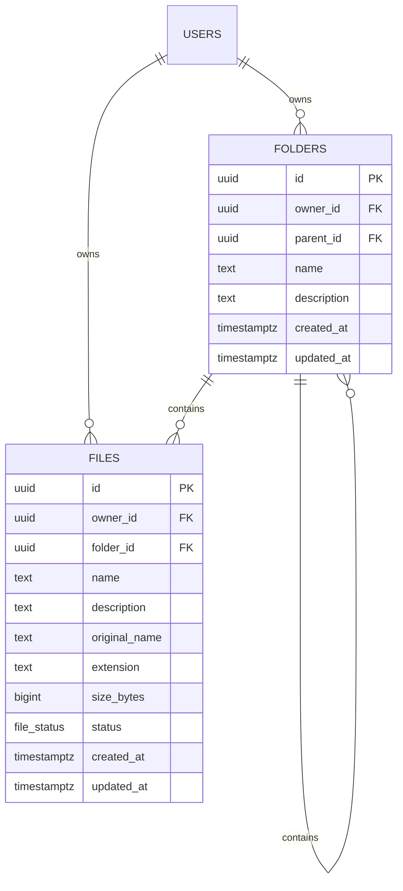

# PHASE_02_PLAN_02 — Authenticated Drive Backend (Specification)

- This specification defines the PLAN_02 end-state: canonical folder/file persistence, authenticated drive APIs, transient ingestion lifecycle, permanent deletion, owner-authorized single-file RAG, security boundaries, requirements, acceptance criteria, risks, and verification boundaries.
- Chronological implementation history belongs in the Codex-owned `CONTEXT` and focused implementation prompts live under `AMENDMENTS/`. This PLAN defines capabilities and contracts without preassigning future Amendment numbering.
- **Branch:** `phase-02/plan-02`
- **Depends on:** PHASE_02_PLAN_01 `IMPLEMENTED & VERIFIED`.
- **Status:** `IMPLEMENTED & VERIFIED` - Amendments 01-06 complete. Canonical persistence, authenticated folders/upload/metadata/deletion/owner-gated single-file RAG passed complete local, packaged, real PostgreSQL/Qdrant, deterministic native SSE, running HTTP, security and exact preservation acceptance. See CONTEXT and MANUAL section 19 for the full closure matrix. PHASE_02 remains `IMPLEMENTED, UNVERIFIED`; authenticated client plans remain `NOT YET BUILT`.
- **Subsystem:** canonical personal-drive state + authenticated transient ingestion + owner-authorized single-file RAG.
- **Implementation evidence:** `PHASE_02_PLAN_02_CONTEXT.md` — Codex-owned; created/maintained only when implementation begins.
- **Repeatable acceptance:** `PHASE_02_PLAN_02_MANUAL.md` — Codex-owned; created/maintained only by Codex CLI.

---

## 1. Objective

Extend the verified Phase 2 identity/authentication foundation into the complete server-side personal-drive boundary required by the later client plans.

At PLAN completion Atlas must be able to:

1. persist recursive owner-scoped folders in PostgreSQL;
2. persist canonical owner-scoped file metadata and lifecycle state in PostgreSQL;
3. browse root or one selected folder through direct-child listing;
4. create and update folder metadata without folder movement/deletion;
5. upload a file through one authenticated canonical ingestion path;
6. preserve one immutable file UUID across PostgreSQL, the public API/client, and Qdrant payload `file_id`;
7. retain original upload bytes only for the lifetime of ingestion;
8. update file name/description without re-parsing, re-embedding, or touching Qdrant;
9. permanently delete one owned file from Qdrant and PostgreSQL through a recoverable cross-store lifecycle;
10. authorize PostgreSQL ownership and `ready` state before file-scoped `/query` and `/ask`;
11. preserve the verified Phase 1 extraction/chunking/embedding/retrieval/generation/SSE/citation contracts except where this PLAN deliberately adds authentication/authorization around them;
12. expose stable server contracts for later Phase 2 client integration.

The completed server-side file flow is:

```mermaid
flowchart LR
    Auth["Bearer current user"] --> PG["PostgreSQL<br/>canonical drive state"]
    PG --> Folder["Owned target folder/root"]
    Folder --> File["files row<br/>processing"]
    File --> Parse["Verified Docling pipeline"]
    Parse --> Embed["Verified BGE-M3"]
    Embed --> Q["Qdrant<br/>same file_id"]
    Q --> Ready["files.status = ready"]
    Ready --> Guard["Owner + ready authorization"]
    Guard --> Rag["Verified single-file RAG"]
```



PLAN_02 stops before Phase 2 client authentication/dashboard implementation, folder deletion/movement, file movement, persistent original-file storage, and multi-file/folder/tree/drive RAG.

---

## 2. Scope

### In scope

- canonical PostgreSQL `folders`;
- canonical PostgreSQL `files`;
- PostgreSQL `file_status` enum:
  - `processing`;
  - `ready`;
  - `deleting`;
- owner relationship from folders/files to canonical `users`;
- recursive same-owner folder hierarchy;
- root-level folders and files;
- duplicate display names;
- direct-child root/folder listing;
- folder creation;
- folder name/description update;
- canonical `POST /files` authenticated upload;
- removal of legacy `POST /documents/upload` under Amendment 03;
- one immutable file UUID across PostgreSQL/API/client/Qdrant payload;
- transient original-file bytes;
- existing verified Docling/chunking/embedding/Qdrant indexing path;
- explicit ingestion lifecycle;
- known-failure exact-file Qdrant cleanup;
- file name/description update without reindexing;
- recoverable permanent file deletion;
- PostgreSQL owner + ready-state authorization before `/files/{file_id}/query`;
- PostgreSQL owner + ready-state authorization before `/files/{file_id}/ask`;
- explicit-origin credentialed CORS expansion required by the new drive API;
- two-user server-side ownership isolation;
- deterministic, real-PostgreSQL, real-Qdrant, packaged/Docker, HTTP, RAG-regression, and security acceptance.

### Explicitly excluded

- Phase 2 client implementation;
- folder deletion;
- folder movement;
- file movement;
- trash/recovery;
- file versions;
- persistent original-file filesystem/object storage;
- file download;
- file preview from persisted originals;
- automatic reprocessing/reindexing from stored originals;
- content/file deduplication;
- multi-file RAG;
- folder/subtree RAG;
- drive-wide RAG;
- hybrid/sparse retrieval;
- reranking;
- retrieval tuning unrelated to measured regressions;
- full-text drive search;
- sharing;
- teams;
- roles;
- ACLs;
- organization accounts;
- Redis;
- background workers;
- queues;
- scheduled repair/cleanup jobs;
- S3/MinIO/object storage;
- a Next.js BFF/proxy;
- new auth/session architecture;
- new RAG framework;
- LangChain;
- managed Gemini File Search/RAG services.

No excluded capability may be stubbed merely because later plans may need it.

---

## 3. Inherited locked architecture

PLAN_02 inherits without reopening:

- Python + FastAPI backend;
- PostgreSQL as canonical application state;
- synchronous SQLAlchemy 2.x + psycopg 3;
- Alembic explicit migrations;
- application startup does not run migrations/create-all;
- process-scoped PostgreSQL engine/pool;
- short-lived operation/request-scoped ORM sessions;
- verified reusable authenticated-current-user dependency from PLAN_01;
- Qdrant as derived retrieval state only;
- one immutable file UUID across PostgreSQL/API/client/Qdrant payload `file_id`;
- Docling extraction/chunking;
- BAAI/bge-m3 embedding space;
- Qdrant dense cosine retrieval;
- native Gemini provider abstraction;
- native POST-SSE ask transport;
- trusted Atlas citation provenance;
- browser communicates directly with FastAPI;
- explicit-origin credentialed CORS;
- no Redis/workers/queues;
- no persistent original-file storage;
- no LangChain by default.

Material changes to these decisions require explicit human approval.

---

## 4. Canonical state and trust model

PostgreSQL is canonical for:

```text
users
verifications
sessions
folders
files
ownership
folder hierarchy
file location
file display metadata
file lifecycle state
```

Qdrant is derived state for:

```text
chunks
embeddings
retrieval payload/provenance
```

Original uploaded bytes are:

```text
untrusted transient ingestion input
```

They are not canonical state and are not persisted after ingestion.

Authorization order is locked:

```text
validated Bearer credential
-> canonical authenticated user
-> PostgreSQL folder/file ownership
-> file ready-state authorization where RAG is requested
-> exact Qdrant file_id scope
-> retrieval
-> generation
```

Never:

- authorize from Qdrant;
- retrieve first and post-filter ownership later;
- trust client-supplied `owner_id` / `user_id`;
- trust display names as identity;
- let the LLM decide authorization;
- derive citation provenance from model-authored metadata.

---

## 5. Drive identity and naming semantics

### UUID identity

Folders and files use application-generated UUID primary keys.

For files, one immutable UUID is used as:

```text
PostgreSQL files.id
= public API file_id
= client file identity
= Qdrant payload file_id
```

Do not introduce a second document/vector/storage identifier.

### Display names

Folder/file names are mutable user-facing metadata.

The following are deliberately valid:

- two sibling folders with the same name;
- two files in the same folder with the same name;
- a file and folder with the same display name.

Names must never be used as:

- database identity;
- authorization identity;
- cache identity;
- Qdrant scope identity;
- client reconciliation identity.

No folder-name or file-name uniqueness constraint belongs in PLAN_02.

### Metadata normalization

- names are required and must remain nonblank after surrounding-whitespace trimming;
- descriptions are optional;
- surrounding-whitespace-only descriptions normalize to `NULL`/absent metadata where consistent with current schema conventions;
- PLAN_02 does not invent a product-specific maximum name/description length beyond established request/database safety conventions;
- do not silently add a name uniqueness rule or filename-derived identity.

---

## 6. Canonical drive data model



### `file_status`

PostgreSQL enum values exactly:

```text
processing
ready
deleting
```

There is no durable `failed` value in PLAN_02.

### `folders`

Columns:

```text
id              UUID PRIMARY KEY
owner_id        UUID NOT NULL
parent_id       UUID NULL
name            TEXT NOT NULL
description     TEXT NULL
created_at      TIMESTAMPTZ NOT NULL
updated_at      TIMESTAMPTZ NOT NULL
```

Required constraints/indexes:

```text
FOREIGN KEY owner_id -> users.id ON DELETE RESTRICT
UNIQUE(id, owner_id)
FOREIGN KEY (parent_id, owner_id) -> folders(id, owner_id) ON DELETE RESTRICT
INDEX(owner_id, parent_id)
```

Semantics:

- `parent_id = NULL` means root;
- a non-null parent must be owned by the same user;
- `parent_id` is immutable during Phase 2;
- folder deletion is absent;
- duplicate sibling names are allowed;
- folder metadata update changes only `name` and/or `description`;
- no materialized path;
- no stored depth;
- no closure table;
- no folder tree cache.

### `files`

Columns:

```text
id              UUID PRIMARY KEY
owner_id        UUID NOT NULL
folder_id       UUID NULL
name            TEXT NOT NULL
description     TEXT NULL
original_name   TEXT NOT NULL
extension       TEXT NOT NULL
size_bytes      BIGINT NOT NULL
status          file_status NOT NULL
created_at      TIMESTAMPTZ NOT NULL
updated_at      TIMESTAMPTZ NOT NULL
```

Required constraints/indexes:

```text
FOREIGN KEY owner_id -> users.id ON DELETE RESTRICT
FOREIGN KEY (folder_id, owner_id) -> folders(id, owner_id) ON DELETE RESTRICT
INDEX(owner_id, folder_id)
CHECK(size_bytes >= 0)
```

The folder composite FK requires the referenced `(folders.id, folders.owner_id)` key defined above.

Semantics:

- `folder_id = NULL` means root;
- non-null `folder_id` must belong to the same owner;
- file location is immutable during Phase 2;
- duplicate names are allowed;
- `name`/`description` are user-facing mutable metadata;
- `original_name` records the submitted source filename;
- `extension` follows the existing verified upload-format/extension normalization rather than introducing a new MIME-identity architecture;
- `size_bytes` is source upload size;
- file IDs are application-generated before ingestion;
- a file row may exist before Qdrant indexing completes.

Do not add in PLAN_02:

- `failure_code`;
- `indexed_at`;
- persistent binary path/object key;
- content hash/deduplication key;
- vector/document secondary identifier;
- `deleted_at`;
- trash state;
- version number;
- move/path/depth fields.

---

## 7. Migration architecture

PLAN_01 established migration head:

```text
0001_identity
```

PLAN_02 introduces one cohesive drive-foundation migration:

```text
0002_drive
```

`0002_drive` owns:

- `file_status`;
- `folders`;
- `files`;
- approved constraints;
- approved indexes.

Upgrade dependency order:

```text
file_status
-> folders
-> folder constraints/indexes
-> files
-> file constraints/indexes
```

Downgrade reverses the dependency order and removes only PLAN_02 drive objects.

Rules:

- never edit `0001_identity` to retrofit drive state;
- never use `create_all()` as migration management;
- normal application startup does not migrate;
- downgrade/re-upgrade acceptance uses disposable PostgreSQL state;
- do not downgrade/reset the normal persistent development database merely to prove reversibility;
- identity tables/data must survive a disposable `0002_drive -> 0001_identity` downgrade path.

---

## 8. Recursive drive hierarchy

Atlas models recursion through nullable adjacency:

```text
Root
├── Folder A
│   ├── Folder B
│   │   ├── File 1
│   │   └── File 2
│   └── File 3
├── Folder A
└── File 4
```

Rules:

- duplicate names do not affect hierarchy;
- navigation is by UUID;
- APIs fetch only the selected location's direct children;
- no recursive full-tree payload is required;
- no server-stored breadcrumb/path materialization is required;
- a child folder cannot reference another user's folder because ownership is enforced in PostgreSQL;
- a file cannot be placed in another user's folder;
- folder/file movement is not implemented.

---

## 9. Public drive DTOs

Exact local Pydantic class names may follow current repository conventions. Public field contracts are stable.

### Folder DTO

```json
{
  "id": "<uuid>",
  "name": "Architecture",
  "description": "Architecture documents",
  "parent_id": "<uuid-or-null>",
  "created_at": "<timestamp>",
  "updated_at": "<timestamp>"
}
```

Do not expose `owner_id` merely to let the client perform authorization.

### File DTO

```json
{
  "id": "<uuid>",
  "name": "Atlas Architecture",
  "description": "Backend and RAG architecture",
  "original_name": "architecture.pdf",
  "extension": ".pdf",
  "size_bytes": 284319,
  "status": "ready",
  "folder_id": "<uuid-or-null>",
  "created_at": "<timestamp>",
  "updated_at": "<timestamp>"
}
```

Do not expose:

- Qdrant point IDs;
- vector metadata not already part of trusted retrieval/citation responses;
- owner IDs as an authorization mechanism;
- internal database/session state.

---

## 10. `GET /drive`

### Request

Root:

```text
GET /drive
Authorization: Bearer <access JWT>
```

Nested location:

```text
GET /drive?folder_id=<folder UUID>
Authorization: Bearer <access JWT>
```

No `owner_id` / `user_id` parameter exists.

### Behavior

1. authenticate current user;
2. if `folder_id` is present, resolve that folder in PostgreSQL under the authenticated owner;
3. foreign/missing selected folder returns the same not-found contract;
4. query direct child folders where `owner_id=current_user.id` and `parent_id=<selected/null>`;
5. query direct child files where `owner_id=current_user.id` and `folder_id=<selected/null>`;
6. return only that location's direct children.

### Response

Root reference:

```json
{
  "folder": null,
  "folders": [],
  "files": []
}
```

Nested reference:

```json
{
  "folder": {
    "id": "<uuid>",
    "name": "Architecture",
    "description": "Architecture documents",
    "parent_id": "<uuid-or-null>",
    "created_at": "<timestamp>",
    "updated_at": "<timestamp>"
  },
  "folders": [],
  "files": []
}
```

Files include their canonical status. In-flight `processing` / `deleting` rows may therefore be observable during concurrent operations; clients must not treat them as RAG-ready.

PLAN_02 defines no public pagination/sort customization contract. Do not silently introduce a user-visible ordering API.

---

## 11. `POST /folders`

Request:

```json
{
  "name": "Architecture",
  "description": "Architecture documents",
  "parent_id": "<uuid-or-null>"
}
```

Behavior:

- authenticate;
- normalize/validate metadata;
- derive `owner_id` from current user;
- if parent is non-null, resolve it under the same owner;
- create one folder;
- duplicate sibling names remain valid.

Success:

- HTTP `201`;
- return Folder DTO.

Missing/foreign parent:

- HTTP `404`;
- code `FOLDER_NOT_FOUND`.

No folder move/delete behavior is introduced.

---

## 12. `PATCH /folders/{folder_id}`

Request may update:

```json
{
  "name": "Atlas Architecture",
  "description": "Updated description"
}
```

Rules:

- authenticate;
- resolve exact folder under current owner;
- missing/foreign folder -> `404 FOLDER_NOT_FOUND`;
- update only `name` and/or `description`;
- `parent_id` is not mutable;
- `owner_id` is never client-controlled;
- no uniqueness conflict for duplicate names;
- no Qdrant/RAG work.

Success:

- HTTP `200`;
- return updated Folder DTO.

---

## 13. Canonical upload: `POST /files`

`POST /files` is the canonical Phase 2 upload route.

### Request

Authenticated multipart form:

```text
file=<binary>
name=<user-facing display name>
description=<optional>
folder_id=<optional UUID>
```

The browser/framework owns the multipart boundary.

Amendment 03 locks file metadata validation: trim `name`, require 1–100 Python characters, and allow Unicode letter/number categories, ASCII space, and only `_ - . , ( ) [ ] & + @ '` punctuation. Reject all other characters after trimming. Trim optional nullable `description`, normalize blank to null, and limit normalized length to 250; no punctuation whitelist. Reject extra multipart fields; identity, ownership, lifecycle, source metadata, and timestamps are server-owned.

### High-level flow

```text
authenticate
-> validate upload metadata
-> authorize target folder/root
-> generate canonical file UUID
-> insert/commit PostgreSQL files row status=processing
-> run verified parse/chunk/embed/Qdrant indexing using same file_id
-> confirm indexing success
-> update PostgreSQL status=ready
-> return File DTO
```

The PostgreSQL transaction must not remain open for the full parse/embed/indexing duration.

### Canonical row before ingestion

The initial row records:

- generated canonical UUID;
- authenticated owner;
- target folder/root;
- display name/description;
- original filename;
- existing normalized extension;
- source size;
- `status=processing`;
- timestamps.

This commit intentionally precedes expensive ingestion so PostgreSQL remains canonical lifecycle state.

### Qdrant

All derived chunks written by this upload use:

```text
payload.file_id = str(files.id)
```

No second ingestion/document ID is generated.

### Success

Only after confirmed Qdrant indexing success:

```text
processing -> ready
```

Return:

- HTTP `201`;
- canonical File DTO with `status=ready`.

Original bytes are discarded after the request/ingestion lifecycle.

---

## 14. Upload failure and recovery boundary

### Known ingestion failure

If parsing, chunking, embedding, or Qdrant indexing fails after the `processing` row exists:

```text
attempt exact-file Qdrant cleanup
-> if cleanup confirmed:
     delete the PostgreSQL processing row
     return structured failure
-> if cleanup cannot be confirmed:
     retain non-ready processing row as a canonical recovery marker
     return structured failure
```

Rationale:

- deleting the canonical row while partial vectors may remain would create unowned derived data;
- retaining a non-ready canonical row is safer than orphaning Qdrant state;
- no background repair worker is introduced in Phase 2.

A normal known failed upload should therefore leave neither PostgreSQL file state nor Qdrant points once cleanup succeeds.

### Finalization failure

If Qdrant indexing succeeded but PostgreSQL cannot transition `processing -> ready`:

- attempt exact-file Qdrant cleanup;
- if cleanup succeeds, remove the processing row when PostgreSQL is available and return failure;
- if canonical cleanup cannot be completed/confirmed, preserve the non-ready row rather than falsely reporting success;
- never return a usable/ready file unless PostgreSQL has committed `ready`.

### Process crash boundary

A process crash can leave a stale `processing` row because PLAN_02 deliberately has no worker/queue.

Such a row:

- is not RAG-ready;
- cannot pass `/query` or `/ask`;
- remains canonical evidence that lifecycle reconciliation is incomplete;
- may be addressed manually/administratively outside this PLAN rather than silently guessed away.

Do not add an automatic repair worker merely to eliminate this accepted distributed-system boundary.

---

## 15. Legacy upload removal: `POST /documents/upload`

Amendment 03 deliberately supersedes the earlier compatibility-adapter decision: the legacy public route is removed entirely. It must not remain as an alias, redirect, hidden route, or adapter. The internal ingestion implementation is reused by canonical authenticated `POST /files`.

The unauthenticated Phase 1 client upload flow is temporarily incompatible until later Phase 2 client integration. Historical Phase 1 verification remains unchanged.

---

## 16. `PATCH /files/{file_id}`

Request may update:

```json
{
  "name": "Atlas Backend Architecture",
  "description": "Updated notes"
}
```

Rules:

- authenticate;
- resolve file under current owner;
- missing/foreign file -> `404 FILE_NOT_FOUND`;
- update only `name` and/or `description`;
- no `folder_id` mutation;
- no `owner_id` mutation;
- no original-file replacement;
- no status mutation through this route;
- no parsing/chunking/embedding;
- no Qdrant write/update;
- no citation/provenance rewrite.

Success:

- HTTP `200`;
- return updated File DTO.

Metadata is canonical PostgreSQL state only.

---

## 17. Permanent deletion: `DELETE /files/{file_id}`

Deletion is permanent; there is no trash.

### Authorization

1. authenticate;
2. resolve owned file from PostgreSQL;
3. missing/foreign file -> `404 FILE_NOT_FOUND`;
4. a `processing` file is not user-deletable through this route while ingestion is active; return the stable non-ready/conflict contract defined below;
5. a `ready` file may enter deletion;
6. an already-`deleting` owned file may be retried idempotently.

### Lifecycle

```text
ready
-> commit status=deleting
-> exact Qdrant delete for payload.file_id == canonical UUID
-> delete PostgreSQL files row
-> 204
```

Do not hold one PostgreSQL transaction open across the Qdrant network operation.

### Qdrant failure

If exact-file Qdrant deletion fails:

- keep PostgreSQL row `deleting`;
- do not delete canonical row;
- return structured operational failure;
- retry is allowed.

### PostgreSQL final-delete failure

If Qdrant deletion succeeded but PostgreSQL row deletion fails:

- row remains/reverts to committed `deleting`;
- retry performs the exact-file Qdrant deletion again;
- zero matching Qdrant points is an acceptable idempotent delete outcome;
- then retry PostgreSQL deletion.

### Isolation

Deletion scope is exactly:

```text
payload.file_id == str(files.id)
```

Never delete by:

- name;
- folder;
- owner alone;
- point-ID guesses;
- broad collection reset.

Success:

- HTTP `204`;
- no body.

---

## 18. Owner-authorized `/query`

Existing route remains:

```text
POST /files/{file_id}/query
```

PLAN_02 adds a PostgreSQL authorization/status gate before any RAG-owned work.

Required sequence:

```text
Bearer authentication
-> PostgreSQL file lookup under current owner
-> require status=ready
-> existing exact file_id Qdrant retrieval
-> existing response contract
```

Rules:

- missing/foreign file -> `404 FILE_NOT_FOUND`;
- owned `processing`/`deleting` file -> `409 FILE_NOT_READY`;
- unauthorized/non-ready requests must not call embedding/Qdrant retrieval;
- preserve existing question/top-k/retrieval response semantics unless the current RAG skill/current implementation already defines them differently;
- no multi-file scope.

---

## 19. Owner-authorized `/ask`

Existing route remains:

```text
POST /files/{file_id}/ask
```

Required sequence:

```text
Bearer authentication
-> PostgreSQL file lookup under current owner
-> require status=ready
-> existing exact file_id retrieval
-> existing grounded generation
-> existing native SSE
-> existing trusted citations
```

Auth/ownership/status failures happen before SSE begins and return normal structured JSON errors.

Rules:

- missing/foreign file -> `404 FILE_NOT_FOUND`;
- owned non-ready file -> `409 FILE_NOT_READY`;
- unauthorized/non-ready requests must not call embedding/Qdrant/Gemini;
- preserve current SSE framing/events/citation semantics;
- no folder/drive/multi-file ask.

---

## 20. Authorization privacy contract

Resource authorization intentionally avoids confirming another user's resource existence.

### Folder

For an authenticated user:

```text
missing folder
and
folder owned by another user
```

both return:

```text
404 FOLDER_NOT_FOUND
```

### File

For an authenticated user:

```text
missing file
and
file owned by another user
```

both return:

```text
404 FILE_NOT_FOUND
```

### Non-ready file

Only after ownership is established:

```text
processing
or
deleting
```

returns:

```text
409 FILE_NOT_READY
```

Do not return `403` merely to reveal that the resource exists for another user.

---

## 21. Error vocabulary

Reuse the existing Atlas `{error, code}` system.

PLAN_02 requires at minimum:

```text
FOLDER_NOT_FOUND
FILE_NOT_FOUND
FILE_NOT_READY
```

Mappings:

- `FOLDER_NOT_FOUND` -> HTTP `404`;
- `FILE_NOT_FOUND` -> HTTP `404`;
- `FILE_NOT_READY` -> HTTP `409`.

Reuse existing:

- `INVALID_ACCESS_TOKEN`;
- `UNPROCESSABLE_ENTITY`;
- PostgreSQL safe operation/connectivity errors;
- Qdrant safe operation/connectivity errors;
- extraction/embedding/generation errors already established by the verified pipeline.

Do not expose:

- raw SQL/driver details;
- raw Qdrant provider errors containing internal data;
- filesystem temp paths;
- model/provider secrets;
- whether a foreign resource exists;
- another user's identity.

---

## 22. CORS contract

PLAN_01 verified:

```text
origins = explicit configured allow-list
credentials = true
methods = GET, POST
headers = Content-Type, Authorization
```

PLAN_02 expands only the methods required by the new browser-facing drive API:

```text
methods = GET, POST, PATCH, DELETE
headers = Content-Type, Authorization
credentials = true
origins = exact configured explicit allow-list
```

Rules:

- no wildcard origins;
- no wildcard methods/headers;
- do not add PUT;
- OPTIONS remains middleware behavior, not a business route;
- CORS is not authentication/authorization;
- preserve refresh-cookie credential support.

---

## 23. RAG integration boundary

Detailed extraction/chunking/embedding/Qdrant retrieval/generation/citation contracts remain owned by:

```text
.agents/skills/rag/SKILL.md
```

Any Amendment that modifies or directly reuses RAG-owned ingestion/storage/retrieval surfaces must read that skill before coding.

PLAN_02 deliberately preserves:

- supported upload formats;
- Docling parsing/chunking behavior;
- BGE-M3 embedding model/tokenizer space;
- dense vector schema/dimension;
- Qdrant collection;
- exact `file_id` filtering;
- retrieval scoring/top-k behavior;
- generation provider;
- native SSE;
- citation marker parsing;
- trusted citation metadata.

Allowed PLAN_02 RAG-adjacent changes are limited to:

- injecting/propagating the canonical file UUID into existing indexing;
- exact-file cleanup for upload failure/deletion;
- PostgreSQL auth/status guard before retrieval/generation;
- authenticated canonical upload orchestration.

Do not change retrieval quality policy without measured evidence and a separate approved decision.

---

## 24. Server responsibility placement

Expected responsibility areas:

```text
server/
├── migrations/
│   └── versions/
│       └── 0002_drive.py
│
├── app/
│   ├── main.py                         # wiring only
│   ├── db/                             # existing PostgreSQL mechanics
│   ├── models/
│   │   └── postgres/
│   │       ├── folder.py               # exact current equivalent allowed
│   │       └── file.py
│   ├── schemas/
│   │   └── drive/                      # public/internal folder/file DTOs as warranted
│   ├── routers/
│   │   └── ...                         # thin drive/file HTTP boundaries
│   ├── errors/
│   │   └── ...                         # drive/resource error categories
│   └── pipeline/ or equivalent domain/
│       └── ...                         # drive/upload/delete authorization orchestration
└── tests/
```

This is a responsibility map, not permission to create empty symmetry folders.

Codex must inspect the current repository and adjacent established patterns before choosing exact local filenames/class names.

Do not create:

- a generic repository framework;
- a generic service/UoW framework;
- a second database runtime;
- a parallel RAG pipeline;
- router-owned business logic;
- ad hoc raw SQL in routers.

---

## 25. Capability decomposition

PLAN_02 naturally separates into focused capability boundaries without assigning future Amendment numbers beyond separately authored prompts.

### Canonical drive persistence foundation

- `file_status`;
- `folders`;
- `files`;
- owner/same-owner constraints;
- `0002_drive`;
- deterministic metadata tests;
- real PostgreSQL migration/schema/constraint acceptance.

### Folder and direct-child drive APIs

- `GET /drive`;
- `POST /folders`;
- `PATCH /folders/{folder_id}`;
- current-user ownership/privacy;
- root/nested direct-child listing;
- CORS method expansion relevant to implemented routes.

### Authenticated canonical upload

- `POST /files`;
- authenticated target-folder authorization;
- canonical UUID and `processing` row;
- existing RAG ingestion reuse;
- ready finalization;
- exact-file failure cleanup;
- removal of legacy `/documents/upload`; one internal ingestion path.

### File metadata and permanent deletion

- `PATCH /files/{file_id}`;
- PostgreSQL-only metadata update;
- `deleting` lifecycle;
- exact Qdrant cleanup;
- permanent PostgreSQL deletion;
- retry/failure boundaries.

### Owner-authorized single-file RAG

- PostgreSQL owner + ready guard for `/query`;
- PostgreSQL owner + ready guard for `/ask`;
- preserve existing retrieval/generation/SSE/citations;
- no multi-scope RAG.

### Final PLAN acceptance

- two-user isolation;
- root/nested drive workflows;
- upload lifecycle/failure cleanup;
- metadata no-reindex proof;
- delete outage/retry proof;
- query/ask auth isolation;
- packaged/Docker verification;
- datastore preservation;
- Phase 1/PLAN_01 regression.

Additional work is introduced only when evidence/defects justify it.

---

## 26. Requirements

### Canonical persistence

- `0002_drive` migration from verified `0001_identity`;
- exact `file_status` values;
- exact folder/file columns and constraints;
- application-generated UUIDs;
- timezone-aware timestamps;
- same-owner hierarchy/location constraints;
- no name uniqueness;
- no persistent-original fields;
- no second file identifier.

### Drive APIs

- Bearer current-user dependency reused;
- no client `owner_id`;
- direct-child listing only;
- missing/foreign privacy equivalence;
- folder parent immutable;
- file folder immutable;
- duplicate names accepted;
- public DTOs omit ownership authority internals.

### Upload

- authenticated target-folder authorization before ingestion;
- canonical file UUID generated before ingestion;
- PostgreSQL `processing` row committed before expensive ingestion;
- no SQL transaction held across parse/embed/Qdrant;
- Qdrant payload uses exact canonical UUID;
- `ready` committed only after confirmed indexing;
- known failure performs exact-file cleanup;
- canonical row deleted only after cleanup confirmation;
- no durable `failed` state;
- no original bytes persisted.

### Metadata update

- file/folder name/description only;
- no movement;
- no file replacement;
- no Qdrant reindex/update for metadata-only edits.

### Delete

- owner-authorized;
- `ready -> deleting` committed before Qdrant deletion;
- exact Qdrant filter by canonical file UUID;
- Qdrant failure leaves retryable `deleting`;
- final PostgreSQL deletion only after derived cleanup;
- repeated exact Qdrant delete is idempotently acceptable;
- no trash.

### RAG authorization

- PostgreSQL owner lookup before Qdrant;
- `ready` required;
- unauthorized/non-ready requests do not invoke retrieval/generation;
- existing single-file RAG behavior preserved;
- auth/status errors occur before ask SSE starts.

### CORS

- explicit origins;
- credentials true;
- methods GET/POST/PATCH/DELETE;
- headers Content-Type/Authorization;
- no wildcard;
- no PUT.

### Compatibility

- existing auth/session contracts remain verified;
- existing system/database health contracts remain verified;
- Phase 1 RAG mechanics remain verified;
- legacy `/documents/upload` is absent; only `/files` exposes upload;
- no client implementation;
- no persistent original storage;
- no multi-scope RAG.

### Documentation

- Codex creates/maintains PLAN_02 CONTEXT and MANUAL when implementation begins;
- planning author does not pre-create/populate them;
- CONTEXT records actual chronology/evidence only;
- MANUAL records proven reproducibility only;
- statuses are evidence-based.

---

## 27. Acceptance criteria

PLAN_02 becomes `IMPLEMENTED & VERIFIED` only when the complete authenticated drive backend destination is built and objectively accepted.

### Migration/schema

- existing `0001_identity` database upgrades to `0002_drive`;
- `file_status` contains exactly `processing`, `ready`, `deleting`;
- `folders` and `files` exist with approved columns/types/nullability;
- owner FKs are restrictive;
- same-owner folder/file location constraints work;
- duplicate folder/file display names are accepted;
- `size_bytes < 0` is rejected;
- no excluded columns/tables are introduced;
- disposable downgrade to `0001_identity` and re-upgrade succeeds;
- normal persistent DB is not destructively downgraded.

### Folder hierarchy

- authenticated user creates root folder;
- creates nested folders;
- duplicate sibling folder names succeed;
- cross-owner parent assignment fails at server/DB boundaries;
- foreign/missing folder privacy returns same 404;
- folder rename/description update preserves parent/location;
- direct-child listing returns only selected location children.

### Canonical files

- root/nested file metadata is canonical in PostgreSQL;
- duplicate file names succeed;
- file/folder matching names succeed;
- same-owner folder location enforced;
- cross-owner folder placement rejected;
- canonical UUID remains stable.

### Upload lifecycle

- authenticated upload creates `processing` canonical state;
- same UUID reaches every Qdrant chunk payload;
- successful indexing ends in `ready`;
- no persistent original bytes remain;
- known ingestion failure cleans exact-file Qdrant state and removes canonical row after cleanup confirmation;
- failed cleanup never falsely deletes canonical recovery state;
- no durable `failed` status exists;
- finalization failure never returns a ready/successful file falsely;
- legacy `/documents/upload` is absent from HTTP/OpenAPI and cannot invoke ingestion.

### Metadata

- folder metadata edit is PostgreSQL-only;
- file metadata edit is PostgreSQL-only;
- file edit does not alter Qdrant point count/payload content;
- no re-embedding/reindexing occurs;
- folder/file location remains unchanged.

### Permanent deletion

- owned ready file transitions to `deleting`;
- exact-file Qdrant points are removed;
- PostgreSQL row is then removed;
- Qdrant outage leaves `deleting` and no canonical-row deletion;
- PostgreSQL final-delete failure after successful Qdrant deletion remains retryable;
- retry with zero matching Qdrant points succeeds safely;
- unrelated users/files/Qdrant points remain intact;
- foreign user cannot trigger Qdrant deletion for another user's file.

### Query/ask authorization

- valid owner + ready file preserves existing query behavior;
- valid owner + ready file preserves existing ask SSE/citations;
- missing/foreign file -> same 404;
- processing/deleting owned file -> 409;
- unauthorized/non-ready query does not invoke query embedding/Qdrant retrieval;
- unauthorized/non-ready ask does not invoke retrieval/Gemini/SSE;
- no folder/drive/multi-file retrieval is introduced.

### Security/regression

- current-user auth remains authoritative;
- no route trusts client owner/user IDs;
- no foreign-resource existence leakage;
- no secrets/source-content leaks in logs/errors beyond existing approved observability;
- CORS is narrow and credentialed;
- full PLAN_01 auth regression passes;
- relevant Phase 1 RAG regression passes;
- persistent Qdrant/PostgreSQL state is preserved except deliberate synthetic acceptance mutations/cleanup;
- Docker/package acceptance passes where required;
- `git diff --check` passes;
- Codex explains lifecycle, transaction boundaries, cross-store failure handling, and remaining client scope.

---

## 28. Risks and accepted boundaries

### No persistent original bytes

After successful ingestion Atlas cannot:

- download the original;
- preview the original from Atlas storage;
- reprocess without re-upload;
- rebuild Qdrant from an object store.

This is a deliberate Phase 2 scope boundary.

### PostgreSQL + Qdrant are not one transaction

Upload and deletion span two datastores.

PLAN_02 uses explicit recoverable lifecycle state rather than pretending distributed atomicity:

```text
upload:   processing -> Qdrant -> ready
delete:   deleting -> Qdrant cleanup -> PostgreSQL delete
```

Known failures perform exact-file compensation.

A process crash can still leave a non-ready canonical recovery row. No worker is added in Phase 2.

### Duplicate display names

Names are intentionally non-unique.

Any client/API implementation that assumes unique names is incorrect. UUIDs are authoritative.

### Permanent deletion

There is no trash/recovery.

Successful deletion removes canonical metadata and derived vectors permanently.

### Removed legacy upload

Amendment 03 removes the legacy Phase 1 `/documents/upload` path; authenticated `POST /files` is the sole upload endpoint.

This can temporarily break the unauthenticated Phase 1 browser workflow until later Phase 2 client integration. The server-first sequencing rule accepts that temporary mismatch; evidence must state it rather than pretending Phase 1 client compatibility remains complete during the transition.

### No background reconciliation

No worker/queue/cron process repairs stale `processing`/`deleting` rows automatically.

If such operational need becomes material, it requires a later explicit architecture decision.

---

## 29. Verification approach

Codex-owned MANUAL must eventually make the complete PLAN reproducible.

Verification should cover:

- migration metadata inspection;
- fresh/disposable `0001_identity -> 0002_drive`;
- disposable downgrade/re-upgrade;
- real PostgreSQL constraints;
- same-owner folder/file relationships;
- duplicate-name behavior;
- direct-child drive APIs;
- two-user privacy/isolation;
- upload success with real Qdrant;
- partial/failed ingestion cleanup;
- finalization failure handling;
- metadata no-reindex proof;
- permanent deletion success;
- Qdrant deletion outage/retry;
- PostgreSQL final-delete failure/retry;
- query owner/ready authorization;
- ask owner/ready authorization before SSE;
- exact-file retrieval/deletion scope;
- CORS GET/POST/PATCH/DELETE + Content-Type/Authorization;
- PLAN_01 authentication regression;
- relevant Phase 1 RAG regression;
- Docker/package/runtime correctness;
- datastore preservation;
- secret/log safety;
- `git diff --check`;
- no prohibited Git mutation.

Exact implementation filenames, package versions, migration hashes/checksums, test counts, timings, container IDs, synthetic UUIDs, failures, deviations, and runtime evidence belong only in Codex-owned CONTEXT/MANUAL—not in this specification.
