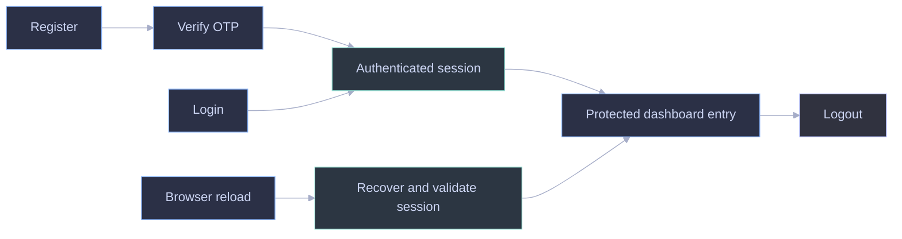
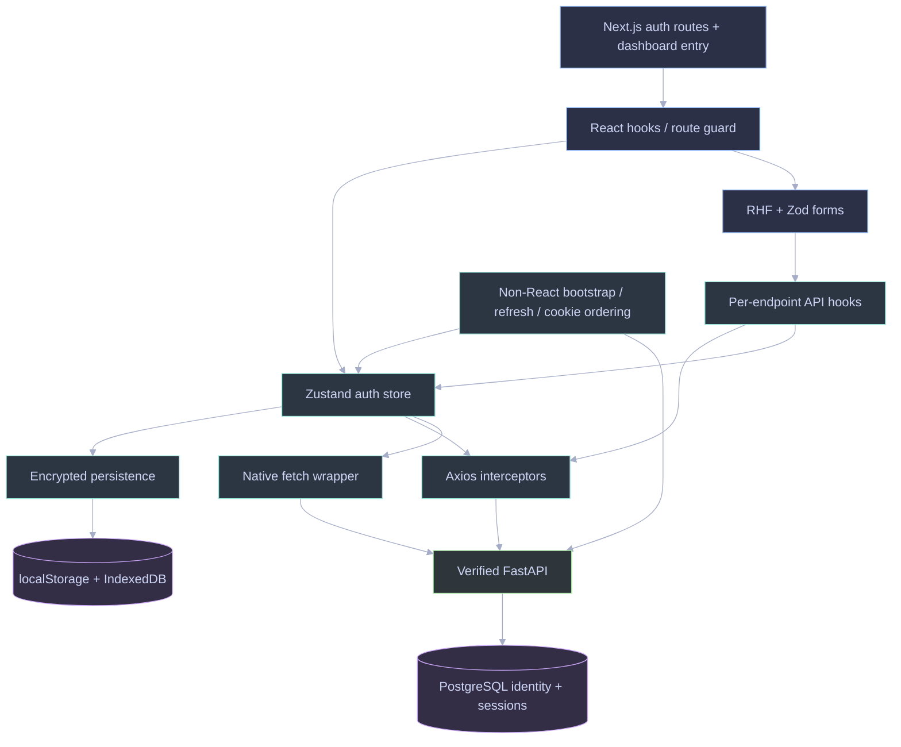
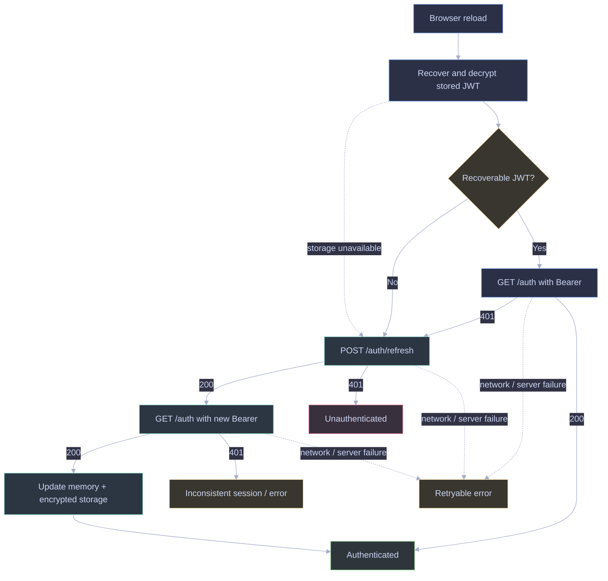
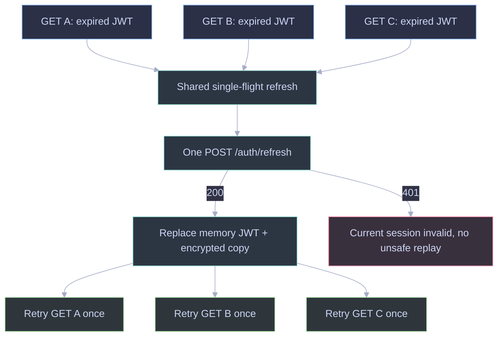
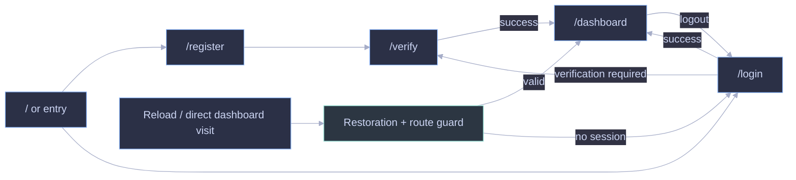

# PHASE_02_PLAN_03 — Client Authentication (Specification)

- **Document role:** Define the PLAN_03 destination, approved client architecture, backend integration contracts, scope boundaries, requirements, risks, and objective acceptance; implementation sequence belongs in focused Amendments.
- **PHASE:** `PHASE_02 — Authenticated Personal Drive` — `IMPLEMENTED, UNVERIFIED`.
- **PLAN:** `PHASE_02_PLAN_03` — `IMPLEMENTED, UNVERIFIED`; registration/verification/resend UI is `IMPLEMENTED & VERIFIED`; login/logout UI is `IMPLEMENTED & VERIFIED`; protected entry remains unbuilt.
- **Required branch:** `phase-02/plan-03`; inspected during implementation, recheck before each task.
- **Verified dependencies:** `PHASE_02_PLAN_01` (identity/auth) and `PHASE_02_PLAN_02` (authenticated drive backend) — both `IMPLEMENTED & VERIFIED`.
- **Primary subsystem:** Static Next.js browser client, authentication UI, shared session authority, credential persistence, and HTTP transports.
- **Next destination:** `PHASE_02_PLAN_04 — Drive Dashboard & Phase Acceptance`.
- **Implementation evidence:** `PHASE_02_PLAN_03_CONTEXT.md` — Codex-owned; Amendment 01 historical verification and Amendment 02 execution are recorded separately.
- **Reproducible procedures:** `PHASE_02_PLAN_03_MANUAL.md` — Codex-owned; only actually exercised procedures establish evidence.
- **Reference contracts:** [PHASE_02 overview](../PHASE_02.md) · [PLAN_01](../PLAN_01/PHASE_02_PLAN_01.md) · [PLAN_02](../PLAN_02/PHASE_02_PLAN_02.md) · [client AGENTS](../../../client/AGENTS.md).

---

## 1. PLAN OBJECTIVE & COMPLETION BOUNDARY

**Objective:** Deliver an authenticated, statically exported Atlas browser client that consumes the existing FastAPI identity/session contracts and supplies a reusable authentication foundation to PLAN_04.

At completion the client must:

1. register an account and proceed to development-OTP verification;
2. verify and resend OTPs, establishing the first authenticated session on successful verification;
3. log in an already verified user and handle unverified/invalid credentials accurately;
4. hold one active access JWT in memory and an encrypted persisted copy in browser storage;
5. restore a session after reload by recovering and server-validating the encrypted JWT, with refresh-cookie fallback;
6. coordinate expiry, refresh-token rotation, concurrent requests, bounded safe retries, and terminal failures;
7. provide the same authenticated session to Axios and native fetch without changing the existing SSE transport contract;
8. protect browser navigation and render a minimal authenticated dashboard entry;
9. log out, clear client credentials/caches, and distinguish confirmed logout from uncertain server outcomes;
10. pass static-build, deterministic, browser, running-backend, cookie/CORS, security, and regression acceptance appropriate to this boundary.

**PLAN_03 stops at the authenticated dashboard entry.** Folder/file browsing, upload and mutation UI, selected-file RAG, and complete drive/dashboard integration are PLAN_04 work.



---

## 2. VERIFIED PREREQUISITES & CURRENT BASELINE

| Area                                | Current status            | Relevant evidence / implication                                                                                                                                       |
| ----------------------------------- | ------------------------- | --------------------------------------------------------------------------------------------------------------------------------------------------------------------- |
| PHASE_01 client and single-file RAG | `IMPLEMENTED & VERIFIED`  | Static Next.js/Bun client, Axios, native fetch/SSE, Zod and React patterns; earlier unauthenticated browser flow is not compatible with the superseding upload route. |
| PLAN_01 identity and sessions       | `IMPLEMENTED & VERIFIED`  | Registration, verification/resend, login, refresh rotation, logout, `GET /auth`, Bearer current-user, and explicit credentialed CORS.                                 |
| PLAN_02 authenticated drive backend | `IMPLEMENTED & VERIFIED`  | Owner-scoped `/drive`, `/folders`, `/files`, exact-file RAG, and canonical upload endpoint; final integrated evidence is in PLAN_02 CONTEXT/MANUAL.                   |
| PLAN_03 authenticated browser       | `IMPLEMENTED, UNVERIFIED` | Amendments 01 and 02 verify the foundation; Amendment 03 UI is browser/live verified; login/logout UI is `IMPLEMENTED & VERIFIED`; protected entry remains unbuilt.   |
| PLAN_04 drive dashboard             | `NOT YET BUILT`           | Will consume PLAN_03 session/transport contracts.                                                                                                                     |

### Reusable client baseline

- Next.js App Router, strict TypeScript, Bun-only scripts and lockfile, static `output: "export"`.
- Tailwind CSS + shadcn/ui; React Hook Form + Zod; TanStack Query v5; Axios; native `fetch()` + `ReadableStream` for POST-SSE.
- Existing Axios/fetch share Zustand auth access and default to no cookies; typed `isProtected` and cookie credentials remain independent.
- Existing Phase 1 page composes `RagWorkspace`; its upload dependency still targets superseded public `POST /documents/upload`.
- **Do not restore the removed route** or claim the old page works end-to-end against the current Phase 2 backend.
- Reuse current route, component, hook, schema, provider, alias, naming and formatting conventions documented in `client/AGENTS.md`.

### Evidence discipline

- Historical backend verification is prerequisite evidence, not proof that PLAN_03 client workflows have run.
- Current repository files and executed test/runtime results supersede historical source snapshots when implementation begins.
- CONTEXT/MANUAL record actual execution. Amendment 01 remains historically verified; Amendment 02 is `IMPLEMENTED & VERIFIED` after approved Stage 02 browser/live acceptance.

---

## 3. SCOPE & EXCLUSIONS

### In scope

| Domain              | Required capability                                                                                                    |
| ------------------- | ---------------------------------------------------------------------------------------------------------------------- |
| Account entry       | `/register`, `/verify`, `/login` with functional forms, validation, resend and expected errors.                        |
| Authenticated entry | Minimal `/dashboard`, defined `/` navigation and protected-route state handling.                                       |
| Session             | One Zustand auth store; focused startup, refresh, logout and stale-generation helpers.                                 |
| Cryptography        | AES-256-GCM encrypted access JWT in `localStorage`; non-extractable browser key in IndexedDB; active JWT in memory.    |
| Transport           | Shared session injection into Axios interceptors and native fetch; credentialed auth-cookie calls; bounded safe retry. |
| Reliability         | Single-flight within one browser session; stale-response suppression; deterministic terminal/uncertain error handling. |
| Verification        | Unit, HTTP integration, static export, browser, running FastAPI cookie/CORS and preservation checks.                   |

### Explicit exclusions

- Full drive dashboard, root/folder listing, lazy folder navigation, folder create/rename, upload, file metadata edit, permanent-delete UI, and client file-selection/query/ask experience (PLAN_04).
- Reintroducing `/documents/upload` or altering canonical `POST /files`.
- Any new FastAPI auth endpoint (including `/auth/check`), request/response contract, JWT algorithm, refresh semantics, schema, migration, or server service topology.
- Folder/tree/drive RAG, cross-file retrieval, hybrid/reranking, and retrieval/generation/citation modifications.
- Password reset/forgot product flows, email OTP delivery, OAuth, profile management, teams, roles, sharing or ACLs.
- Redis, persistent client server runtime, BFF/proxy, Next.js Route Handler/Server Action proxy, client Docker service, service worker authentication proxy, workers/queues, or speculative global-state libraries.
- Cross-tab refresh serialization and synchronized logout across independent tabs in the initial baseline; its limitation must be tested and documented.
- Automatic replay of mutations, uploads, login/verification calls, POST-SSE, or partially consumed streams.

---

## 4. CLIENT ARCHITECTURE & OWNERSHIP

### Runtime and layer boundaries

| Layer                  | Authority / responsibility                                                                                                                         |
| ---------------------- | -------------------------------------------------------------------------------------------------------------------------------------------------- |
| FastAPI                | Authoritative JWT verification, canonical user resolution, refresh-token rotation, ownership and authorization.                                    |
| Zustand auth store     | Sole synchronous in-memory JWT/user/status authority; React selectors and non-React getState read the same store.                                  |
| Auth lifecycle helpers | Focused bootstrap, refresh single-flight, cookie ordering, `sessionVersion`/`tokenVersion` checks and credential commit; no duplicate token state. |
| Crypto/persistence     | Browser-native AES-GCM, IndexedDB `CryptoKey`, versioned ciphertext in `localStorage`, safe error/cleanup behavior.                                |
| Auth endpoint hooks    | useRegister/useResend/useVerify/useLogin/useLogout/useAuth own endpoint path/method/status/schemas and query/mutation lifecycle.                   |
| Auth constants         | Literal endpoint path map only; no verbs, DTO registry or executors.                                                                               |
| Axios service          | Request interceptor, Bearer attachment, auth-failure classification, bounded eligible GET replay.                                                  |
| Native fetch service   | Same session authority and auth-failure policy while retaining raw `Response`, streams and abort semantics.                                        |
| React integration      | Zustand selectors for user/status; QueryProvider starts browser bootstrap in an effect; no dedicated auth provider/useSession wrapper.             |
| Routes/components      | Forms, status/error display, navigation, minimal dashboard; no authorization decisions.                                                            |
| TanStack Query         | Remote-state lifecycle/caches; cleared once at account boundaries; no JWT response data in query/mutation results.                                 |

- Keep `src/app/` for route composition, `src/components/<Domain>/` for UI, `src/hooks/<domain>/` for React lifecycle, `src/services/` for network/session logic, and `src/schemas/` for untrusted DTO validation.
- Exact new module names and test placements follow current repository conventions rather than becoming speculative PLAN contracts.
- **SUPERSEDED by Amendment 02:** The standalone session controller, grouped auth API service, useSession adapter and no-Zustand design. Historical Amendment 01 evidence remains unchanged.
- Zustand is the only approved new runtime dependency. Store actions are synchronous; no HTTP, crypto, IndexedDB, persist middleware, devtools token logging or speculative slices.
- Shared lifecycle helpers remain non-React. Hooks own user-triggered requests; internal startup candidate validation and automatic refresh use fixed raw HTTP paths without invoking hooks.
- Use `stores/auth.ts` for state and `constants/auth.ts` for paths; schemas remain in their existing boundary.
- Approved simplification: `services/auth/auth.ts` owns non-React lifecycle, `token.ts` owns encrypted persistence, and `key.ts` owns IndexedDB keys. These replace the fragmented lifecycle modules and old storage filenames.
- Endpoint hooks accept no client/context arguments; named actions validate input, await direct HTTP, validate responses and handle errors. Start/finish operations order cookies and commit state without wrapping hook requests in callbacks.
- Client route guards control UX and visibility only; no browser storage value is authorization proof.



---

## 5. BACKEND AUTHENTICATION CONTRACTS

**No new backend authentication route is required.** The client consumes exactly the verified PLAN_01 API:

| Endpoint              | Request and authentication                                                | Success                                        | Client use                                                |
| --------------------- | ------------------------------------------------------------------------- | ---------------------------------------------- | --------------------------------------------------------- |
| `POST /auth/register` | JSON `name`, `email`, `password`; no existing session required            | `201`, `{"status":"verification_required"}`    | Registration → verification; no credentials issued.       |
| `POST /auth/verify`   | JSON `email`, string `otp`; credentialed browser request for `Set-Cookie` | `200`, authenticated response + refresh cookie | First session.                                            |
| `POST /auth/resend`   | JSON `email`; no session                                                  | `200`, verification-required response          | Replace current OTP; no session.                          |
| `POST /auth/login`    | JSON `email`, `password`; credentialed browser request for `Set-Cookie`   | `200`, authenticated response + refresh cookie | Established-account session.                              |
| `POST /auth/refresh`  | Current browser-managed refresh cookie; no Bearer/body required           | `200`, authenticated response + rotated cookie | Recover or renew session.                                 |
| `GET /auth`           | `Authorization: Bearer <JWT>`                                             | `200`, user profile                            | Validate recovered access JWT and resolve canonical user. |
| `POST /auth/logout`   | Current browser-managed refresh cookie                                    | `204`, empty body + cleared cookie             | Revoke current refresh session.                           |

### DTO and validation contracts

```json
{
  "access_token": "<JWT>",
  "user": {
    "id": "<UUID>",
    "name": "Example User",
    "email": "example@example.com"
  }
}
```

- Authenticated response above is shared by verify, login and refresh; `GET /auth` returns **only** the `user` object.
- Failed Atlas requests return the sanitized `{ "error": "...", "code": "..." }` structure; always validate unknown JSON before using it as trusted state.
- Registration `name` is trimmed/nonblank and at most 100 characters; password length is 8–128; `email` uses server email validation and canonical lowercase.
- OTP is **exactly six numeric characters as a string** (leading zeros preserved); default server OTP lifetime is 600 seconds.
- Access JWT default lifetime is 900 seconds; refresh session default lifetime is 604800 seconds. Client must not hard-code these defaults as guaranteed expiry contracts.
- Refresh cookie `atlas_refresh`: `Path=/auth`, `HttpOnly`, `SameSite=Lax`, configured `Secure`; JavaScript does not read, log, copy or persist this credential.
- Enable `withCredentials` / `credentials: "include"` for auth requests that set, rotate or clear the refresh cookie; ordinary Bearer data requests do not require cookie exposure.
- Avoid client-controlled `owner_id`/`user_id` as identity and never send user identifiers to bypass server authorization.

### Stable error mapping

| Case                                   | HTTP / code                     | Client interpretation                                         |
| -------------------------------------- | ------------------------------- | ------------------------------------------------------------- |
| Invalid email/password                 | `401 INVALID_CREDENTIALS`       | Generic credential failure.                                   |
| Unverified account login               | `403 VERIFICATION_REQUIRED`     | Offer `/verify`.                                              |
| Duplicate registration                 | `409 ACCOUNT_ALREADY_EXISTS`    | Report account conflict.                                      |
| Invalid OTP                            | `400 INVALID_VERIFICATION`      | Correction allowed.                                           |
| Expired OTP                            | `400 VERIFICATION_EXPIRED`      | Offer resend.                                                 |
| Verification not required              | `409 VERIFICATION_NOT_REQUIRED` | Return to login.                                              |
| Missing account on verification/resend | `404 ACCOUNT_NOT_FOUND`         | Safe account error.                                           |
| Invalid/expired access JWT             | `401 INVALID_ACCESS_TOKEN`      | Coordinate refresh when eligible.                             |
| Invalid/replayed refresh token         | `401 INVALID_REFRESH_TOKEN`     | Terminal only if no newer valid session superseded it.        |
| Invalid form/body                      | `422 UNPROCESSABLE_ENTITY`      | Map to form/validation feedback.                              |
| Backend transport/operational fault    | Network/CORS or `5xx`           | Uncertain, retryable failure; not proof of credential expiry. |

- Auth API operations bypass general response-interceptor refresh/replay recursion.
- The browser cannot determine refresh-cookie expiry by reading the cookie; the authoritative decision is the backend response.
- Logout invalidates the refresh session but does **not** revoke previously issued JWTs before natural expiry.

---

## 6. TOKEN STORAGE & ENCRYPTION

### Approved storage design

| Item                                    | Location                | Role / lifecycle                                                                                                 |
| --------------------------------------- | ----------------------- | ---------------------------------------------------------------------------------------------------------------- |
| Active plaintext access JWT             | Zustand memory          | Ordinary request authorization; lost on reload; cleared on logout/session invalidation.                          |
| AES-GCM encrypted access JWT            | `localStorage`          | Persisted encrypted recoverable copy; overwritten on verified token renewal.                                     |
| Non-extractable AES-256-GCM `CryptoKey` | IndexedDB               | Recoverable across reload; deleted on logout; created when absent on later explicit login/verify; never bundled. |
| Opaque refresh token                    | Browser HttpOnly cookie | FastAPI-issued, single-use rotating session credential.                                                          |
| Authenticated user                      | Zustand memory          | Only published after successful server validation or trusted successful login/verification/refresh response.     |

### Encryption contract

- Use browser-native Web Crypto with a **randomly generated 256-bit AES-GCM key**, `extractable: false` and only encrypt/decrypt usages.
- Generate a new cryptographically random **96-bit IV for every encryption**; never reuse the same key/IV pair.
- Persist the non-extractable `CryptoKey` as a structured-clone value in IndexedDB; do not export raw key bytes or create a static `.env` key.
- Store only versioned ciphertext, IV and required encoding/metadata in `localStorage`; never plaintext JWT, password, OTP, refresh token or encryption key.
- Treat decrypted JWT as untrusted until FastAPI accepts it through `GET /auth`; never infer session validity merely from successful AES-GCM decryption or local `exp` inspection.
- On a storage/key/ciphertext mismatch, corruption or absent IndexedDB key: discard unusable persisted ciphertext and fall back to refresh-cookie restoration.
- Ensure encryption and storage writes are bound to the session generation that produced the JWT; a delayed write must not resurrect an older token after logout or account switching.
- If storage or Web Crypto is unavailable, allow a valid memory-only session with cookie-backed restoration when supported; do not represent persistence as successful when it failed.
- Encrypt upon accepted login/verification, successful credential renewal, and validated token recovery only when persistence needs updating; **do not decrypt for every HTTP request**.
- Normal Axios/fetch requests read the plaintext JWT from Zustand. Decryption is performed **at browser initialization to recover the saved token**; version-1 ciphertext/key format stays compatible.
- Logout serializes deletion of auth-owned ciphertext and IndexedDB `atlas.auth/keys/access`; never delete unrelated records/databases. Deletion failure is observable as persistence unavailable, independently of server logout confirmation.
- Account replacement, corruption and terminal invalidation clear ciphertext; a later explicit login/verify creates a non-extractable key when absent and writes fresh encrypted persistence.
- Encryption-at-rest reduces casual storage disclosure, but **is not an XSS barrier**: same-origin malicious JavaScript may invoke the key and use the JWT.

```mermaid
%%{init: {'theme': 'base', 'themeVariables': {'background': '#1e1e2e', 'primaryColor': '#45475a', 'primaryTextColor': '#cdd6f4', 'primaryBorderColor': '#89b4fa', 'lineColor': '#a6adc8', 'secondaryColor': '#313244', 'tertiaryColor': '#181825', 'fontFamily': 'Inter, sans-serif'}}}%%
flowchart LR
    API["Login / verify / refresh JWT"] --> Memory["Active JWT in Zustand"]
    API --> Encrypt["AES-256-GCM encryption"]
    Key[("IndexedDB<br/>non-extractable CryptoKey")] --> Encrypt
    Encrypt --> Stored[("localStorage<br/>IV + ciphertext")]
    Stored --> Decrypt["Decrypt on startup recovery"]
    Key --> Decrypt
    Decrypt --> Check["GET /auth validates JWT"]
    Check --> Memory
    Memory --> Calls["Axios / fetch Bearer request"]
    class API,Calls client;
    class Memory,Encrypt,Decrypt,Check service;
    class Key,Stored storage;
    classDef client fill:#2b3046,stroke:#89b4fa,stroke-width:1px,color:#cdd6f4;
    classDef service fill:#2c3642,stroke:#94e2d5,stroke-width:1px,color:#cdd6f4;
    classDef storage fill:#332e46,stroke:#cba6f7,stroke-width:1px,color:#cdd6f4;
    classDef verified fill:#2e363c,stroke:#a6e3a1,stroke-width:1px,color:#cdd6f4;
    classDef planned fill:#30323f,stroke:#b4befe,stroke-width:1px,color:#cdd6f4;
    classDef caution fill:#38362e,stroke:#f9e2af,stroke-width:1px,color:#cdd6f4;
    classDef denied fill:#39303d,stroke:#f38ba8,stroke-width:1px,color:#cdd6f4;
```



---

## 7. SESSION STATE & RESTORATION

### Authoritative client states

| State             | Meaning                                                                   | Protected route behavior                                                      |
| ----------------- | ------------------------------------------------------------------------- | ----------------------------------------------------------------------------- |
| `restoring`       | Initial credential recovery/validation is pending.                        | Show loading; do not render protected content or start independent refreshes. |
| `authenticated`   | Valid server-established/validated user session snapshot available.       | Render authenticated entry; use memory JWT.                                   |
| `unauthenticated` | No usable session or a definitive terminal auth failure.                  | Navigate to login.                                                            |
| `error`           | Network, CORS, server, or other uncertainty prevents reliable validation. | Show recoverable error and explicit retry; do not assume logout.              |

### Initialization and recovery contract

1. Start in `restoring` and publish no authenticated route content.
2. Resolve an optional versioned encrypted JWT from `localStorage` and the key from IndexedDB; perform AES-GCM decryption if possible.
3. If recovery succeeds, call **raw `GET /auth`** with the recovered Bearer JWT, bypassing general refresh interceptors.
4. `GET /auth → 200`: validate user DTO, store JWT in memory, publish `authenticated` without rotating the refresh cookie.
5. `GET /auth → 401 INVALID_ACCESS_TOKEN`: discard the rejected local token and proceed to one coordinated `POST /auth/refresh`.
6. Missing/unrecoverable persisted JWT: proceed directly to `POST /auth/refresh` with credentials enabled.
7. Refresh `200`: receive new JWT/rotated cookie, then call `GET /auth` with the new JWT as the restoration validation gate; publish authenticated state and persist an encrypted copy on success.
8. Definitive refresh `401 INVALID_REFRESH_TOKEN`: if no newer session superseded the response, clear unusable client auth and publish `unauthenticated`.
9. If refresh succeeds but its returned JWT is unexpectedly rejected by startup `GET /auth`, treat this as an inconsistent session requiring explicit error/recovery handling, not proof that the refresh cookie expired.
10. Network/CORS/`5xx`/indeterminate outcomes: publish a retryable `error`, not a false invalid-session conclusion.
11. Duplicate initializers, React Strict Mode effects and multiple mounting hooks must share one in-flight initialization operation.

- An optional local `exp` inspection can skip a known-expired JWT and proceed directly to refresh; it is never an authorization decision.
- A successful decrypt alone cannot publish `authenticated`; server authentication is required.
- No route/hook independently reads persisted credentials or initiates its own refresh operation.
- A successful login or verification uses its authenticated response to establish the session without an unnecessary immediate `GET /auth`.
- A normal in-session successful refresh may adopt its verified endpoint response without an additional `GET /auth`; the extra `GET /auth` is required for **startup restoration**, not every renewal.
- `sessionVersion` must prevent late recovery/refresh results from replacing credentials established by a newer login or cleared by logout, **including asynchronous encrypted-storage writes**. `tokenVersion` distinguishes separate issuances even when the token string repeats.
- Preserve React hydration safety: browser-only storage and Web Crypto operations run on the client, not during static rendering.



### Session-state transition rules

- Login/verification success: `unauthenticated` or `error` → `authenticated` after validated response.
- Initialization: `restoring` → `authenticated`, `unauthenticated`, or `error` according to authoritative outcomes.
- Expired access during a live session: shared non-React refresh renews Zustand credentials without duplicate flights; terminal failure transitions to `unauthenticated` only after checking the current generation.
- Logout intent: block new authenticated work, serialize with any pending refresh, and prevent a late response from publishing authenticated state.

---

## 8. HTTP TRANSPORT, REFRESH & RETRY

### Shared Axios and fetch policy

- Axios and native fetch read the same Zustand memory JWT through non-React access helpers; Bearer remains restricted to the configured trusted origin/base path.
- Both accept `isProtected?: boolean`; omission preserves public/system/auth exclusions, `true` requires Bearer for a trusted target, and `false` strips Authorization without waiting for bootstrap or attempting recovery/replay.
- `isProtected` is independent of cookie credentials. Export one actual Axios instance and one configured native fetch client; preserve native request/cancellation options without facades or public client factories.
- Add response interception for `401 INVALID_ACCESS_TOKEN` only; unrelated `401`, `403`, `404`, validation and server errors retain their original semantics.
- Extend `src/services/http/fetch.ts` with the same token acquisition, refresh classification, and bounded replay policy while preserving raw native response, body stream, `Headers`, `AbortSignal`, and custom request options.
- User-facing auth hooks import the shared Axios instance directly and use `isProtected: false` with explicit cookies where required; useAuth is a disabled-by-default explicit GET /auth query with `isProtected: true`. Internal startup validation and refresh use private native-fetch bypass mechanics.
- Hooks remain free to use existing Axios and native fetch services; they must not duplicate token/refresh handling.
- Attach only configured Atlas API credentials; never forward Bearer tokens to arbitrary external URLs.
- When a route requires a token and initialization is still `restoring`, await the shared initialization (or fail deterministically on cancellation) rather than sending a known missing token.

### Refresh concurrency and request replay

- A single in-flight refresh promise is shared by all consumers in **one browser JavaScript session**.
- If a failed request used an older access-token issuance and Zustand already holds a replacement, use the newer issuance instead of rotating refresh again; `sessionVersion` changes prevent cross-account replay.
- Retry only eligible **idempotent, replayable GETs**, at most once; preserve the caller's cancellation, headers and original request semantics.
- Do **not** replay mutation calls, file uploads, registration, verification, login, refresh, logout, or POST-SSE ask streams automatically.
- Do not buffer, clone and replay already consumed request/response streams, and never restart a partial stream without feature-level user action.
- No infinite loop: refresh itself bypasses the interceptor and a request may cross the retry boundary only once.
- An invalid refresh response is terminal **only when it belongs to the current session generation**; it must not erase credentials from a newer login/refresh.
- Treat a lost refresh response as an uncertain operation: backend may already have rotated the single-use cookie; do not blindly parallel-retry or assert logout.
- Cross-tab refresh arbitration is excluded for this PLAN baseline; concurrent independent tabs can race and a losing tab may need explicit recovery. Do not claim guaranteed cross-tab consistency.

| Request category             | Auto refresh on invalid access?                 | Automatic replay                       |
| ---------------------------- | ----------------------------------------------- | -------------------------------------- |
| Eligible ordinary GET        | Yes, coordinated                                | Once, if safe and not cancelled.       |
| Mutating POST/PATCH/DELETE   | May renew session for subsequent actions        | **Never** replay the failed operation. |
| `POST /files` multipart      | May renew for next explicit user action         | **Never** replay upload.               |
| `POST /files/{id}/ask` SSE   | May renew before a fresh user-initiated request | **Never** restart/replay stream.       |
| `/auth/*` control operations | Explicit service flow only                      | No recursive refresh or replay.        |



---

## 9. AUTHENTICATION ROUTES & USER EXPERIENCE

| Route        | Required behavior                                                                                                            | Scope boundary                                                                                           |
| ------------ | ---------------------------------------------------------------------------------------------------------------------------- | -------------------------------------------------------------------------------------------------------- |
| `/register`  | Name/email/password form, client validation, API errors, navigate to verification on `201`.                                  | No login on registration alone.                                                                          |
| `/verify`    | Email context/input, exact six-digit string OTP, verify, resend, expired/invalid feedback; establish first session on `200`. | Development PostgreSQL OTP retrieval is a controlled manual/test workflow; no email delivery UI promise. |
| `/login`     | Email/password form, credential errors, `VERIFICATION_REQUIRED` handoff, session establishment.                              | No password reset/forgot implementation.                                                                 |
| `/dashboard` | Minimal authenticated entry, safe user profile and logout control.                                                           | No drive listing, CRUD, files or ask.                                                                    |
| `/`          | Explicit redirect/entry behavior according to auth state.                                                                    | Do not silently retain the incompatible legacy Phase 1 workspace as the authenticated home.              |

### Forms and feedback

- Use established React Hook Form + Zod and shadcn/ui patterns; server validation remains authoritative.
- Prevent duplicate submissions; provide loading, success, validation and network-error states without exposing credentials.
- Preserve email context through route transition where practical, but support direct `/verify` navigation with user-supplied email; do not put passwords or OTPs in URLs.
- Keep OTP string precision (including leading zeroes) and do not expose OTP from a general public API.
- Map server error `code` rather than matching human-readable error strings.
- Navigate authenticated users away from anonymous-entry routes, but wait for the restoration state before redirecting.
- A session `error` state requires a retry path; it must not be silently interpreted as unauthenticated.
- Auth route navigation should work on refresh/direct deep links from the static-export host.



---

## 10. SECURITY, FAILURE & RECOVERY CONTRACTS

### Trust, origin and cookie boundaries

- FastAPI is authoritative for JWT, canonical user and resource ownership; client route guards, encrypted storage and CORS are not authorization systems.
- Do not ship or log secrets, JWTs, passwords, OTPs, refresh-cookie values, AES key material or decrypted token payloads.
- `NEXT_PUBLIC_ATLAS_API_BASE_URL` is a public build-time API URL, **not a place for a cryptographic secret**.
- The configured frontend/backend origins must support credentialed CORS and the current `SameSite=Lax` refresh cookie. A cross-site topology requiring different cookie/CSRF controls is an explicit architecture change, not an automatic client workaround.
- Browser requests that need cookies use credentialed mode; authenticated data APIs use the verified Bearer contract, not a readable refresh cookie.
- Preserve narrow server CORS: configured origins, credentials, `GET/POST/PATCH/DELETE`, and `Content-Type`/`Authorization`; do not broaden CORS or add BFF to bypass deployment constraints.
- Static-export hosting must serve directly visited route artifacts; do not rely on Next.js runtime middleware or server redirects.

### Failure classification and expected behavior

| Failure                                                | Client obligation                                                                                                                                                                |
| ------------------------------------------------------ | -------------------------------------------------------------------------------------------------------------------------------------------------------------------------------- |
| Persisted ciphertext/key missing or corrupted          | Purge unusable encrypted record; attempt cookie-based restoration.                                                                                                               |
| Recovered JWT rejected by `GET /auth`                  | Attempt one coordinated refresh; no premature protected render.                                                                                                                  |
| Refresh `401 INVALID_REFRESH_TOKEN`                    | Clear current invalid session only if response is current; route to login.                                                                                                       |
| `GET /auth` / refresh timeout, CORS failure, 5xx       | Preserve uncertainty; show retryable error, no false logout claim.                                                                                                               |
| Wrong password, invalid/expired OTP, duplicate account | Preserve structured server error and actionable form state.                                                                                                                      |
| Delayed refresh response after newer login/logout      | Ignore stale client state result; serialize same-tab cookie-changing operations.                                                                                                 |
| Logout `204`                                           | Clear memory token, ciphertext, user-related caches, and session UI state; confirm server cookie cleared.                                                                        |
| Logout network/server failure                          | Prevent further local authenticated use, flag server logout as **unconfirmed**, and offer retry; suppress silent reauthentication after reload until explicit recovery or login. |
| Browser crypto or storage blocked                      | Memory-only authenticated operation may continue; report persistence unavailable, never store plaintext fallback.                                                                |
| Independent tabs competing to refresh                  | Accepted limitation, not a guarantee of automatic cross-tab healing.                                                                                                             |

### Logout ordering and client cleanup

- Block new authenticated requests once logout starts; coordinate outstanding same-tab refresh/restore before calling cookie-backed logout so an older `Set-Cookie` cannot silently overwrite the intended cleared cookie.
- Invalidate old async generations, clear Zustand token/user and private query cache immediately, and serialize auth ciphertext/IndexedDB-key deletion on local sign-out.
- A failed logout cannot be represented as server-confirmed revocation; preserve a non-secret local sign-out intent across reload if required to suppress automatic cookie-based login until the user retries logout or explicitly signs in.
- On successful explicit login/verification, clear any previous local sign-out intent and replace all prior-account authentication state.
- Do not promise immediate invalidation of independently issued access JWTs; they remain valid until expiration under the backend contract.

---

## 11. VERIFICATION & REGRESSION STRATEGY

| Verification boundary       | Required demonstration                                                                                                                                                           |
| --------------------------- | -------------------------------------------------------------------------------------------------------------------------------------------------------------------------------- |
| Crypto and persistence unit | AES-GCM round trip, random-IV uniqueness, IndexedDB key recovery, tamper rejection, corrupt/missing key/ciphertext, memory-only fallback, and cleanup.                           |
| Session-state unit          | Restoring/authenticated/unauthenticated/error transitions, startup deduplication, late-result invalidation, replacement token ownership, logout ordering.                        |
| Transport integration       | Axios and fetch share Bearer authority; exact 401 classification; no interceptor recursion; one refresh for concurrent calls; once-only GET replay; no unsafe POST/SSE replay.   |
| Form/component integration  | Registration/verify/resend/login happy/error paths, invalid OTP handling, disabled submissions, error feedback, protected-route gating and navigation.                           |
| Static/quality              | Current Bun scripts for formatter, lint, strict TypeScript, relevant test suite and production static export; no Node-only auth runtime assumption.                              |
| Browser acceptance          | Direct route visits and reloads, encrypted recovery, refresh fallback, logout, interrupted network, cookie behavior and protected-content gating in supported browser.           |
| Running backend integration | Real FastAPI `/auth/*` session semantics, rotating cookie, explicit CORS, verified profile, expired/replayed credentials, cookie-compatible frontend/API topology.               |
| Regression/security         | Existing client native SSE parser/abort/headers, current backend contracts and route inventory, no token/OTP/key leaks, and no prohibited server/client architectural expansion. |

- Test with representative independent requests and concurrency/fault injection; do not declare security/concurrency correctness from happy-path mocks alone.
- Confirm cookie behavior and static deep links in an actual browser/origin deployment, not just a test client.
- Preserve configured PostgreSQL/Qdrant records; use isolated synthetic users/sessions and scoped cleanup for live acceptance.
- Do not reset persistent tables or Qdrant collections, run `docker compose down -v`, or call an external paid LLM for PLAN_03 acceptance.
- Real server/Docker acceptance, if necessary, must follow current user authorization and environment-safety gates; never assume previous Amendment approvals transfer.
- Record exact commands, outcomes and deviations in Codex-owned CONTEXT; record only reproducible **tested** commands/procedures in MANUAL.
- If a required browser/live check cannot run, mark the relevant criterion **unverified**, not passed.

---

## 12. ACCEPTANCE CRITERIA

PLAN_03 becomes `IMPLEMENTED & VERIFIED` only if every applicable acceptance item is supported by executed evidence; completion of a component or Amendment alone is insufficient.

### Authentication UI

1. **AC-01 — Registration:** `/register` validates and submits approved fields; `201` proceeds to verification without falsely creating an authenticated session.
2. **AC-02 — Verification:** `/verify` supports exact-string OTP, correct success/session establishment, wrong/expired error states, and resend replacement.
3. **AC-03 — Login:** `/login` establishes a verified-user session; wrong credentials and `VERIFICATION_REQUIRED` are handled by stable server error codes.
4. **AC-04 — Routes:** `/`, `/register`, `/verify`, `/login`, and `/dashboard` have coherent entry/redirect rules, protected-content loading gates, and static-export direct navigation.
5. **AC-05 — Dashboard entry:** Validated user/profile and logout are exposed with no prematurely implemented drive dashboard features.

### Persistence and restoration

6. **AC-06 — Encryption:** AES-256-GCM encrypts each persisted JWT with fresh IV; `localStorage` contains no plaintext JWT/key, and IndexedDB stores a non-extractable browser-generated key.
7. **AC-07 — Recovery:** Browser reload decrypts a recoverable token and validates it through `GET /auth`; success restores state without unnecessary refresh rotation.
8. **AC-08 — Fallback:** Expired, invalid or unrecoverable persisted JWT leads to cookie-backed `POST /auth/refresh`; successful startup refresh is validated with `GET /auth` and re-persisted encrypted.
9. **AC-09 — Failure semantics:** Bad/missing refresh credential produces terminal unauthenticated state; network/CORS/5xx uncertainty produces retryable error, not a false logout.
10. **AC-10 — State coherence:** Startup/Strict Mode initializes once, protected routes never show unvalidated content, and stale async completions cannot overwrite newer session state.

### Transport and logout

11. **AC-11 — Shared transports:** Axios and native fetch obtain JWT from one Zustand store, use `isProtected?: boolean` independently of cookies, and share non-React recovery without endpoint-hook recursion.
12. **AC-12 — Single flight:** Same-session concurrent expired-token requests cause one refresh; obsolete 401 responses do not trigger duplicate rotation after a new token is available.
13. **AC-13 — Safe replay:** Eligible GET retries are bounded to one; mutations, uploads, auth-control operations and POST-SSE are never automatically replayed.
14. **AC-14 — Native SSE compatibility:** Existing fetch `Response`/stream/AbortSignal and Phase 1 SSE parser/citation contracts remain regression-clean.
15. **AC-15 — Logout:** Clear Zustand/private cache/ciphertext/auth IndexedDB key; successful logout revokes the presented refresh session, failed logout stays unconfirmed, and later explicit login regenerates usable persistence.

### Quality, security and handoff

16. **AC-16 — Browser/server integration:** Real browser and running FastAPI session workflows pass under explicit origins, cookie policy and the static-host direct-route configuration.
17. **AC-17 — Client quality:** Current Bun formatting/lint/strict-type/tests/build checks pass; new code follows client AGENTS conventions and does not introduce unapproved dependencies.
18. **AC-18 — Security:** No browser-bundled key, plaintext persistent JWT, logged credentials, refresh-token JS storage, or client-only authorization trust; unsupported cross-site cookie setup is not silently accepted.
19. **AC-19 — Scope and regression:** Existing verified backend API/drive/RAG contracts and client utility behavior are preserved; excluded PLAN_04 capabilities remain unbuilt.
20. **AC-20 — Evidence/closure:** Actual test/browser/live outcomes, known limitations and exact PLAN_04 integration contracts are documented by Codex in PLAN_03 CONTEXT/MANUAL before marking the PLAN verified.

---

## 13. ACCEPTED LIMITATIONS & PLAN_04 HANDOFF

### Accepted limitations

- AES-GCM protects the persisted ciphertext from casual inspection but does not make in-browser credentials safe against same-origin malicious JavaScript/XSS.
- The refresh cookie is not accessible to client code; session validity and expiry remain backend decisions.
- A valid access JWT remains usable until its natural expiry, even after refresh-session logout.
- Single-flight is scoped to one browser JavaScript session; independent tabs can race on single-use refresh credentials.
- Recovery after an ambiguous network failure cannot assume whether the backend rotated or revoked a session; UI must report uncertainty rather than assert a nonexistent guarantee.
- The browser auth guard cannot authorize drive/folder/file/RAG access; FastAPI's existing owner/ready checks remain mandatory.
- A minimal dashboard entry proves authenticated navigation only, not end-to-end drive functionality.
- Current Phase 1 `RagWorkspace` uses a superseded upload route; its full user journey is not revalidated until PLAN_04 integrates canonical backend endpoints.

### PLAN_04 integration contract

| Provided by verified PLAN_03                                                | Consumed by PLAN_04                                                         |
| --------------------------------------------------------------------------- | --------------------------------------------------------------------------- |
| Zustand user/status selectors and per-endpoint auth hooks                   | Dashboard layout and user-facing account state; components do not read JWT. |
| `restoring` / `authenticated` / `unauthenticated` / `error` state and guard | Safe loading and navigation for drive pages.                                |
| Axios Bearer attachment, refresh classification and GET retry               | `GET /drive`, folder/file mutations, direct-child navigation.               |
| Authenticated native fetch preserving SSE response/abort                    | Owner/ready-gated `POST /files/{file_id}/ask` client workflow.              |
| Defined non-replay policy for writes/streams                                | Upload, permanent delete, file metadata edits, and ask UX recovery.         |
| Stable logout/cleanup and error semantics                                   | Query cache invalidation and account switching without private state leak.  |
| Tested browser cookie/origin/static-export deployment assumptions           | End-to-end real backend drive acceptance.                                   |

### Capability decomposition (without preassigning Amendment numbering)

- Shared authentication/session foundation: DTOs, Zustand state, endpoint hooks, encrypted token/key persistence, focused restoration/refresh/order helpers, Axios/fetch and bounded retry.
- Registration and verification/resend UI: forms, OTP handling, session handoff and error states.
- Login and logout UI: account entry, session adoption, user-facing logout/uncertainty UX.
- Protected entry and route navigation: auth gates, `/`/`/dashboard`, loading/errors and static deep-link behavior.
- Integrated acceptance and PLAN closure: deterministic tests, browser/runtime verification, safe cleanup, current-state alignment and evidence-backed status decision.

**Recorded implementation:** Amendment 01 established the historically verified foundation. [Amendment 02](AMENDMENTS/02_ZUSTAND_AUTH_HTTP_HOOKS_REFACTOR.md) supersedes its controller/grouped-service design; coding, local checks and approved Chromium/live acceptance are complete. Amendment 03 adds verified registration/verification/resend UI and operation-prefixed hook returns; approved Chromium/live UI acceptance is recorded in CONTEXT/MANUAL. Amendment 04 login/logout UI is `IMPLEMENTED & VERIFIED`; protected entry remains later work.

**Completion gate:** Once all PLAN_03 acceptance criteria are verified, mark PLAN_03 `IMPLEMENTED & VERIFIED`, retain PHASE_02 `IMPLEMENTED, UNVERIFIED`, and hand off the authenticated client foundation to PLAN_04.
