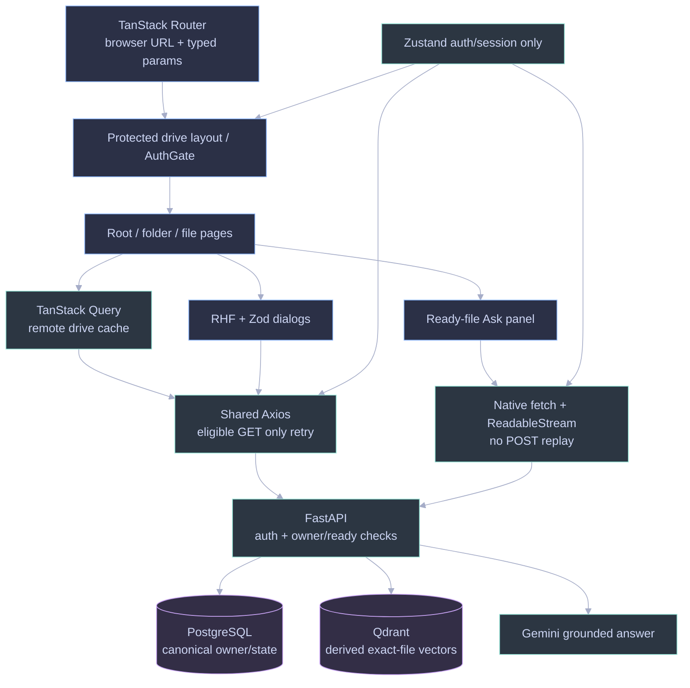
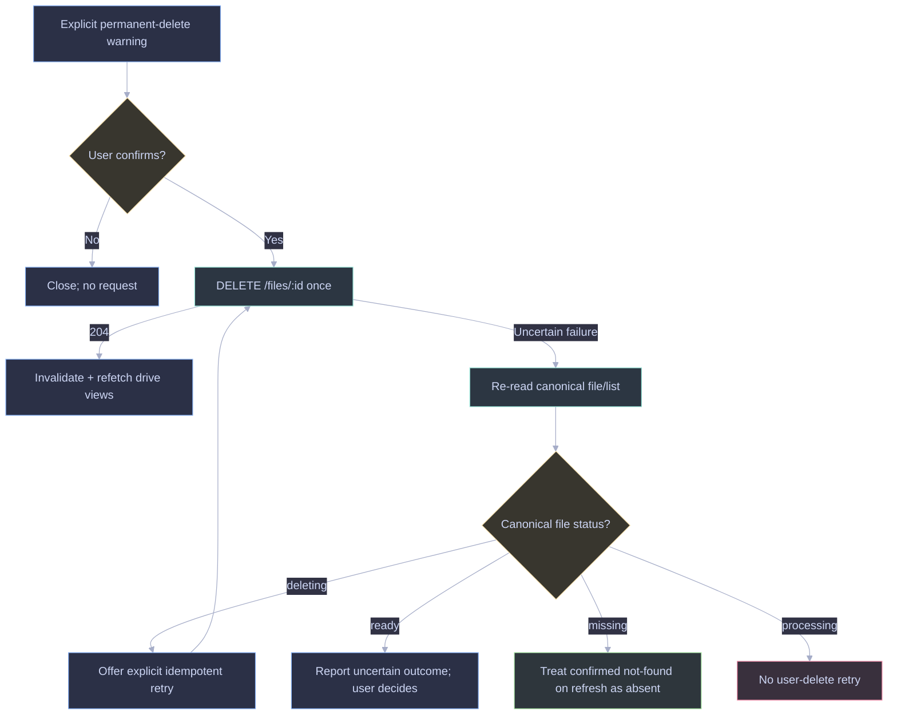
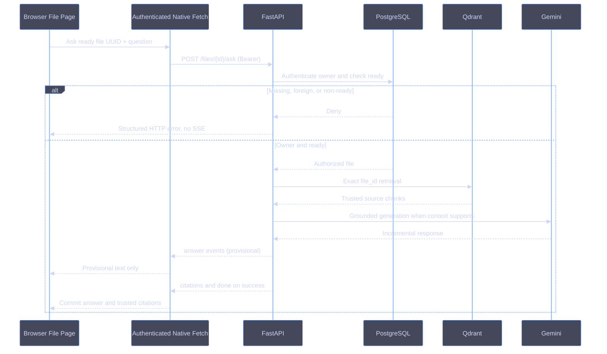

# PHASE_02_PLAN_04 — Drive Dashboard & Phase Acceptance (Specification)

- **Document role:** Define the PLAN_04 destination, approved Vite/TanStack Router migration, existing and approved backend contracts, client drive/RAG workflows, scope, risks, objective acceptance, and PHASE_02 closure. Implementation chronology belongs in focused Amendments and executed CONTEXT/MANUAL records.
- **PHASE:** `PHASE_02 — Authenticated Personal Drive` — independently `IMPLEMENTED & VERIFIED`; all fifteen PHASE criteria have final evidence in CONTEXT.
- **PLAN:** `PHASE_02_PLAN_04` — `IMPLEMENTED & VERIFIED`; Amendments 01–05 retain their historical scoped evidence. Amendment 06 completed separately approved fresh packaged deployment and final production-SPA/two-owner/datastore acceptance with exact cleanup. The user accepted the historical cache-loss exception; final generation was deterministic, with no fresh Gemini call.
- **Planned branch convention:** `phase-02/plan-04`; inspect the actual repository branch/worktree before any implementation. Do not create, switch, commit, or push automatically.
- **Verified prerequisites:** `PHASE_02_PLAN_01` (identity/auth), `PHASE_02_PLAN_02` (owner-scoped drive and file RAG backend), and `PHASE_02_PLAN_03` (Next.js browser authentication) — all recorded `IMPLEMENTED & VERIFIED`.
- **Primary subsystem:** Controlled Next.js-to-Vite browser migration, TanStack Router drive routes, folder/file UI, authenticated selected-file RAG, backend folder/file contract consolidation, and final integrated PHASE acceptance.
- **Approved architectural supersession:** Replace the **frontend** Next.js App Router/static export with React + Vite + TanStack Router file-based SPA. Preserve Bun, strict TypeScript, authentication/session contracts, browser-direct FastAPI, PostgreSQL, Qdrant, and native POST-SSE.
- **Execution evidence:** `PHASE_02_PLAN_04_CONTEXT.md` — Codex-owned chronological record, **not pre-populated with hypothetical results**.
- **Reproducibility:** `PHASE_02_PLAN_04_MANUAL.md` — Codex-owned tested procedures, not hypothetical acceptance claims.
- **Reference contracts:** [PHASE_02 overview](../PHASE_02.md) · [PLAN_01](../PLAN_01/PHASE_02_PLAN_01.md) · [PLAN_02](../PLAN_02/PHASE_02_PLAN_02.md) · [PLAN_03](../PLAN_03/PHASE_02_PLAN_03.md) · [root AGENTS](../../../AGENTS.md) · [client AGENTS](../../../client/AGENTS.md) · [server AGENTS](../../../server/AGENTS.md) · [RAG skill](../../../.agents/skills/rag/SKILL.md).

---

## 1. PLAN OBJECTIVE & COMPLETION BOUNDARY

**Objective:** Replace the verified, minimal Next.js authenticated entry with a behaviorally equivalent React/Vite/TanStack Router application; add a usable authenticated personal drive and single-file question-answering experience on dedicated client pages; and close PHASE_02 only after complete, real-boundary acceptance evidence.

At completion, Atlas must:

1. preserve the original Next.js client through migration acceptance (completed; subsequently retired with separate approval), scaffold a clean canonical `client/`, and reproduce PLAN_03 authentication, transport, persistence, and browser behavior before extending the application;
2. retain strict TypeScript, Bun, existing React/RHF/Zod/Tailwind/shadcn patterns, Axios, TanStack Query, Zustand-for-auth-only, and native streamed fetch;
3. support real browser-history URLs: `/drive` (root), `/drive/:id` (selected folder), `/drive/file/:id` (file details and Ask); retire `/dashboard`, and retain `/login`, `/register`, `/verify` and session-aware `/`;
4. consume existing owner-scoped direct-child `GET /folders` responses with lazy nested navigation, Root/Up controls, accurate selected-folder states, and no invented full-tree backend endpoint;
5. present create/edit folder dialogs and authenticated file upload/metadata edit/permanent delete dialogs using existing forms, canonical UUID identity and actual server contracts;
6. add and independently verify the approved authenticated `GET /files/{file_id}` metadata endpoint so a file URL can load directly without its parent location in the URL;
7. present canonical `processing`, `ready`, and `deleting` states, reconcile uncertain mutations safely, and expose retry only for existing supported retryable deletion;
8. use TanStack Query for remote drive/file data with in-memory freshness, account/session-safe lifecycle, approved simple folder keys, drive-scoped invalidation and active-view refetch after confirmed mutations, never hard browser refresh;
9. ask only an owned `ready` file through authenticated native `POST /files/{file_id}/ask`, showing provisional answer deltas and only completed, trusted backend citations;
10. preserve session restoration, cookie rotation, error distinctions, cross-account cleanup, safe request replay, abort and cancellation behavior; and
11. verify the complete static SPA/browser → FastAPI → PostgreSQL/Qdrant journey, two-owner isolation, exact cleanup, all PLAN_04 criteria and all fifteen PHASE_02 criteria, with truthful execution records.

**PLAN_04 completes the Phase 2 browser-drive integration; it does not implement multi-file, folder, tree, or drive-scoped RAG.** No additional dashboard feature is introduced. `/dashboard` is reserved for a future purpose and must not remain an active Phase 2 route or auth redirect destination.

```mermaid
%%{init: {'theme': 'base', 'themeVariables': {'background': '#1e1e2e', 'primaryColor': '#45475a', 'primaryTextColor': '#cdd6f4', 'primaryBorderColor': '#89b4fa', 'lineColor': '#a6adc8', 'secondaryColor': '#313244', 'tertiaryColor': '#181825', 'fontFamily': 'Inter, sans-serif'}}}%%
flowchart LR
    Legacy["Verified Next.js auth<br/>PLAN_03"] --> Migration["Verified Vite + TanStack Router<br/>auth-equivalent SPA"]
    Migration --> Drive["/drive<br/>root + folder browsing"]
    Drive --> Folders["Folder create/edit dialogs"]
    Drive --> Files["Verified file upload/edit/delete dialogs"]
    Files --> Detail["/drive/file/:id<br/>owner-scoped metadata"]
    Detail --> Ask["Ready-file Ask<br/>native SSE + citations"]
    Ask --> Accept["Full PHASE_02 acceptance<br/>15 criteria + preserved state"]
    class Legacy,Migration,Drive,Folders,Files verified;
    class Detail,Ask caution;
    class Accept caution;
    classDef client fill:#2b3046,stroke:#89b4fa,stroke-width:1px,color:#cdd6f4;
    classDef service fill:#2c3642,stroke:#94e2d5,stroke-width:1px,color:#cdd6f4;
    classDef storage fill:#332e46,stroke:#cba6f7,stroke-width:1px,color:#cdd6f4;
    classDef verified fill:#2e363c,stroke:#a6e3a1,stroke-width:1px,color:#cdd6f4;
    classDef planned fill:#30323f,stroke:#b4befe,stroke-width:1px,color:#cdd6f4;
    classDef caution fill:#38362e,stroke:#f9e2af,stroke-width:1px,color:#cdd6f4;
    classDef denied fill:#39303d,stroke:#f38ba8,stroke-width:1px,color:#cdd6f4;
```



---

## 2. VERIFIED PREREQUISITES & CURRENT BASELINE

| Area                          | Recorded status          | Evidence / PLAN_04 implication                                                                                                                                                                                                                                                       |
| ----------------------------- | ------------------------ | ------------------------------------------------------------------------------------------------------------------------------------------------------------------------------------------------------------------------------------------------------------------------------------ |
| PHASE_01 single-file RAG      | `IMPLEMENTED & VERIFIED` | Existing Docling/BGE-M3 pipeline, native SSE framing, provisional answer, trusted citations and pure parser tests are reusable; removed unauthenticated upload is not.                                                                                                               |
| PLAN_01 identity and sessions | `IMPLEMENTED & VERIFIED` | PostgreSQL identity/sessions, JWT, rotating HttpOnly refresh cookie, register/verify/resend/login/refresh/logout, Bearer `GET /auth`, credentialed CORS.                                                                                                                             |
| PLAN_02 authenticated backend | `IMPLEMENTED & VERIFIED` | Canonical folder/file UUIDs and ownership, direct children, `POST /files`, metadata/delete, owner/ready file query/ask, Qdrant exact-file scope. Historical baseline; Amendment 02 file GET and public-route supersession passed approved Stage 02.                                  |
| PLAN_03 browser auth          | `IMPLEMENTED & VERIFIED` | Verified Next.js static-export client, one Zustand auth authority, encrypted JWT recovery, safe Axios/native fetch, auth routes, guarded minimal `/dashboard`; final recorded 20/20 criteria and real Chromium/FastAPI acceptance.                                                   |
| PLAN_04 Vite migration        | `IMPLEMENTED & VERIFIED` | Amendment 01 completed migration/auth-equivalence acceptance; separately approved legacy retirement is complete.                                                                                                                                                                     |
| PLAN_04 file metadata GET     | `IMPLEMENTED & VERIFIED` | Amendment 02 implements this API and folder/query supersession; approved matching-source native HTTP/PostgreSQL/Qdrant acceptance and exact preservation passed. Amendment 04 explicit reconciliation consumes file GET; selected-file page consumes it under verified Amendment 05. |
| PLAN_04 folder workspace      | `IMPLEMENTED & VERIFIED` | Amendment 03 passed approved production-SPA/current-source API/two-owner acceptance and exact fixture/resource preservation.                                                                                                                                                         |
| PLAN_04 file lifecycle UI     | `IMPLEMENTED & VERIFIED` | Amendment 04 root/nested upload/edit/delete and explicit reconciliation passed approved production-SPA/packaged-API/two-owner acceptance and exact cleanup.                                                                                                                          |
| PLAN_04 file detail/Ask UI    | `IMPLEMENTED & VERIFIED` | Amendment 05 passed approved production-SPA/current-source native API/two-owner acceptance, deterministic generation and exact preservation.                                                                                                                                         |

### Implementation authority and evidence discipline

- Treat verified PLAN_01/02/03 CONTEXT/MANUAL as **recorded prerequisite evidence**, not fresh test results. PLAN_03's final Stage 02 ledger records 20/20 acceptance, 246 client tests, browser/live checks and pre/post preservation; these counts are historical, not numerical targets for Vite.
- Preserve PLAN_03 Amendment 02's final auth architecture; the earlier grouped auth controller/`useSession` design from Amendment 01 was **SUPERSEDED**. In particular retain `credential_action` error origin, per-endpoint operation-prefixed hooks and QueryProvider-owned startup.
- At execution time the live repository, actual tests/runtime, authoritative documentation and current approved AGENTS/PHASE supersede uploaded planning snapshots. Inspect only relevant files, not the entire tree.
- The replacement `client/` is verified by Amendment 01. Metadata GET and folder/query consolidation are verified under Amendment 02 after approved Stage 02; `/dashboard` is historical and retired. File lifecycle is verified after Amendment 04 Stage 02; file detail/Ask is verified under Amendment 05 scoped Stage 02 acceptance.
- Before writing any new implementation, inspect actual branch/worktree, dependencies, source locations and test coverage. No permission to switch branches, commit/push, discard work, mutate Docker state, or call paid providers is implied by this PLAN.

---

## 3. SCOPE & EXCLUSIONS

### In scope

| Domain                    | Required capability                                                                                                                                                                                                     |
| ------------------------- | ----------------------------------------------------------------------------------------------------------------------------------------------------------------------------------------------------------------------- |
| Frontend migration        | Preserve `client/` as `client-legacy/` safely; clean React/Vite/TanStack Router scaffold; selectively migrate auth, HTTP, stream/citation utilities and needed tests; establish behaviorally equivalent production SPA. |
| Routing                   | `/`, `/register`, `/verify`, `/login`, `/drive`, `/drive/:id`, `/drive/file/:id`; retire `/dashboard`; typed UUID params and reload/history/fallback behavior.                                                          |
| Auth and transport        | Preserve one Zustand auth store; existing encrypted persistence, cookie rotation, startup, guarded routes, safe GET replay and native SSE no-replay.                                                                    |
| Drive browser             | Root and selected folder direct children, lazy traversal, Root and Up controls, loading/empty/error states, UUID-based navigation.                                                                                      |
| Folder UI                 | Create in root/current folder; edit name/description; dialog validation, pending/error handling and drive-cache invalidation.                                                                                           |
| File lifecycle UI         | Authenticated multipart upload; metadata-only edit; display statuses; permanent delete confirmation, reconciliation and supported retry.                                                                                |
| Backend API consolidation | Folder root/selected GETs, owner-scoped file GET with existing DTOs, complete retirement of backend `/drive` and public `/query`; no schema/index change.                                                               |
| File RAG UI               | File detail page, name/description/status, ready-gated question input, progressively streamed clean text, valid terminal completion and trusted citations.                                                              |
| State/privacy             | TanStack Query in-memory drive data, 60-second initial freshness, drive-scoped invalidation/refetch, account/session-safe cache and stream lifecycle.                                                                   |
| Evidence                  | Focused tests, full appropriate regression, built SPA with real history-fallback host, approved browser/backend/data-store/provider acceptance and complete PHASE closure.                                              |

### Explicit exclusions

- Folder deletion, movement, reparenting, bulk operations, tree-fetch API, server-side breadcrumbs/ancestor endpoint, or full-tree drive indexing.
- File movement, versions, trash/recovery, download, preview, persistent original bytes, replacement/reprocessing, deduplication, or content-based drive search.
- Sharing, teams, ACLs, OAuth, email delivery, password-reset flows, and additional identity flows not specified in Phase 2.
- Folder/subtree/drive/multi-file RAG, sparse/hybrid retrieval, reranking, new embedding space, new provider abstraction, or citation/provenance redesign.
- New PostgreSQL tables/migrations, background workers, Redis/cache service, object storage, queue, client Docker service, full-stack runtime, Next.js BFF, TanStack Start, SSR/server functions, or a custom history router.
- A second global application-data store, persisted drive cache, router-loader copy of canonical drive data, speculative query prefetch system, or new client state/network/form/testing library unless approved separately.
- Reintroducing removed `POST /documents/upload`, mounting the legacy `RagWorkspace` as-is, or migrating obsolete Next.js build/runtime code into the new app.
- A user-facing Ask cancel button, stream reconnect/retry, or provider calls from deterministic unit tests. Internal request abort ownership remains mandatory.
- Unrelated styling overhaul, new custom UI design system, advanced search/filter/sorting API, pagination contract or a new `/dashboard` product.

---

## 4. CLIENT ARCHITECTURE & OWNERSHIP

**Amendment 03 current state:** Folder browsing/forms use existing QueryProvider, shared Axios and installed Base UI primitives; no dependency, server, deployment or persistence boundary changed. The folder workspace is `IMPLEMENTED & VERIFIED` after approved production-SPA/two-owner Stage 02 acceptance and exact preservation; see CONTEXT/MANUAL for executed evidence.

**Amendment 04 current state:** Existing root/nested workspace now composes file upload/edit/delete dialogs and operation-prefixed hooks using the same QueryProvider/auth lease, Axios, RHF/Zod and Base UI primitives. File lifecycle is `IMPLEMENTED & VERIFIED` after explicitly approved Stage 02; no new page, dependency, HTTP client, file-list cache or backend source change. The separately requested API image rebuild and cached-runtime deviation are recorded in CONTEXT.

### Runtime and deployment boundary

- **Amendment 06 deployment source:** root `compose.yml` defines `name: atlas`, the same three backend services and build context `./server`. Invoke from root with `--env-file server/.env -f compose.yml`; Dockerfile, `.dockerignore` and private configuration remain server-local. Approved Stage 02A established project-name availability, a fresh image, existing migration head and packaged readiness. Separately approved Stage 02B final acceptance passed; the historical cache-loss exception was explicitly accepted. Actual comparisons, limits and independent closure ledgers are in CONTEXT/MANUAL.

- **Approved target:** React + Vite static SPA, TanStack Router with Vite file-based route generation, strict TypeScript (`strict: true`, `allowJs: false`), Bun-only dependencies/scripts and `bun.lock`; Tailwind/shadcn, React Hook Form/Zod, TanStack Query v5, Axios, Zustand auth, and native fetch/ReadableStream.
- Vite production `dist/` is served by an ordinary static host supporting browser-history fallback. Deep links to `/drive/<uuid>` and `/drive/file/<uuid>` must load the SPA entry document; missing assets must still return a missing-asset response, and FastAPI traffic must remain direct browser-to-backend rather than passing through the host as a new BFF/proxy.
- `VITE_ATLAS_API_BASE_URL` replaces `NEXT_PUBLIC_ATLAS_API_BASE_URL` in the new browser build. It is public/build-time, strictly validated, and never carries secrets; changing it in a deployed artifact requires rebuild. Prefer local port 3000 with strict port selection, subject to actual FastAPI origin/CORS configuration.
- Use TanStack Router (not React Router and not TanStack Start). Keep route definitions thin and type-safe; validate folder/file UUID parameters at the client boundary before sending them, while letting FastAPI decide ownership.
- Preserve the existing style, aliases, readable TypeScript conventions, query-provider lifecycle and error boundaries. The generated route tree is a generated, version-controlled artifact: never hand-edit; exclude generated content from handwritten formatting/lint rewrites.

### Responsibility map

| Layer                                                      | Ownership / rule                                                                                                                                                      |
| ---------------------------------------------------------- | --------------------------------------------------------------------------------------------------------------------------------------------------------------------- |
| Router and route files                                     | URL matching, typed params/navigation, protected layout, route-local composition; **not** a second store for drive responses or auth tokens.                          |
| Auth gate + QueryProvider                                  | Existing sole browser auth-bootstrap owner; block protected data fetching while `restoring` or uncertain `error`; hand off anonymous credential-action errors safely. |
| `stores/auth.ts`                                           | One Zustand authority for access JWT/user/session status and existing session/version safeguards; **no folders, files or ask data**.                                  |
| `services/auth/*`                                          | Non-React login/refresh/logout/restoration ordering; AES-256-GCM persistence in `localStorage` and IndexedDB non-extractable key; preserve verified implementation.   |
| `services/http/*`                                          | Existing authenticated Axios and native fetch wrappers, auth classification and bounded replay rules; no feature transport logic embedded in UI.                      |
| `schemas/*`                                                | Zod validation of existing FastAPI DTOs and user form input; infer types, keep network payloads untrusted until checked.                                              |
| `hooks/drive`, `hooks/folder`, `hooks/file`                | Domain-scoped remote queries, mutation lifecycle, invalidation/refetch, status/error exposure; follow established operation-prefixed hook returns.                    |
| `components/Drive`, `components/Folder`, `components/File` | Listings, actions, dialogs and local interaction state; minimal shadcn/RHF/Zod UI.                                                                                    |
| `hooks/ask` and stream utilities                           | Native POST-SSE request, abort, framing, event validation, provisional text, committed citations and failure handling.                                                |
| FastAPI/PostgreSQL                                         | Canonical user/folder/file ownership, status and lifecycle, privacy-safe errors; browser cannot authorize itself.                                                     |
| Qdrant/LLM                                                 | Derived exact-file retrieval and grounded generation after server owner/ready gate; never browser-accessed directly.                                                  |

The exact source filenames beyond established contracts are **illustrative** and must be discovered from existing patterns before Codex creates them. Do not create speculative directories merely to mirror this table.



---

## 5. FRONTEND MIGRATION & ROUTING CONTRACT

### Migration checkpoints — one cohesive capability

**Completed migration note:** Amendment 01 checkpoints below describe accepted historical work; the user separately approved legacy retirement afterward. Do not repeat the rename or recreate the retired directory.

The approved `client/` → `client-legacy/` strategy is a **controlled cutover**, not permission for a broad rewrite. Keep this as one substantial frontend migration capability with explicit internal acceptance checkpoints:

| Checkpoint                             | Required destination / verification                                                                                                                                                                                                                                                                                                                                                         |
| -------------------------------------- | ------------------------------------------------------------------------------------------------------------------------------------------------------------------------------------------------------------------------------------------------------------------------------------------------------------------------------------------------------------------------------------------- |
| **0 — Legacy baseline**                | Inspect branch, tracked/untracked/ignored material, dependencies, current tests/routes/aliases and current runtime. Record feasible legacy frozen install, formatting, lint, strict typecheck, unit tests and build, plus relevant PLAN_03 browser acceptance. Document blocked checks; do not overwrite user work.                                                                         |
| **1 — Safe rename and scaffold**       | Ensure `client-legacy/` is absent or halt for review; preserve original `client/` under that name without discard, commit, or branch change. Scaffold a clean Bun-managed Vite React strict-TypeScript `client/`, only approved compatible deps, proper scripts, aliases, Tailwind/shadcn and TanStack Router Vite plugin before the React plugin; ensure generated tree and initial build. |
| **2 — Selective foundation migration** | Carry forward needed auth Zod DTOs/hooks, Zustand selectors, lifecycle, AES-GCM/IndexedDB, Axios/fetch, QueryProvider, SSE framing/citations and focused tests; adapt Next-specific imports. No legacy upload, Next configuration, secrets, generated builds or wholesale unused components.                                                                                                |
| **3 — Route composition**              | Restore login/register/verify and guarded session-aware `/`, create minimal protected `/drive`, remove active `/dashboard` route/redirects. Verify `credential_action` handoff, `restoring/error` gates, refresh concurrency, logout/uncertainty and route navigation; defer folder/file CRUD.                                                                                              |
| **4 — Equivalence acceptance**         | Fresh Bun frozen install, format-check/lint/typecheck/tests/Vite build, auth/browser/CORS/real-FastAPI acceptance and production-SPA history fallback under separately authorized Stage 02; compare real-store/resources before/after if fixtures are touched. Keep `client-legacy/` preserved for review.                                                                                  |

No migration checkpoint implies that a capability is verified without executed checks. A legacy behavior with no transferable automated test requires a proportionate new test, not a declaration of parity based on copied code. Preserve legacy auth encryption format/session semantics and singleflight's documented **single-JavaScript-context** limit.

### Approved route inventory

**Amendment 06 directory organization:** `drive/route.tsx` is an Outlet-only parent; `drive/index.tsx`, `drive/$id.tsx` and `drive/file/$id.tsx` compose the existing root/folder/file panels. Generated IDs are `/drive/`, `/drive/$id` and `/drive/file/$id`; the canonical root navigation target remains `/drive`. No shared parent fetch/auth/cache owner is added. This refactor is `IMPLEMENTED & VERIFIED` after approved Amendment 06 final static-SPA/packaged acceptance. Amendments 03/05 verified the earlier flat organization; their evidence remains historical.

| Browser path      | Page purpose / behavior                                                                                                                                                 |
| ----------------- | ----------------------------------------------------------------------------------------------------------------------------------------------------------------------- |
| `/`               | Session-aware entry: authenticated goes to `/drive`; unauthenticated to `/login`; uncertain `restoring/error` has explicit loading/recovery rather than redirect loops. |
| `/register`       | Existing register UX and verification transition.                                                                                                                       |
| `/verify`         | Existing six-character OTP, resend and safe credential-action handoff.                                                                                                  |
| `/login`          | Existing login UX and verified-session adoption.                                                                                                                        |
| `/drive`          | Protected drive root, `GET /folders`, direct children and root-level operations.                                                                                        |
| `/drive/:id`      | Protected selected folder, `GET /folders/{folder_id}`, direct children, Root/Up and folder-level operations.                                                            |
| `/drive/file/:id` | Protected metadata page, `GET /files/{file_id}`, canonical status and ready-gated Ask; back link derived from returned `folder_id`.                                     |
| `/dashboard`      | Retired: no active feature route or authenticated redirect; reserved for future reuse. Unknown/deprecated paths use the application's ordinary not-found behavior.      |

An illustrative TanStack Router file-based mapping (confirm installed-plugin conventions during scaffolding):

```text
src/routes/
├── __root.tsx
├── index.tsx
├── login.tsx
├── register.tsx
├── verify.tsx
└── drive/
    ├── route.tsx
    ├── index.tsx
    ├── $id.tsx
    └── file/
        └── $id.tsx
```

- Static hosting must return the SPA entry document for **client navigation paths** on direct requests, without turning missing scripts/assets or FastAPI 404s into HTML success.
- Param shape validation precedes HTTP; malformed IDs render non-sensitive route errors. Foreign/missing valid IDs converge on server 404, not a foreign-existence disclosure.
- `GET /folders/{folder_id}` returns `folder.parent_id` for the selected folder; **Root** always navigates `/drive`, **Up** uses that parent ID or Root. No full ancestor query or name-based breadcrumb reconstruction. Browser back/forward uses TanStack Router history.
- Folder and file routes must work after a fresh reload with only their URL UUID; they cannot depend on in-memory selection from a prior listing.
- On logout, terminal unauthenticated state or account switch, protected content and pending private streams/queries are withheld or cleared through the existing session boundary.

### Migration safety and repository layout

**Current-state supersession:** Amendment 01 passed acceptance; the user separately approved retirement of `client-legacy/`, which is absent. The rename/checkpoint instructions above describe the completed migration, not work to repeat. The active layout is:

```text
atlas/
├── AGENTS.md
├── client/                         # New, canonical Vite SPA (after migration)
│   ├── AGENTS.md
│   ├── src/
│   ├── package.json
│   ├── bun.lock
│   └── vite.config.ts
├── server/
└── prompts/PHASE_02/PLAN_04/
```

- Inspect ignored/untracked files, symlinks and pre-existing destinations before rename. Do not overwrite `client-legacy/`, delete secrets/user data, clean `node_modules` destructively, or copy legacy private env/config values into tracked files.
- Preserve the old `client-legacy/AGENTS.md` as a legacy instruction snapshot. New `client/AGENTS.md` defines the approved Vite destination. Any related root/PHASE engineering-document edits remain explicit, reviewable, status-accurate work rather than implied implementation.
- Legacy retention through review/acceptance is complete; separate retirement approval was granted and executed. Do not recreate `client-legacy/` or operate two production frontends.
- No Git branch creation/switch, staging, commit, push, reset, history rewrite, or unrelated worktree edits without authorization.

---

## 6. BACKEND DRIVE CONTRACTS & FILE-DETAIL EXTENSION

All drive endpoints require the existing Bearer authentication and server-derived current user. Ordinary browser HTTP uses the shared authenticated Axios service; no browser-provided `owner_id`/`user_id`. The server remains source of truth for canonical state and authorization.

**Amendment 04 consumption:** Multipart root upload omits `folder_id`; nested upload sends the validated current UUID once. Editable `name` is separate from immutable source `original_name`; PATCH sends changed name/description only, with cleared description `null`. Validated ready `201`/`200` and delete `204` alone confirm writes. Existing metadata GET is used only for explicit reconciliation; backend ownership/status rules are unchanged.

### Current public contracts — Amendment 02 supersession

**Explicit supersession:** PLAN_04 Amendment 02 replaces historical `GET /drive` root/query modes with the two folder GETs and completely removes public `POST /files/{file_id}/query`. No aliases, redirects or deprecation routes remain. Historical PLAN_02 verification is unchanged. Amendment 02 is `IMPLEMENTED & VERIFIED` after separately approved Stage 02 acceptance recorded in CONTEXT. Browser `/drive` routes remain unchanged.

Both folder GETs reject **all** query parameters, including `folder_id`, `owner_id`, `user_id` and unknown keys, with sanitized `422 UNPROCESSABLE_ENTITY`. The logical root is not a persisted folder row.

**Approved naming follow-up:** `pipeline/folders.py` owns folder orchestration; shared `ValidationRoute` lives in `routers/validation.py`. Endpoint DTOs live under `schemas/folders/` and `schemas/files/`. `FolderListingResponse` names the existing composite listing shape in OpenAPI. Shared validation now says `Invalid request input`; status 422 and code `UNPROCESSABLE_ENTITY` remain unchanged. Historical migration identifiers and browser `/drive` paths are preserved.

**Approved router consolidation:** all five `/files` handlers live in `routers/files.py`, registered once by `main.py`; upload and metadata route-class overrides preserve their earlier validation/authentication behavior, and Ask retains its existing dependency/SSE path. Pipeline ownership and public contracts are unchanged.

The complete API has 18 application operations: system 2, auth 7, folders 4, files 5. The 15 non-retired operations preserve their contracts; generated documentation facilities are excluded.

| Capability         | HTTP contract                | Success and semantics                                                                                                         |
| ------------------ | ---------------------------- | ----------------------------------------------------------------------------------------------------------------------------- |
| Root listing       | `GET /folders`               | `200` `{folder:null, folders:Folder[], files:File[]}`; direct children only.                                                  |
| Folder listing     | `GET /folders/{folder_id}`   | `200` `{folder:Folder, folders:Folder[], files:File[]}`; selected owner folder; direct children only.                         |
| Folder creation    | `POST /folders`              | `201` Folder DTO; `name`, optional `description`, optional nullable `parent_id`; duplicates allowed.                          |
| Folder metadata    | `PATCH /folders/{folder_id}` | `200` Folder DTO; editable name/description only, no parent change.                                                           |
| File detail        | `GET /files/{file_id}`       | `200` existing ten-field File DTO for the owner in any lifecycle state; read-only, no Qdrant/provider work.                   |
| Canonical upload   | `POST /files`                | Multipart `file`, `name`, optional `description`, optional `folder_id`; `201` ready File DTO only after successful ingestion. |
| File metadata      | `PATCH /files/{file_id}`     | `200` File DTO; name/description only; no content replacement/reindex.                                                        |
| Permanent deletion | `DELETE /files/{file_id}`    | `204` empty body only after exact Qdrant point cleanup and PostgreSQL file-row deletion.                                      |
| File Ask           | `POST /files/{file_id}/ask`  | Existing owner/ready-gated native SSE answer/citations/done semantics.                                                        |

### Approved **new** endpoint: `GET /files/{file_id}`

**State:** `IMPLEMENTED & VERIFIED` under Amendment 02; local and approved matching-source native HTTP/PostgreSQL/Qdrant evidence is in CONTEXT. Folder reads and public-query retirement are the other approved contract changes. Amendment 02 did not rebuild the then-retained older API image. Amendment 04 subsequently packaged current source using retained runtime/models after a canonical model-download timeout; its recorded deviation remains applicable.

```text
GET /files/{file_id}
Authorization: Bearer <access JWT>
```

- Resolve the UUID and authenticated owner in **PostgreSQL** using existing repository/service patterns. Return HTTP `200` with the **existing public File DTO**, no additional fields or owner identity.
- Return `404 FILE_NOT_FOUND` for missing and foreign file IDs identically. Malformed path IDs follow established FastAPI/Pydantic validation/error behavior; do not reveal existence from parsing or distinguish foreign resources.
- Permit metadata read for owned `processing`, `ready` and `deleting` files. **`ready` is required for `/ask`, not for metadata read.**
- Do not add a schema migration, file index, Qdrant call, embedding, storage of original bytes, provider call, new permission model, or changes to existing upload/mutation routes.
- Reuse current error serializer `{ "error": "...", "code": "..." }`, established auth dependency and existing File DTO mapping/validation. No new React or browser-specific backend responsibilities.
- Verify exact owned/foreign/missing/status/error/unauthenticated behavior with deterministic tests and, after authorization, real HTTP/PostgreSQL; assert this path never calls Qdrant/LLM.

### Canonical response shapes

```json
{
  "folder": {
    "id": "<uuid>",
    "name": "Architecture",
    "description": "Architecture notes",
    "parent_id": "<uuid-or-null>",
    "created_at": "<timestamp>",
    "updated_at": "<timestamp>"
  },
  "folders": [],
  "files": []
}
```

At root, `folder` is `null`. Each File DTO, including the new GET response, contains exactly the existing public fields:

```json
{
  "id": "<uuid>",
  "name": "Atlas Architecture",
  "description": "Backend and RAG architecture",
  "original_name": "architecture.pdf",
  "extension": ".pdf",
  "size_bytes": 284319,
  "status": "ready",
  "folder_id": "<uuid-or-null>",
  "created_at": "<timestamp>",
  "updated_at": "<timestamp>"
}
```

The response has no client-authoritative owner field, no persistent original-blob pointer and no Qdrant point IDs. UUID identity, not display names, governs every action. The server allows duplicate folder/file display names and folder/file name collisions.

### Validation, error and state rules

- Reuse actual FastAPI/Pydantic constraints. Existing file name: trimmed, 1–100 Python characters, restricted approved Unicode/punctuation set; optional description normalized to nullable at most 250 characters. Folder validation follows its separately verified server rules; do not assume file and folder validators are identical without checking targeted source.
- Validate with Zod at the corresponding browser input and HTTP response boundaries. Do not invent new public DTO properties or reinterpret blank/omitted/null PATCH semantics. In particular inspect server PATCH update behavior before choosing client payload shape.
- Stable privacy codes: `404 FOLDER_NOT_FOUND`, `404 FILE_NOT_FOUND`; only after file ownership is established may non-ready `/ask` return `409 FILE_NOT_READY`. A 404 on a resource must not expose a foreign owner's existence.
- File states are **exactly** `processing`, `ready`, `deleting`. There is no durable `failed` file status; an interrupted known ingestion failure may leave a non-ready recovery marker and no background worker repairs it automatically.
- `processing` is not ready for Ask or user deletion; `ready` may be asked or deleted; `deleting` is non-queryable and may be retried idempotently with existing DELETE semantics.
- Known ingestion failures normally compensate exact-file Qdrant writes and remove the canonical processing row; partial cleanup failure or process crash can leave a non-ready row and must not be disguised as durable success.

---

## 7. DRIVE NAVIGATION, REMOTE STATE & CACHE CONTRACT

### Folder browsing and navigation

1. AuthGate confirms a validated authenticated session; only then can folder/file data queries become active.
2. Root loads `GET /folders`; folder path UUID loads `GET /folders/{folder_id}`; parse and runtime-validate `folder`, `folders` and `files` before publication.
3. Present only the returned location's immediate folders/files; clicking a folder navigates to its UUID route, triggering the corresponding direct-child query.
4. Show selected location name/description, Root and Up (using the selected `folder.parent_id`), and distinct loading, empty, recoverable error, and privacy-safe not-found states. No recursive eager fetch.
5. Navigate to a file UUID page only by its canonical ID; that page independently calls the new owner-scoped metadata GET and does not rely on the source folder list still being cached.
6. Folder create/edit and file operations invalidate drive queries and refresh the currently mounted location without a document reload. A folder rename must refresh the active folder title as well as its parent listing when cached.

### Query and state ownership

**Amendment 04 current state:** File rows stay inside the existing folder-list cache. Confirmed writes invalidate `['drive']` with active refetch; uncertain writes invalidate with `refetchType: 'none'` and block the dialog until explicit canonical refresh. A route-owned request lifetime combines existing user/session checks, auth-boundary abort and unmount retirement; stale completion cannot invalidate a replacement account's same-key cache. Approved Stage 02 verified actual DOM unmount/focus, same-key account isolation and live persistence.

| State                                                    | Owner / policy                                                                                   |
| -------------------------------------------------------- | ------------------------------------------------------------------------------------------------ |
| Authenticated user/access JWT/status/version             | Existing Zustand auth store; **no drive state**.                                                 |
| Current folder/file UUID                                 | TanStack Router pathname/typed params.                                                           |
| Root/selected folder direct-child data                   | TanStack Query + authenticated Axios.                                                            |
| File metadata on the file page                           | TanStack Query + authenticated `GET /files/{id}`.                                                |
| Create/edit/delete pending state and dialog field values | Owning hook/component with RHF/Zod; no global modal store.                                       |
| Stream/session provisional answer/citations              | Existing selected-file ask hook and component-local state; never cached as canonical drive data. |
| Canonical folder/file ownership/status                   | PostgreSQL through the verified FastAPI contract.                                                |

- **Folder query-key supersession — Amendment 03:** use EXACTLY `['drive', 'folder', 'root']` and `['drive', 'folder', folderUUID]`; owner/session-in-key guidance is SUPERSEDED FOR FOLDER QUERY KEYS. The privacy invariant remains LOCKED: usable auth gating, existing QueryProvider cancellation/cache retirement and lease/user/abort checks MUST reject previous-session results. Future file-key decisions are unchanged.
- Keep remote drive data in TanStack Query, not a duplicate router loader cache or Zustand. The router owns navigation; optional loader prefetch is not needed for Phase 2.
- Initial `staleTime` target: **60 seconds**, in-memory. Navigating to a recently loaded location may reuse fresh data; a full browser document reload rebuilds cache and requires auth revalidation and a fresh authorized API fetch. No persisted drive cache.
- **Confirmed mutation:** invalidate **all drive-related** query keys (root, folders, file details where relevant), then refetch mounted active queries; leave unrelated auth queries untouched. Inactive invalidated locations refetch when revisited. Do not hard-refresh/recreate the SPA or use global QueryClient clearing for ordinary mutations.
- **Account boundary:** cancel/retire in-flight private queries and streams, clear private cache through existing session cleanup, suppress late responses from a prior account/session, and never show cached private content before current-session validation. `queryClient.clear()` may be appropriate for the existing explicit account-boundary cleanup, not for routine drive mutations.
- Prefer server-confirmed reconciliation over optimistic folder/file writes; do not fabricate canonical UUIDs/statuses or assume a failed response means the server operation never happened.

### Request, mutation and error policy

| Situation                               | Browser behavior                                                                                                                                                                           |
| --------------------------------------- | ------------------------------------------------------------------------------------------------------------------------------------------------------------------------------------------ |
| Normal authenticated listing/detail GET | Use shared Axios; `isProtected` Bearer policy, single-flight refresh and at most one replay of eligible bodyless GET on exact `401 INVALID_ACCESS_TOKEN`.                                  |
| Create/update/upload/delete             | Submit exactly once per user action; disable duplicate submit; never replay on expired token/transport failure. Preserve form/error context and offer fresh canonical read/reconciliation. |
| Confirmed mutation success              | Close modal, invalidate drive namespace, refetch active location/detail without browser reload.                                                                                            |
| Invalid UUID                            | Render safe local error or 404 page without sending malformed resource request.                                                                                                            |
| Missing/foreign folder/file             | Render equivalent non-disclosing not-found UX; never infer owner from client state.                                                                                                        |
| `FILE_NOT_READY` or status change       | Disable or stop Ask; show current status and refresh/reconcile file metadata.                                                                                                              |
| Network/5xx/CORS uncertainty            | Distinguish ambiguous operation outcome from definitive rejection; no silent retransmission.                                                                                               |
| Account switch/logout                   | Abort/retire pending private operations; clear user-visible private state and Query cache via existing auth boundary.                                                                      |

---

## 8. FOLDER & FILE CRUD USER EXPERIENCE

### Modal conventions

**Amendment 03 current state:** Minimal folder create/edit dialogs are implemented using installed Base UI and RHF/Zod, without new dependencies. Uncertain writes require explicit canonical refresh before resubmission; their drive queries are marked stale without automatic refetch/replay so revisiting cannot reuse presumed-fresh pre-write state. Approved Stage 02 verified actual form events, focus/keyboard behavior, history, two-owner isolation and exact preservation.

**Amendment 04 current state:** Upload accepts one nonempty supported source file, display name and optional description. Ready rows expose Edit/Delete; processing rows expose neither; deleting rows expose explicit Retry delete. Permanent confirmation, idle Cancel, pending dismissal guards and explicit reconciliation are implemented; deterministic/SSR checks and approved actual browser/ingestion/cleanup acceptance pass. A fresh 404 means currently unavailable and does not prove an earlier delete outcome.

- Use existing shadcn dialog/alert-dialog primitives and React Hook Form + Zod; explicit Cancel and task-appropriate submit buttons. Dialogs remain route-local or domain-component-local, with visible pending, validation, server and uncertainty feedback.
- A dialog Cancel before submission closes without mutation; while a request is in flight, do not promise cancellation/rollback of a server-side operation. Prevent duplicate submissions and handle dismissal deterministically.
- Use minimal functionality-first UI, not a visual redesign. Preserve keyboard/form accessibility and standard focus handling from the component primitives.

| Action         | Inputs / controls                                                                                         | Server call                                               | Post-success behavior                                                                    |
| -------------- | --------------------------------------------------------------------------------------------------------- | --------------------------------------------------------- | ---------------------------------------------------------------------------------------- |
| Create folder  | Name; optional description; Cancel/Create                                                                 | `POST /folders` with current folder UUID or `null` parent | Close, invalidate drive queries, refetch active folder/root.                             |
| Edit folder    | Existing name/description; Cancel/Save                                                                    | `PATCH /folders/{id}`                                     | Close, invalidate drive queries, refresh current folder/parent views. No move.           |
| Upload file    | Browser file, display name, optional description; Cancel/Upload                                           | Multipart `POST /files` with current folder UUID or root  | On `201`, use returned canonical ID/status, close, invalidate/refetch; no second upload. |
| Edit file      | Existing display name/description; Cancel/Save                                                            | `PATCH /files/{id}`                                       | Close, invalidate/refetch location and metadata views; never re-embed.                   |
| Delete file    | Explicit permanent warning; Cancel/Delete                                                                 | `DELETE /files/{id}`                                      | On `204`, close, invalidate/refetch; no undo/trash.                                      |
| Retry deleting | Present only for canonical `deleting` state after an interrupted delete; explicit user retry/confirmation | Existing idempotent `DELETE /files/{id}`                  | Reconcile exact status and list; no automatic background retry.                          |

### Upload lifecycle and failure fidelity

- The backend—not the UI—generates the UUID, creates the `processing` row, indexes by that same Qdrant `file_id`, commits `ready`, and returns `201` only on successful ingestion. Upload may take time; show pending rather than claiming ready before the response.
- Do not set multipart `Content-Type` boundary manually; the browser owns it. Do not force a repeated upload after token refresh, timeout, browser abort or uncertain response. Display that the canonical outcome may need inspection.
- Folder target is the current root/folder route, never a client-owned `owner_id`. Backend authorizes the parent. Duplicate names are valid, so a same-name row cannot identify an ambiguous upload reliably.
- Observed `processing` or `deleting` rows in a listing reflect actual concurrent/interrupted server work. Do not invent a persistent `failed` state or a worker-based progress percentage. Manual refresh and mutation-driven refetch suffice; no polling mandate.

### Permanent delete lifecycle



Do not claim `204` before the backend confirms exact-file Qdrant and PostgreSQL cleanup. The backend has **no distributed transaction and no background reconciliation worker**; a committed `deleting` marker is an accepted recovery state. The UI never deletes by filename, folder name, user-wide filter or guessed Qdrant point IDs.

---

## 9. SELECTED-FILE RAG & TRUSTED CITATIONS

### File detail page and readiness

- `/drive/file/:id` loads `GET /files/{file_id}` with current authenticated session. Present canonical name, optional description, source metadata/status as appropriate, and a link to `/drive` or `/drive/:id` from canonical `folder_id`.
- File metadata may be visible when `processing` or `deleting`, but Ask is disabled unless the server-returned status is `ready`. Treat `ready` UI gating as convenience only; the server independently authorizes ownership/readiness for Ask.
- The file page is independent of the previous folder page's cached list, supports direct/deep links, and does not display prior-account file data during restoration.

### POST-SSE workflow

1. Validate a nonblank question and any existing query parameter policy against the verified RAG contract. Use the canonical route UUID and the existing authenticated native fetch wrapper.
2. Call `POST /files/{file_id}/ask`; do not route it through Axios or EventSource, do not automatically retry/reconnect, and do not wrap the live stream in TanStack Query.
3. If FastAPI returns pre-stream JSON denial (`401`, `404 FILE_NOT_FOUND`, `409 FILE_NOT_READY`, or structured operational error), show a safe error and do not treat it as an SSE success.
4. Incrementally decode UTF-8 and parse logical SSE frames across arbitrary network chunks. Validate event payloads using existing Zod/protocol rules.
5. Render clean incremental answer text **provisionally**. Stage citations from backend-trusted provenance only and commit/display them after a valid successful terminal `done`/stream-completion condition.
6. On stream error, malformed event, unexpected EOF, abort, route change, file change, logout or account replacement, close/abort the request and prevent provisional output/citations from becoming a successful completed answer.
7. Preserve the existing exact insufficient-context fallback and no-citations rule. Do not fabricate citation page/heading/section metadata or show model-authored citation markers as trusted.



The backend retrieval policy, native Gemini SDK, Qdrant metadata, chunking, `top_k`, SSE framing, cleanup ownership and citation validation are **not redesigned** by this PLAN. Reuse Phase 1 ask/parsing/citation code selectively; do not migrate old `/documents/upload` dependencies.

---

## 10. SECURITY, FAILURE & RECOVERY CONTRACTS

### Preserved authentication boundary

- Browser `AuthGate` controls rendering/navigation only. FastAPI derives the current authenticated user and checks folder/file ownership; file-scoped RAG also requires PostgreSQL `status=ready` **before** embedding, Qdrant retrieval or generation.
- Preserve PLAN_03 states `restoring`, `authenticated`, `unauthenticated`, `error`; `credential_action` error origin supports safe verification/login handoff without granting protected access.
- Preserve encrypted JWT version-1 compatibility: active JWT in Zustand, AES-256-GCM ciphertext in `localStorage`, non-extractable key in IndexedDB, refresh token in HttpOnly cookie. Browser encryption is not an XSS protection/authorization guarantee.
- Preserve auth cookie `Path=/auth`, SameSite Lax, local-origin/CORS behavior, single-use rotation and accurate terminal versus uncertain results. Production HTTPS/cross-site cookie arrangements require their own verified deployment acceptance; local HTTP is not proof of them.
- Single-flight refresh is within one browser JS context, not independent tabs. A valid access token remains usable until natural expiry after refresh-session logout.

### Failure and privacy matrix

| Boundary                                                  | Expected failure handling                                                                                                                                               |
| --------------------------------------------------------- | ----------------------------------------------------------------------------------------------------------------------------------------------------------------------- |
| Initial session unresolved                                | Withhold private pages/data; never issue drive fetch from independently mounted route.                                                                                  |
| Valid JWT rejected as `INVALID_ACCESS_TOKEN`              | Shared one coordinated refresh; only eligible bodyless GET may replay once.                                                                                             |
| Auth mutation, file upload/PATCH/DELETE or POST-SSE error | No automatic replay, even after refresh; show definitive vs ambiguous outcome accurately.                                                                               |
| Browser/network/CORS/5xx uncertainty                      | Retryable explicit recovery; do not infer credential expiry, data deletion, ingestion failure, or session revocation.                                                   |
| Foreign/missing folder/file                               | Identical non-disclosing 404 handling; no owner, name, or status detail revealed.                                                                                       |
| Owned non-ready file Ask                                  | Server returns `409 FILE_NOT_READY` before embedding/retrieval/generation; UI refreshes detail when relevant.                                                           |
| Malformed SSE/missing terminal completion                 | Provisional/failed output only; no completed answer or trusted citation publication.                                                                                    |
| Logout/account switch during GET, mutation or stream      | Cancel/retire requests when possible, suppress stale responses, clear private query and Ask state; do not assume cancelling an HTTP request reversed a server mutation. |
| Missing static asset or unknown SPA route                 | Preserve correct host/router 404 behavior; deep-link fallback does not swallow asset/API failures.                                                                      |
| Failed cross-store delete                                 | Preserve canonical `deleting`; explicit idempotent retry, never broad Qdrant cleanup.                                                                                   |

### Session and cache separation

- On normal confirmed CRUD, invalidate **drive namespace** only and refetch mounted remote views; leave existing auth ownership intact.
- On logout, terminal session failure or account change, invoke existing private-cache cleanup; prevent late responses from reinstating foreign-account data. Use consistent generation checks at transport/query/ask publication boundaries where available.
- Browser selection, navigation URLs, encrypted local storage and cached owner IDs never authorize backend resources. A valid path is not proof of access.

---

## 11. IMPLEMENTATION SEQUENCE & VERIFICATION STRATEGY

**Current gate:** Amendments 01–04 are `IMPLEMENTED & VERIFIED`; Amendment 04 passed its separately approved browser/Docker/live datastore Stage 02 and exact cleanup. Amendment 05 selected-file detail/Ask is `IMPLEMENTED & VERIFIED`; its approved scoped Stage 02 acceptance passed. The user-requested router parameter is `$id`; browser URLs remain `/drive/file/<uuid>`. Amendment 06 approved Stage 02A and separately approved Stage 02B final packaged/static-browser acceptance passed. The historical cache-loss exception was explicitly accepted. Amendment 06, PLAN_04 and PHASE_02 are independently `IMPLEMENTED & VERIFIED`; full unchanged-criterion ledgers are in CONTEXT.

### Five cohesive capability workstreams

These five capability workstreams describe the PLAN destination, not assigned Amendment artifact IDs. **Amendment 05 supersession:** its implementation/acceptance is limited to file detail and selected-file Ask. The earlier assignment of final PLAN/PHASE closure to Amendment 05 is **SUPERSEDED**; comprehensive acceptance and the final crosswalk now belong to Amendment 06 under its separate approval gates. Existing destination criteria and the specification crosswalk remain binding, not newly executed evidence.

| Order | Capability / intended Amendment         | Dependencies                                                          | Completion boundary                                                                                                                                                                                                              |
| ----- | --------------------------------------- | --------------------------------------------------------------------- | -------------------------------------------------------------------------------------------------------------------------------------------------------------------------------------------------------------------------------- |
| **1** | **Vite + TanStack Router migration**    | Verified PLAN_03 legacy Next.js auth; approved frontend supersession  | All five migration checkpoints; equivalent auth/route behavior, strict build/tests and separately approved production-SPA browser/live acceptance; preserve legacy through acceptance (separately approved retirement complete). |
| **2** | **Backend API contract consolidation**  | Verified PLAN_02 File DTO and owner lookup                            | Both folder GETs, metadata file GET, public query/drive removal, exact 18-operation inventory, regression and separately approved real PostgreSQL/HTTP acceptance; preserve internal RAG.                                        |
| **3** | **Drive browser and folder management** | Verified migration, existing `GET /folders`, folder POST/PATCH        | Root/nested typed routes, Root/Up, create/edit dialogs, query-key isolation, drive refetch, browser/real backend folder acceptance.                                                                                              |
| **4** | **File lifecycle UI**                   | Verified migration/drive pages; canonical PLAN_02 upload/PATCH/DELETE | Authenticated multipart, edit/delete dialogs, accurate status/reconciliation, exact UUID, owner/failed-mutation/cleanup tests and approved real-store lifecycle.                                                                 |
| **5** | **File page and selected-file RAG**     | Verified GET file endpoint, drive/file UI, auth/stream foundations    | Dedicated file detail, native SSE, trusted citations and scoped account/route isolation acceptance. Comprehensive PLAN/PHASE acceptance belongs to Amendment 06 under separate approval gates.                                   |

**Server-first exception is scoped:** Workstream 1 is frontend-only and can precede the new API. Workstream 2 consolidates folder/file APIs and verifies `GET /files/{id}` **before** workstreams 3 and 5 consume the changed contracts. Workstream 4 relies on unchanged verified PLAN_02 mutations; no speculative backend design is delegated to Codex.

### Two-stage execution gate for each workstream

| Stage                                            | Authorized work / required evidence                                                                                                                                                                                                                                                                                                                                                       |
| ------------------------------------------------ | ----------------------------------------------------------------------------------------------------------------------------------------------------------------------------------------------------------------------------------------------------------------------------------------------------------------------------------------------------------------------------------------- |
| **Stage 01 — implementation + local checks**     | Inspect targeted AGENTS/PLAN/source/tests, implement approved capability, run focused and full proportionate deterministic checks, build/lint/typecheck/format or backend package tests, `git diff --check`, inspect exact diff and record honest CONTEXT/MANUAL. Stop for review.                                                                                                        |
| **Stage 02 — separately authorized integration** | Only after fresh explicit approval: exercise the actual built SPA/history-fallback host and live FastAPI/HTTP, PostgreSQL/Qdrant/Docker as relevant, and optional controlled provider call if approved. Inventory existing resources, create distinct scoped synthetic fixtures, capture pre/post full preservation fingerprints, cleanup exact fixture IDs only, record actual outcomes. |

Approval of a PLAN, local Stage 01 implementation or an earlier Amendment's Stage 02 does **not** authorize another Amendment's Docker, database, browser automation, network provider or persistent-state operations.

### Verification matrix

| Boundary              | Deterministic/local verification                                                                                                                                          | Separately authorized live verification                                                                                                                         |
| --------------------- | ------------------------------------------------------------------------------------------------------------------------------------------------------------------------- | --------------------------------------------------------------------------------------------------------------------------------------------------------------- |
| Migration/toolchain   | Frozen Bun install, current scripts, strict TS, formatting, lint, full/focused tests, Vite `dist/` build, absence of Next-only imports/route residue in canonical client. | Actual static SPA history host, auth direct routes, reload/history, real cookie/CORS and FastAPI auth; compare legacy functional acceptance.                    |
| File detail backend   | Owned/missing/foreign/not-ready metadata GET tests, error DTO, no Qdrant/model calls, packaged regression.                                                                | Real PostgreSQL + HTTP owner isolation and status variants, unchanged existing rows.                                                                            |
| Folder browsing/forms | Mocked direct-child/empty/404/nested/UUID/validation tests; query keys and drive invalidation; auth gate/late-response tests.                                             | Actual two-owner root/nested folders, reload/deep-link navigation and verified 404 privacy.                                                                     |
| File lifecycle        | Exact multipart body, pending duplicate guard, no retry, status UI, confirmation, correct PATCH and refetch, failure/uncertain flows.                                     | Real upload/ingestion, canonical UUID, PG/Qdrant indexing/cleanup, metadata no reindex, retryable deleting, exact preservation.                                 |
| File RAG              | Native SSE event fragmentation, invalid payload, abort, route/account stale answers, incomplete stream/citation prohibition, ready gate and no replay.                    | Owned ready file grounded answer, no-context fallback, foreign/non-ready denial before Qdrant/Gemini, actual trusted citations and provider only with approval. |
| Final PHASE closure   | Full relevant client/backend regression, crosswalk of 15 PHASE criteria, exact scope/diff and docs review.                                                                | Full two-owner browser workflow, real-store fingerprints and cleanup, all relevant criteria explicitly passed or left unverified.                               |

- Prefer actual `bun install --frozen-lockfile` after the new lockfile is established. `bun run format:check`, `bun run lint`, `bun run typecheck`, `bun run test`, `bun run build` must run from the canonical client where those scripts exist; server uses its existing Python/Docker-authoritative checks.
- Do not convert historical PLAN_03 test totals into artificial Vite numerical targets. Preserve observable behavior and enforce current tests plus new migration/drive regressions.
- Use static host with appropriate SPA fallback for **both** folder/file deep links, not merely Vite dev server or a preview server that does not represent production deployment.
- A live Gemini invocation is conditional on fresh authorization and available safe credentials; deterministic SSE tests are always required. If live provider verification is part of required final acceptance but blocked, mark that evidence unverified rather than asserting it passed.
- Never perform broad database truncation, Qdrant collection resets, `docker compose down -v`, host resource pruning, or cleanup by display name. Preserve full existing Docker, PostgreSQL and Qdrant state aside from explicitly identified synthetic fixtures.
- Codex maintains chronological `PHASE_02_PLAN_04_CONTEXT.md` and actually reproduced `PHASE_02_PLAN_04_MANUAL.md` during implementation. Planning does not fabricate command outputs, green tests or acceptance closure.

---

## 12. ACCEPTANCE CRITERIA

PLAN_04 becomes `IMPLEMENTED & VERIFIED` only when all applicable criteria below pass against the newly migrated frontend and the existing/new backend contracts. Workstream success alone is not complete PLAN acceptance.

### Migration and authenticated route equivalence

1. **AC-01 — Safe cutover:** Original Next.js `client/` was inventoried and preserved intact as `client-legacy/` through acceptance, then retired with separate approval; no overwrite, unrelated work loss, unapproved Git mutation or legacy secret import. New `client/` is canonical and deployable.
2. **AC-02 — Vite toolchain:** New React/Vite/TanStack Router SPA uses Bun + canonical `bun.lock`, strict TypeScript, expected aliases/formatting, Tailwind/shadcn, tracked generated route tree, and passes frozen install, lint, format-check, typecheck, tests and production `dist/` build.
3. **AC-03 — Auth parity:** Registration, exact OTP verify/resend, login, `credential_action` handoff, encryption/key recovery, restoration/refresh, logout/uncertainty, session race prevention and cross-account privacy preserve verified PLAN_03 behavior on the new app.
4. **AC-04 — Routing/deployment:** `/`, auth routes, `/drive`, direct nested folder/file URLs, reload/history and static-host fallback work in an actual built SPA; `/dashboard` and superseded Next routes are not active, and no BFF/runtime server is introduced.

### Canonical file detail and drive hierarchy

5. **AC-05 — File detail API:** Authenticated `GET /files/{id}` returns the existing owned File DTO for `processing`/`ready`/`deleting`; foreign/missing are equivalent `404 FILE_NOT_FOUND`, unauthenticated access is denied, and the endpoint does not call Qdrant or introduce a migration.
6. **AC-06 — Browse:** Root and arbitrarily nested folders display only direct children from `GET /folders` and `GET /folders/{folder_id}`; typed UUID routes, Root/Up, empty/loading/recoverable error, malformed ID and privacy-safe 404 states behave correctly after navigation/reload.
7. **AC-07 — Folder mutations:** Create and name/description edit dialogs validate against backend rules, use canonical UUID/parent, preserve duplicate-name behavior and never expose folder move/delete; confirmed writes invalidate drive data and refetch active views without hard reload.
8. **AC-08 — Drive cache privacy:** TanStack Query owns remote data with in-memory freshness and account/session-safe identity; all confirmed drive mutations invalidate drive namespace, unrelated auth cache remains intact, stale responses cannot cross sessions, and no persisted or duplicate cache is added.

### File lifecycle and selected-file RAG

9. **AC-09 — Upload:** Authenticated browser multipart submits the chosen source and metadata/target once, uses browser boundary generation, receives canonical ID and ready File DTO only on confirmed ingestion, and handles uncertain failure without blind retry.
10. **AC-10 — File metadata/status:** Metadata-only PATCH changes name/description without reindexing; listing/detail reflect `processing`, `ready`, `deleting` and no fictional `failed`; duplicate names do not replace UUID identity.
11. **AC-11 — Delete:** Permanent warning confirmation precedes delete; `204` reflects exact-file PG/Qdrant cleanup; interrupted `deleting` supports explicit idempotent retry, processing file does not, and no broad collection/data cleanup occurs.
12. **AC-12 — File page:** Direct `/drive/file/:id` loads trusted own metadata without folder-list context, links to canonical parent/root and enables Ask only when `ready`; missing/foreign/non-ready cases do not leak data.
13. **AC-13 — Native ask:** Selected-file POST-SSE uses existing authenticated native fetch, parser and citation provenance; streamed text is provisional, citations only commit after valid completion, and error/abort/EOF/route/account changes cannot publish false success or replay the POST.

### Integrated completion, security and evidence

14. **AC-14 — Isolation and recovery:** Two independent owners cannot browse/access/ask/cite another owner's files or folders; FastAPI blocks unauthorized/non-ready work before retrieval/generation; auth restoration, logout/login and account switch preserve privacy in real browser and backend checks.
15. **AC-15 — Full browser journey:** Production-built SPA against actual FastAPI/PostgreSQL/Qdrant completes register → verify → drive → nested folder → upload → edit → ready-file Ask → session restoration/relogin → foreign denial → permanent delete; demonstrates exact cleanup and unmodified pre-existing resources.
16. **AC-16 — Scope and regression:** Existing PLAN_01/02/03 contracts (except the explicitly superseded Amendment 02 public routes), RAG semantics, auth HTTP behavior and required tests remain valid after migration; none of the explicitly excluded features or unapproved dependencies/services/APIs appears.
17. **AC-17 — Evidence and PHASE closure:** Codex records exact Stage 01/approved Stage 02 commands/outcomes, known limitations, fixture/resource preservation, PLAN_04 criterion ledger and complete fifteen-criterion PHASE_02 crosswalk in CONTEXT/MANUAL before assigning any verified completion status.

### Crosswalk to all fifteen PHASE_02 acceptance criteria

This crosswalk is a **required evidence map**, not a claim that the new PLAN_04 client has passed earlier backend/browser acceptance automatically.

| PHASE_02 criterion                                               | Existing prerequisite evidence       | PLAN_04 confirmation / responsible capability                                                    |
| ---------------------------------------------------------------- | ------------------------------------ | ------------------------------------------------------------------------------------------------ |
| **AC-01** Register and verify dev OTP                            | PLAN_01 server, PLAN_03 browser auth | Vite auth parity and final browser registration/verification (workstreams 1, 5).                 |
| **AC-02** Verified login access + refresh                        | PLAN_01, PLAN_03                     | New SPA login/cookie/session acceptance (1, 5).                                                  |
| **AC-03** Single-use refresh rotation                            | PLAN_01, PLAN_03                     | Preserve auth coordinator and verify browser/HTTP rotation/recovery (1, 5).                      |
| **AC-04** Reload session restoration                             | PLAN_03                              | Actual Vite SPA restore after direct route reload, encrypted-token/cookie fallback (1, 5).       |
| **AC-05** Create/navigate/rename nested folders                  | PLAN_02 server                       | New SPA root/nested folder UI and dialogs, real backend (3, 5).                                  |
| **AC-06** Canonical owner/UUID; duplicate names                  | PLAN_02 server                       | Client UUID identity, duplicate folder/file names, two-owner testing (3, 4, 5).                  |
| **AC-07** Canonical metadata; no original persistence            | PLAN_02 server                       | New upload/detail/edit UI plus backend storage inspection (2, 4, 5).                             |
| **AC-08** Single-UUID transient ingestion; compensating cleanup  | PLAN_02 server                       | Live upload, `processing` → `ready`, known-failure evidence and PG/Qdrant exact scope (4, 5).    |
| **AC-09** Metadata edit does not reindex                         | PLAN_02 server                       | Confirm file PATCH changes DB metadata, no Qdrant vector rewrite (4, 5).                         |
| **AC-10** Only owner + ready may retrieve/ask                    | PLAN_02 server                       | Ready-gated new file page and actual pre-retrieval auth denial (5).                              |
| **AC-11** Two-owner folder/file/retrieval/ask/citation isolation | PLAN_01/02                           | Browser and real backend foreign resource/ask denial and no leaked private cache (2–5).          |
| **AC-12** Retryable deleting → exact PG/Qdrant cleanup           | PLAN_02 server                       | File confirmation/retry UX and real scoped cleanup with preserved unrelated data (4, 5).         |
| **AC-13** Full static browser end-to-end                         | PLAN_03 limited auth browser only    | New Vite `dist/`, history host/deep links and complete authenticated drive/RAG journey (1, 3–5). |
| **AC-14** No excluded scope                                      | PHASE_02 boundary                    | Source/diff, dependencies, backend schema/API and deployment review (all).                       |
| **AC-15** Actual CONTEXT/MANUAL evidence                         | Recorded PLAN_01/02/03               | New PLAN_04 executed ledgers, reproducible MANUAL and complete PHASE closure (all).              |

---

## 13. ACCEPTED LIMITATIONS & PHASE_02 CLOSURE HANDOFF

### Accepted limitations and explicit trade-offs

- **Migration cost:** A clean Vite scaffold and selective port has more upfront risk than keeping Next.js, but removes the runtime-server requirement for arbitrary UUID routes while retaining FastAPI as backend. The Next.js baseline remains a preserved reference, not a second maintained frontend.
- **Static SPA hosting:** Human-readable routes depend on a correctly configured history fallback; client routing cannot repair a host that hard-404s valid deep links. Real built-artifact hosting must be verified.
- **Simple hierarchy navigation:** Root/Up uses returned `parent_id`; no complete ancestor breadcrumbs or additional hierarchy endpoint. Direct-child listing does not eagerly load a full tree.
- **In-memory cache only:** TanStack Query freshness reduces repeat requests within a live SPA, not across a hard browser reload. Security and session correctness take precedence over cache reuse.
- **No optimistic server authority:** Confirmed writes refetch canonical state; a failed/aborted upload or delete may have completed server-side, requiring deliberate reconciliation rather than automatic replay.
- **Lifecycle limitations:** `processing` can remain after crashes/incomplete cleanup; `deleting` may need explicit retry. No durable `failed` enum or background reconciliation exists in Phase 2.
- **No persistent originals:** Upload bytes are transient; rename does not reprocess, and download/preview/replacement are outside scope.
- **Single-file retrieval only:** Browser selects one owned ready file UUID; all retrieval, generation and citations remain subject to existing exact-file server authorization and trusted provenance.
- **Browser security:** Encryption in same-origin JavaScript is not XSS protection; URL/state/cache is not authorization; independent tabs can race on single-use refresh cookies, and access JWTs retain their natural lifetime after refresh logout.
- **Live verification dependencies:** Browser hosting, provider credentials and persistent Docker/PG/Qdrant integration may be unavailable or require approval. Missing required evidence leaves the corresponding capability `IMPLEMENTED, UNVERIFIED`, not verified.

### Complete end-to-end product journey

```mermaid
%%{init: {'theme': 'base', 'themeVariables': {'background': '#1e1e2e', 'primaryColor': '#45475a', 'primaryTextColor': '#cdd6f4', 'primaryBorderColor': '#89b4fa', 'lineColor': '#a6adc8', 'secondaryColor': '#313244', 'tertiaryColor': '#181825', 'fontFamily': 'Inter, sans-serif'}}}%%
flowchart TD
    Register["Register + database-visible OTP"] --> Verify["Verify; validated auth session"]
    Verify --> Drive["/drive — root direct children"]
    Drive --> Folder["Create folder → /drive/:id"]
    Folder --> Nested["Create nested folder; Root / Up"]
    Nested --> Upload["POST /files multipart<br/>target current folder"]
    Upload --> Refresh["Invalidate + refetch drive queries"]
    Refresh --> Edit["PATCH file metadata<br/>no Qdrant reindex"]
    Edit --> Detail["/drive/file/:id<br/>GET metadata"]
    Detail --> Ask["Ready file native SSE Ask<br/>trusted citations on done"]
    Ask --> Session["Reload / restore; logout / login"]
    Session --> Foreign["Second-user foreign resource denial"]
    Foreign --> Delete["Confirm permanent delete / retry if deleting"]
    Delete --> Preserve["Exact PG + Qdrant cleanup<br/>full resource preservation"]
    Preserve --> Ledger["PLAN_04 + 15 PHASE criteria ledgers"]
    class Register,Verify,Drive,Folder,Nested,Upload,Refresh,Edit,Detail,Ask,Session,Delete client;
    class Foreign denied;
    class Preserve,Ledger verified;
    classDef client fill:#2b3046,stroke:#89b4fa,stroke-width:1px,color:#cdd6f4;
    classDef service fill:#2c3642,stroke:#94e2d5,stroke-width:1px,color:#cdd6f4;
    classDef storage fill:#332e46,stroke:#a6adc8,stroke-width:1px,color:#cdd6f4;
    classDef verified fill:#2e363c,stroke:#a6e3a1,stroke-width:1px,color:#cdd6f4;
    classDef planned fill:#30323f,stroke:#b4befe,stroke-width:1px,color:#cdd6f4;
    classDef caution fill:#38362e,stroke:#f9e2af,stroke-width:1px,color:#cdd6f4;
    classDef denied fill:#39303d,stroke:#f38ba8,stroke-width:1px,color:#cdd6f4;
```



### Documentation and implementation handoff

- **Current review handoff:** Amendments 01–04 remain `IMPLEMENTED & VERIFIED`. Amendment 05 file detail/selected-file Ask is `IMPLEMENTED & VERIFIED` after separately approved scoped Stage 02 acceptance. Generation was deterministic and the current-source API ran natively; optional Gemini and fresh packaged-runtime verification were not performed. Final PLAN/PHASE acceptance is excluded from Amendment 05 and assigned to Amendment 06 under separate Stage 02A/02B gates. The Amendment 04 cached-runtime build deviation remains recorded in CONTEXT.

- Codex reads root `AGENTS.md`, then only task-relevant scoped `client/AGENTS.md` or `server/AGENTS.md`, this PLAN, targeted source/tests and applicable RAG skill. Do not direct Codex to read or rewrite the entire repository.
- Do not invent future Amendment filenames/content here. When requested, an Amendment prompt uses the six unnumbered uppercase sections `CONTEXT`, `OBJECTIVE`, `CONSTRAINTS`, `REQUIREMENTS`, `ACCEPTANCE CRITERIA`, `EXPLAIN-BACK REQUIREMENT` in one fenced prompt.
- An Amendment must make one cohesive, defensible change; migration's five checkpoints belong to its single frontend-architecture objective. No commits/pushes/branch switches or destructive Git by default.
- The five updated architecture documents (root/client/server AGENTS, PHASE_02 and RAG skill) and this PLAN are approved **planning artifacts**; their generation is not evidence the repository has applied them or the app implemented the architecture. Inspect actual deployed docs/repo before invoking Codex.
- At implementation time, Codex appends actual decisions, diffs, tested commands, results, environment restrictions and unresolved failures to the PLAN_04 CONTEXT. MANUAL contains reproducible procedures **only after execution**. No hypothetical green-test records are allowed.
- **Closure gate:** PLAN_04 and PHASE_02 become `IMPLEMENTED & VERIFIED` only when every applicable PLAN_04 acceptance criterion and **all fifteen PHASE_02 criteria** have passed with relevant executed evidence, preserved canonical data, complete user journey and reviewed documentation. Otherwise retain `IMPLEMENTED, UNVERIFIED` for implemented but incompletely tested work; preserve `NOT YET BUILT` for absent capabilities.
