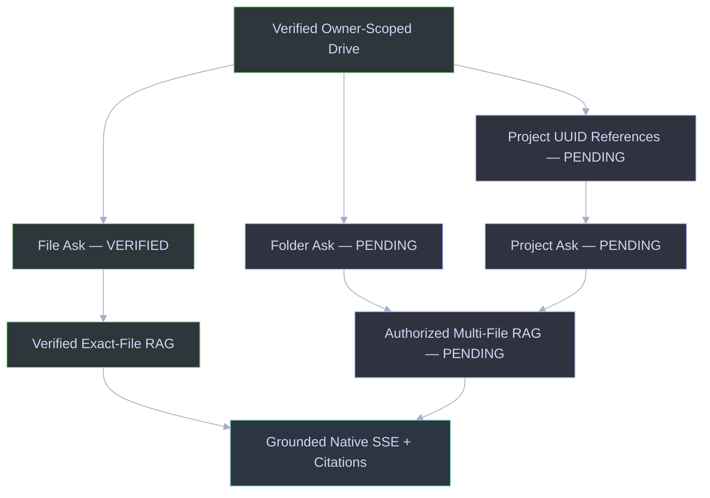
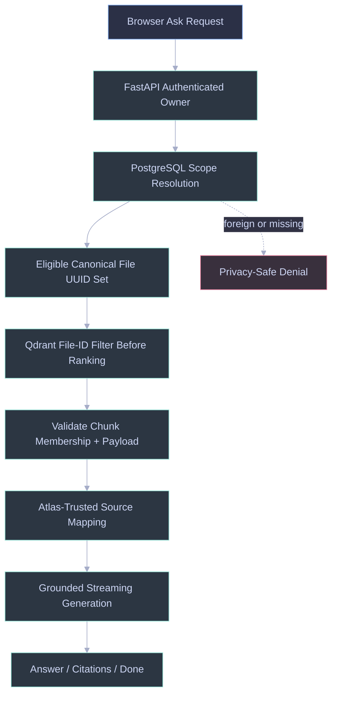
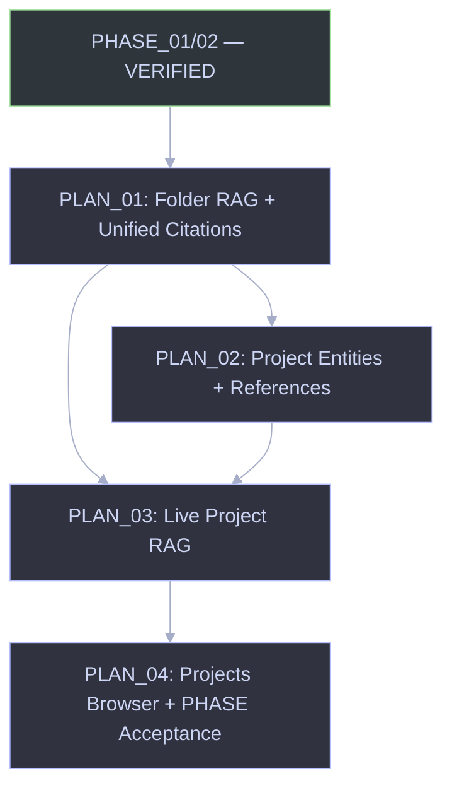
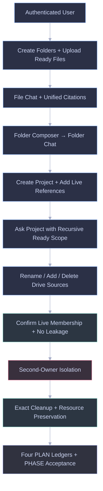

# PHASE_03 — Folder & Project RAG

| Field                    | Current Decision                                                                                                   |
| ------------------------ | ------------------------------------------------------------------------------------------------------------------ |
| PHASE Status             | `BUILDING` — Amendment 01 internal resolver `VERIFIED`; remaining PLAN workstreams outstanding                     |
| Verified Prerequisites   | `PHASE_01 — MVP Core RAG`; `PHASE_02 — Authenticated Personal Drive`                                               |
| First PLAN               | `PHASE_03_PLAN_01 — Single-Level Folder RAG` (`BUILDING`)                                                          |
| Later PLANS              | `PLAN_02` Projects Foundation & Membership; `PLAN_03` Project-Scoped RAG; `PLAN_04` Projects UX & PHASE Acceptance |
| Canonical State          | PostgreSQL owns identity, Drive hierarchy, readiness and future Project membership                                 |
| Derived Retrieval        | Existing BGE-M3 dense vectors and Qdrant; trusted source provenance and native SSE                                 |
| Implementation Authority | Approved PLAN + focused AMENDMENT + separately authorized verification stage                                       |

- **Authority:** This PHASE specifies the product destination, cross-PLAN boundaries, decisions, dependencies and final acceptance. Each PLAN specifies its own implementation contract.
- **Scope:** File Ask remains available; single-level Folder Ask and live, reference-based Project Ask are new capabilities.
- **Evidence:** PHASE_01/02 results are historical. [PLAN_01 CONTEXT](PLAN_01/PHASE_03_PLAN_01_CONTEXT.md) records verified internal resolution/retrieval, local/packaged/real-store acceptance, BGE-M3 semantic/capacity measurements and exact preservation. Public Folder Ask, citation migration, Projects and browser flows remain pending.
- **Amendment 02:** `VERIFIED` at the internal retrieval/evaluation boundary. Final numeric policy awaits user decision; no public Folder Ask is delivered by this amendment. PLAN_01 / PHASE_03 remain `BUILDING`.
- **Instructions:** [Root AGENTS](../../AGENTS.md) · [Server AGENTS](../../server/AGENTS.md) · [Client AGENTS](../../client/AGENTS.md) · [RAG SKILL](../../.agents/skills/rag/SKILL.md).

---

## 1. PHASE Objective & Success Boundary

**Objective:** Extend Atlas's authenticated, owner-scoped Drive and verified single-file RAG with immediate-folder question answering and independently managed Projects whose live Drive references define a reusable, authorized multi-file retrieval scope.

### Product Capabilities

- **Drive — `VERIFIED` baseline**
  - Canonical owner-scoped files, nested folders, metadata, upload, indexing, readiness and recoverable file deletion.
  - Drive hierarchy remains the source of file/folder identity and location; Project references do not change it.
- **File Ask — `VERIFIED` baseline with approved Phase 3 presentation/citation migration**
  - One owned `ready` file; exact-file retrieval; grounded native POST-SSE.
  - Existing backend endpoint: `POST /files/{file_id}/ask`.
  - New browser destination: `/drive/file/:id/chat`; retain `/drive/file/:id` through a compatibility redirect.
  - Adopt the unified citation DTO during PLAN_01 through an **intentional, approved public-schema supersession**, not a claim of existing behavior.
- **Folder Ask — `PENDING`, PLAN_01**
  - Search **only immediate** owned `ready` files within the selected canonical folder.
  - Provide an Ask composer at the bottom of `/drive/:id`; submit to `/drive/:id/chat` to show the question and stream the answer.
  - Expose `POST /folders/{folder_id}/ask`; no folder-depth controls or descendant search.
- **Projects — `PENDING`, later PLANS**
  - Independent top-level logical collections outside the Drive tree; a user can create multiple Projects.
  - Store references to the user's canonical file and folder UUIDs from anywhere in Drive; do not copy files, chunks or vectors.
  - Membership is **live**: referenced folders recursively contribute current descendant `ready` files; direct references and overlapping folder paths deduplicate by canonical file UUID.
  - Project Ask searches only the dynamically resolved, authorized set; removing a membership or deleting a Project does not delete Drive resources.

### PHASE Boundary Diagram



- **Success:** All four PLANS independently reach `VERIFIED`, the full File → Folder → Project product journeys pass, and Phase-wide security, retrieval, citation, lifecycle, browser and preservation criteria have executed evidence.
- **Not success:** Writing specifications, generating Codex prompts, completing PLAN_01 alone, or passing only mocked tests.

---

## 2. Current State & PLAN Roadmap

### Verified Historical Prerequisites

| PHASE                                     | Status     | Inherited Baseline                                                                                                                                |
| ----------------------------------------- | ---------- | ------------------------------------------------------------------------------------------------------------------------------------------------- |
| `PHASE_01 — MVP Core RAG`                 | `VERIFIED` | Docling extraction/OCR/chunking; BGE-M3; Qdrant; grounded Gemini; native SSE; provenance-based citations                                          |
| `PHASE_02 — Authenticated Personal Drive` | `VERIFIED` | PostgreSQL identity/session ownership; folders/files; `processing`/`ready`/`deleting`; authenticated upload/deletion; selected-file Ask; Vite SPA |

- **Phase 2 final recorded evidence:** 424 client tests, 329 packaged backend tests, 222 production-browser checks, plus 17 PLAN_04 and 15 PHASE_02 acceptance criteria.
- **Evidence qualification:** Final Phase 2 generation was deterministic, **not** a fresh Gemini invocation. The prior Docker builder-cache comparison **FAILED** (111 → 73 entries; 42 older IDs missing; unknown cause); the user explicitly accepted this historical exception. Do not relabel it as a passing comparison.
- **Authority:** [PHASE_02](../PHASE_02/PHASE_02.md) · [PLAN_04 CONTEXT](../PHASE_02/PLAN_04/PHASE_02_PLAN_04_CONTEXT.md) · [PLAN_04 MANUAL](../PHASE_02/PLAN_04/PHASE_02_PLAN_04_MANUAL.md).
- **Source boundary:** Last reviewed remote work was on `phase-02/plan-04`; local Git state, merge readiness, and retained runtime must be independently inspected before implementation. Historical source inspection does not constitute new runtime verification.

### Proposed PLAN Responsibilities

| PLAN               | Milestone                            | Completion Boundary                                                                                                                                           | Status     |
| ------------------ | ------------------------------------ | ------------------------------------------------------------------------------------------------------------------------------------------------------------- | ---------- |
| `PHASE_03_PLAN_01` | **Single-Level Folder RAG**          | Complete authorized direct-folder RAG, unified citations, Folder Ask API, approved File/Folder chat routes, and integrated PLAN acceptance                    | `BUILDING` |
| `PHASE_03_PLAN_02` | **Projects Foundation & Membership** | Owner-scoped Project CRUD and live canonical UUID references with safe relational membership/deletion integrity; independently verified API/database behavior | `PENDING`  |
| `PHASE_03_PLAN_03` | **Project-Scoped RAG**               | Live recursive Project scope resolution; deduplicated ready-file set; reuse PLAN_01 retrieval/grounding; verified Project Ask backend                         | `PENDING`  |
| `PHASE_03_PLAN_04` | **Projects UX & PHASE Acceptance**   | Projects browser flows and complete cross-PLAN, real-store, security, retrieval-quality, and product acceptance                                               | `PENDING`  |

- **Sequential dependency:** PLAN_03 requires both PLAN_01's multi-file RAG foundation and PLAN_02's Project ownership/membership foundation.
- **Delivery discipline:** PLAN_01's Folder Ask must be usable end-to-end before Projects are implemented. PLAN_02 must not silently build Project RAG or speculative UI features ahead of PLAN_03/04.
- **Status rules:** `PENDING`, `BUILDING`, `IMPLEMENTED`, `VERIFIED` describe maturity; `LOCKED`, `PROVISIONAL`, `OPEN`, `SUPERSEDED` describe decisions. A `VERIFIED` PLAN does not automatically verify this PHASE.

---

## 3. Scope & Explicit Exclusions

### Included

**Single-File Continuity**

- Preserve file ownership/readiness gate, dense exact-file retrieval, grounded generation, native SSE lifecycle, file fallback and upload/index/deletion behavior.
- Migrate the browser route and **unify the citation response** under the separately approved Phase 3 supersession; reverify all affected File Ask clients and contracts.

**Single-Level Folder Ask**

- Use an existing folder UUID, authenticated owner identity and current PostgreSQL `files.folder_id`.
- Include all directly contained `ready` files, within approved resource limits; exclude root-level files, nested descendants, siblings, foreign files and non-ready files.
- Keep folder browsing and management on `/drive/:id`; provide Ask submission from that page and a dedicated chat-style destination.
- Use one filtered multi-file dense retrieval operation and Atlas-trusted source attribution.

**Projects**

- CRUD independent owner-scoped Projects; add/remove explicit file/folder references across the owner's Drive.
- Resolve live folder membership recursively for Project RAG; include newly added descendant files when `ready` and exclude deleted/non-ready sources from new requests.
- Preserve distinct explicit references when overlapping with referenced folders; deduplicate the **effective retrieval set**, not the stored membership intent.
- Display current canonical metadata and maintain database-enforced referential integrity for direct memberships.
- Deliver integrated Project management and Project chat in the existing SPA during the corresponding later PLANS.

### Explicit Exclusions

| Capability                                                                                          | Boundary                                                                      |
| --------------------------------------------------------------------------------------------------- | ----------------------------------------------------------------------------- |
| Entire-drive Ask                                                                                    | Deferred; Projects provide curated multi-file scopes instead                  |
| Folder depth selector                                                                               | Deferred; Folder Ask is direct-only, Project folder references are recursive  |
| User-selected file subsets in Folder Ask                                                            | Future enhancement; not in PLAN_01 or required for PHASE_03 acceptance        |
| Persistent conversations / multi-turn model memory                                                  | Not implied by chat-style routes; each Ask is an independent grounded request |
| Sharing, teams, ACLs, collaborative Projects                                                        | Owner-only until separately approved                                          |
| File/folder movement, folder deletion, trash, recovery, versioning                                  | Not introduced in this PHASE; existing file deletion remains                  |
| Persistent original-file storage, downloads, previews, content replacement                          | Outside current approved scope                                                |
| Hybrid/sparse retrieval, reranking, adaptive top-k, new embedding/LLM provider, managed File Search | Require separate evidence and approval                                        |
| New Qdrant collection or Project-specific reindexing                                                | Not required by live reference-based membership                               |
| Background jobs, Redis, queues or additional frontend/backend frameworks                            | No speculative introduction                                                   |

- A later PLAN must not interpret the exclusions above as permission to silently add related infrastructure.
- Deferred scope can be revisited only through a new explicit product/architecture decision.

---

## 4. System Architecture & Authority

### Canonical State & Derived Index

- **PostgreSQL:** Owns users, sessions, folders, files, ownership, parent relationships, location, readiness and future Project/member references.
- **Qdrant:** Owns derived vectors and retrieval payloads. `file_id` identifies source chunks; the index is **not** canonical membership or authorization state.
- **Docling/BGE-M3:** Existing ingestion and dense embedding contracts remain unchanged; no re-embedding is needed merely because a scope contains several files.
- **FastAPI:** Authenticates every request and resolves resource ownership/ready eligibility before retrieval.
- **Browser:** Presents Drive and chat views; route state, cached data and user-supplied identifiers never establish authorization.
- **Gemini:** Receives only validated retrieved context; the model cannot grant access or create trusted file metadata.

### Cross-PLAN Retrieval Architecture



**Diagram status:** Scope-set resolution, multi-file permitted-ID filtering and unified attribution are planned; the verified File Ask path still uses one UUID and exact matching.

### Non-Negotiable Trust Ordering

1. Validate identity and the addressed File/Folder/Project resource against PostgreSQL.
2. Resolve current **owned, ready** eligible file UUIDs on the server; apply the selected scope's inclusion rules.
3. Apply the exact/allowed-UUID filter **inside Qdrant, before similarity ranking**.
4. Verify every returned payload's file ID belongs to the authorized set; reject malformed or out-of-scope results.
5. Build model context and citations solely from validated chunks and trusted Atlas source metadata.
6. Produce bounded, grounded answers through existing native SSE semantics; preserve error and cancellation behavior.

- **MUST NOT:** Query Qdrant globally and remove unauthorized matches afterward.
- **MUST NOT:** Accept model- or client-authored file UUID sets, ownership flags or provenance as authorization.
- **MUST NOT:** Treat empty retrieval, generation error, permission denial and resource-limit failure as interchangeable.
- **Concurrency:** An authorized request may continue using its request-start scope after source deletion begins; new scope resolutions exclude a committed `deleting` state or deleted row. See Section 7.

---

## 5. File & Folder Ask Contracts

### File Ask — Preserved Backend, Deliberate Citation Extension

- **Endpoint:** `POST /files/{file_id}/ask` remains unchanged.
- **Gate:** The referenced file must belong to the authenticated user and be `ready` when the request is authorized.
- **Retrieval:** Existing single-file dense Qdrant filter and default `top_k=5`; existing request validation and native SSE lifecycle remain the baseline.
- **Fallback:** Preserve exactly `I don't have enough information in this file to answer that.`
- **Browser:** `/drive/file/:id/chat`; redirect existing `/drive/file/:id` route without breaking direct links, reload or history behavior.
- **Approved supersession:** Migrate File Ask to the unified eight-field citation representation and request-local source indexes. This **changes** the existing public citation shape and requires explicit client/server/test updates and fresh acceptance. Do not claim the prior five-field DTO is the final Phase 3 contract.

### Folder Ask — PLAN_01

- **Endpoint:** `POST /folders/{folder_id}/ask` (approved).
- **Scope:** The folder UUID must resolve to an owned canonical folder. Include only `File.owner_id = owner`, `File.folder_id = folder_id`, `File.status = 'ready'`.
- **No traversal:** A direct folder Ask excludes descendants, siblings and files at virtual Drive root. It does not accept a depth parameter or user-authored UUID list.
- **Empty authorized scope:** Successful folder-specific fallback and empty citations; skip unnecessary embedding, Qdrant and Gemini work.
- **No returned chunks:** Use the same fallback after retrieval; do not call Gemini.
- **Fallback:** Preserve exactly `I don't have enough information in this folder to answer that.`
- **Oversized scope:** Reject explicitly before retrieval/stream commitment; do not silently search a truncated subset or return fallback.
- **Missing/foreign folder:** Preserve privacy-safe indistinguishable denial; do not query Qdrant/Gemini.

### Browser Routes & Chat Handoff

| Browser Route          | Product Behavior                                                                        |
| ---------------------- | --------------------------------------------------------------------------------------- |
| `/drive/:id`           | Existing folder listing, management and direct-child navigation; Ask input at bottom    |
| `/drive/:id/chat`      | Show submitted question immediately, then streamed answer and file-attributed citations |
| `/drive/file/:id/chat` | File-scoped chat-style view, with existing file metadata and readiness behavior         |
| `/drive/file/:id`      | Compatibility redirect to file chat; preserve bookmarks and direct navigation           |

- Folder submission transfers its question **once** into the destination chat page; the destination owns POST-SSE initiation.
- Refresh, history navigation and direct chat URL loads MUST NOT automatically replay prior submissions.
- Route changes, logout and account changes retire prior sessions/streams and suppress stale private results.
- A chat-style sequence may display multiple independent Ask turns in the current view, but persistent transcripts, conversations and multi-turn model context are **not** approved.
- Client route/transport implementation belongs to the client PLAN; detailed RAG framing belongs to the RAG skill.

---

## 6. Unified Retrieval, Grounding & Citation Contract

### Reusable Authorized Multi-File Core

- PLAN_01 creates an internal scoped retrieval operation that consumes a **server-validated** eligible file scope, a question and a bounded global top-k.
- Folder scope comes from direct-file PostgreSQL resolution. Later Project scope comes from live Project membership expansion.
- The exact internal Python signature/immutable scope type belongs to PLAN_01; arbitrary UUID arrays from a public request are never proof of permission.
- Embed a question once; run one dense Qdrant search with an authorized permitted-ID filter **before ranking**; validate every returned source.
- Keep the established BGE-M3 model, 1024-dimensional dense vectors, cosine collection, Qdrant payload shape and existing runtime reuse/encoding controls.
- No broad retrieval refactor, new vector collection, Project-specific embeddings or speculative reranker.

### One Unified Citation DTO — Approved Supersession

The same public citation object must serve File, Folder and Project Ask:

| Field         | Required Meaning                                                        |
| ------------- | ----------------------------------------------------------------------- |
| `index`       | Unique non-negative **request-local** source index used by `[[cite:N]]` |
| `file_id`     | Canonical source-file UUID                                              |
| `file_name`   | Canonical file name captured for the request                            |
| `chunk_index` | Original chunk index **within** that file                               |
| `page`        | Trusted nullable page number                                            |
| `heading`     | Trusted nullable heading                                                |
| `section`     | Trusted nullable section                                                |
| `excerpt`     | Trusted source-oriented excerpt                                         |

```json
{
  "index": 1,
  "file_id": "11111111-1111-4111-8111-111111111111",
  "file_name": "api-design.md",
  "chunk_index": 0,
  "page": 2,
  "heading": "Authentication",
  "section": "API Security",
  "excerpt": "The API uses bearer-token authentication."
}
```

_Illustrative synthetic values only; not a claim of existing API output._

- The current five-field single-file Citation DTO is **VERIFIED historical behavior**, intentionally **SUPERSEDED** for Phase 3 by this approved eight-field design.
- Every retrieved chunk receives a unique request-local source reference; original `chunk_index` values may collide between files.
- Atlas maps source references to trusted `(file_id, original chunk_index, page, heading, section, excerpt)` plus canonical file name.
- Preserve the exact `[[cite:N]]` marker grammar and native `answer`, `citations`, `done`, and terminal `error` semantics.
- Reject unknown, malformed, ambiguous or model-invented source references; source names and file IDs are **never model-authored**.
- A canonical file name is a **request-time metadata snapshot**, not a live rename subscription during generation.
- Source markers are removed from user-visible answer text; citations become final only on successful generation completion.

### Fallback, SSE & Trust

- **File fallback:** `I don't have enough information in this file to answer that.`
- **Folder fallback:** `I don't have enough information in this folder to answer that.`
- **Project fallback:** To be specified in PLAN_03; do not infer an approved exact sentence from the folder contract.
- A successful insufficient-context answer emits `answer` with the canonical fallback, `citations` with `[]`, then `done` with `completed` status.
- For substantive generation, every answer must pass the existing grounding/citation semantics; failure after provisional text emits terminal `error` without successful `done`.
- Treat retrieved document text as untrusted instructions; preserve prompt-boundary isolation and citation validation.
- Model fluency, citation membership and cosine scores are not guarantees of factual entailment.

### Retrieval Tuning & Resource Budgets

| Parameter                             | Approved Policy                                                        | Current Value/Status                                        |
| ------------------------------------- | ---------------------------------------------------------------------- | ----------------------------------------------------------- |
| File Ask default                      | Preserve existing single-file behavior                                 | `top_k=5` (`LOCKED`)                                        |
| File Ask validation                   | Preserve inherited request bounds                                      | `1–20` (`LOCKED`)                                           |
| Folder ranking                        | Fixed **global** top-k across eligible files, not per file             | `LOCKED` strategy                                           |
| Folder top-k candidates               | Benchmark same corpus/questions                                        | `k=5`, `8`, `12`                                            |
| Folder preferred initial candidate    | Hypothesis, not verified optimum                                       | `k=8` (`PROVISIONAL`)                                       |
| Eligible ready files                  | Complete server-authorized set; reject oversized scope                 | `100` candidate (`PROVISIONAL`)                             |
| Generation context                    | Measure assembled provider context; bound independently of chunk count | Approximately `12,000` tokens (`PROVISIONAL`)               |
| Scope-limit failure                   | Explicit, privacy-safe structured response before SSE                  | Exact numeric limit and error contract finalized in PLAN_01 |
| Adaptive/diversified/hybrid retrieval | Requires demonstrated need and approval                                | Deferred                                                    |

- Do **not** make k proportional to eligible-file count, force every file to contribute, or impose an arbitrary cosine cutoff.
- Compare Recall@k, necessary-file coverage for cross-document questions, grounded answer/citation accuracy, latency and provider-context budget.
- The chunk `token_count` under the BGE-M3 tokenizer is **not** guaranteed to equal Gemini prompt tokens; measure or conservatively estimate the assembled generation context.
- Never silently truncate an oversized file scope. A bounded chunk selection is normal retrieval; a partial, unannounced **eligible file set** is not.
- Final numeric thresholds require measured evidence and explicit PLAN/Amendment approval. The Phase does not claim that 100 files, 12,000 tokens or k=8 have passed benchmarks.

---

## 7. Project Membership & Source Lifecycle

### Projects — Logical References, Not Physical Drive Folders

```text
Drive
├── Engineering/
│   ├── architecture.pdf
│   └── Backend/
│       └── database.md
├── Finance/
│   └── budget.xlsx
└── notes.md

Projects
└── Atlas Development
    ├── Engineering/         [folder UUID reference]
    ├── Finance/budget.xlsx  [file UUID reference]
    └── notes.md             [file UUID reference]
```

- A Project is an owned, top-level application entity separate from Drive folder placement.
- Store **relations** to canonical files and folders, not copied source bytes, index points or per-Project embeddings.
- A direct file reference remains a distinct membership intention even if a referenced folder already includes it.
- The same file/folder may be referenced by more than one Project; duplicate _effective_ file IDs are removed before retrieval.
- A referenced folder contributes its **current descendants recursively**; new `ready` descendant files become eligible automatically on subsequent Project scope resolution.
- References resolve current canonical names/descriptions. Renames preserve UUID identity; delete-and-reupload creates a new identity.
- Owner-scoped Project and membership validation is mandatory. Database foreign keys and uniqueness/owner-consistency rules should enforce direct reference integrity; exact table names, keys and migrations belong to PLAN_02.
- Physically deleting a file removes its direct Project references by database-managed referential integrity after canonical deletion. A file in `deleting` is non-queryable even before final row deletion.
- Deleting a Project only deletes the Project and its membership records, **never** the original Drive files/folders.
- Folder deletion is not part of the verified baseline or current PHASE; future folder deletion must reconcile descendant and reference lifecycles deliberately.

### Scope Semantics

| Operation                 | Folder Ask                                           | Project Ask                                                     |
| ------------------------- | ---------------------------------------------------- | --------------------------------------------------------------- |
| Select an existing folder | Immediate owned `ready` files only                   | Referenced folder and **all descendants**, owner/ready-gated    |
| Add nested folder/file    | Not searched by parent Folder Ask                    | Automatically eligible if under a referenced folder and `ready` |
| Add file at Drive root    | Not in any ordinary folder Ask                       | Eligible through a direct file reference                        |
| Explicit file reference   | Not supported as a Folder Ask selector in this PHASE | Allowed from anywhere in owned Drive                            |
| Duplicate inclusion       | Each direct file is unique                           | Deduplicate union of direct references and folder descendants   |
| Deleted/non-ready file    | Excluded from newly authorized scope                 | Excluded from newly authorized scope                            |

### Concurrent Deletion — Approved Request-Start Policy

- **Authorization point:** A new File Ask must find its source owned and `ready`; a new Folder/Project Ask includes only ready members in the PostgreSQL scope query.
- **In-flight continuation:** If a source changes to `deleting` or is removed **after** the Ask's successful scope authorization, the authorized request may continue with the material available to it.
- **No repeated readiness requirement:** The former proposal for mandatory pre-generation revalidation is **SUPERSEDED**; do not add polling or long-lived PostgreSQL locks solely for revocation.
- **Future requests:** Once `deleting` is committed or the file row is removed, no newly authorized request may include that file. File Ask denies the non-ready source; Folder/Project Ask excludes it and may use other ready files.
- **Race qualification:** Qdrant cleanup may happen before an already authorized request retrieves its chunks; completion is permitted, **not guaranteed**. Empty retrieval follows the canonical scope fallback; real dependency faults remain errors.
- **Existing lifecycle:** Keep Phase 2 `ready → deleting → Qdrant cleanup → canonical row deletion` and its retry/recovery behavior. Do not move deletion authority to Projects or Qdrant.

---

## 8. PLAN Responsibilities & Handoffs

### PLAN_01 — Single-Level Folder RAG

- Deliver the first fully usable multi-file capability, from direct-folder PostgreSQL scope resolution to grounded answers in the production browser.
- Extend Qdrant retrieval for server-approved file UUID sets; unify File/Folder/Project citation representation **without changing existing File Ask ownership, fallback or SSE behavior**.
- Expose `POST /folders/{folder_id}/ask`; build `/drive/:id` Ask composer and `/drive/:id/chat`, and migrate File Ask to `/drive/file/:id/chat` with a compatibility redirect.
- Verify empty/non-ready folders, two-owner isolation, same-index cross-file citations, deletion races, limits, streaming/cancellation and full File Ask regressions.
- Evaluate `k=5/8/12` and scope/context budgets; lock production numerical choices only after recorded evidence.

**Proposed capability sequence** (six workstreams, **not** preassigned Amendment artifact numbers):

1. Direct-folder authorization and canonical ready-file scope resolver.
2. Authorized multi-file retrieval and controlled retrieval/resource evaluation.
3. Unified file-attributed citations, request-local source references, grounding and scope fallbacks.
4. Folder Ask API/native SSE **together with** existing File Ask browser-route migration.
5. Folder composer, destination chat, one-time question handoff and session-safe streaming.
6. Integrated packaged/API/PostgreSQL/Qdrant/browser acceptance, quality evidence and PLAN closure.

The precise requirements and acceptance for these workstreams belong to `PHASE_03_PLAN_01.md`, when authored and approved. No workstream is implemented by listing it here.

### PLAN_02 — Projects Foundation & Membership

- Introduce canonical Project entities and direct file/folder membership references in PostgreSQL.
- Deliver owner-scoped Project CRUD, reference add/remove operations, current metadata views and reference uniqueness/integrity.
- Enforce same-owner resource membership and database-managed cleanup of directly referenced deleted resources.
- Verify removal from a Project never deletes a Drive resource; multi-Project memberships do not alias ownership.
- **Boundary:** Project management API/database behavior; no Project RAG or full browser Project workspace.
- **OPEN to PLAN_02:** Exact tables, ownership-composite constraints, error DTOs, endpoint inventory, transaction details and feasible limits.

### PLAN_03 — Project-Scoped RAG

- Resolve current Project references into a deduplicated, owner-authorized set of ready files.
- Expand referenced folders **recursively**, with bounded server-side traversal and no client-supplied search scope.
- Reuse PLAN_01 multi-file retrieval, unified citation DTO and native SSE lifecycle for Project Ask.
- Verify live new-file inclusion, rename metadata, ready/deleting changes, overlapping references, empty Projects, large scopes, missing/foreign Projects and two-owner isolation.
- **Boundary:** Complete Project Ask backend and real datastore verification; browser Projects UX belongs to PLAN_04.
- **OPEN to PLAN_03:** Exact public Project Ask API/DTO, Project fallback sentence, traversal/resource limits and evaluation-driven retrieval tuning.

### PLAN_04 — Projects UX & PHASE Acceptance

- Provide a top-level Projects overview and Project detail workspace within the verified React/Vite/TanStack Router SPA.
- Create, list, rename and delete Projects; select/remove owned Drive file/folder references and display current metadata.
- Integrate Project Ask with the verified multi-file SSE/citation pipeline, error/cancellation handling and route/account isolation.
- Execute the complete File, Folder, Project and Drive user journey with real PostgreSQL/Qdrant/HTTP/browser acceptance under separate approval.
- Reconcile every PLAN outcome, security boundary, retrieval-quality metric, resource preservation comparison and Phase-wide acceptance criterion.
- **Boundary:** A verified product, not merely a collection of passing unit tests.

### Handoff Diagram



- The PLANs are sequenced for implementation governance. PLAN_02's data model does not inherently depend on Qdrant, but the proposed milestone sequence is retained for focused acceptance.
- PLAN completion is a prerequisite, **not** substitute evidence, for later PLANs or independent PHASE closure.

---

## 9. Execution & Documentation Governance

### Source Of Truth & Inherited Instructions

1. Current repository/targeted source and local Git state.
2. Executed tests and actual runtime evidence.
3. Current authoritative SDK/library documentation for changing technical claims.
4. Approved PHASE/PLAN/AMENDMENT contracts.
5. Historical CONTEXT/MANUAL implementation and acceptance records.
6. Explicit decisions and history, then clearly marked inference.

- Apply [root](../../AGENTS.md), [server](../../server/AGENTS.md), [client](../../client/AGENTS.md) and [RAG skill](../../.agents/skills/rag/SKILL.md) by task boundary.
- The four prepared instruction files predate the **later approved unified Citation DTO and request-start deletion policy**. Those specific inconsistencies require a separately authorized documentation alignment before implementing affected workstreams. Do **not** interpret an older five-field citation lock or pre-generation revalidation proposal as the newly approved Phase 3 destination; equally, do not claim the new code already exists.
- Current source and executed acceptance remain the authority for **what exists**; explicit approved supersessions govern **what is planned**. Stop and report unresolved contradictions before implementation.

### Two-Stage Verification & Human Approval

| Stage        | Permitted Work                                                                                                                                                      | Completion Rule                                                                              |
| ------------ | ------------------------------------------------------------------------------------------------------------------------------------------------------------------- | -------------------------------------------------------------------------------------------- |
| **Stage 01** | Focused authorized AMENDMENT; targeted local code/docs; deterministic tests, type/static/build checks and scope review                                              | Record actually executed checks in CONTEXT/MANUAL; **STOP** for human review                 |
| **Stage 02** | Only after fresh explicit approval: Docker, real PostgreSQL/Qdrant/HTTP, browser automation, migrations, deployment/provisioning or provider calls where applicable | Preserve data/resources, use exact test-owned fixtures, record actual cleanup and comparison |

- Documentation approval does **not** authorize coding, database mutations, Git branch changes, commits, pushes, PR operations, Docker or provider spending.
- Follow server-first contract verification before client consumption unless a PLAN documents a focused exception.
- Do not silently change embedding/chunking/schema/LLM provider, top-k policy, index, auth, lifecycle or hosting architecture.
- No automatic Docker prune, resetting storage, migration rollback, destructive Git, or deletion of unrelated resources.
- Respect the existing `phase-<NN>/plan-<NN>` branch convention; inspect the actual checked-out branch and remote state before implementation. No implicit branch creation/switch.

### Artifact Ownership

| Artifact  | Responsibility                                                                                  |
| --------- | ----------------------------------------------------------------------------------------------- |
| PHASE     | Overall objective, constraints, PLAN handoffs, Phase-wide acceptance                            |
| PLAN      | Specific end state, decisions, technical contracts and objective acceptance                     |
| AMENDMENT | One focused implementation task; numbering begins when actually authorized                      |
| CONTEXT   | Codex-maintained chronological changes, failures, decisions, commands and executed verification |
| MANUAL    | Codex-maintained reproducibility and actual acceptance procedures                               |

- Proposed target placement: `prompts/PHASE_03/PHASE_03.md` and later `prompts/PHASE_03/PLAN_01/PHASE_03_PLAN_01.md`.
- Do not pre-create PLAN CONTEXT/MANUAL or Amendment prompts; never fabricate execution results.
- Historical Phase 1/2 evidence is not rewritten or revalidated by publishing this PHASE specification.

---

## 10. PHASE-Wide Security & Lifecycle Invariants

### Authentication & Ownership

- Every File/Folder/Project Ask requires validated current user identity.
- PostgreSQL must check both resource ownership and file readiness before a file participates in a new retrieval scope.
- Foreign and missing resource IDs use indistinguishable privacy-safe failures where the established API contract requires them.
- Project membership links MUST enforce owner consistency; an attacker cannot create a Project that references another user's resources.
- CORS, route guards, client filters, cached lists, Project UI and UUID opacity are not authorization controls.

### Retrieval & Provenance

- All eligible file IDs are server-resolved and bounded before Qdrant search.
- Qdrant applies file-ID restriction **before ranking**; Atlas validates each returned chunk against the request's permitted set.
- No global retrieval followed by authorization filtering; no model-derived access control or file provenance.
- Unified citations always identify the true canonical source; duplicate per-file chunk indexes cannot collide at the request-local citation layer.
- User questions, uploaded documents, retrieved chunks and provider output are untrusted; preserve prompt-injection boundaries.

### File, Project & Stream Lifecycle

- A new Ask cannot include a file currently `processing`, `deleting`, deleted or foreign. Retain verified File Ask privacy-safe denial and Folder/Project exclusion/fallback semantics.
- An Ask authorized before deletion may continue; no continuous revocation or database lock spanning a provider stream is required by the approved policy.
- Project deletion removes the Project and membership links only; physical file deletion follows the existing Qdrant-then-PostgreSQL lifecycle.
- Canonical metadata is read from PostgreSQL; rename does not alter identity or re-embed indexed content.
- Browser navigation/account/logout changes suppress stale private responses, abort owned streams and prevent automatic replay of prior questions.
- Generation errors, malformed citations or provider disconnects never emit a false terminal `done` event.

### Secrets & Resource Preservation

- Never disclose secrets, personal documents or credential material through tests, logs, screenshots, prompts or documentation.
- Run real-store verification with isolated synthetic users/files/Projects, tracked fixture ownership and exact cleanup.
- Preserve unrelated PostgreSQL rows, Qdrant points/collections and Docker resources. Compare before/after authoritative state, recording exceptions and failures literally.
- Native client `fetch`/SSE and verified auth/session behavior remain; do not add a proxy or a second auth owner without approval.

---

## 11. Verification & Regression Standard

| Boundary                     | Minimum Evidence For Relevant PLANs                                                                                                                        |
| ---------------------------- | ---------------------------------------------------------------------------------------------------------------------------------------------------------- |
| **File Baseline**            | Existing exact-file authorization/retrieval, `top_k=5`, file fallback, upload/deletion and native SSE regressions; deliberate unified DTO migration tested |
| **Folder Scope**             | Owned folder, direct-only ready files, root/child/sibling/foreign exclusion, mixed readiness, empty scope and oversized-scope policy                       |
| **Qdrant Retrieval**         | Real filtered query constrains permitted UUIDs **before** ranking; malformed/out-of-scope payloads fail safely                                             |
| **Citation & Generation**    | Cross-file duplicate `chunk_index`, exact file attribution, fake markers, scope fallbacks, native SSE ordering/cancellation and terminal-error safety      |
| **Project Integrity**        | Owner-consistent membership, repeated references, concurrent deletion, project/source removal semantics and foreign-UUID rejection                         |
| **Live Project Scope**       | Recursive descendants, new ready files, no stale/deleted/non-ready members, overlap deduplication and bounded traversal                                    |
| **Client Routes**            | File route redirect, Folder Ask-to-chat handoff, no question replay, production SPA deep links, authenticated streaming and source display                 |
| **Auth & Session Isolation** | Two-owner real PostgreSQL/Qdrant/HTTP/browser denial and stale-response isolation                                                                          |
| **Retrieval Quality**        | Labeled corpus, 5/8/12 comparison, Recall@k, necessary-file coverage, citation accuracy, latency/context/cost measurements                                 |
| **Runtime & Preservation**   | Packaged server, production SPA, real-store fixtures, exact cleanup, preserved unrelated state and recorded exceptions                                     |
| **Documentation**            | Actual commands/results, decision provenance, failed/unrun checks, acceptance crosswalk in the relevant PLAN CONTEXT/MANUAL                                |

- Unit/mock evidence supports focused logic but does not replace required actual PostgreSQL/Qdrant, packaged HTTP or browser evidence.
- Provider streaming may be verified deterministically; label a fresh live Gemini call only if approved and actually executed.
- Compare current system performance with a known baseline, make a targeted change only after a demonstrated limitation, and reevaluate.
- Every PLAN reports its acceptance independently. `IMPLEMENTED` means code exists without complete acceptance; only completed criteria with executed evidence justify `VERIFIED`.

---

## 12. PHASE Completion Criteria

**PHASE_03 becomes `VERIFIED` only when all four PLANS are independently `VERIFIED` and every applicable criterion below has been exercised with appropriate evidence.** No criterion is satisfied by this document alone.

### Scope & Product Acceptance

1. **AC-01 — File Continuity:** Authenticated File Ask remains functional with exact-file ownership/readiness filtering, grounded SSE and the approved unified citation response.
2. **AC-02 — File Chat Route:** `/drive/file/:id/chat` opens correctly; existing `/drive/file/:id` URLs redirect; reload/history and File Ask regressions pass.
3. **AC-03 — Folder Eligibility:** Folder Ask searches all and only directly contained, owned, `ready` files; excludes root/descendants/siblings/foreign/non-ready files.
4. **AC-04 — Folder Workflow:** Ask at `/drive/:id` transfers a submitted question once to `/drive/:id/chat`; answer streams; direct URL/reload does not replay automatically.
5. **AC-05 — Folder API & Fallback:** `POST /folders/{folder_id}/ask` enforces ownership and validation; empty/no-match scope returns exact folder fallback with empty citations; failures stay distinguishable.
6. **AC-06 — Project Lifecycle:** Authorized users can create, inspect, update and remove multiple independent Projects; deleting a Project preserves Drive resources.
7. **AC-07 — Project Membership:** Users can add/remove files and folders anywhere in their own Drive; ownership, current metadata, duplicate intent and canonical referential integrity hold.
8. **AC-08 — Live Project Scope:** Referenced folders recursively include current descendant ready files; new ready files appear, deleted/non-ready files disappear, and overlaps deduplicate.
9. **AC-09 — Project Ask:** A Project question retrieves and grounds context only from the current authorized Project scope; empty/oversized/foreign cases are safe and explicit.
10. **AC-10 — Projects Browser:** The SPA supports Project overview, membership management and Project chat with correct current source attribution and account/route isolation.

### Security, Retrieval & Evidence Acceptance

11. **AC-11 — Pre-Ranking Authorization:** Canonical PostgreSQL ownership/readiness and resource membership gate every retrieval scope; Qdrant filters permitted file IDs **before** ranking; returned results are revalidated for membership.
12. **AC-12 — Unified Citations:** All three Ask scopes return one eight-field citation DTO; request-local indexes map accurately to canonical file UUID/name, original chunk index and provenance. Malformed/invented references are rejected.
13. **AC-13 — Streaming & Failure Fidelity:** Native SSE gives provisional `answer` followed by trusted `citations` and `done` only on success; expected fallback and terminal errors remain distinct; cancellation cleans resources.
14. **AC-14 — Lifecycle & Concurrency:** New questions exclude `deleting`/deleted sources; already-authorized in-flight requests may continue, with documented Qdrant-cleanup races; direct Project references clean on final source deletion.
15. **AC-15 — Retrieval Quality & Limits:** Demonstrate measured multi-file recall/coverage, answer/citation quality, latency and context use; choose and enforce explicit global top-k and bounded scope/context limits without silent truncation.
16. **AC-16 — Cross-Owner Privacy:** Two independently authenticated owners cannot read, reference, retrieve, stream or cite each other's files/folders/Projects; no cache or route-state leak.
17. **AC-17 — Deployment & Regressions:** Required existing server/client and RAG regressions pass; packaged FastAPI, real PostgreSQL/Qdrant and built SPA/browser integration pass under separately authorized runtime checks.
18. **AC-18 — Preservation & Evidence:** Test-owned fixtures are cleaned by exact identity; unrelated canonical/vector/Docker state is preserved or exceptions explicitly recorded; every PLAN's CONTEXT/MANUAL contains actual observed acceptance and unresolved limitations.
19. **AC-19 — Scope Discipline:** Excluded/deferred capabilities have not been silently introduced; all material API, schema, provider and retrieval changes have explicit approval.

### End-To-End Acceptance Flow



### Completion Gate & Handoff

- Mark individual capabilities/AMENDMENTS/PLANS `PENDING`, `BUILDING`, `IMPLEMENTED`, or `VERIFIED` from executed evidence, not reports or source existence alone.
- Reconcile all 19 Phase criteria against their owning PLAN's actual tests, runtime checks, negative cases, risks, and preservation results. Do not duplicate historical Phase 2 evidence as if rerun.
- A PLAN may be `VERIFIED` while this PHASE remains `PENDING`, `BUILDING`, or `IMPLEMENTED` depending on actual aggregate scope and evidence.
- No PLAN_04 acceptance or Phase closure may be claimed until all cross-PLAN user journeys, trust boundaries and required runtime/deployment checks have passed; a user-approved historical exception remains an exception, not proof of a passing comparison.
- Upon independent Phase completion and separate Git approval, follow the repository's normal PLAN/PR/merge workflow; do not infer permission to commit, push, merge or create the next branch.

---
