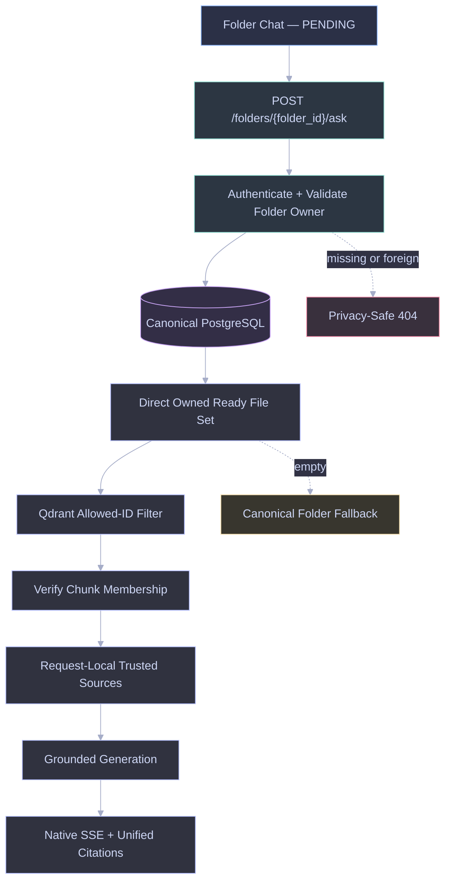
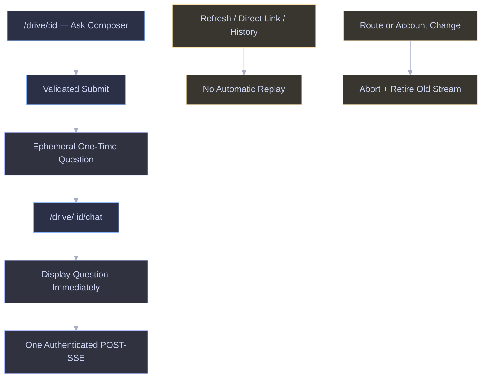

# PHASE_03_PLAN_01 — Single-Level Folder RAG

| Field                  | PLAN Contract                                                                                                              |
| ---------------------- | -------------------------------------------------------------------------------------------------------------------------- |
| PHASE                  | [PHASE_03 — Folder & Project RAG](../PHASE_03.md)                                                                          |
| PLAN                   | `PHASE_03_PLAN_01 — Single-Level Folder RAG`                                                                               |
| PLAN Status            | `BUILDING` — Amendment 01 internal resolver `VERIFIED`; remaining workstreams outstanding                                  |
| Verified Prerequisites | PHASE_01 single-file RAG; PHASE_02 authenticated Drive and React/Vite SPA                                                  |
| Primary Outcome        | End-to-end Folder Ask for immediate owned `ready` files, plus unified File/Folder citations and approved file-chat routing |
| Canonical Authority    | PostgreSQL identity, folder ownership, file location and readiness                                                         |
| Retrieval Authority    | Server-resolved UUID scope; existing BGE-M3/Qdrant dense pipeline; Atlas-trusted provenance                                |
| Delivery Model         | Six cohesive capability workstreams; actual AMENDMENT IDs assigned chronologically when authorized                         |
| Execution Gate         | Approved focused AMENDMENT; Stage 01 local checks; separate approval for Stage 02/live checks                              |

- **Role:** This PLAN defines the finished PLAN_01 contracts, delivery boundaries, requirements and acceptance. It is not an execution record or an implementation authorization.
- **Instructions:** [Root AGENTS](../../../AGENTS.md) · [Server AGENTS](../../../server/AGENTS.md) · [Client AGENTS](../../../client/AGENTS.md) · [RAG SKILL](../../../.agents/skills/rag/SKILL.md).
- **Later PLANS:** Project entities/membership, recursive Project RAG and Projects UI remain `PENDING`; this PLAN provides only a reusable multi-file RAG foundation.
- **Evidence:** Actual implementation, decisions, checks, failures and reproduction belong to Codex-owned `PHASE_03_PLAN_01_CONTEXT.md` and `PHASE_03_PLAN_01_MANUAL.md`, created at their proper lifecycle stages.
- **Amendment 02:** `VERIFIED`; internal authorized multi-file retrieval has local, packaged, real-store, cached BGE-M3 semantic/capacity and exact cleanup/preservation evidence. Numeric-policy approval, public API, citations and browser workstreams remain incomplete; PLAN_01 / PHASE_03 remain `BUILDING`.

---

## 1. PLAN Objective & Completion Boundary

**Objective:** Deliver authenticated, single-level Folder Ask in the existing Atlas Drive, using PostgreSQL-authorized direct-file scope and pre-ranking filtered dense retrieval; migrate File and Folder Ask to dedicated chat views with one unified eight-field citation contract, without regressing verified File Ask.

### Required End State

- **Folder authorization:** An owned folder resolves only its direct, owned `ready` files; no hierarchy recursion or client-selected scope.
- **Retrieval:** One server-authorized multi-file query searches the entire eligible set before globally ranking up to the chosen `top_k`.
- **Grounding:** Retrieved chunks are validated, attributed to trusted file metadata and cited through collision-free request-local indexes.
- **Folder API:** `POST /folders/{folder_id}/ask` returns native SSE grounded answers, exact folder fallback or explicit errors.
- **Unified citations:** File and Folder Ask use the approved eight-field DTO; the same contract is reusable by later Project Ask.
- **File route:** `/drive/file/:id/chat` becomes the destination; `/drive/file/:id` redirects without breaking direct links.
- **Folder routes:** `/drive/:id` retains browsing and gains a bottom Ask composer; `/drive/:id/chat` displays the submitted question and streams its answer.
- **Reliability:** Cancellation, session isolation, error fidelity, deletion races, resource bounds and no-replay navigation have tested behavior.
- **Acceptance:** Current packaged server, actual PostgreSQL/Qdrant, built SPA/browser and two-owner end-to-end evidence support `VERIFIED`, after the required independent approval gates.

### Completion Boundary

- PLAN_01 is **not complete** when only server retrieval works, a folder endpoint exists, or a mock UI streams sample text.
- PLAN_01 is `VERIFIED` only after all applicable Section 14 criteria and separately approved runtime acceptance pass and are recorded.
- Completion does **not** complete PHASE_03; PLAN_02–04 remain independent.

---

## 2. Verified Prerequisites & Authority

### Inherited Baseline

| Area     | Verified Phase 2 Behavior                                                                 | PLAN_01 Treatment                                           |
| -------- | ----------------------------------------------------------------------------------------- | ----------------------------------------------------------- |
| Identity | PostgreSQL users, JWT, refresh sessions and authenticated request handling                | Reuse; do not replace or duplicate                          |
| Drive    | Canonical folder/file UUIDs, ownership, direct-child listing, metadata and file lifecycle | Reuse canonical state; add a folder Ask operation only      |
| File Ask | `POST /files/{file_id}/ask`, owner/ready gate, exact-file Qdrant filter                   | Preserve endpoint, validation, fallback and SSE behavior    |
| RAG      | Docling, BGE-M3 1024-d dense, Qdrant cosine, Gemini, trusted chunk provenance             | Extend scope and citation mapping; do not reindex           |
| Browser  | React/Vite/TanStack Router SPA, Bun, authenticated fetch and streaming                    | Extend verified routes/components, not revive Next.js       |
| Evidence | Historical Phase 2 packaged/backend/browser and two-owner acceptance                      | Keep historical; rerun affected regressions as new evidence |

- Phase 2's recorded final acceptance included **424 client tests**, **329 packaged backend tests**, **222 production-browser checks** and an **accepted historical Docker builder-cache comparison failure**. Those counts are historical, not PLAN_01 results.
- The last inspected remote reference was `phase-02/plan-04`. Local worktree, `master` integration, branches and runtime state require fresh read-only inspection before implementation.
- Current code and executed observations determine _what exists_; approved PHASE*03 decisions determine \_the planned supersession*.

### Documentation Alignment Prerequisite

The prepared root/client/server AGENTS and RAG skill contain earlier proposed constraints that **predate** these subsequently approved decisions:

| Earlier Wording                                                          | Approved PLAN_01 Destination                                              |
| ------------------------------------------------------------------------ | ------------------------------------------------------------------------- |
| Keep existing five-field File Ask citation DTO permanently               | Intentionally migrate File and Folder Ask to one eight-field DTO          |
| Add a separate multi-file-only citation DTO                              | Use **one** citation DTO for all Ask scopes                               |
| Pre-generation readiness revalidation required or deletion policy `OPEN` | Authorize once at request start; already-authorized requests may continue |
| Folder fallback exact text remains `OPEN`                                | Use the exact approved folder fallback in Section 8                       |

- Before any affected implementation, align the applicable instruction files **with separate documentation-edit authorization**. This PLAN does not itself edit them.
- Do not silently treat an obsolete prohibition as the final Phase 3 design or portray the planned replacement as already verified.
- If current repository state differs from the prepared instruction artifacts, report the discrepancy before applying a Codex AMENDMENT.

- **Current alignment:** The checked-out root/server/RAG instructions contain the approved unified citation and request-start deletion contracts. Amendment 01 required no repeat architecture rewrite; its Stage 01/02 evidence and narrow maturity updates are recorded in [CONTEXT](PHASE_03_PLAN_01_CONTEXT.md).

---

## 3. Scope & Explicit Exclusions

### In Scope

- Authenticated direct-folder ready-file resolution from existing canonical PostgreSQL tables.
- Internal reusable authorized multi-file retrieval with Qdrant permitted-ID filtering **before** similarity ranking.
- Trusted file-attributed grounding, unified eight-field citation schema and collision-free request-local source references.
- Existing file fallback, approved folder fallback, and native POST-SSE error/success lifecycle.
- Public `POST /folders/{folder_id}/ask`, including privacy-safe ownership errors and bounded resource behavior.
- File Ask citation migration and client compatibility, without changing its endpoint, original file eligibility or normal query policy.
- Browser `/drive/file/:id/chat`, redirect from the old file route, `/drive/:id` bottom composer and `/drive/:id/chat`.
- Account/route-safe transient questions, stream cleanup, malformed event handling and no automatic submission replay.
- Controlled retrieval-quality evaluation and measured selection of production limits, followed by independently authorized integrated acceptance.

### Explicit Exclusions

| Capability                                                                   | PLAN_01 Boundary                                                          |
| ---------------------------------------------------------------------------- | ------------------------------------------------------------------------- |
| Project CRUD, membership, persistence or browser workspace                   | PLAN_02/04                                                                |
| Recursive Project folder expansion or Project Ask API                        | PLAN_03                                                                   |
| Folder descendants in ordinary Folder Ask                                    | Excluded; only immediate files                                            |
| Entire-drive Ask, folder depth options and chosen-file subsets               | Deferred; future file selection may narrow scope, but is not required now |
| Public arbitrary file-ID list                                                | Prohibited as a source of authorization                                   |
| Persistent conversations, chat tables, multi-turn model memory               | Not implied by chat-style UI                                              |
| File/folder movement, folder deletion, sharing and ACLs                      | Outside approved PHASE_03 scope                                           |
| Persistent originals, preview/download, versioning or content replacement    | Outside approved PHASE_03 scope                                           |
| New provider, embeddings, Qdrant collection, hybrid/rerank, Redis or workers | Requires evidence and separate approval                                   |
| New backend/frontend frameworks, BFF or client-hosted backend                | Prohibited without material architecture approval                         |

---

## 4. Architecture & Ownership Boundaries

### Data Flow



_Legend: the canonical Drive and single-file pipeline are `VERIFIED`; Folder Ask and shared multi-file machinery are `PENDING`. The diagram shows successful retrieval, denial and empty-scope paths._

### Responsibility Map

| Owner                    | Responsibilities                                                                             | MUST NOT Own                                  |
| ------------------------ | -------------------------------------------------------------------------------------------- | --------------------------------------------- |
| PostgreSQL/server domain | Folder authorization, direct-file scope, owner/ready state and canonical file names          | Vector similarity ranking                     |
| Qdrant/retrieval         | Search across **server-authorized** UUIDs using current dense collection                     | Identity, ownership or folder hierarchy       |
| Grounding/citation code  | Source-index mapping, untrusted-content separation, provider lifecycle and trusted citations | Authorization from model text                 |
| FastAPI router           | Endpoint validation, pre-stream errors, native SSE lifecycle and cleanup                     | Duplicate ownership bypasses                  |
| React/Vite client        | Routes, question handoff, streaming UX, citation display and abort/retire behavior           | Resource authorization or citation provenance |

### Architecture Invariants

- PostgreSQL is the source of truth; Qdrant remains a **derived** index.
- Check authenticated identity and resource ownership **before** retrieval or generation.
- Never perform global Qdrant ranking followed by authorization filtering.
- Never trust browser/user/model-supplied `owner_id`, `file_id` sets or source labels as permission/provenance.
- Keep the existing indexed chunks, embedding space, file lifecycle and deployment model.
- Preserve established synchronous/threadpool execution and provider lifetime unless targeted evidence justifies a change.

---

## 5. Canonical Direct-Folder Scope Resolver

### Input & Output

- **Input:** Authenticated canonical user ID and selected folder UUID from the validated route.
- **Authority:** Query the existing PostgreSQL `folders` and `files` state; never derive children from Qdrant or a cached browser listing.
- **Folder gate:** Folder must exist and belong to the user; a missing or foreign folder returns the same privacy-safe 404, before retrieval.
- **Eligible files:** Canonical `file.owner_id = authenticated_user`, `file.folder_id = selected_folder_id`, `file.status = ready`.
- **Output:** Deduplicated, bounded set of canonical file UUIDs and trusted request-time file-name/source metadata, ready for the internal retrieval helper.
- **No traversal:** No `parent_id` recursion, subtree search, root-level inclusion, sibling inclusion or file-selector input.

### Scope Cases

| Folder State                                                          | Authorized Result                                        |
| --------------------------------------------------------------------- | -------------------------------------------------------- |
| Existing owned folder with direct ready files                         | Exact direct, owned, ready UUID set                      |
| Existing owned folder with no direct files                            | Empty eligible set; successful folder fallback           |
| Folder contains only `processing`/`deleting` files                    | Empty set; successful folder fallback                    |
| Folder has direct ready files and nested ready files                  | Include **direct** files only                            |
| Folder contains files belonging to another owner (inconsistent state) | Exclude; do not leak metadata or retrieve vectors        |
| Root `/drive` or invented virtual root UUID                           | Not an eligible Folder Ask target                        |
| Missing/foreign folder UUID                                           | Indistinguishable privacy-safe 404                       |
| Eligible set exceeds approved ceiling                                 | Explicit pre-retrieval resource error; no partial search |

- Avoid a time-of-check/time-of-use authorization gap created by separate unscoped reads; resolve folder ownership and eligible membership under consistent canonical queries/transactions appropriate to the existing session design.
- No new PostgreSQL migration is expected; inspect actual models/indexes first. Any material schema change **REQUIRES APPROVAL**.
- Empty scope is not an authorization failure once the folder itself is authorized.
- File rename changes only canonical presentation metadata, never embedding or UUID identity.

---

## 6. Authorized Multi-File Retrieval

### Shared Internal Contract

```text
Authenticated Resource + Canonical Scope Resolver
  -> AuthorizedFileScope (permitted UUIDs + trusted metadata)
  -> retrieve(question, authorized_scope, global_top_k)
  -> Ranked, Validated RetrievedChunks
```

_Architectural interface illustration; exact Python type and signature are chosen in the focused implementation AMENDMENT without broadening the approved contract._

- Consume **only** a server-resolved authorized scope; immutable scope-carrying values are recommended to prevent mutation across the request.
- Validate the question using established request validation; embed once through the existing cached BGE-M3 provider and encoding lock.
- Reuse the existing `QdrantClient.query_points` integration and stored `file_id` payload; apply a multi-value exact-ID filter **inside** Qdrant before ranking.
- Globally rank chunks across all permitted files; `top_k` limits returned chunks in total, **not per file**.
- Preserve Qdrant order, raw similarity scores, existing chunk structure, payload checks and exception categories.
- Reject an out-of-scope `file_id`, missing/invalid payload, malformed vector or invalid provenance; do not silently skip a suspicious match and treat the remainder as complete success.
- Never log full questions, source text, raw credentials or large permitted-UUID inventories.
- No extra Qdrant collections, folder/project payload membership fields, reindexing, new embedding provider or reranker.

### Scope, Ranking & Result Safety

| Case                                               | Required Behavior                                                       |
| -------------------------------------------------- | ----------------------------------------------------------------------- |
| Empty permitted set                                | No embedding, Qdrant call or Gemini construction                        |
| Nonempty scope, no ranked hits                     | Folder fallback; skip Gemini                                            |
| Duplicate file UUID in a resolver result           | Deduplicate before retrieval                                            |
| Qdrant candidate from non-permitted file           | Reject as scope-integrity failure                                       |
| Returned chunk with invalid trusted identifiers    | Explicit sanitized pipeline error                                       |
| Embedding/Qdrant transport or model failure        | Explicit structured dependency error, **not** fallback                  |
| File enters `deleting` after request authorization | Existing authorized request may proceed with available indexed material |

- The initial File Ask may reuse lower-level retrieval machinery, but its existing exact-file security, request validation and default `top_k=5` must remain compatible.
- Later Project RAG provides another authorized scope resolver to the same helper; do **not** implement Project membership here.

---

## 7. Unified Source Mapping, Citations & Grounding

### One Public Citation DTO

The following **eight fields** are the planned public representation for **every** File, Folder and later Project Ask. This intentionally supersedes the verified five-field File Ask citation response.

| Field         | Contract                                                               |
| ------------- | ---------------------------------------------------------------------- |
| `index`       | Unique, non-negative request-local citation index used in `[[cite:N]]` |
| `file_id`     | Canonical source-file UUID, serialized consistently                    |
| `file_name`   | Canonical file name captured from PostgreSQL for this Ask              |
| `chunk_index` | Original non-negative chunk index inside that source file              |
| `page`        | Trusted nullable page integer                                          |
| `heading`     | Trusted nullable heading string                                        |
| `section`     | Trusted nullable section string                                        |
| `excerpt`     | Trusted source-oriented excerpt (`display_text`)                       |

```json
{
  "index": 1,
  "file_id": "11111111-1111-4111-8111-111111111111",
  "file_name": "api-design.md",
  "chunk_index": 0,
  "page": 2,
  "heading": "Authentication",
  "section": "API Security",
  "excerpt": "The API uses bearer-token authentication."
}
```

_The sample uses synthetic values; the new shape is `PENDING`, not current API output._

### Request-Local Source Identity

| Request Index | Canonical File | Stored `chunk_index` | Citation Marker |
| ------------- | -------------- | -------------------- | --------------- |
| `0`           | File A         | `7`                  | `[[cite:0]]`    |
| `1`           | File B         | `7`                  | `[[cite:1]]`    |
| `2`           | File A         | `12`                 | `[[cite:2]]`    |

- Assign a stable unique index to each retrieved source **within one request**, including for single-file Ask.
- Preserve the original per-file `chunk_index` separately, since two different files can share it.
- Use the existing `[[cite:N]]` ASCII marker grammar and trusted parser defenses; change its index mapping deliberately.
- Source UUID, name, page, heading, section and excerpt come from validated Atlas retrieval/canonical metadata, **not** Gemini-generated labels.
- Snapshot canonical names for the request; a concurrent rename does not require retroactive correction of an in-flight citation.
- Ensure every cited index exists in the request mapping and maps to a validated chunk; malformed, unknown, ambiguous or partial reserved markers fail safely.

### Grounded Generation

- Retain existing prompt-boundary separation: uploaded/retrieved content remains **untrusted data**, not instructions.
- Prompt references use request-local source indexes; ensure only source blocks actually provided to the model are citeable.
- A substantive successful answer requires valid trusted citations; an unsupported answer must be the exact scope fallback without citations.
- Strip markers from displayed answer deltas; do not expose synthetic model-attributed filenames or fabricated citation metadata.
- Preserve streamed marker parsing across arbitrary provider delta boundaries, parser cleanup and success-only citation finalization.
- Update `CitationParser`, `GroundedStream`, schemas, prompt source construction and consumer tests **cohesively**, not as independent incompatible DTO layers.
- Preserve File Ask endpoint/fallback/native SSE behavior while intentionally migrating its citation indexing and DTO.

---

## 8. Public API, Fallback & Native SSE

### Route Inventory

| Endpoint                        | PLAN_01 Behavior                                       |
| ------------------------------- | ------------------------------------------------------ |
| `GET /folders`                  | Preserve verified root listing; no new query controls  |
| `GET /folders/{folder_id}`      | Preserve verified owned folder listing                 |
| `POST /folders/{folder_id}/ask` | **New:** authorized direct-folder grounded Ask         |
| `POST /files/{file_id}/ask`     | Existing File Ask; migrate citation DTO only           |
| `GET /files/{file_id}`          | Preserve canonical metadata read and readiness display |

### Folder Ask Request

The proposed public request body for PLAN_01 is **question-only**; retrieval depth, owner ID, file UUID list, and top-k are server-controlled. An exact validation schema must follow the existing FastAPI/Pydantic conventions.

```json
{
  "question": "What are the deployment requirements?"
}
```

- Use the established trimmed/nonblank question rules and error normalization.
- Choose Folder Ask's global top-k server-side from the measured/approved policy; no speculative public tuning API.
- Authenticate before resource existence/ownership disclosure or pipeline initialization; preserve the established pre-auth validation ordering where applicable.

### Canonical Fallbacks

| Scope  | Exact Successful Insufficient-Context Answer                     |
| ------ | ---------------------------------------------------------------- |
| File   | `I don't have enough information in this file to answer that.`   |
| Folder | `I don't have enough information in this folder to answer that.` |

- An authorized folder with zero eligible ready files bypasses embedding, Qdrant and Gemini.
- A nonempty authorized scope with zero Qdrant hits bypasses Gemini.
- Both successful fallback paths use `answer` (exact sentence), `citations` (`[]`) and `done` (`completed`) in existing native SSE semantics.
- A real dependency, authorization, resource or parser failure **MUST NOT** be converted to fallback.

### Error & Transport Boundary

| Condition                                             | Expected Response                                                                               |
| ----------------------------------------------------- | ----------------------------------------------------------------------------------------------- |
| Missing/invalid bearer credential                     | Established safe auth failure; no vector access                                                 |
| Folder absent or owned by someone else                | Same privacy-safe 404, before retrieval                                                         |
| Invalid UUID or malformed question                    | Established validated error, before retrieval                                                   |
| Eligible scope above final approved limit             | Explicit structured pre-stream failure; proposed HTTP `409`, code `FOLDER_SCOPE_LIMIT_EXCEEDED` |
| Embedding or Qdrant preparation fails                 | Sanitized pre-stream pipeline failure, no successful SSE                                        |
| Gemini, parser or transport fails after stream starts | Terminal SSE `error`, never `citations` + `done` as false success                               |
| Valid but insufficient information                    | Successful exact fallback, empty citations, completed `done`                                    |

- Reuse the existing application error envelope and native FastAPI `EventSourceResponse`/`ServerSentEvent`; do not invent a parallel transport.
- Resolve authorization, eligible scope and retrieval before committing to SSE so preparatory failures can remain proper HTTP errors where existing request-scoped semantics allow.
- Success: provisional `answer` deltas → trusted `citations` → one terminal `done` with `{"status":"completed"}`.
- Failure after commitment: terminal `error` with sanitized code/message; **no successful `done`** or trusted-citation promotion.
- Always release provider iterators/streams on completion, cancellation, disconnect or exception.

---

## 9. Browser Routes, Chat Handoff & Session Isolation

### Routes

| Route                  | Required Presentation                                                                 |
| ---------------------- | ------------------------------------------------------------------------------------- |
| `/drive`               | Existing Drive root, unchanged; no root-level Folder Ask                              |
| `/drive/:id`           | Existing direct-child folder browsing, management and bottom Ask composer             |
| `/drive/:id/chat`      | Folder chat-style view; show transferred question immediately, then POST-SSE response |
| `/drive/file/:id/chat` | File chat-style destination; preserve metadata/readiness and File Ask                 |
| `/drive/file/:id`      | Redirect to new file chat via history replacement; preserve old deep links            |

- Reuse the verified TanStack Router file-based routing and production Vite SPA history fallback.
- Preserve canonical file read `GET /files/{file_id}`; the browser route change does not change the backend File Ask URL.
- Folder page's Ask composer remains **at the bottom**, without replacing Drive browsing controls or file management.
- No persistent thread store, model conversation memory or route-based authorization claim.

### One-Time Question Handoff



_The handoff is ephemeral, not a persistent conversation or URL-carried question._

- Submission navigates to the selected folder chat and transfers the question **once**; the destination owns initiating the request.
- The question appears before the answer stream begins; retries, refreshes, Back/Forward and direct chat links do not auto-repeat a previous submission.
- A direct chat URL opens an empty composer/ready state; do not infer a stored question from browser history or prior session.
- An additional user-submitted question may create another **independent** Ask within the active view; no implicit LLM multi-turn context.
- Do not place sensitive question text in URL/query parameters, durable browser storage or cross-account global state.

### Streaming & State Ownership

- Use the existing authenticated native `fetch`/`ReadableStream` and incremental UTF-8 SSE parser, **not** Axios, EventSource, new SSE packages or TanStack Query for a live stream.
- Validate SSE events and the **unified** citation DTO at runtime before displaying trusted source file information.
- Render provisional clean deltas; only a valid `citations`/`done` sequence commits a successful completed answer.
- On folder/file route change, logout, account switch, auth restoration mismatch or unmount: abort/retire owned streams and suppress late results.
- Keep session ownership in existing Zustand/auth infrastructure; TanStack Query owns canonical remote data, not ephemeral chat stream state.
- Preserve current folder/file readiness UI as a convenience while the server independently authorizes every Ask.

---

## 10. Authorization, Concurrency & Lifecycle

### Request-Start Authorization — LOCKED

- A **new File Ask** requires its one canonical file to be owned and `ready` at the authorization read.
- A **new Folder Ask** requires an owned folder and resolves its direct, owned `ready` files at the authorization read.
- After successful authorization, an in-flight request **may continue** even if a source is subsequently marked `deleting` or physically removed.
- New requests authorized after a committed `deleting` transition or row deletion **must not** include that source.
- Do not introduce mandatory pre-generation revalidation, continuous revocation polling or PostgreSQL locks held through provider streaming.
- If Qdrant cleanup races an already-authorized request before it retrieves data, return the normal insufficient-context result when retrieval is empty; real operational failures stay errors.
- A Folder Ask whose new scope contains other ready files may proceed without a now-deleting file; if no ready files remain, use the folder fallback.

### Security & Isolation

- Authenticated identity is derived from the server session/token, not a browser-supplied owner UUID.
- Folder missing/foreign behavior must be indistinguishable at the resource disclosure boundary.
- Qdrant must never inspect unauthorized candidates through a global-then-postfilter search.
- Validate retrieved file IDs even after pre-ranking Qdrant filtering; never trust raw payloads as authorization.
- Use only canonical file names from PostgreSQL and validated chunk source metadata; model-generated identities are untrusted.
- No cross-account leakage through cached file names, old stream deltas, redirect state, navigation handoff or failed refresh.
- Maintain the existing `processing → ready → deleting → Qdrant cleanup → canonical deletion` lifecycle and exact-file cleanup.
- No changes to folder deletion, file/folder movement, sharing, ownership model or persistent originals.

---

## 11. Retrieval Evaluation & Resource Budgets

### Fixed Global Retrieval Policy

| Parameter                                            | PLAN_01 Policy                                                      | State               |
| ---------------------------------------------------- | ------------------------------------------------------------------- | ------------------- |
| File Ask default                                     | `top_k=5`, current validated `1–20`                                 | `LOCKED` baseline   |
| Folder ranking                                       | One global top-k across the full eligible file set                  | `LOCKED` strategy   |
| Folder evaluated k                                   | Compare `5`, `8`, `12` on same corpus/questions                     | Approved evaluation |
| Folder initial favorite                              | `k=8`; use only as hypothesis before approval                       | `PROVISIONAL`       |
| Eligible-file ceiling                                | `100` as benchmark candidate; no first-N truncation                 | `PROVISIONAL`       |
| Generation context budget                            | Approximately `12,000` assembled prompt tokens as evaluation target | `PROVISIONAL`       |
| Public user-supplied file selection                  | Not in PLAN_01                                                      | Deferred            |
| Hybrid, reranking, per-file quotas, score thresholds | Not authorized without a measured need                              | Deferred            |

### Evaluation Plan

- Prepare a deterministic labeled corpus containing direct ready files, nested excluded files, near-duplicate terminology, one-file facts, cross-file comparisons and unanswerable questions.
- Hold indexing, source set and prompt/provider policy constant when comparing k=5/8/12; record corpus and question-set identity.
- Measure Recall@k, whether all needed files contribute evidence, answer correctness, citation attribution, p50/p95 retrieval latency, assembled context size and provider cost where observable.
- Measure scope-resolution and Qdrant-filter behavior at approximately 10, 50, 100 and 250 ready files with synthetic fixtures; record the environment and repetitions.
- Do not equate BGE-M3 stored chunk `token_count` with exact Gemini prompt tokens; measure/estimate the assembled generation context appropriately.
- Select the smallest k meeting approved relevance/coverage expectations with acceptable latency/context; do not presume eight is optimal.
- Approve and document the numeric ceiling, context/latency budget and enforcement contract **after** evaluation. Record chosen values and rationale before shipping the affected public API behavior.

### Resource-Limit Semantics

- Resolve a complete eligible scope or establish its size reliably before retrieval. **Never** silently search an arbitrary first-N subset.
- Above the approved file ceiling, return an explicit pre-stream resource error, not a misleading fallback; proposed 409/application code is in Section 8.
- Limit retrieved chunks and provider input independently. If a final prompt cannot fit the approved budget, fail explicitly or use a separately approved deterministic context-selection rule that preserves citation mapping; never silently exceed the limit.
- Changes to Qdrant payload indexes/collection configuration require measured evidence and the normal approval boundary; do not assume an index migration is necessary.
- Numeric candidates are **not** established production limits until the applicable experiment and user decision are recorded.

---

## 12. Delivery Workstreams & Dependencies

These are **six capability workstreams, not preassigned AMENDMENT numbers or artifacts**. Actual focused AMENDMENT prompts are authored chronologically with user approval.

| Workstream                        | Cohesive Deliverable                                                                                          | Exit Evidence                                                                      |
| --------------------------------- | ------------------------------------------------------------------------------------------------------------- | ---------------------------------------------------------------------------------- |
| Canonical Folder Scope            | Owner/ready-gated direct-folder resolver; privacy-safe 404; empty and oversized states                        | Focused domain/auth tests; real PostgreSQL evidence only in approved Stage 02      |
| Authorized Multi-File Retrieval   | Internal trusted scope helper, pre-ranking UUID filter, payload checks, top-k/resource evaluation             | Retrieval/failure tests; labeled 5/8/12 benchmark results                          |
| Unified Citation & Grounding      | One eight-field DTO for File/Folder; request-local indexes, parser/prompt integration, exact fallbacks        | File/multi-file citation collision tests; generation, parser, fallback regressions |
| Folder API & File Route Migration | New Folder Ask endpoint/native SSE and `/drive/file/:id/chat` route + compatibility redirect                  | API/SSE regressions, route redirect and file-chat smoke checks                     |
| Folder Composer & Chat            | `/drive/:id` bottom composer, `/drive/:id/chat`, one-time handoff, source display and stream isolation        | Browser-state, handoff/no-replay, auth/abort and multi-source rendering tests      |
| Integrated Acceptance & Closure   | Real PostgreSQL/Qdrant/HTTP/packaged backend/production SPA, two-owner cases, quality/limits and preservation | Full PLAN acceptance ledger, exact cleanup and documented remaining risk           |

### Dependency Rules

- Canonical folder authorization is a prerequisite for scoped retrieval.
- Scope-safe retrieval is a prerequisite for trusted multi-file grounding.
- The API must consume a settled citation/error/stream contract; client integration follows verified server behavior.
- The file-chat route migration is intentionally paired with the Folder Ask API workstream; do not reintroduce a separate migration workstream.
- Production numerical tuning must be decided from retrieval evaluation before final integrated acceptance.
- No Project tables, Project endpoints, recursive scope resolver or speculative Project UI may be built ahead of their later PLANs.

### Implementation Permission

- Planning approval does not authorize code changes, Docker, migrations, commits, branch operations, paid provider calls or data mutation.
- Each focused AMENDMENT needs explicit execution scope and verification-stage authorization; Stage 01 ends at a human review STOP.

---

## 13. Verification Strategy & Evidence

### Stage 01 — Local & Deterministic

- Inspect current branch/status/diff, the applicable AGENTS/SKILL, this PLAN, targeted code/tests and current CONTEXT (when it exists).
- Run focused backend tests for folder authorization, Qdrant filter construction, malformed payloads, source-index collisions and cancellation/fallback cases.
- Run focused client tests for file redirect, folder composition, no-replay handoff, unified citation validation, SSE parsing and account/route isolation.
- Preserve prior File Ask regressions: exact-file authorization, bounded `top_k`, canonical fallback, SSE success/error and trusted metadata.
- Run established relevant Python, Bun, TypeScript, build/static and `git diff --check` checks when the affected AMENDMENT warrants them.
- Record actual commands/results, failures, unrun requirements and changed paths in Codex-owned CONTEXT/MANUAL; **STOP** for human review.

### Stage 02 — Separately Authorized Runtime Acceptance

- Requires **fresh explicit approval** for packaged FastAPI, Docker, real PostgreSQL/Qdrant, live HTTP, production browser, paid provider or other persistent/side-effectful execution.
- Verify two independent owners, direct versus nested file scope, `processing`/`ready`/`deleting`, missing/foreign folders, real Qdrant pre-ranking filtering and attribution collisions.
- Exercise actual native SSE over HTTP, stream failures/disconnects, browser history/reload/auth transition and built SPA history fallback.
- Test deletion during in-flight Ask, including Qdrant-cleanup race qualification, without claiming immediate cancellation.
- Collect retrieval quality/capacity evidence and approve final numeric policies before PLAN closure.
- Use uniquely identified synthetic fixtures; inventory their PostgreSQL rows/Qdrant points and clean **only** owned test resources.
- Compare authoritative before/after state to demonstrate preservation of unrelated rows, vectors, collections, containers and caches where applicable.
- Record any preservation failure literally. The previously user-accepted Phase 2 builder-cache failure remains historical **FAILED** evidence, not a successful PLAN_01 comparison.
- Live Gemini invocation is not presumed: label deterministic provider tests separately from newly approved actual provider checks.

### Evidence & Status Rules

| Status        | Meaning For This PLAN                                                                  |
| ------------- | -------------------------------------------------------------------------------------- |
| `PENDING`     | Specification prepared; no implementation claim                                        |
| `BUILDING`    | Focused implementation work underway; not all requirements delivered                   |
| `IMPLEMENTED` | Required code exists, but full applicable acceptance has not passed or remains blocked |
| `VERIFIED`    | Every required PLAN criterion passed under its proper approval/evidence gate           |

- Historical tests do not count as new PLAN_01 execution. Static inspection does not count as a runtime pass.
- Record per-AMENDMENT and per-PLAN statuses separately. Completing this PLAN does not verify PHASE_03.
- Codex owns CONTEXT and MANUAL; planning work must not fabricate chronology or command results.

---

## 14. PLAN Acceptance Criteria

**All applicable criteria require actual execution evidence.** Checklists below define destinations only; none are represented as passed by this specification.

### Scope, API & Retrieval

- **AC-01 — Folder Resource Privacy:** Only an authenticated owner can address a real folder; missing/foreign folders are indistinguishable and rejected before retrieval.
- **AC-02 — Exact Direct Scope:** The resolver includes all and only directly contained, owned, `ready` files; excludes root, descendants, siblings and non-ready/foreign files.
- **AC-03 — Empty Folder:** Owned folders with zero eligible ready files bypass embedding/Qdrant/provider and return the exact successful folder fallback with empty citations.
- **AC-04 — Scoped Dense Search:** Qdrant filters the complete authorized UUID set **before** ranking and returns globally ranked chunks; no global-plus-postfilter shortcut.
- **AC-05 — Retrieval Integrity:** Malformed payloads, out-of-scope IDs and embedding/Qdrant failures are sanitized errors, never trusted context or false fallback.
- **AC-06 — Bounded Behavior:** Global k evaluation 5/8/12 is recorded; final numeric scope/context policy is approved and enforced without partial-scope truncation.
- **AC-07 — Folder Public API:** `POST /folders/{folder_id}/ask` validates inputs and ownership and exposes the established native POST-SSE response/error semantics.

### Generation, Citations & File Continuity

- **AC-08 — Unified Citation Contract:** File and Folder Ask return precisely the approved eight-field source DTO with trusted canonical `file_id`, request-time `file_name` and actual per-file `chunk_index`.
- **AC-09 — Collision-Free Attribution:** Equal original chunk indexes across different files yield unique request-local citation indexes and correct source mapping.
- **AC-10 — Grounded Answer Safety:** Unknown/malformed `[[cite:N]]` markers fail safely; model-authored provenance is never trusted; substantive success has supported citations.
- **AC-11 — Fallback & Error Fidelity:** File fallback remains exact; folder fallback remains exact; provider/parser/dependency failures never masquerade as insufficient context.
- **AC-12 — Streaming Lifecycle:** Provisional answer chunks, trusted citations, one `done` on success; terminal `error` without false success; release resources on abort/disconnect.
- **AC-13 — File Ask Regression:** Existing `POST /files/{file_id}/ask`, owner/ready gate, exact Qdrant scope, `top_k=5` default/range, upload/deletion lifecycle and SSE behavior remain correct after deliberate citation migration.

### Browser, Lifecycle & Verification

- **AC-14 — File Route Compatibility:** `/drive/file/:id/chat` loads directly; old `/drive/file/:id` redirects safely; metadata/readiness, browser history and production deep links work.
- **AC-15 — Folder Composer & Chat:** `/drive/:id` retains browsing and bottom Ask; `/drive/:id/chat` displays the question immediately and streams correctly attributed answers.
- **AC-16 — One-Time Handoff:** Exactly one request per submission; refresh, direct visit, Back/Forward and auth restoration cannot automatically replay a prior question.
- **AC-17 — Isolation:** Route/file/folder/account/logout transitions retire in-flight state; no stale answer, question or citation is published to the wrong context.
- **AC-18 — Deletion Consistency:** New authorization excludes `deleting`/deleted files; previously authorized requests may continue; Qdrant cleanup races do not become authorization leaks.
- **AC-19 — Cross-Owner Acceptance:** Two-owner real PostgreSQL/Qdrant/API/browser evidence proves no other-owner vectors, files, metadata, source citations or stream state leak.
- **AC-20 — Runtime & Preservation:** Required packaged/backend/production-browser checks, exact fixture cleanup and before/after state comparison pass or any remaining blocked/failed criterion prevents `VERIFIED`.
- **AC-21 — Evidence & Governance:** CONTEXT/MANUAL contain actual commands/results, measured tuning decisions, review approvals, failures and scope exclusions; no unapproved Project or infrastructure work.

### PHASE_03 Acceptance Crosswalk

| PHASE_03 Criterion                                  | PLAN_01 Evidence Owner                        |
| --------------------------------------------------- | --------------------------------------------- |
| AC-01 File Continuity                               | PLAN_01 AC-08, AC-11, AC-13                   |
| AC-02 File Chat Route                               | PLAN_01 AC-14                                 |
| AC-03 Folder Eligibility                            | PLAN_01 AC-01, AC-02                          |
| AC-04 Folder Workflow                               | PLAN_01 AC-15, AC-16                          |
| AC-05 Folder API & Fallback                         | PLAN_01 AC-03, AC-07, AC-11                   |
| AC-11 Pre-Ranking Authorization                     | PLAN_01 AC-01, AC-04, AC-05                   |
| AC-12 Unified Citations                             | PLAN_01 AC-08, AC-09, AC-10                   |
| AC-13 Streaming & Failure Fidelity                  | PLAN_01 AC-11, AC-12, AC-17                   |
| AC-14 Lifecycle & Concurrency (Folder/File Portion) | PLAN_01 AC-18; Project-specific portion later |
| AC-15 Retrieval Quality & Limits (Folder Portion)   | PLAN_01 AC-06; Project portion later          |
| AC-16 Cross-Owner Privacy (Folder/File Portion)     | PLAN_01 AC-17, AC-19; Project portion later   |
| AC-17 Deployment & Regressions (PLAN_01 Portion)    | PLAN_01 AC-13, AC-14, AC-20                   |
| AC-18 Preservation & Evidence (PLAN_01 Portion)     | PLAN_01 AC-20, AC-21                          |
| AC-19 Scope Discipline (PLAN_01 Portion)            | PLAN_01 AC-21                                 |

- Project-only PHASE_03 criteria AC-06–10 remain with PLAN_02–04; PLAN_01 does not claim their completion.
- PHASE-wide closure requires independent cross-PLAN acceptance; this crosswalk allocates evidence, not passes.

---

## 15. Risks, Decision Ledger & Completion Gate

### Risks & Mitigations

| Risk                                                | Control                                                                             |
| --------------------------------------------------- | ----------------------------------------------------------------------------------- |
| Mixed-file `chunk_index` collision                  | Request-local source indexes, original chunk preserved, negative parser tests       |
| Unauthorized candidates affect ranking              | Canonical scope resolution, Qdrant pre-ranking filter, return-membership validation |
| Folder's file set changes during Ask                | Request-start authorized snapshot; explicit in-flight deletion semantics            |
| Qdrant cleanup races active retrieval               | Graceful empty-result fallback; real failures remain errors                         |
| Large scopes or excessive context                   | Measured limits, complete eligible set, explicit resource rejection                 |
| Duplicate submits or stale browser streams          | One-time handoff, stream abort/retire and session-scoped state                      |
| File citation migration regresses verified behavior | Coordinated schema/parser/UI tests; exact endpoint/fallback/SSE regression          |
| Historical instruction conflicts                    | Explicit supersession and separately authorized AGENTS/SKILL alignment              |
| Multi-file recall gaps                              | Labeled k comparison before adaptive retrieval decisions                            |
| Incomplete live evidence / cleanup damage           | Stage approval, exact test fixtures, preservation records, truthful status          |

### Decision Ledger

| Decision                                                            | State              | PLAN_01 Boundary                                                        |
| ------------------------------------------------------------------- | ------------------ | ----------------------------------------------------------------------- |
| Direct-folder, owned `ready` files only                             | `LOCKED`           | No descendants or file selector                                         |
| Unified eight-field citation DTO for File/Folder/Project            | `LOCKED`           | File citation public schema deliberately superseded                     |
| Legacy five-field File Ask DTO and separate multi-file DTO proposal | `SUPERSEDED`       | Historical behavior/earlier proposal only; migrate cohesively           |
| Request-local source indexes and `[[cite:N]]` grammar               | `LOCKED`           | Preserve original `chunk_index` separately                              |
| File and Folder exact fallback sentences                            | `LOCKED`           | No error-as-fallback                                                    |
| Server-authorized internal multi-file helper                        | `LOCKED` direction | Exact implementation type chosen without new architecture               |
| Qdrant permitted-ID filtering before ranking                        | `LOCKED`           | Validate payload scope after query                                      |
| Fixed global top-k strategy                                         | `LOCKED`           | No per-file quotas or proportional k                                    |
| Folder default `k=8`                                                | `PROVISIONAL`      | Evaluate 5/8/12 and approve production k                                |
| Folder eligible file ceiling 100                                    | `PROVISIONAL`      | Measure and approve final limit                                         |
| Folder prompt context budget ~12,000 tokens                         | `PROVISIONAL`      | Measure actual provider context; approve enforcement                    |
| Oversized scope explicit structured failure                         | `LOCKED` principle | HTTP 409/code proposed in this PLAN; confirm established error envelope |
| In-flight deletion: request-start authorization                     | `LOCKED`           | No repeated revalidation or mid-stream revocation guarantee             |
| Folder Ask browser one-time handoff                                 | `LOCKED`           | Exact implementation mechanism must remain ephemeral/safe               |
| User-selected folder file subset                                    | Deferred           | Later optional scope narrowing; not in PLAN_01                          |
| Project schema, Project Ask and recursive references                | Later PLAN         | No speculative implementation here                                      |
| Broad embedding/provider/reindexing changes                         | Not approved       | Preserve verified baseline                                              |

### Completion & Handoff

- The PLAN is `BUILDING`: Amendment 01's internal canonical resolver is `VERIFIED` through local, packaged and separately approved real PostgreSQL acceptance with exact cleanup/preservation. The remaining workstreams are `PENDING`; this does not close the PLAN or PHASE.
- After approved Stage 01 work, Codex records results and **STOPS**. Stage 02 requires fresh approval per relevant AMENDMENT.
- Final PLAN_01 status becomes `VERIFIED` only when all 21 criteria are reconciled with executed acceptance, approved decisions and preserved resources; incomplete gates leave it `IMPLEMENTED` at most once coding is finished.
- Codex records chronological implementation/failures in CONTEXT and reproducible commands/expected results in MANUAL; neither is prefilled during planning.
- Later PLAN_02 may reuse this exact retrieval/grounding foundation without changing its trust model; recursive Project scope logic remains later work.
- No unapproved Git branch creation/switching, commits, pushes, merges or PR actions. Inspect and reconcile Phase 2 repository state before the first implementation AMENDMENT.

---
