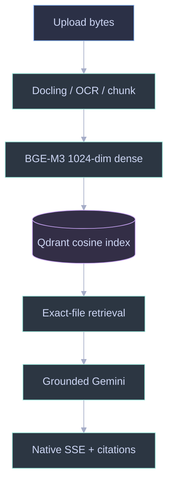
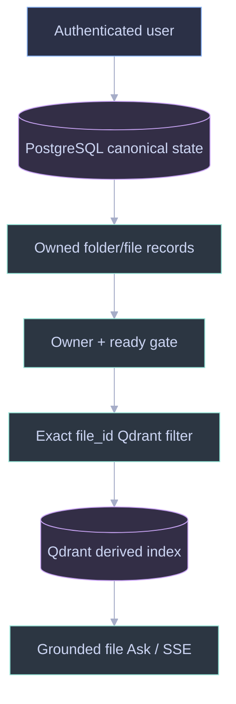
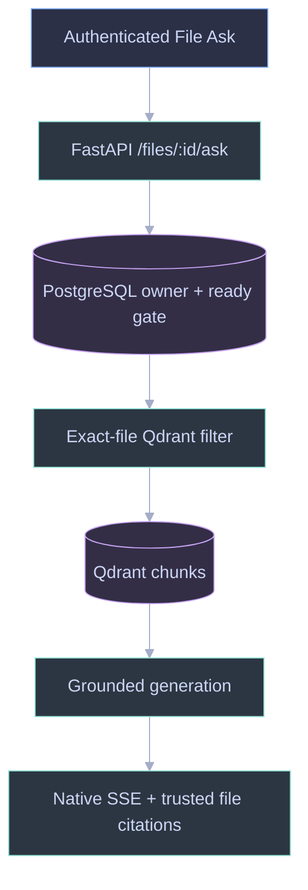
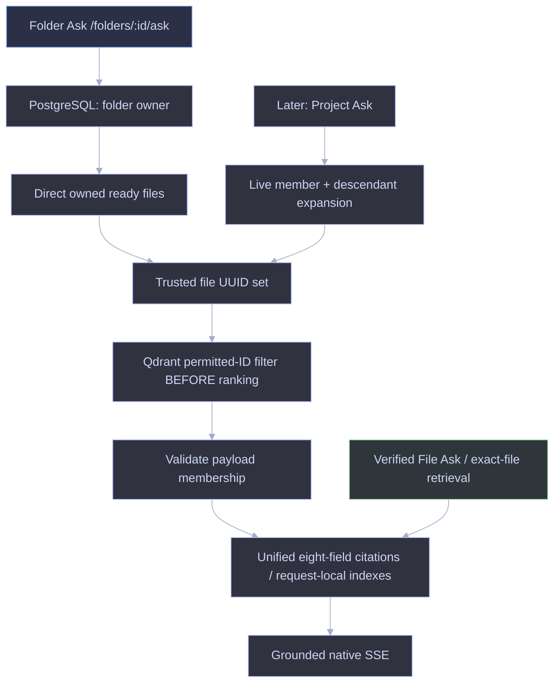
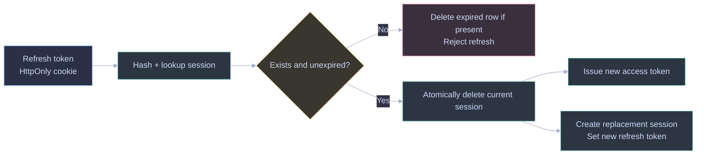

# Atlas — Server Engineering Standards

Server-specific contract for FastAPI, canonical PostgreSQL state, authorized retrieval and backend lifecycle; applies to `server/**`.

- [Root AGENTS](../AGENTS.md) — inherited repository-wide policy.
- [Client AGENTS](../client/AGENTS.md) — browser/API consumer boundary.
- [RAG SKILL](../.agents/skills/rag/SKILL.md) — authoritative pipeline mechanics and trusted citations.
- Preserve verified Phase 2 behavior; report new implementation and verification only with evidence.

---

## 0. DOCUMENT ROLE & INSTRUCTION HIERARCHY

### Authority

Read the **numbered, linked files in order**. Then read the approved PLAN, current evidence and targeted source/tests.

- Server
  1. [Root AGENTS](../AGENTS.md)
  2. [Server AGENTS](AGENTS.md)
- Server + RAG
  1. [Root AGENTS](../AGENTS.md)
  2. [Server AGENTS](AGENTS.md)
  3. [RAG SKILL](../.agents/skills/rag/SKILL.md)
- Cross-Boundary
  1. [Root AGENTS](../AGENTS.md)
  2. [Server AGENTS](AGENTS.md)
  3. [Client AGENTS](../client/AGENTS.md)
  4. [RAG SKILL](../.agents/skills/rag/SKILL.md)
- Root instructions take precedence; this file specializes server domain/API/runtime contracts.
- The RAG skill—not this file—owns chunking, embeddings, Qdrant payload shapes, retrieval algorithms, grounding and citations.
- Read latest relevant **CONTEXT.md** evidence and **MANUAL.md** reproduction steps; avoid repo-wide scans.

### Instruction Inheritance

- Keep FastAPI authentication/authorization, owner scopes and canonical state server-side.
- Public route and DTO changes require an approved PLAN/AMENDMENT; browser behavior cannot define backend trust.
- Do not silently replace inherited `LOCKED` contracts with future planning assumptions.

---

## 1. PURPOSE & ENGINEERING OBJECTIVES

### Server Objective

Deliver secure canonical Drive services and a trusted RAG retrieval/generation pipeline, extending the verified single-file boundary into Folder and later Project Ask only through approved scope resolution.

**Backend Features:**

- **Canonical Drive — Verified**
  - PostgreSQL users, verifications, sessions, owned folders/files, metadata and `processing`/`ready`/`deleting` states.
  - Transient original upload bytes; Qdrant is a derived vector index.
- **File Ask — Verified Baseline; Planned Citation Migration**
  - Preserve `POST /files/{file_id}/ask`, request validation, exact authorized ready-file retrieval, fallback and native SSE.
  - PLAN_01 deliberately supersedes the historical five-field citation DTO and file-local source indexes with one unified eight-field DTO and request-local indexes.
- **Folder Ask — PHASE_03_PLAN_01**
  - `POST /folders/{folder_id}/ask`; include only immediate, owned, `ready` child files.
  - Reuse a server-authorized multi-file retrieval operation, unique request-local source markers and trusted file-attributed citations.
  - No folder depth, recursion or new PostgreSQL migration expected in PLAN_01.
- **Projects — Later PHASE_03 PLANS**
  - Independent owner-scoped PostgreSQL Projects; reference canonical file/folder UUIDs, never source copies.
  - Live recursive expansion of selected folders, file deduplication and current canonical metadata.
  - Database-enforced membership cleanup on final canonical deletion; Project deletion preserves Drive sources.

**Deferred:** Entire-drive Ask, configurable folder depths, user-selected folder file subsets, sharing, original-file persistence, folder movement/deletion, new providers and unmeasured hybrid/reranking.

### Engineering Priorities

- PostgreSQL owns identity, scope, ownership and `ready` eligibility; Qdrant only ranks authorized source chunks.
- Filter permitted IDs **before vector ranking**; validate every returned chunk's canonical membership.
- Keep routers thin, domain orchestration in `pipeline/`, data models in `models/`, transport schemas in `schemas/` and reusable runtime in `core/`/`db/`.
- Preserve file ingestion/deletion compensation, explicit errors, streaming lifecycle and existing authentication/session behavior.
- Follow the RAG skill for detailed provider and provenance contracts; no new library or schema by default.
- Implement only explicitly approved AMENDMENTS and verification stages.

---

## 2. CURRENT STATE & DEVELOPMENT DESTINATION

This is a current-state snapshot. Dated implementation evidence belongs in PLAN **CONTEXT.md**.

### Status Vocabulary

Use exactly the root file's four statuses for PHASES, PLANS, AMENDMENTS and capabilities:

| Status        | Definition                                                       | Required Evidence                       |
| ------------- | ---------------------------------------------------------------- | --------------------------------------- |
| `PENDING`     | Planned or approved; implementation pending.                     | Approval/specification; no code claim.  |
| `BUILDING`    | Implementation underway; scope remains incomplete.               | Work in progress and open requirements. |
| `IMPLEMENTED` | Required code exists; full acceptance incomplete/failed/blocked. | Source evidence and remaining checks.   |
| `VERIFIED`    | Applicable acceptance passed and is recorded.                    | Executed tests/runtime evidence.        |

- Status is scope-specific; a verified PLAN does not verify the containing PHASE automatically.
- Historical CONTEXT/MANUAL retain original wording; do not reclassify known failures as passes.

### Phase Roadmap

| PHASE                                   | Backend Boundary                                        | Status     |
| --------------------------------------- | ------------------------------------------------------- | ---------- |
| PHASE_01 — MVP Core RAG                 | Ingestion, exact-file retrieval, grounded SSE/citations | `VERIFIED` |
| PHASE_02 — Authenticated Personal Drive | PostgreSQL auth, Drive, ready-gated File Ask            | `VERIFIED` |
| PHASE_03 — Folder & Project RAG         | Scoped multi-file Folder Ask and live Project Ask       | `BUILDING` |

### Development Destination

- **Active direction:** `PHASE_03`; **first milestone:** `PHASE_03_PLAN_01 — Single-Level Folder RAG` (`BUILDING`).
- **Current boundary:** Amendment 01's internal bounded direct-folder resolver and Amendment 02's internal multi-file retrieval/evaluation are `VERIFIED` through applicable local, packaged, separately approved real-store/model/capacity and exact cleanup/preservation evidence; see [CONTEXT](../prompts/PHASE_03/PLAN_01/PHASE_03_PLAN_01_CONTEXT.md). PLAN_01/PHASE_03 remain `BUILDING`; final numeric policy, public Folder Ask and citation changes remain pending.
- **PLAN_01 server scope:** owner-checked direct ready-file resolver; bounded internal multi-file retrieval; unified File/Folder citations; `POST /folders/{folder_id}/ask` native SSE.
- **Future:** `PLAN_02` Project entities/live membership; `PLAN_03` recursive Project RAG; `PLAN_04` browser/PHASE acceptance—all `PENDING`.
- **Baseline:** PHASE_02 PLANs 01–04 are `VERIFIED`. File Ask remains verified under its historical contract; only its approved citation/index migration and client routing are superseded in PLAN_01.
- **Remote reference:** `phase-02/plan-04` last inspected; inspect actual local Git state before implementation and do not switch branches without approval.

### Integration Gate

- Server contract and deterministic authorization tests precede client integration.
- The detailed RAG SKILL and existing File Ask contracts remain binding unless a narrowly approved extension supersedes them.
- Stage 01 local implementation/checks must STOP for review; Stage 02 live/side-effectful verification needs fresh approval.

---

## 3. COMPLETED HISTORY & VERIFIED BASELINES

This section records completed, **`VERIFIED`** PHASES only. PHASE_03 belongs in Section 2 until independently verified.

### PHASE_01 — MVP Core RAG

**Objective:** Implement source-preserving ingestion, exact-file dense retrieval and grounded, streaming answers with trusted citations.

#### Verified Baseline



#### Verified Maturity

| Capability   | Delivered Behavior                                                       |
| ------------ | ------------------------------------------------------------------------ |
| Extraction   | Docling structure/OCR, contextual text and raw display provenance.       |
| Embeddings   | Shared BGE-M3 tokenizer/embedding space; dense 1024-dimensional vectors. |
| Vector Store | Qdrant cosine and file-associated payloads.                              |
| Retrieval    | Exact `file_id` filtering before grounded generation.                    |
| Generation   | Gemini provider abstraction, native SSE and trusted citations.           |

#### Completion Boundary

- Historical Phase 1 was single-user, unauthenticated and single-file only.
- Legacy upload/query routes were superseded by canonical authenticated Phase 2 contracts.

#### Evidence

| PLAN      | Records                                                                                                                               |
| --------- | ------------------------------------------------------------------------------------------------------------------------------------- |
| `PLAN_01` | [CONTEXT](../prompts/PHASE_01/PLAN_01/PHASE_01_PLAN_01_CONTEXT.md) · [MANUAL](../prompts/PHASE_01/PLAN_01/PHASE_01_PLAN_01_MANUAL.md) |
| `PLAN_02` | [CONTEXT](../prompts/PHASE_01/PLAN_02/PHASE_01_PLAN_02_CONTEXT.md) · [MANUAL](../prompts/PHASE_01/PLAN_02/PHASE_01_PLAN_02_MANUAL.md) |
| `PLAN_03` | [CONTEXT](../prompts/PHASE_01/PLAN_03/PHASE_01_PLAN_03_CONTEXT.md) · [MANUAL](../prompts/PHASE_01/PLAN_03/PHASE_01_PLAN_03_MANUAL.md) |
| `PLAN_04` | [CONTEXT](../prompts/PHASE_01/PLAN_04/PHASE_01_PLAN_04_CONTEXT.md) · [MANUAL](../prompts/PHASE_01/PLAN_04/PHASE_01_PLAN_04_MANUAL.md) |

### PHASE_02 — Authenticated Personal Drive

**Objective:** Establish canonical identity, owned file/folder hierarchy, file lifecycle and owner/ready-gated File Ask.

#### Verified Baseline



#### Verified Maturity

| PLAN      | Delivered Behavior                                                                                            |
| --------- | ------------------------------------------------------------------------------------------------------------- |
| `PLAN_01` | Users/verifications/sessions, Argon2id, JWT, OTP, rotating single-use refresh and logout.                     |
| `PLAN_02` | Canonical folders/files, direct-child scope, transient upload, deletion/retry and ready-gated file retrieval. |
| `PLAN_03` | Historical Next.js browser auth, later retired.                                                               |
| `PLAN_04` | Consolidated folder/file APIs, Vite SPA, File Ask UI, root Compose and final Phase acceptance.                |

- **Recorded final acceptance:** 424 client tests, 329 packaged backend tests, 222 production-browser checks; 17 PLAN_04 and 15 PHASE_02 criteria reconciled.
- **Provider qualification:** Final Phase 2 RAG browser/integration used deterministic generation; no new live Gemini call.
- **Preservation qualification:** Docker cache record comparison 111 → 73 (42 originals missing) literally FAILED; cause unknown and exception explicitly accepted. No failure was relabeled as a pass. Final approved PostgreSQL/Qdrant restoration/cleanup passed.

#### Completion Boundary

- `VERIFIED`: authentication, Drive canonical ownership/lifecycle, file Ask and 18-operation API baseline.
- Not part of Phase 2: Folder Ask, Projects, multi-file citations, entire-drive retrieval or configured depth controls.
- Do not silently claim original-file persistence, file/folder movement or folder deletion exists.

#### Evidence

| PLAN      | Records                                                                                                                               |
| --------- | ------------------------------------------------------------------------------------------------------------------------------------- |
| `PLAN_01` | [CONTEXT](../prompts/PHASE_02/PLAN_01/PHASE_02_PLAN_01_CONTEXT.md) · [MANUAL](../prompts/PHASE_02/PLAN_01/PHASE_02_PLAN_01_MANUAL.md) |
| `PLAN_02` | [CONTEXT](../prompts/PHASE_02/PLAN_02/PHASE_02_PLAN_02_CONTEXT.md) · [MANUAL](../prompts/PHASE_02/PLAN_02/PHASE_02_PLAN_02_MANUAL.md) |
| `PLAN_03` | [CONTEXT](../prompts/PHASE_02/PLAN_03/PHASE_02_PLAN_03_CONTEXT.md) · [MANUAL](../prompts/PHASE_02/PLAN_03/PHASE_02_PLAN_03_MANUAL.md) |
| `PLAN_04` | [CONTEXT](../prompts/PHASE_02/PLAN_04/PHASE_02_PLAN_04_CONTEXT.md) · [MANUAL](../prompts/PHASE_02/PLAN_04/PHASE_02_PLAN_04_MANUAL.md) |

---

## 4. ARCHITECTURE & DATA FLOW

### Stack

| Layer           | Verified Selection                                                  |
| --------------- | ------------------------------------------------------------------- |
| Backend         | Python, FastAPI, Pydantic, SQLAlchemy/Alembic                       |
| Configuration   | `python-dotenv`, existing validated constants/schemas               |
| Canonical State | PostgreSQL owners, sessions, folders and files                      |
| Derived Index   | Self-hosted Qdrant, dense cosine vectors                            |
| Processing      | Docling, HybridChunker, RapidOCR and BGE-M3 via FlagEmbedding       |
| Generation      | Gemini Flash behind Atlas `LLMProvider`, official `google-genai`    |
| Deployment      | Root `compose.yml`, `atlas` project, server Docker image            |
| Deferred        | Redis, workers/queues, managed RAG and new orchestration frameworks |

### Backend Authority Boundaries

- `routers/` handles authenticated HTTP contracts and thin request dispatch; `pipeline/` owns application orchestration.
- `models/postgres/` and PostgreSQL own canonical identity, ownership, folder relationships, state and readiness.
- Qdrant stores derived chunks only; Qdrant metadata is **not** authorization authority.
- `core/` and `db/` own prepared runtime resources, configuration, storage interaction and lifecycle.
- `errors/` owns structured sanitized errors; no provider/raw source/secrets in response bodies.
- The [RAG SKILL](../.agents/skills/rag/SKILL.md) owns technical retrieval/generation/citation contracts.
- `main.py` is wiring only, never a place for domain logic.

### Verified File Ask Flow



### PHASE_03 Planned Scope Flow



- File Ask retains its exact-file filter, endpoint, fallback and SSE; its five-field DTO and file-local citation mapping are `SUPERSEDED` by the planned unified contract.
- Folder Ask selects immediate files only; Projects later expand referenced folders recursively.
- Empty eligible sets must bypass retrieval/provider work and use the approved scope-specific fallback.
- No global vector retrieval followed by owner filtering; revalidate each Qdrant result's membership.
- No long-lived PostgreSQL transaction spanning external retrieval/LLM streaming without approval.

---

## 5. REPOSITORY STRUCTURE & OWNERSHIP

### Verified Server Structure

```text
server/
├── AGENTS.md
├── .env                         # ignored private settings
├── .env.example                 # safe placeholders
├── Dockerfile
├── requirements.txt
├── app/
│   ├── main.py                  # FastAPI wiring only
│   ├── routers/                 # public API boundaries
│   ├── errors/                  # sanitized typed HTTP errors
│   ├── core/                    # config, lifespan, prepared runtime
│   ├── schemas/                 # API and internal validated DTOs
│   │   ├── folders/
│   │   ├── files/
│   │   ├── retrieval.py
│   │   └── generation.py
│   ├── models/
│   │   ├── postgres/            # canonical entities
│   │   └── qdrant/              # stored chunk payload mapping
│   ├── pipeline/
│   │   ├── folders.py
│   │   ├── files.py
│   │   ├── retrieval.py
│   │   └── generation/
│   └── db/                      # PostgreSQL/Qdrant mechanics
├── migrations/
└── tests/
```

### Ownership Boundaries

- `routers/folders.py` owns `/folders` resources; `routers/files.py` owns `/files`, including the verified native File Ask SSE.
- `pipeline/folders.py` owns current folder listing and folder metadata operations; PLAN_01 adds focused direct-file Ask scope resolution without altering listing behavior.
- `pipeline/retrieval.py` and `db/qdrant.py` own vector request mechanics; use RAG SKILL before editing them.
- `schemas/folders/`, `schemas/files/`, `schemas/generation.py` own validated DTOs and consistent errors.
- PostgreSQL `models/` contain storage entities, not app orchestration; SQL/database mechanics remain in the established `db/` boundaries.
- Startup-prepared embedding/provider/Qdrant resources are reused, never reconstructed per request.
- `main.py` only includes routers, exception handlers and lifespan.
- Preserve existing `ValidationRoute` semantics; file router has separate upload, metadata and Ask authentication/validation behavior.
- Do not revive removed `GET /drive`, `POST /files/{file_id}/query`, or Next.js-specific backend routes.
- PLAN_01 does not create Project schema or recursive folder resolver; PLAN_02/03 will own them later.

---

## 6. ENGINEERING & DOCUMENTATION CONVENTIONS

### Naming

- Prefer single-word variable/function/parameter names where clear.
- Use multiple words only when needed for clarity.
- Follow adjacent established module naming when adding files.

### Imports

Order backend Python imports as:

1. standard library;
2. third-party;
3. internal `app.*`.

Within internal imports, group by top-level subpackage:

- `app.core`
- `app.db`
- `app.pipeline`
- `app.routers`
- `app.schemas`
- `app.models`
- `app.errors`

Use one blank line between groups and no blank line within a group.

### Comments & Docstrings

- Do not scatter inline comments explaining individual code lines.
- Use function/method docstrings to describe behavior, parameters, returns, lifecycle, or non-obvious contracts.

### Vertical Spacing

For new/edited code:

- no blank line between a function/method docstring and its first statement;
- one blank line between logical steps such as guard, try/except, logging, construction, return;
- no blank lines inside one tight logical step.

Apply this manually; formatter output does not replace the convention.

Example:

```python
def load(path: str) -> list[str]:
    """Read non-empty lines from a file."""
    if not path:
        raise ValueError("path required")

    try:
        with open(path) as handle:
            lines = handle.readlines()
    except OSError:
        logger.exception("Read failed: path=%s", path)

        raise

    logger.info("Read file: lines=%d", len(lines))

    return [line for line in lines if line.strip()]
```

New files mirror the latest established file in the same folder unless this documented convention intentionally supersedes it.

### Documentation & Ownership

- Inherit root PHASE / PLAN / AMENDMENT terminology and the status labels in Section 2.
- Codex maintains CONTEXT for execution/evidence and MANUAL for reproduced commands.
- Do not rewrite historical evidence to hide current failures or incomplete checks.
- Keep public contracts, schema ownership, and architecture choices under the approved PLAN.

---

## 7. TECHNICAL CONTRACTS & RUNTIME BEHAVIOR

### Configuration, Errors & Lifecycle

Atlas configuration uses:

```text
.env
-> python-dotenv loading in core/constants.py
-> Pydantic validation in schemas/constants.py
-> validated Constants groups
```

Rules:

- `.env` loading remains in `core/constants.py`.
- Validation remains in `schemas/constants.py`.
- Configuration groups remain 1:1 across those layers.
- Loading and validation are separate concerns.
- Do not introduce `pydantic-settings`.
- Preserve existing lazy validation where a verified subsystem intentionally validates only when prepared/used.
- `.env` is local/ignored.
- `.env.example` uses placeholders/safe examples only.
- Never print secrets through diagnostics or full environment dumps.
- Compose environment forwarding must stay aligned with validated settings.
- CORS uses an explicit configured allow-list; do not replace it with wildcard defaults.
- Verified Phase 2 refresh-cookie auth uses explicit credentialed browser CORS/cookie behavior; later method/header expansion must remain narrow, PLAN-defined, and non-wildcard.

`server/app/errors/` uses one structured FastAPI-native pattern.

Requirements:

- one category-specific string error-code set per error category;
- one mapping from error code to HTTP status;
- base exception such as `ApiError` carrying message + code;
- consistent serialization:

```json
{ "error": "...", "code": "..." }
```

- one FastAPI exception handler registered in `main.py`;
- routers raise structured application errors rather than constructing ad hoc `HTTPException` responses;
- dependency/provider failures remain explicit;
- no silent conversion of operational failure into empty success;
- no raw provider/source/secret leakage through public errors.

The pattern was adapted from the human-provided TypeScript/Hono reference; preserve the pattern, not the original framework-specific implementation.

- Startup-prepared resources must not be reconstructed per request without an approved reason.
- Preserve current lifespan ownership.
- Keep provider/client lifecycle deterministic.
- Request-scoped cleanup must remain explicit where streaming/resources require it.
- Blocking synchronous work must not be run directly on an async event loop when the current architecture already provides the correct sync/threaded boundary.
- Do not introduce global provider state beyond established runtime ownership.
- Do not silently add background tasks/threads/queues for convenience.
- Lifecycle changes are material architecture when they alter service/resource ownership; stop and report before broadening scope.

### Authentication & Canonical State

#### Locked Credential Primitives

- Password hashing and verification use Argon2id server-side.
- Access tokens are short-lived HS256 JWTs validated by FastAPI.
- Refresh credentials are opaque, single-use tokens with only their hashes persisted.
- OTP generation uses a secure six-digit string; preserve leading zeroes.
- Browser refresh credentials use the verified HttpOnly `atlas_refresh` cookie contract.

These are cross-Amendment Phase 2 rules. Exact DTOs, ORM/migration tooling and layout, token TTL values, and endpoint error contracts belong in the applicable PLAN.

#### Users & Credentials

- `users.password` stores the password hash, never plaintext.
- Password hashing/verification is server-side.
- Never persist or log raw passwords.
- Normalize/validate identity input according to the approved server contract before canonical lookup/storage.

#### Verifications

- Canonical table name: `verifications`.
- Verification records carry a typed purpose that supports at least `auth`, `reset`, and `forgot`.
- Phase 2 product behavior uses `auth`; `reset` and `forgot` are schema-supported purposes, not implemented password flows.
- Phase 2 intentionally stores the development OTP so it can be inspected from PostgreSQL while email delivery is absent.
- Never log OTPs.
- Successful OTP use deletes the verification record.
- An encountered expired verification is invalid and is deleted during that request.
- No cron/background TTL mechanism is required.

#### Sessions & Refresh Tokens

- Canonical table name: `sessions`.
- Persist only a hash of each refresh token, never the raw token.
- A refresh token is single-use.
- Successful refresh atomically consumes/deletes the current session row before creating the replacement session and issuing the next access token.
- An encountered expired session is invalid and is deleted during that request.
- No revocation-history/family audit model or scheduled TTL cleanup is part of Phase 2 unless a later approved contract adds it.

Legend: a refresh credential is a single-use server session; the old session must disappear before its replacement becomes authoritative.



#### Folders & Files

- **PLAN_04 Amendment 02 supersession (`VERIFIED`):** `GET /folders` returns logical-root `FolderListingResponse`; `GET /folders/{folder_id}` returns the owned selected folder and direct children. Both reject every query parameter using `FolderQuery` and shared `ValidationRoute` validation.
- `GET /files/{file_id}` uses `FileRoute` authentication before UUID parsing, one unlocked SQL SELECT by file ID AND owner, and existing ten-field `FileResponse` for all three statuses. No commit, write, readiness guard, Qdrant or provider access.
- `GET /drive` and `POST /files/{file_id}/query` are completely unregistered (ordinary framework 404), including OpenAPI. No alias or fallback is allowed; the shared `ValidationRoute` class remains for existing validation callers.
- The 18 application operations comprise system 2, auth 7, folders 4 and files 5; documentation facilities are excluded. Internal retrieval and public owner/ready-gated Ask/SSE remain intact. Historical PLAN_02 contracts retain their original verification evidence.
- Folders and files are canonical PostgreSQL records owned by one canonical user.
- Folders are owner-scoped and recursively nestable through a parent-folder relationship.
- A child folder's parent and a file's optional folder must belong to the same owner; cross-owner placement is invalid.
- Folder metadata includes user-facing name and description.
- Phase 2 supports folder creation and rename; it does not support folder deletion or movement.
- Files may be placed in one owned folder or at root; file movement is not supported in Phase 2.
- Duplicate sibling folder names and duplicate sibling file names are allowed, and files/folders may share the same display name. UUIDs establish identity; names do not.
- Original file bytes are not persistently stored in Phase 2.
- File name/description metadata changes do not imply content replacement or Qdrant reindexing.
- **PLAN_04 metadata read (`VERIFIED`):** `GET /files/{file_id}` returns the existing canonical File DTO for the authenticated owner. Missing and foreign IDs produce the same privacy-safe `404 FILE_NOT_FOUND`. File metadata reads are permitted for `processing`, `ready`, and `deleting`; internal retrieval and public `/ask` require `ready`. Do not add a schema migration, Qdrant call, download, preview, or RAG operation for this endpoint.
- This public file metadata contract is historically `VERIFIED`; any change requires renewed targeted verification.
- Canonical file lifecycle states are `processing`, `ready`, and `deleting`.
- Canonical upload creates the file UUID/`processing` row before ingestion, uses that exact UUID for Qdrant `file_id`, and transitions to `ready` only after confirmed indexing success.
- Known ingestion failure cleans any exact-file Qdrant writes and removes the temporary PostgreSQL file row; Phase 2 does not retain a durable `failed` file state.
- Only an owner-authorized `ready` file at the request-start authorization read may enter a new Ask scope.
- Permanent deletion transitions the canonical file to `deleting`, removes all derived Qdrant points for the exact `file_id`, then removes the PostgreSQL row. A `deleting` file is excluded from new Ask scopes and the operation is retryable; already-authorized requests may continue under the PLAN_01 snapshot policy.
- A file must be owner-authorized from PostgreSQL at request start before any Qdrant retrieval/generation access; later deletion does not mandate cancellation or revalidation.

### RAG Integration Boundary

Detailed RAG contracts remain authoritative in:

```text
../.agents/skills/rag/SKILL.md
```

Read that skill before modifying:

- extraction;
- Docling configuration/behavior;
- chunking;
- tokenizer/chunk limits;
- embeddings;
- BGE-M3;
- vector dimensions/schema;
- Qdrant retrieval/filtering;
- retrieval `top_k`/score behavior;
- grounding;
- Gemini provider behavior;
- citation marker parsing;
- trusted citation mapping;
- GroundedStream;
- public RAG SSE semantics.

#### Locked High-Level RAG Selections

These high-level selections remain resolved:

- Docling `DocumentConverter` + `HybridChunker`.
- Standard Docling pipeline + RapidOCR.
- No VLM tier.
- `pdfplumber`/`tiktoken` are superseded.
- Chunk tokenizer: `BAAI/bge-m3`.
- `DOCLING_MAX_CHUNK_TOKENS` controls chunk size; default `500`.
- Do not hardcode the configurable chunk size.
- `merge_peers=True`.
- BAAI/bge-m3 through FlagEmbedding `BGEM3FlagModel`.
- Dense-only MVP; hybrid remains deferred.
- The historical single-file baseline tolerated model size/latency; PHASE_03 multi-file scopes require explicit measured resource and latency budgets.
- Qdrant cosine dense retrieval baseline.
- Gemini Flash through official `google-genai`, behind `LLMProvider`.

Supported upload formats currently include:

- `.pdf`
- `.docx`
- `.pptx`
- `.xlsx`
- `.md`
- `.txt`
- `.html`
- `.csv`
- `.png`
- `.jpg`
- `.jpeg`
- `.tiff`
- `.bmp`
- `.webp`

Deferred formats:

- audio/video;
- EPUB;
- AsciiDoc;
- LaTeX;
- XML schemas.

Flag additions before implementing them.

If any high-level summary here conflicts with the RAG skill, stop and report the discrepancy; do not silently choose one.

### PHASE_03 Planned Scope & Folder Ask API

**Status: `PENDING` — no Folder/Project RAG implementation is claimed.**

- `POST /folders/{folder_id}/ask` is the approved new Folder Ask endpoint. The selected real folder UUID must belong to the authenticated user; missing/foreign folders must share the non-disclosing 404 behavior.
- Resolve **only** direct `files.folder_id = folder_id`, owner-matching, `status = ready` canonical files. Exclude nested descendants, root, siblings, other users and non-ready files.
- Pass a **server-resolved** authorized UUID set and canonical request-time source metadata to a reusable internal retrieval operation; never accept arbitrary client-supplied allowed-file lists as authorization. Recommend an immutable request scope; the exact interface belongs to the focused AMENDMENT.
- Embed the validated question using existing BGE-M3; apply Qdrant permitted-ID filtering **before ranking**. Validate all returned file IDs and stored payloads against authorized membership.
- Zero eligible files bypass embedding, Qdrant and Gemini; zero retrieved chunks bypass Gemini. Both use successful fallback with empty citations and `done`. Preserve structured pre-stream HTTP errors and native SSE error/cleanup lifecycle.
- Use unique request-local numeric source references for **all** Ask scopes; map `[[cite:N]]` to canonical `(file_id, chunk_index)` and trusted metadata. Model text must not author provenance.
- **Unified Citation DTO (`LOCKED`):** exactly `index`, `file_id`, `file_name`, `chunk_index`, `page`, `heading`, `section`, `excerpt`. Use request-local `index`, canonical PostgreSQL UUID/name snapshot and validated chunk provenance. Preserve nullable metadata and trusted source excerpt as defined in the RAG skill.
- The five-field File Ask citation DTO and file-local index are historically `VERIFIED` but `SUPERSEDED` for PLAN_01. Coordinate parser/prompt, serialization and client migration; preserve marker grammar and native SSE lifecycle.
- **Fallbacks (`LOCKED`):** File Ask retains `I don't have enough information in this file to answer that.` Folder Ask uses `I don't have enough information in this folder to answer that.` Never convert an authorization, dependency, parser or resource error into fallback.
- File Ask keeps `top_k=5` and range `1–20`; Folder Ask evaluates fixed global candidate limits k=5, 8, 12, with k=8 still `PROVISIONAL`. Never use file-count-proportional top-k or arbitrary unmeasured thresholds.
- Bound eligible files, retrieved chunks, context, latency and response size using approved limits; never silently truncate the eligible UUID set. A ceiling of 100 eligible files and ~12,000 assembled prompt tokens are `PROVISIONAL` evaluation candidates, not production limits.
- Benchmark scope resolution/filtering at approximately 10/50/100/250 eligible files and compare k=5/8/12 on the same labeled corpus. Record quality, latency and context evidence; approve final limits before shipping. BGE-M3 token counts are not exact Gemini token counts.
- Oversized scope is an explicit pre-stream structured error, not fallback; HTTP `409` and `FOLDER_SCOPE_LIMIT_EXCEEDED` remain proposed pending confirmation of the established error envelope. Future file-subset selection is deferred.
- **Deletion Consistency (`LOCKED`):** preserve `ready → deleting → Qdrant cleanup → canonical delete`. Authorize once at request start; already-authorized Ask may continue after deletion begins.
- New File Ask rejects `deleting`/deleted sources; new Folder Ask excludes them, continuing with other eligible files or returning the exact fallback when empty. No mandatory pre-generation revalidation, continuous polling or long-held PostgreSQL locks.
- Qdrant cleanup racing retrieval may reduce/remove matches; normal empty-result fallback applies, but actual dependency failures stay errors.
- PLAN_01 expects no PostgreSQL migration; do not add one without review/approval.
- A future Project resolver will provide the _same_ internal authorized retrieval operation with live recursive membership. Project entities, schema and APIs belong to later PLANS.

### Canonical File Lifecycle

```mermaid
%%{init: {'theme': 'base', 'themeVariables': {'background': '#1e1e2e', 'primaryColor': '#45475a', 'primaryTextColor': '#cdd6f4', 'primaryBorderColor': '#89b4fa', 'lineColor': '#a6adc8', 'secondaryColor': '#313244', 'tertiaryColor': '#181825', 'fontFamily': 'Inter, sans-serif'}}}%%
flowchart LR
    Upload["POST /files"] --> Processing["PostgreSQL: processing"]
    Processing --> Index["Index exact file_id in Qdrant"]
    Index -- "success" --> Ready["PostgreSQL: ready"]
    Index -- "known failure" --> Cleanup["Remove exact-file points and row"]
    Ready --> Delete["PostgreSQL: deleting"]
    Delete --> Remove["Exact Qdrant cleanup"]
    Remove --> Gone["Remove PostgreSQL row"]
    class Upload client;
    class Processing,Index,Delete,Remove service;
    class Ready verified;
    class Cleanup caution;
    class Gone storage;
    classDef client fill:#2b3046,stroke:#89b4fa,stroke-width:1px,color:#cdd6f4;
    classDef service fill:#2c3642,stroke:#94e2d5,stroke-width:1px,color:#cdd6f4;
    classDef storage fill:#332e46,stroke:#cba6f7,stroke-width:1px,color:#cdd6f4;
    classDef verified fill:#2e363c,stroke:#a6e3a1,stroke-width:1px,color:#cdd6f4;
    classDef planned fill:#30323f,stroke:#b4befe,stroke-width:1px,color:#cdd6f4;
    classDef caution fill:#38362e,stroke:#f9e2af,stroke-width:1px,color:#cdd6f4;
    classDef denied fill:#39303d,stroke:#f38ba8,stroke-width:1px,color:#cdd6f4;
```



---

## 8. SECURITY & TRUST BOUNDARIES

Logging should support debugging/evaluation without leaking content.

At the relevant pipeline stages, log chunk count, embedding dimension, retrieval top-k scores, and generation token usage. These required diagnostics preserve the existing debugging baseline.

Safe examples when relevant:

- file_id;
- chunk count;
- embedding dimension;
- retrieval top_k;
- retrieval scores;
- durations;
- generation token usage;
- safe failure code/category.

Do not log:

- API keys;
- passwords or password hashes;
- OTPs;
- raw access/refresh tokens or refresh-token hashes;
- full sensitive source documents;
- unnecessary PII;
- full user questions unless an approved debugging policy explicitly permits it;
- generated answers by default;
- citation excerpts by default;
- raw provider request/response/error bodies.

Security boundaries:

- uploads are untrusted input;
- validate at trust boundaries;
- enforce retrieval scope server-side;
- never let the LLM decide authorization/scope;
- preserve CORS as browser-origin policy, not authentication;
- authentication does not replace owner authorization;
- client route state never establishes ownership;
- do not leak out-of-scope retrieval context.

### Non-Delegable Trust Decisions

- Treat uploaded bytes, browser IDs and model output as untrusted.
- Validate authorization server-side at request start, before retrieval and generation; use only the captured authorized scope thereafter.
- Preserve redaction and no-secret/no-content logging rules even in test output.
- Authentication uses the validated server dependency, never a browser-provided owner claim.

---

## 9. SCOPE & ARCHITECTURE GOVERNANCE

### Always Do

- Read root AGENTS, server AGENTS and the RAG skill for pipeline changes.
- Keep canonical ownership/readiness in PostgreSQL before all retrieval/generation.
- Preserve established configuration, error, runtime, provider, Qdrant and transaction boundaries.
- Retain File Ask endpoint, request validation, exact-file filter, fallback and SSE lifecycle; implement only the explicitly approved unified citation/index migration.
- Run task-proportional tests and record actual failures, not inferred results.

### Requires Approval

- New backend dependencies, service boundaries, caches/queues, environment and Docker topology.
- PostgreSQL migrations or public API/DTO changes beyond the approved scope.
- Changes to the `LOCKED` unified citation DTO, request-local mapping, exact fallback sentences or request-start deletion policy.
- Final numeric scope, Folder `top_k`, latency/context limits and other material resource policies not yet approved.
- Project membership schema, constraint and route specifics before PLAN_02 approval.
- Changes to providers, embeddings, model/query settings, chunking, Qdrant schema/indexes or RAG policies.
- Any auth/session ownership or lifecycle redesign.

### Prohibited

- Implement Folder/Project RAG before the corresponding approved AMENDMENT and verification stage.
- Globally search Qdrant and filter unauthorized points afterward.
- Let client/model-supplied IDs, metadata or instructions authorize access or citations.
- Silently turn a Qdrant/embedding/LLM failure into insufficient-context success.
- Create duplicate runtime clients/provider initialization paths per request.
- Modify the verified File Ask backend behavior to simplify multi-file support without explicit supersession.
- Add original-file persistence, folder movement/deletion, entire-drive/depth UI or managed RAG without a new decision.
- Reset databases/collections or prune persistent/unrelated Docker resources during ordinary tests.

### Decision States

- `LOCKED`: approved; require user authorization to change.
- `PROVISIONAL`: recommended but unconfirmed.
- `OPEN`: blocks affected material implementation until approved.
- `SUPERSEDED`: prior contract replaced; preserve evidence/history.

---

## 10. GIT & REPOSITORY SAFETY

- Inherit all Git restrictions from [root AGENTS.md](../AGENTS.md).
- Inspect `git status` and diff before backend work; protect existing uncommitted changes.
- Do not commit, push, create/switch branches, reset, rewrite history or discard work without explicit authorization.
- Preserve PostgreSQL and Qdrant state; never reset databases, drop collections, delete volumes or broadly prune Docker as an incidental test step.
- `phase-02/plan-04` is the last inspected remote branch **reference**, not an instruction to switch.
- Prefer `git diff --check` before completion; report all changed files.

---

## 11. VERIFICATION & ACCEPTANCE

Inherit root risk-based verification, Stage 01 STOP and independently authorized Stage 02 rules.

### Local Backend Checks

- Use the established project virtual environment from `server/` and current test commands:

```bash
python -m tests.run
```

- Install requirements only when explicitly needed/authorized; avoid incidental dependency or model changes.
- Focus on changed authorization, request/stream, retrieval and citation tests; rerun the relevant existing single-file suite.
- Never claim local in-memory SQLite/Qdrant checks establish real PostgreSQL or persistent Qdrant behavior.

### PLAN_01 Verification Boundaries

- **Scope:** two-owner, missing/foreign folder, root/sibling/descendant exclusion, readiness and empty-scope tests.
- **Retrieval:** real Qdrant permitted-file filter before ranking; validate injected wrong-file/invalid payloads and bounded inputs.
- **Citations:** one eight-field DTO for File and Folder Ask; duplicate per-file chunk indexes across sources, request-local references, exact trusted metadata, unknown/malformed markers and deliberate File Ask migration regressions.
- **Streaming:** pre-stream auth/resource errors, provider bypass on empty evidence, exact File/Folder fallbacks, event order, disconnect cleanup, partial text/error handling and preserved File Ask lifecycle after citation migration.
- **Quality:** deterministic evaluation comparing k=5, 8, 12, source coverage, context use, retrieval latency; no invented optimum.
- **Concurrency:** new authorization excludes `deleting`/deleted files; already-authorized requests may continue. Test Qdrant cleanup races and new-scope exclusion; do not claim immediate in-flight revocation.
- **Real acceptance:** separately authorized packaged API, real PostgreSQL/Qdrant, production SPA/browser checks and exact synthetic fixture preservation.

### Docker & Data Safety

- Root `compose.yml` defines `atlas`; private interpolation requires `--env-file server/.env`.
- Docker rebuilds are required for deployment-sensitive inputs under root policy, but any Docker execution requires fresh Stage 02 approval.
- Reuse existing images/containers/volumes when appropriate; no incidental `down -v`, DB reset, collection deletion or image/cache pruning.
- Record the prior Phase 2 Docker builder-cache exception exactly as accepted historical evidence, not a new pass.
- Preserve unrelated Mongo/other resources and existing canonical data; scoped fixture cleanup only by exact IDs.

### Evidence

- Stage 01: record actual Python tests/static checks and diff review; STOP for human review.
- Stage 02: record explicitly authorized HTTP/PostgreSQL/Qdrant/browser/provider results and actual resource restoration.
- `git diff --check` before completion; blocked checks remain unverified, not silently accepted.

---

## 12. STANDARD ENGINEERING WORKFLOW

### Before Implementation

1. Read root AGENTS, this file and the approved PLAN/AMENDMENT; read the RAG skill for retrieval, grounding or citations.
2. Inspect current branch/status/diff, targeted server source/tests, latest relevant CONTEXT and MANUAL.
3. Confirm API/error/DTO, scope, provider, schema and resource-lifecycle impacts.
4. Escalate `OPEN`/`LOCKED` conflicts rather than silently letting Codex decide them.

### During Implementation

- Implement one cohesive AMENDMENT; keep HTTP routers thin and ownership/trust logic in backend services.
- Preserve prepared runtime, clean session/stream closure, canonical deletion compensation and verified File Ask behavior except the approved citation/index migration.
- Keep multi-file filter authorization separate from Qdrant storage/query plumbing; no speculative Project data model in PLAN_01.
- No unapproved migration, Docker action, destructive cleanup, branch operation, commit or push.

### Verification & Completion

- Stage 01: local deterministic regressions, static/package checks and `git diff --check`; update CONTEXT/MANUAL; STOP for review.
- Stage 02: fresh approval before packaged/real DB/Qdrant/HTTP/browser/provider checks; inventory, uniquely own and clean test fixtures.
- Report exact executed commands, failures, remaining unverified gates and status (`PENDING`, `BUILDING`, `IMPLEMENTED`, `VERIFIED`).

---

## 13. MCP USAGE GUIDELINES

These MCPs are configured for Codex CLI but must be checked for availability in the active execution. Root [MCP policy](../AGENTS.md) governs consent, safety, minimal use and evidence recording.

| MCP               | Server Relevance                                                             | Use Only When                                                                             |
| ----------------- | ---------------------------------------------------------------------------- | ----------------------------------------------------------------------------------------- |
| `context7`        | Version-specific FastAPI, Pydantic, SQLAlchemy, Docker or SDK documentation. | Current repo/dependency docs leave an implementation-critical API uncertainty.            |
| `playwright`      | Cross-boundary browser acceptance.                                           | An approved server/client integration check requires actual browser behavior.             |
| `chrome-devtools` | Targeted cookie/CORS/network diagnostics.                                    | A concrete browser/server integration defect cannot be verified through HTTP tests alone. |

- Prefer focused server unit, packaged regression and live HTTP tests over browser MCPs for backend-only work.
- Do not treat MCP output as permission to alter LOCKED architecture.
- Do not capture credentials, cookies, JWTs, OTPs, source content or secret settings in recordings, logs or evidence.
- Use only authorized test data; never reset external application/database state for convenience.
- Record significant observed results in Codex-owned CONTEXT and identify unavailable MCP checks.

---

## 14. COMMANDS & TOOLING

Run from `server/`:

```bash
python -m pip install -r requirements.txt -r tests/requirements.txt
python -m tests.run
```

Run Docker commands from repository root, only within approved execution scope:

```bash
docker compose --env-file server/.env -f compose.yml up --no-build
docker compose --env-file server/.env -f compose.yml ps
```

Use the project venv for local backend debugging.

For exact PLAN-specific verification, follow the current PLAN/MANUAL/Amendment rather than assuming every task requires the full Docker path.

---

## 15. EXPLAIN-BACK REQUIREMENT

For non-trivial server work, report:

- files changed and each responsibility;
- affected backend/RAG stage;
- request/resource/data flow;
- architecture boundaries reused;
- error/failure behavior;
- lifecycle/cleanup behavior where relevant;
- focused/full test commands and exact results;
- Docker/runtime verification actually performed;
- security/logging considerations;
- remaining unverified backend scope.

For RAG work, explain how the change conforms to the detailed RAG skill rather than restating the entire skill.
