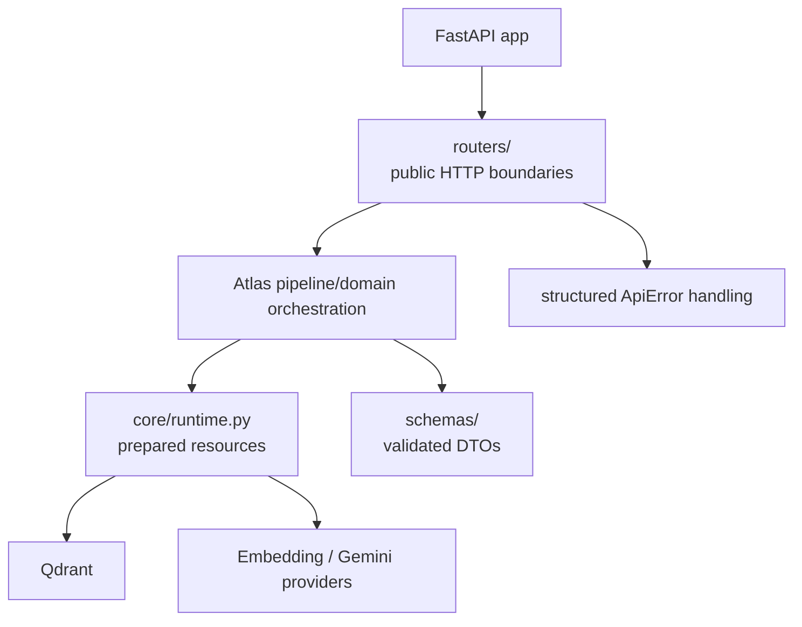

# AGENTS.md — Atlas Server

- Applies to all work under `server/**`.
- Inherits every repository-wide rule from [root AGENTS.md](../AGENTS.md); read the root file first.
- This file is the authoritative backend engineering contract for Atlas.
- It specializes root policy for FastAPI, Python, backend runtime, Qdrant integration, configuration, errors, Docker/Compose, and backend verification.
- Detailed extraction/chunking/embedding/retrieval/generation/citation contracts remain owned by the [RAG skill](../.agents/skills/rag/SKILL.md).
- Do not duplicate or silently override the RAG skill here.

---

## 1. Server purpose and current objective

The Atlas server owns the Phase 1 backend pipeline:

```text
upload -> chunk -> embed -> store -> retrieve -> generate -> stream -> cite
```

Current backend objective:

- preserve the verified single-file RAG baseline;
- keep backend trust/scope enforcement server-side;
- expose stable public API contracts to the static client;
- maintain explicit resource lifecycle, error, configuration, and verification boundaries;
- avoid speculative infrastructure before the approved phase.

Phase 1 server remains:

- single-file;
- unauthenticated;
- single-user;
- Qdrant-backed retrieval;
- no folders/tree/drive retrieval;
- no PostgreSQL canonical application state;
- no Redis caching layer.

---

## 2. Current backend maturity

| Backend capability         | Status                 |
| -------------------------- | ---------------------- |
| Upload endpoint            | Implemented & Verified |
| Extraction/chunking        | Implemented & Verified |
| Embedding                  | Implemented & Verified |
| Qdrant storage             | Implemented & Verified |
| File-scoped retrieval      | Implemented & Verified |
| Gemini generation          | Implemented & Verified |
| Grounding/citation core    | Implemented & Verified |
| Public `/ask` native SSE   | Implemented & Verified |
| Browser-facing CORS config | Implemented & Verified |

Detailed implementation evidence belongs in PLAN CONTEXT files, especially PLAN_01 through PLAN_04 and the PLAN_05 CORS records.

Do not reopen a verified backend contract merely because client work consumes it.

---

## 3. Locked backend stack and architecture

### Backend stack

- Python + FastAPI.
- Pydantic for validation/DTOs/config schemas.
- `python-dotenv` for `.env` loading.
- Qdrant self-hosted in Docker.
- Docker Compose under `server/`.
- Docling for extraction/chunking.
- BAAI/bge-m3 / FlagEmbedding for dense embeddings.
- Gemini Flash through official `google-genai`, behind Atlas `LLMProvider`.
- No LangChain by default.
- PostgreSQL begins in Phase 3 for canonical application state.
- Redis only when caching becomes concretely relevant.

### Backend authority boundaries

- PostgreSQL will become canonical application state when introduced.
- Qdrant remains a retrieval index, not canonical app state.
- Retrieval scope is enforced server-side before generation.
- Never rely on an LLM to ignore unauthorized/out-of-scope context.
- Citation metadata comes from trusted Atlas retrieval/provenance data.
- Existing public API contracts remain authoritative unless a PLAN explicitly changes them.

---

## 4. Server architecture and request flow



`main.py` remains wiring only.

Detailed RAG sub-stage mechanics live in the [RAG skill](../.agents/skills/rag/SKILL.md).

---

## 5. Server repository structure

```text
server/
├── AGENTS.md
├── .env                         # local secrets/runtime config; ignored
├── .env.example                 # safe reproducible template
├── docker-compose.yml           # server + Qdrant Compose definition
├── Dockerfile                   # backend runtime image
├── requirements.txt
├── app/
│   ├── main.py                  # wiring only
│   ├── routers/                 # public HTTP boundaries
│   ├── errors/                  # structured error categories
│   ├── core/
│   │   ├── constants.py         # dotenv loading + validated constants construction
│   │   ├── lifespan.py          # startup/shutdown ownership
│   │   └── runtime.py           # access to startup-prepared resources
│   ├── schemas/
│   │   ├── constants.py
│   │   ├── pipeline.py
│   │   ├── documents.py
│   │   ├── retrieval.py
│   │   ├── generation.py
│   │   └── system.py
│   ├── models/
│   │   ├── qdrant/
│   │   │   └── chunk.py
│   │   └── postgres/            # planned from Phase 3
│   ├── pipeline/
│   │   ├── chunking.py
│   │   ├── embeddings/
│   │   ├── storage.py
│   │   ├── retrieval.py
│   │   └── generation/
│   └── db/
└── tests/
```

Use the current repository implementation if exact names evolve; do not create parallel ownership boundaries merely because this tree shows the intended responsibility.

---

## 6. Module placement and responsibility rules

- HTTP handlers live in `routers/`, not `api/`.
- `main.py`:
  - creates the FastAPI app;
  - includes routers;
  - registers exception handlers;
  - sets lifespan;
  - contains no implementation logic.
- Startup/shutdown implementation belongs in `core/`, imported into `main.py`.
- Runtime access to startup-prepared resources belongs in `core/runtime.py` or the current equivalent.
- `models/` contains storage-mapped entities only, split by datastore.
- One stored class per file; complex PostgreSQL entities may use a folder such as `models/postgres/user/`.
- `schemas/` contains validation, public API shapes, and pipeline DTOs.
- Group schemas by cohesive concern.
- Prefer one class per file unless classes are tightly coupled with no independent use.
- Pipeline/domain orchestration belongs in `pipeline/`, not routers.
- DB/client mechanics remain behind established Atlas boundaries.
- Do not duplicate verified provider/client initialization in request paths.
- Reuse startup-prepared runtime resources.

---

## 7. Configuration architecture

Atlas configuration uses:

```text
.env
-> python-dotenv loading in core/constants.py
-> Pydantic validation in schemas/constants.py
-> validated Constants groups
```

Rules:

- `.env` loading remains in `core/constants.py`.
- Validation remains in `schemas/constants.py`.
- Configuration groups remain 1:1 across those layers.
- Loading and validation are separate concerns.
- Do not introduce `pydantic-settings`.
- Preserve existing lazy validation where a verified subsystem intentionally validates only when prepared/used.
- `.env` is local/ignored.
- `.env.example` uses placeholders/safe examples only.
- Never print secrets through diagnostics or full environment dumps.
- Compose environment forwarding must stay aligned with validated settings.
- CORS uses an explicit configured allow-list; do not replace it with wildcard defaults.

---

## 8. Error handling

`server/app/errors/` uses one structured FastAPI-native pattern.

Requirements:

- one category-specific string error-code set per error category;
- one mapping from error code to HTTP status;
- base exception such as `ApiError` carrying message + code;
- consistent serialization:

```json
{ "error": "...", "code": "..." }
```

- one FastAPI exception handler registered in `main.py`;
- routers raise structured application errors rather than constructing ad hoc `HTTPException` responses;
- dependency/provider failures remain explicit;
- no silent conversion of operational failure into empty success;
- no raw provider/source/secret leakage through public errors.

The pattern was adapted from the human-provided TypeScript/Hono reference; preserve the pattern, not the original framework-specific implementation.

---

## 9. Python code style and imports

### Naming

- Prefer single-word variable/function/parameter names where clear.
- Use multiple words only when needed for clarity.
- Follow adjacent established module naming when adding files.

### Imports

Order backend Python imports as:

1. standard library;
2. third-party;
3. internal `app.*`.

Within internal imports, group by top-level subpackage:

- `app.core`
- `app.db`
- `app.pipeline`
- `app.routers`
- `app.schemas`
- `app.models`
- `app.errors`

Use one blank line between groups and no blank line within a group.

### Comments and docstrings

- Do not scatter inline comments explaining individual code lines.
- Use function/method docstrings to describe behavior, parameters, returns, lifecycle, or non-obvious contracts.

### Vertical spacing

For new/edited code:

- no blank line between a function/method docstring and its first statement;
- one blank line between logical steps such as guard, try/except, logging, construction, return;
- no blank lines inside one tight logical step.

Apply this manually; formatter output does not replace the convention.

Example:

```python
def load(path: str) -> list[str]:
    """Read non-empty lines from a file."""
    if not path:
        raise ValueError("path required")

    try:
        with open(path) as handle:
            lines = handle.readlines()
    except OSError:
        logger.exception("Read failed: path=%s", path)

        raise

    logger.info("Read file: lines=%d", len(lines))

    return [line for line in lines if line.strip()]
```

New files mirror the latest established file in the same folder unless this documented convention intentionally supersedes it.

---

## 10. Runtime and lifecycle ownership

- Startup-prepared resources must not be reconstructed per request without an approved reason.
- Preserve current lifespan ownership.
- Keep provider/client lifecycle deterministic.
- Request-scoped cleanup must remain explicit where streaming/resources require it.
- Blocking synchronous work must not be run directly on an async event loop when the current architecture already provides the correct sync/threaded boundary.
- Do not introduce global provider state beyond established runtime ownership.
- Do not silently add background tasks/threads/queues for convenience.
- Lifecycle changes are material architecture when they alter service/resource ownership; stop and report before broadening scope.

---

## 11. RAG boundary and skill delegation

Detailed RAG contracts remain authoritative in:

```text
../.agents/skills/rag/SKILL.md
```

Read that skill before modifying:

- extraction;
- Docling configuration/behavior;
- chunking;
- tokenizer/chunk limits;
- embeddings;
- BGE-M3;
- vector dimensions/schema;
- Qdrant retrieval/filtering;
- retrieval `top_k`/score behavior;
- grounding;
- Gemini provider behavior;
- citation marker parsing;
- trusted citation mapping;
- GroundedStream;
- public RAG SSE semantics.

### Locked high-level RAG selections

These high-level selections remain resolved:

- Docling `DocumentConverter` + `HybridChunker`.
- Standard Docling pipeline + RapidOCR.
- No VLM tier.
- `pdfplumber`/`tiktoken` are superseded.
- Chunk tokenizer: `BAAI/bge-m3`.
- `DOCLING_MAX_CHUNK_TOKENS` controls chunk size; default `500`.
- Do not hardcode the configurable chunk size.
- `merge_peers=True`.
- BAAI/bge-m3 through FlagEmbedding `BGEM3FlagModel`.
- Dense-only MVP; hybrid remains deferred.
- Size/latency is explicitly not a constraint for the project.
- Qdrant cosine dense retrieval baseline.
- Gemini Flash through official `google-genai`, behind `LLMProvider`.

Supported upload formats currently include:

- `.pdf`
- `.docx`
- `.pptx`
- `.xlsx`
- `.md`
- `.txt`
- `.html`
- `.csv`
- `.png`
- `.jpg`
- `.jpeg`
- `.tiff`
- `.bmp`
- `.webp`

Deferred formats:

- audio/video;
- EPUB;
- AsciiDoc;
- LaTeX;
- XML schemas.

Flag additions before implementing them.

If any high-level summary here conflicts with the RAG skill, stop and report the discrepancy; do not silently choose one.

---

## 12. Logging and security

Logging should support debugging/evaluation without leaking content.

At the relevant pipeline stages, log chunk count, embedding dimension, retrieval top-k scores, and generation token usage. These required diagnostics preserve the existing debugging baseline.

Safe examples when relevant:

- file_id;
- chunk count;
- embedding dimension;
- retrieval top_k;
- retrieval scores;
- durations;
- generation token usage;
- safe failure code/category.

Do not log:

- API keys;
- full sensitive source documents;
- unnecessary PII;
- full user questions unless an approved debugging policy explicitly permits it;
- generated answers by default;
- citation excerpts by default;
- raw provider request/response/error bodies.

Security boundaries:

- uploads are untrusted input;
- validate at trust boundaries;
- enforce retrieval scope server-side;
- never let the LLM decide authorization/scope;
- preserve CORS as browser-origin policy, not authentication;
- do not leak out-of-scope retrieval context.

---

## 13. Docker and Compose

- Backend/Qdrant Compose remains in `server/docker-compose.yml`.
- `.env` remains beside Compose for the established workflow.
- Reuse existing Docker images/containers/volumes when the task does not require rebuilding.
- Do not run `docker compose down -v` unless explicitly authorized.
- Do not delete/reset the Qdrant volume or collection for routine verification.
- Do not prune unrelated images/cache/volumes.
- Docker rebuild is required when changes affect:
  - Dockerfile;
  - Compose;
  - runtime dependencies;
  - environment/configuration forwarding;
  - model caching;
  - startup lifecycle;
  - another deployment-sensitive image input.
- Client-only work does not justify a backend image rebuild.
- If a prompt explicitly requires reuse-only verification, do not rebuild unless a deployment-sensitive blocker appears and the human approves the scope change.
- Docker is authoritative for backend deployment-sensitive verification.

---

## 14. Backend testing and verification

Verification follows the root risk model.

Primary backend loop runs from `server/` inside the project venv:

```bash
python -m pip install -r requirements.txt -r tests/requirements.txt
python -m tests.run
```

Docker/runtime checks when required:

```bash
docker compose --env-file .env -f docker-compose.yml up --no-build
docker compose --env-file .env -f docker-compose.yml ps
```

Rules:

- Do not claim tests passed unless they actually ran.
- Prefer focused tests plus the established full suite for behavior/contract changes.
- Real-provider smoke checks must use synthetic/non-sensitive content.
- Do not spend Gemini quota in ordinary discovered unit tests.
- Preserve persistent Qdrant data unless a task explicitly authorizes mutation/cleanup.
- Use Docker only proportionally to the change.
- Run `git diff --check` before completion.
- Record exact blocked verification when an environment dependency prevents a required check.

---

## 15. Scope and architecture boundaries

### Always do

- Read root `AGENTS.md` before this file.
- Read the RAG skill before RAG-pipeline changes.
- Reuse established provider/client/runtime/error/config patterns.
- Keep routers thin.
- Keep `main.py` wiring-only.
- Keep dependency failures explicit.
- Preserve server-side retrieval scope.
- Preserve public API contracts unless the current PLAN explicitly changes them.

### Ask first

- new backend dependency;
- new service boundary;
- new queue/cache/storage architecture;
- new auth architecture;
- DB schema/public API changes;
- embedding/retrieval/generation policy changes;
- provider/resource lifecycle redesign;
- Docker/Compose topology changes.

### Never do

- introduce LangChain merely for convenience;
- use Gemini File Search/managed RAG-as-a-service;
- globally query Qdrant and post-filter security scope in Python;
- treat model-authored citation metadata as trusted;
- hide provider/Qdrant failures behind empty success;
- create parallel provider/client initialization paths;
- add Phase 2+ auth/folders/multi-scope retrieval without explicit approval;
- reset/delete persistent Qdrant state for ordinary tests.

---

## 16. Common commands

Run from `server/`:

```bash
python -m pip install -r requirements.txt -r tests/requirements.txt
python -m tests.run
docker compose --env-file .env -f docker-compose.yml up --no-build
docker compose --env-file .env -f docker-compose.yml ps
```

Use the project venv for local backend debugging.

For exact PLAN-specific verification, follow the current PLAN/MANUAL/Amendment rather than assuming every task requires the full Docker path.

---

## 17. Explain-back requirement

For non-trivial server work, report:

- files changed and each responsibility;
- affected backend/RAG stage;
- request/resource/data flow;
- architecture boundaries reused;
- error/failure behavior;
- lifecycle/cleanup behavior where relevant;
- focused/full test commands and exact results;
- Docker/runtime verification actually performed;
- security/logging considerations;
- remaining unverified backend scope.

For RAG work, explain how the change conforms to the detailed RAG skill rather than restating the entire skill.
