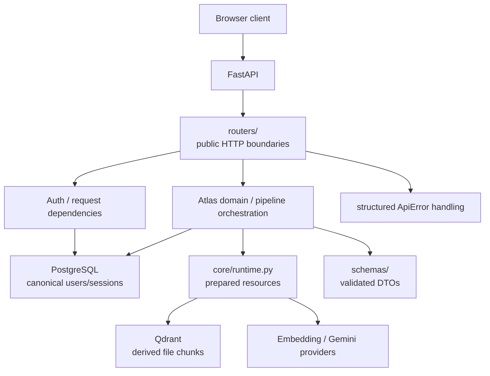
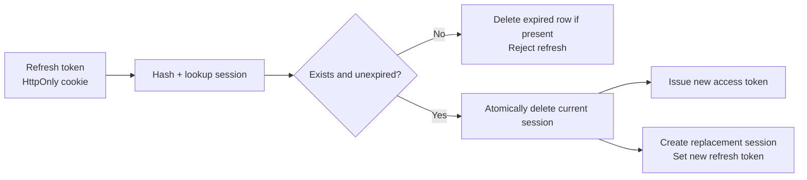

# AGENTS.md — Atlas Server

## 0. DOCUMENT ROLE & INHERITANCE

- Applies to all work under `server/**`.
- Inherits every repository-wide rule from [root AGENTS.md](../AGENTS.md); read the root file first.
- This file is the authoritative backend engineering contract for Atlas.
- It specializes root policy for FastAPI, Python, backend runtime, PostgreSQL, Qdrant integration, configuration, errors, Docker/Compose, and backend verification.
- Detailed extraction/chunking/embedding/retrieval/generation/citation contracts remain owned by the [RAG skill](../.agents/skills/rag/SKILL.md).
- Do not duplicate or silently override the RAG skill here.

### Reading order

For normal server work:

```text
root AGENTS.md
-> server/AGENTS.md
-> current PLAN
-> targeted source/tests
```

For RAG-owned work:

```text
root AGENTS.md
-> server/AGENTS.md
-> .agents/skills/rag/SKILL.md
-> current PLAN
-> targeted source/tests
```

Read CONTEXT current-state/latest relevant entries when implementation evidence is required. Use MANUAL for current reproducibility/acceptance commands.

Do not read the entire repository by default.

---

## 1. SERVER PURPOSE & CURRENT OBJECTIVE

### Verified Phase 1 backend baseline

The Atlas server already owns the verified single-file RAG pipeline:

```text
upload
-> chunk
-> embed
-> Qdrant
-> exact file-scoped retrieve
-> grounded generate
-> native SSE
-> trusted citations
```

Phase 1 backend status is IMPLEMENTED & VERIFIED.

### Current Phase 2 backend objective

Phase 2 extends the server into the canonical authority for identity, personal-drive state, ownership, and authorized reuse of the verified RAG pipeline:

```text
authenticate
-> PostgreSQL canonical state
-> folder/file ownership
-> authorize selected file
-> Qdrant exact file_id retrieval
-> existing grounded generation/SSE
```

Current backend goals:

- preserve the verified Phase 1 RAG contracts unless a current PLAN deliberately supersedes one;
- introduce PostgreSQL as canonical application state for users, verifications, sessions, folders, and files;
- keep authentication, authorization, ownership, retrieval scope, and trust enforcement server-side;
- support recursively nested folders and canonical file metadata without introducing multi-scope RAG;
- treat original upload bytes as transient ingestion input only in Phase 2;
- expose stable public API contracts before the client integrates them;
- maintain explicit resource lifecycle, error, configuration, and verification boundaries;
- avoid speculative infrastructure outside the approved phase.

Still excluded from the Phase 2 backend unless explicitly approved:

- multi-file/folder/tree/drive retrieval;
- persistent original-file storage;
- folder deletion/movement, file movement, trash/recovery;
- email delivery and password-reset/forgot-password product flows;
- Redis, background queues/workers, or new storage services.

---

## 2. CURRENT SERVER STATE

### Active phase

#### PHASE_02 — AUTHENTICATED PERSONAL DRIVE

- **Status:** `IMPLEMENTED, UNVERIFIED`
- **Current PLAN:** `PHASE_02_PLAN_01 — PostgreSQL Identity & Authentication Foundation`

#### VERIFIED FOUNDATION

```text
PostgreSQL identity persistence
-> explicit migrations + runtime ownership
-> PostgreSQL health/lifecycle
-> Argon2id password primitives
-> HS256 access-JWT primitives
-> opaque refresh-token generation/hash
-> secure OTP generation
```

#### CURRENT SERVER MATURITY

| Backend capability                   | Status                 |
| ------------------------------------ | ---------------------- |
| PostgreSQL identity persistence      | IMPLEMENTED & VERIFIED |
| Authentication credential primitives | IMPLEMENTED & VERIFIED |
| User registration                    | IMPLEMENTED & VERIFIED |
| OTP verification / resend            | IMPLEMENTED & VERIFIED |
| Initial session / access issuance    | IMPLEMENTED & VERIFIED |
| User login                           | IMPLEMENTED & VERIFIED |
| Refresh rotation / current logout    | IMPLEMENTED & VERIFIED |
| Credentialed cookie CORS             | IMPLEMENTED & VERIFIED |
| Bearer current-user resolution       | NOT YET BUILT          |
| Recursive folders                    | NOT YET BUILT          |
| Canonical file metadata/lifecycle    | NOT YET BUILT          |
| Owner authorization before RAG       | NOT YET BUILT          |

Identity persistence models, explicit migrations, runtime ownership, and PostgreSQL health integration are implemented and verified through Docker and real PostgreSQL acceptance.

Argon2id password, HS256 access JWT, opaque refresh/hash, and secure OTP primitives are also implemented and verified locally and in the packaged server.

Amendments 01–05 are complete. Registration, OTP verification/resend, initial session/access issuance, and login passed real PostgreSQL, packaged regression, live API, and datastore-preservation acceptance. Login rehash/session rollback, independent concurrent sessions, unchanged verification state on unverified login, and the shared access-token/user response are verified. Amendment 06 is complete. Atomic refresh rotation, idempotent current-session logout, and credentialed CORS passed packaged regression, real PostgreSQL rollback/concurrency, live HTTP/cookie/CORS, image/log security, and datastore-preservation acceptance. Bearer current-user resolution remains unbuilt. Canonical folder/file state belongs to later work.

Planned/approved behavior is not implementation evidence. Do not mark a Phase 2 capability implemented or verified until the corresponding code and required verification exist.

#### CURRENT EVIDENCE

- [PHASE_02 PLAN_01 CONTEXT](../prompts/PHASE_02/PLAN_01/PHASE_02_PLAN_01_CONTEXT.md)
- [PHASE_02 PLAN_01 MANUAL](../prompts/PHASE_02/PLAN_01/PHASE_02_PLAN_01_MANUAL.md)

---

## 3. COMPLETED SERVER HISTORY

This section records durable verified backend baselines for completed Atlas phases.

It is not a chronological implementation log. Detailed Amendment history, failures, timings, versions, hashes, test counts, and corrective work remain in the corresponding CONTEXT files.

Completed backend phases are appended here in order when the entire PHASE reaches `IMPLEMENTED & VERIFIED`.

### PHASE_01 — MVP CORE RAG

- **Status:** `IMPLEMENTED & VERIFIED`
- **Brief:** Established the complete single-file backend RAG path from upload and extraction through retrieval, grounded generation, native SSE, trusted citations, and browser-facing CORS support.

#### VERIFIED BASELINE

```text
upload
-> chunk
-> embed
-> Qdrant
-> exact file-scoped retrieve
-> grounded generate
-> native SSE
-> trusted citations
```

#### VERIFIED SERVER MATURITY

| Backend capability         | Status                 |
| -------------------------- | ---------------------- |
| Upload endpoint            | IMPLEMENTED & VERIFIED |
| Extraction/chunking        | IMPLEMENTED & VERIFIED |
| Embedding                  | IMPLEMENTED & VERIFIED |
| Qdrant storage             | IMPLEMENTED & VERIFIED |
| File-scoped retrieval      | IMPLEMENTED & VERIFIED |
| Gemini generation          | IMPLEMENTED & VERIFIED |
| Grounding/citation core    | IMPLEMENTED & VERIFIED |
| Public `/ask` native SSE   | IMPLEMENTED & VERIFIED |
| Browser-facing CORS config | IMPLEMENTED & VERIFIED |

#### COMPLETION BOUNDARY

Phase 1 backend remains:

- single-file;
- unauthenticated;
- without PostgreSQL canonical application state;
- without folders or owner authorization;
- without multi-file/folder/tree/drive retrieval.

Do not reopen a verified backend contract merely because a later phase consumes it.

#### EVIDENCE

- [PLAN_01 CONTEXT](../prompts/PHASE_01/PLAN_01/PHASE_01_PLAN_01_CONTEXT.md)
- [PLAN_01 MANUAL](../prompts/PHASE_01/PLAN_01/PHASE_01_PLAN_01_MANUAL.md)
- [PLAN_02 CONTEXT](../prompts/PHASE_01/PLAN_02/PHASE_01_PLAN_02_CONTEXT.md)
- [PLAN_02 MANUAL](../prompts/PHASE_01/PLAN_02/PHASE_01_PLAN_02_MANUAL.md)
- [PLAN_03 CONTEXT](../prompts/PHASE_01/PLAN_03/PHASE_01_PLAN_03_CONTEXT.md)
- [PLAN_03 MANUAL](../prompts/PHASE_01/PLAN_03/PHASE_01_PLAN_03_MANUAL.md)
- [PLAN_04 CONTEXT](../prompts/PHASE_01/PLAN_04/PHASE_01_PLAN_04_CONTEXT.md)
- [PLAN_04 MANUAL](../prompts/PHASE_01/PLAN_04/PHASE_01_PLAN_04_MANUAL.md)
- [PLAN_05 CONTEXT](../prompts/PHASE_01/PLAN_05/PHASE_01_PLAN_05_CONTEXT.md)
- [PLAN_05 MANUAL](../prompts/PHASE_01/PLAN_05/PHASE_01_PLAN_05_MANUAL.md)

---

## 4. SERVER ARCHITECTURE & REQUEST FLOW

### Backend stack

- Python + FastAPI.
- Pydantic for validation/DTOs/config schemas.
- `python-dotenv` for `.env` loading.
- PostgreSQL begins in Phase 2 as canonical application state.
- Qdrant remains self-hosted in Docker as the derived retrieval index.
- Docker Compose remains under `server/`.
- Docling for extraction/chunking.
- BAAI/bge-m3 / FlagEmbedding for dense embeddings.
- Gemini Flash through official `google-genai`, behind Atlas `LLMProvider`.
- No LangChain by default.
- Redis only when caching becomes concretely relevant and explicitly approved.

### Backend authority boundaries

- PostgreSQL is canonical application state for Phase 2 users, verifications, sessions, folders, and files.
- Qdrant remains a retrieval index, not canonical application state.
- Derive the current user from validated server-side authentication; never trust client-supplied `user_id`/`owner_id` to establish ownership.
- Authorize folder/file ownership in PostgreSQL before accessing file-scoped retrieval data.
- After authorization, preserve exact `file_id` filtering in Qdrant before generation.
- Never globally retrieve from Qdrant and post-filter security scope in Python.
- Never rely on an LLM to ignore unauthorized/out-of-scope context.
- Citation metadata comes from trusted Atlas retrieval/provenance data.
- Existing verified public RAG contracts remain authoritative unless a PLAN explicitly changes them.
- Persistent original-file storage is not part of Phase 2; uploaded bytes are transient input to ingestion/indexing only.

Legend: PostgreSQL establishes identity/ownership; Qdrant remains the derived RAG index.



For owner-authorized RAG:

```text
access token
-> authenticated user
-> PostgreSQL file ownership + ready state
-> exact Qdrant file_id scope
-> verified Phase 1 generation/streaming/citation path
```

`main.py` remains wiring only.

Detailed RAG sub-stage mechanics live in the [RAG skill](../.agents/skills/rag/SKILL.md).

---

## 5. SERVER REPOSITORY & OWNERSHIP

```text
server/
├── AGENTS.md
├── .env                         # local secrets/runtime config; ignored
├── .env.example                 # safe reproducible template
├── docker-compose.yml           # server + Qdrant + PostgreSQL Compose definition
├── Dockerfile                   # backend runtime image
├── requirements.txt
├── app/
│   ├── main.py                  # wiring only
│   ├── routers/                 # public HTTP boundaries
│   ├── errors/                  # structured error categories
│   ├── core/
│   │   ├── constants.py         # dotenv loading + validated constants construction
│   │   ├── lifespan.py          # startup/shutdown ownership
│   │   └── runtime.py           # access to startup-prepared resources
│   ├── schemas/
│   │   ├── constants.py
│   │   ├── pipeline.py
│   │   ├── documents.py
│   │   ├── retrieval.py
│   │   ├── generation.py
│   │   └── system.py
│   ├── models/
│   │   ├── qdrant/
│   │   │   └── chunk.py
│   │   └── postgres/            # Phase 2 canonical application entities
│   ├── pipeline/
│   │   ├── chunking.py
│   │   ├── embeddings/
│   │   ├── storage.py
│   │   ├── retrieval.py
│   │   └── generation/
│   └── db/
└── tests/
```

Use the current repository implementation if exact names evolve; do not create parallel ownership boundaries merely because this tree shows the intended responsibility.

- HTTP handlers live in `routers/`, not `api/`.
- `main.py`:
  - creates the FastAPI app;
  - includes routers;
  - registers exception handlers;
  - sets lifespan;
  - contains no implementation logic.
- Startup/shutdown implementation belongs in `core/`, imported into `main.py`.
- Runtime access to startup-prepared resources belongs in `core/runtime.py` or the current equivalent.
- `models/` contains storage-mapped entities only, split by datastore.
- One stored class per file; complex PostgreSQL entities may use a folder such as `models/postgres/user/`.
- `schemas/` contains validation, public API shapes, and pipeline DTOs.
- Group schemas by cohesive concern.
- Prefer one class per file unless classes are tightly coupled with no independent use.
- Pipeline/domain orchestration belongs in `pipeline/`, not routers.
- DB/client mechanics remain behind established Atlas boundaries.
- Do not duplicate verified provider/client initialization in request paths.
- Reuse startup-prepared runtime resources.
- PostgreSQL models represent persisted entities only; keep database mechanics behind the established `db/` boundary rather than issuing ad hoc SQL from routers.
- Phase 2 canonical PostgreSQL entity names are `users`, `verifications`, `sessions`, `folders`, and `files`; exact ORM/schema details belong in the current PLAN.
- Keep authentication/session mechanics and ownership checks in dedicated backend boundaries rather than duplicating them across routers.

---

## 6. PYTHON & SERVER CODE CONVENTIONS

### Naming

- Prefer single-word variable/function/parameter names where clear.
- Use multiple words only when needed for clarity.
- Follow adjacent established module naming when adding files.

### Imports

Order backend Python imports as:

1. standard library;
2. third-party;
3. internal `app.*`.

Within internal imports, group by top-level subpackage:

- `app.core`
- `app.db`
- `app.pipeline`
- `app.routers`
- `app.schemas`
- `app.models`
- `app.errors`

Use one blank line between groups and no blank line within a group.

### Comments and docstrings

- Do not scatter inline comments explaining individual code lines.
- Use function/method docstrings to describe behavior, parameters, returns, lifecycle, or non-obvious contracts.

### Vertical spacing

For new/edited code:

- no blank line between a function/method docstring and its first statement;
- one blank line between logical steps such as guard, try/except, logging, construction, return;
- no blank lines inside one tight logical step.

Apply this manually; formatter output does not replace the convention.

Example:

```python
def load(path: str) -> list[str]:
    """Read non-empty lines from a file."""
    if not path:
        raise ValueError("path required")

    try:
        with open(path) as handle:
            lines = handle.readlines()
    except OSError:
        logger.exception("Read failed: path=%s", path)

        raise

    logger.info("Read file: lines=%d", len(lines))

    return [line for line in lines if line.strip()]
```

New files mirror the latest established file in the same folder unless this documented convention intentionally supersedes it.

---

## 7. CONFIGURATION, ERRORS & LIFECYCLE

Atlas configuration uses:

```text
.env
-> python-dotenv loading in core/constants.py
-> Pydantic validation in schemas/constants.py
-> validated Constants groups
```

Rules:

- `.env` loading remains in `core/constants.py`.
- Validation remains in `schemas/constants.py`.
- Configuration groups remain 1:1 across those layers.
- Loading and validation are separate concerns.
- Do not introduce `pydantic-settings`.
- Preserve existing lazy validation where a verified subsystem intentionally validates only when prepared/used.
- `.env` is local/ignored.
- `.env.example` uses placeholders/safe examples only.
- Never print secrets through diagnostics or full environment dumps.
- Compose environment forwarding must stay aligned with validated settings.
- CORS uses an explicit configured allow-list; do not replace it with wildcard defaults.
- When Phase 2 refresh-cookie auth is implemented, credentialed browser CORS/cookie behavior must follow the current PLAN and remain explicit rather than permissive.

`server/app/errors/` uses one structured FastAPI-native pattern.

Requirements:

- one category-specific string error-code set per error category;
- one mapping from error code to HTTP status;
- base exception such as `ApiError` carrying message + code;
- consistent serialization:

```json
{ "error": "...", "code": "..." }
```

- one FastAPI exception handler registered in `main.py`;
- routers raise structured application errors rather than constructing ad hoc `HTTPException` responses;
- dependency/provider failures remain explicit;
- no silent conversion of operational failure into empty success;
- no raw provider/source/secret leakage through public errors.

The pattern was adapted from the human-provided TypeScript/Hono reference; preserve the pattern, not the original framework-specific implementation.

- Startup-prepared resources must not be reconstructed per request without an approved reason.
- Preserve current lifespan ownership.
- Keep provider/client lifecycle deterministic.
- Request-scoped cleanup must remain explicit where streaming/resources require it.
- Blocking synchronous work must not be run directly on an async event loop when the current architecture already provides the correct sync/threaded boundary.
- Do not introduce global provider state beyond established runtime ownership.
- Do not silently add background tasks/threads/queues for convenience.
- Lifecycle changes are material architecture when they alter service/resource ownership; stop and report before broadening scope.

---

## 8. AUTHENTICATION & CANONICAL STATE CONTRACTS

These are cross-Amendment Phase 2 rules. Exact DTOs, ORM/migration tooling and layout, token TTL values, and endpoint error contracts belong in the applicable PLAN.

### Users and credentials

- `users.password` stores the password hash, never plaintext.
- Password hashing/verification is server-side.
- Never persist or log raw passwords.
- Normalize/validate identity input according to the approved server contract before canonical lookup/storage.

### Verifications

- Canonical table name: `verifications`.
- Verification records carry a typed purpose that supports at least `auth`, `reset`, and `forgot`.
- Phase 2 product behavior uses `auth`; `reset` and `forgot` are schema-supported purposes, not implemented password flows.
- Phase 2 intentionally stores the development OTP so it can be inspected from PostgreSQL while email delivery is absent.
- Never log OTPs.
- Successful OTP use deletes the verification record.
- An encountered expired verification is invalid and is deleted during that request.
- No cron/background TTL mechanism is required.

### Sessions and refresh tokens

- Canonical table name: `sessions`.
- Persist only a hash of each refresh token, never the raw token.
- A refresh token is single-use.
- Successful refresh atomically consumes/deletes the current session row before creating the replacement session and issuing the next access token.
- An encountered expired session is invalid and is deleted during that request.
- No revocation-history/family audit model or scheduled TTL cleanup is part of Phase 2 unless a later approved contract adds it.

Legend: a refresh credential is a single-use server session; the old session must disappear before its replacement becomes authoritative.



### Folders and files

- Folders are owner-scoped and recursively nestable through a parent-folder relationship.
- Phase 2 supports folder creation and rename; it does not support folder deletion or movement.
- Files are canonical PostgreSQL records owned by one user and optionally placed in one folder/root location according to the current PLAN.
- Original file bytes are not persistently stored in Phase 2.
- File name/description metadata changes do not imply content replacement or Qdrant reindexing.
- Permanent file deletion removes the canonical PostgreSQL file record and all derived Qdrant points for that `file_id`.
- A file must be owner-authorized from PostgreSQL before retrieval/generation uses its Qdrant data.

---

## 9. RAG INTEGRATION BOUNDARY

Detailed RAG contracts remain authoritative in:

```text
../.agents/skills/rag/SKILL.md
```

Read that skill before modifying:

- extraction;
- Docling configuration/behavior;
- chunking;
- tokenizer/chunk limits;
- embeddings;
- BGE-M3;
- vector dimensions/schema;
- Qdrant retrieval/filtering;
- retrieval `top_k`/score behavior;
- grounding;
- Gemini provider behavior;
- citation marker parsing;
- trusted citation mapping;
- GroundedStream;
- public RAG SSE semantics.

### Locked high-level RAG selections

These high-level selections remain resolved:

- Docling `DocumentConverter` + `HybridChunker`.
- Standard Docling pipeline + RapidOCR.
- No VLM tier.
- `pdfplumber`/`tiktoken` are superseded.
- Chunk tokenizer: `BAAI/bge-m3`.
- `DOCLING_MAX_CHUNK_TOKENS` controls chunk size; default `500`.
- Do not hardcode the configurable chunk size.
- `merge_peers=True`.
- BAAI/bge-m3 through FlagEmbedding `BGEM3FlagModel`.
- Dense-only MVP; hybrid remains deferred.
- Size/latency is explicitly not a constraint for the project.
- Qdrant cosine dense retrieval baseline.
- Gemini Flash through official `google-genai`, behind `LLMProvider`.

Supported upload formats currently include:

- `.pdf`
- `.docx`
- `.pptx`
- `.xlsx`
- `.md`
- `.txt`
- `.html`
- `.csv`
- `.png`
- `.jpg`
- `.jpeg`
- `.tiff`
- `.bmp`
- `.webp`

Deferred formats:

- audio/video;
- EPUB;
- AsciiDoc;
- LaTeX;
- XML schemas.

Flag additions before implementing them.

If any high-level summary here conflicts with the RAG skill, stop and report the discrepancy; do not silently choose one.

---

## 10. SECURITY, LOGGING & OBSERVABILITY

Logging should support debugging/evaluation without leaking content.

At the relevant pipeline stages, log chunk count, embedding dimension, retrieval top-k scores, and generation token usage. These required diagnostics preserve the existing debugging baseline.

Safe examples when relevant:

- file_id;
- chunk count;
- embedding dimension;
- retrieval top_k;
- retrieval scores;
- durations;
- generation token usage;
- safe failure code/category.

Do not log:

- API keys;
- passwords or password hashes;
- OTPs;
- raw access/refresh tokens or refresh-token hashes;
- full sensitive source documents;
- unnecessary PII;
- full user questions unless an approved debugging policy explicitly permits it;
- generated answers by default;
- citation excerpts by default;
- raw provider request/response/error bodies.

Security boundaries:

- uploads are untrusted input;
- validate at trust boundaries;
- enforce retrieval scope server-side;
- never let the LLM decide authorization/scope;
- preserve CORS as browser-origin policy, not authentication;
- authentication does not replace owner authorization;
- client route state never establishes ownership;
- do not leak out-of-scope retrieval context.

---

## 11. DOCKER & SERVER VERIFICATION

- Backend/datastore service topology remains in `server/docker-compose.yml`; Phase 2 PostgreSQL joins that topology when its server PLAN implements it.
- `.env` remains beside Compose for the established workflow.
- Reuse existing Docker images/containers/volumes when the task does not require rebuilding.
- Do not run `docker compose down -v` unless explicitly authorized.
- Do not delete/reset the Qdrant volume or collection for routine verification.
- Do not prune unrelated images/cache/volumes.
- Docker rebuild is required when changes affect:
  - Dockerfile;
  - Compose;
  - runtime dependencies;
  - environment/configuration forwarding;
  - model caching;
  - startup lifecycle;
  - another deployment-sensitive image input.
- Client-only work does not justify a backend image rebuild.
- If a prompt explicitly requires reuse-only verification, do not rebuild unless a deployment-sensitive blocker appears and the human approves the scope change.
- Docker is authoritative for backend deployment-sensitive verification.

Verification follows the root risk model.

Primary backend loop runs from `server/` inside the project venv:

```bash
python -m pip install -r requirements.txt -r tests/requirements.txt
python -m tests.run
```

Docker/runtime checks when required:

```bash
docker compose --env-file .env -f docker-compose.yml up --no-build
docker compose --env-file .env -f docker-compose.yml ps
```

Rules:

- Do not claim tests passed unless they actually ran.
- Prefer focused tests plus the established full suite for behavior/contract changes.
- Real-provider smoke checks must use synthetic/non-sensitive content.
- Do not spend Gemini quota in ordinary discovered unit tests.
- Preserve persistent Qdrant data unless a task explicitly authorizes mutation/cleanup.
- Use Docker only proportionally to the change.
- Run `git diff --check` before completion.
- Record exact blocked verification when an environment dependency prevents a required check.

---

## 12. SERVER SCOPE GOVERNANCE

### Always do

- Read root `AGENTS.md` before this file.
- Read the RAG skill before RAG-pipeline changes.
- Reuse established provider/client/runtime/error/config patterns.
- Keep routers thin.
- Keep `main.py` wiring-only.
- Keep dependency failures explicit.
- Preserve server-side retrieval scope.
- Preserve public API contracts unless the current PLAN explicitly changes them.

### Ask first

- new backend dependency;
- new service boundary;
- new queue/cache/storage architecture;
- changes to the approved auth/session architecture;
- DB schema/public API changes;
- embedding/retrieval/generation policy changes;
- provider/resource lifecycle redesign;
- Docker/Compose topology changes.

### Never do

- introduce LangChain merely for convenience;
- use Gemini File Search/managed RAG-as-a-service;
- globally query Qdrant and post-filter security scope in Python;
- treat model-authored citation metadata as trusted;
- hide provider/Qdrant failures behind empty success;
- create parallel provider/client initialization paths;
- introduce multi-file/folder/tree/drive retrieval, persistent original-file storage, folder deletion/movement, or other excluded Phase 2 scope without explicit approval;
- authorize from Qdrant alone or retrieve before PostgreSQL ownership authorization;
- trust client-supplied `user_id`/`owner_id` as authorization;
- add cron/background TTL cleanup for Phase 2 `verifications`/`sessions` without approval;
- reset/delete persistent Qdrant state for ordinary tests.

---

## 13. COMMON COMMANDS

Run from `server/`:

```bash
python -m pip install -r requirements.txt -r tests/requirements.txt
python -m tests.run
docker compose --env-file .env -f docker-compose.yml up --no-build
docker compose --env-file .env -f docker-compose.yml ps
```

Use the project venv for local backend debugging.

For exact PLAN-specific verification, follow the current PLAN/MANUAL/Amendment rather than assuming every task requires the full Docker path.

---

## 14. EXPLAIN-BACK REQUIREMENT

For non-trivial server work, report:

- files changed and each responsibility;
- affected backend/RAG stage;
- request/resource/data flow;
- architecture boundaries reused;
- error/failure behavior;
- lifecycle/cleanup behavior where relevant;
- focused/full test commands and exact results;
- Docker/runtime verification actually performed;
- security/logging considerations;
- remaining unverified backend scope.

For RAG work, explain how the change conforms to the detailed RAG skill rather than restating the entire skill.
